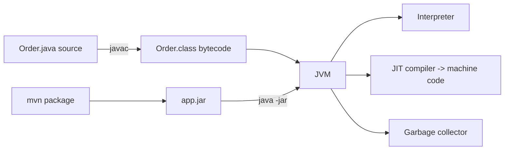
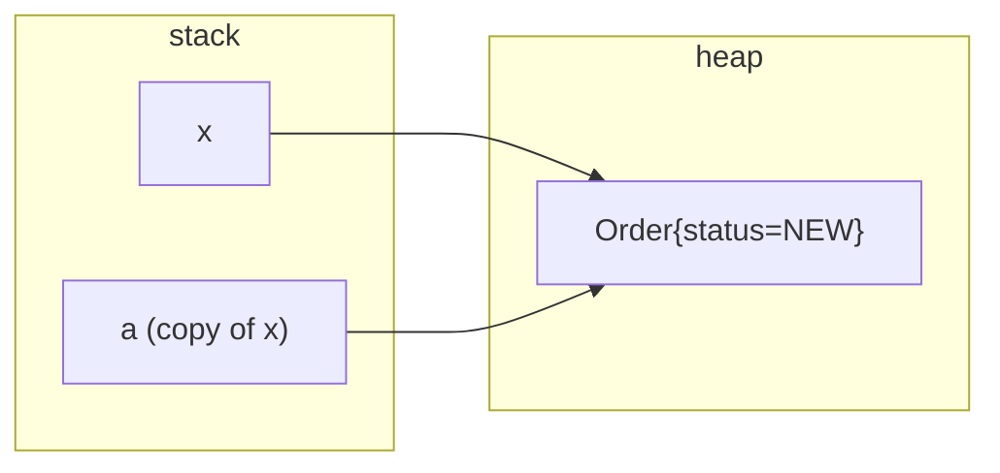
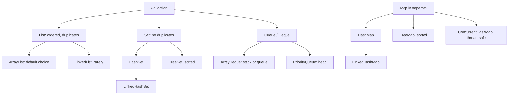
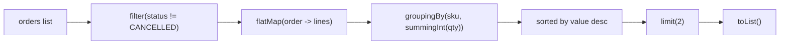
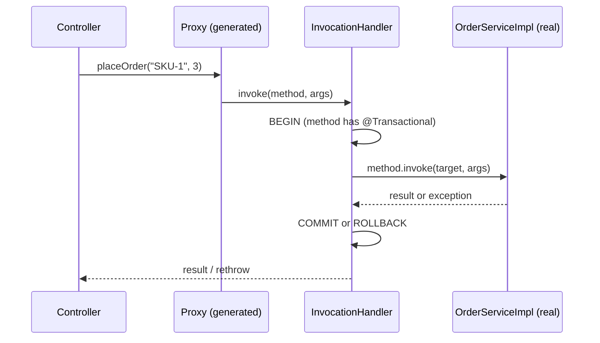
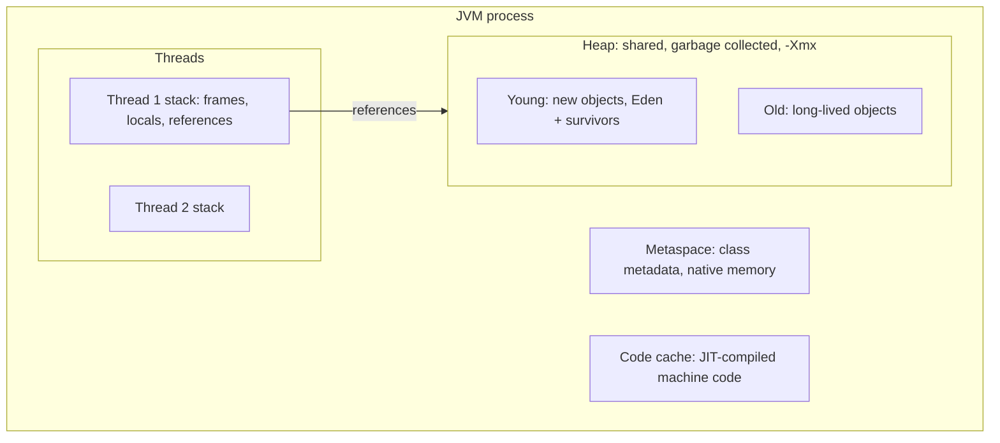
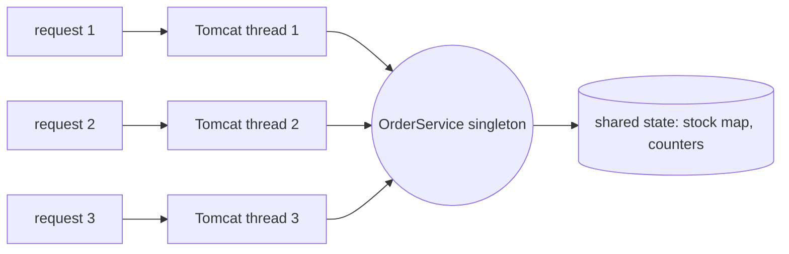
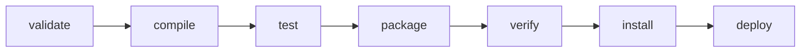

# Session 1 - Java for Spring Boot (from zero, for a C++ developer)

Goal: get the Java language and the JVM model solid enough that Spring Boot stops looking like magic. You already write Java at work, so this is not "what is a class". It is the 20% of Java that explains 80% of Spring bugs and code-review comments: references vs values, `equals`/`hashCode`, collections, generics and erasure, streams, exceptions, **annotations + reflection + proxies** (how `@Component`, `@GetMapping` and `@Transactional` really work), the JVM heap and GC, concurrency, Maven, and modern Java 17-21 syntax. Everything runs with the JDK you already have (`java File.java`), no Spring needed yet.

The running domain is **shopflow**, an e-commerce / fulfilment backend: Products, stock, Customers, Orders + OrderItems, Payments, wallet accounts. Where another scenario teaches a point better (wallet transfers for deadlocks, flash-sale overselling for lost updates, a product page that calls three services for `CompletableFuture`) we use that instead of forcing one domain. These are the same shapes you meet in real backend work: "decrement stock safely", "never charge twice", "aggregate three downstream calls with a timeout", "why is the heap growing".

HLD notes to read alongside (optional, theory side): `B3-Transactions-Isolation.md` and `G1-Locking.md` (lost update, deadlock - sections 12.1 and 12.3), `I2-Timeouts-Retries-Backoff.md` (the `orTimeout` fallback in 12.2), `C1-Cache-Patterns.md` and `C3-Eviction-Failure-Modes.md` (the unbounded static map in section 11), `D1-Queues.md` (thread pools and back-pressure).

> Versions used (all verified by running them): Java 21.0.9, Maven 3.9.11, `spring-boot-starter-parent` 4.0.8. Spring Boot 4 only matters in the Maven section here; the language is identical on Spring Boot 3.5.x. Differences are called out as `If your company is on Spring Boot 3.x:`.

## How to use this article
1. Make a folder, for example `session1\`. Every block starts with `// file: Name.java` (or `<!-- file: pom.xml -->`). Save each in that folder under exactly that name.
2. Run any single-file program with `java Name.java` (Java 21 compiles and runs it in one step, no `javac`). JVM flags go **before** the file name: `java -Xmx64m Leak.java leak`.
3. Section 13 (Maven) needs its own folder `mvn-demo\` with the standard layout shown there. Section 15 is the mini project that ties everything together.
4. Each section has the **expected output** from a real run. Numbers that depend on timing or luck (lost updates, milliseconds) will differ on your machine; the *shape* must match.
5. Do the **Try it** lines. Breaking things on purpose is how the rules stick.
6. All files on a PowerShell prompt: run them from the same folder; use `Get-Content demo.txt | java ShopCli.java` to pipe a file into a program.

> Corporate Maven mirror problems (PKIX / certificate errors)? Not a Java problem. Try again on VPN, or run Maven with a settings file that has no mirror: `mvn -s central-settings.xml test` where that file is just `<settings xmlns="http://maven.apache.org/SETTINGS/1.0.0"><interactiveMode>false</interactiveMode></settings>`. That is how the Maven output in section 13 was produced.

## Topics

| # | Topic | You will be able to |
|---|---|---|
| 1 | C++ to Java mental model | Map RAII, templates, headers, `const`, UB to the Java equivalents |
| 2 | References vs values | Prove "pass by value of the reference" with a swap demo |
| 3 | `equals` / `hashCode` / `toString` / records | Reproduce and fix the HashMap-key bug, write immutable value types |
| 4 | Interfaces, abstract classes, enums, sealed, pattern `switch` | Model an order state machine and payment results the compiler can check |
| 5 | Inner and static nested classes | Know which one to use and what the hidden reference costs |
| 6 | Collections and HashMap internals | Pick the right collection, explain buckets/resize, see fail-fast |
| 7 | Generics and type erasure | Use bounds and wildcards, know what erasure prevents |
| 8 | Lambdas, streams, `Optional` | Write a top-N report, know when a loop is clearer, avoid `Optional` misuse |
| 9 | Exceptions | Checked vs unchecked, try-with-resources order, suppressed exceptions |
| 10 | Annotations, reflection, dynamic proxy | Build a mini Spring (DI + routes + `@Transactional`) in 150 lines |
| 11 | JVM basics | Heap vs stack, G1, `-Xmx`, find a leak with `jcmd`/`jstat`, ThreadLocal leak |
| 12 | Concurrency | Lost updates, atomics, `CompletableFuture`, deadlock with `jcmd`, virtual threads |
| 13 | Maven | `pom.xml` anatomy, scopes, lifecycle, BOM/parent, `dependency:tree`, a JUnit test |
| 14 | Modern Java 17-21 | `var`, text blocks, switch expressions, records, pattern matching |
| 15 | Mini project: in-memory shop CLI | Combine records, streams, `Optional`, atomics in one program |
| 16 | What you will meet in code review | The 20 comments you will get (and give) |
| 17 | Practice, interview questions, done when, reading | |

---

## 1. C++ to Java mental model

You know C++. The shortest path is to list what is **different**, because the syntax is similar enough to mislead you.



| C++ habit | Java reality | Why it matters in Spring work |
|---|---|---|
| Objects live on the stack by value | Objects **always** live on the heap; variables hold **references**. Only primitives (`int`, `long`, `boolean`, `double`...) are values | `Order b = a;` does not copy the order. Two variables, one object |
| Copy constructor / assignment copies | No implicit copy. You write `copy()`/`withX()` or use records | Defensive copies of lists in DTOs |
| RAII, destructors | Garbage collector frees memory at some unknown time. No destructor you can rely on. Use `try-with-resources` (`AutoCloseable`) for files, connections, locks | Always close JDBC connections, streams, HTTP responses |
| `delete`, dangling pointers, use-after-free | Cannot happen. But **memory leaks** still can (objects reachable from a static map) | Unbounded caches in a `static Map` |
| `==` on overloaded types compares values | `==` on objects is **identity**. `equals()` is value equality. Override `hashCode()` with it | HashMap keys, `Set` of ids, JPA entities |
| Templates instantiated per type at compile time | Generics are **erased**: one compiled class, casts inserted. No `List<int>`, no `new T()` | Why Jackson needs `TypeReference`, why Spring needs `ParameterizedTypeReference` |
| Header + source, namespaces | Packages = folders. One public top-level class per file, file name = class name | `com.example.shopflow.order.OrderService` lives at `src/main/java/com/example/shopflow/order/OrderService.java` |
| Multiple inheritance | One superclass, many interfaces (interfaces may have `default` methods) | Services are interfaces; Spring proxies them |
| Methods non-virtual unless `virtual` | **All instance methods are virtual** unless `final`/`private`/`static` | Overridden methods always dispatch dynamically; `final` is a design statement |
| Undefined behaviour (out of range, null deref, signed overflow) | Defined: `ArrayIndexOutOfBoundsException`, `NullPointerException`; integer overflow wraps silently (no exception) | Money in `int` cents overflows at ~21 million dollars: use `long` |
| `const` | `final` = the *variable* cannot be reassigned, the object can still change | Immutability needs final fields or records |
| `unsigned`, `size_t`, pointer arithmetic | No unsigned types (except via helper methods). No pointer arithmetic | |
| `std::string` mutable, `char` is 1 byte | `String` is **immutable**, `char` is a 16-bit UTF-16 unit | `StringBuilder` in loops; never compare strings with `==` |
| `operator==`, operator overloading | No operator overloading (only `+` on `String`) | `BigDecimal.add()` instead of `+` |
| Exceptions are all "unchecked" | Two kinds: **checked** (compiler forces you to catch/declare) and unchecked | Spring code is unchecked by convention; rollback depends on it (section 9) |
| Threads + mutexes by hand | `ExecutorService`, `CompletableFuture`, `synchronized`, `java.util.concurrent`, **virtual threads (21)** | Tomcat runs each request on a pool thread: your code is multi-threaded by default |
| CMake / Conan | **Maven** (`pom.xml`): dependencies, lifecycle, plugins | Section 13 |
| Header-only libs, `#include` | `import` + the **classpath** (the list of jars the JVM loads classes from) | "ClassNotFoundException" = missing jar on the classpath |

React/Express equivalent: a Spring Boot app is like an Express app where the "middleware chain" and "dependency wiring" are done by a framework scanning annotations at startup, and `package.json` is the `pom.xml`.

Pitfall: assuming "Java is slow because of the VM". The JIT compiles hot code to machine code; a warmed-up Java service is within small factors of C++ for typical backend work. The real costs are start-up time, memory footprint and GC pauses.

---

## 2. References vs values: "pass by value of the reference"

Java passes **everything by value**. For objects, the value that is copied is the **reference** (like a pointer). So the callee can change the object the pointer points at, but cannot change which object the caller's variable points at.



```java
// file: PassByValue.java
import java.math.BigDecimal;

public class PassByValue {

    static class Order {
        String status;
        Order(String status) { this.status = status; }
        @Override public String toString() { return "Order(" + status + ")"; }
    }

    static void swap(Order a, Order b) {      // swaps the LOCAL copies of the references
        Order tmp = a;
        a = b;
        b = tmp;
        System.out.println("  inside swap: a=" + a + " b=" + b);
    }

    static void markPaid(Order o) {
        o.status = "PAID";                    // follows the reference: caller sees it
    }

    static void reassign(Order o) {
        o = new Order("REPLACED");            // changes only the local copy of the reference
    }

    static void addTax(long priceCents) { priceCents = priceCents + 100; }   // primitives: plain copy

    public static void main(String[] args) {
        Order x = new Order("NEW");
        Order y = new Order("SHIPPED");
        swap(x, y);
        System.out.println("after swap:     x=" + x + " y=" + y);          // unchanged!

        markPaid(x);
        System.out.println("after markPaid: x=" + x);                      // changed
        reassign(x);
        System.out.println("after reassign: x=" + x);                      // not changed

        long price = 500;
        addTax(price);
        System.out.println("after addTax:   price=" + price);

        // == vs equals
        String a = "SKU-1001";
        String b = "SKU-1001";                 // same literal -> same interned object
        String c = new String("SKU-1001");     // new object on the heap
        System.out.println("a == b      : " + (a == b));
        System.out.println("a == c      : " + (a == c));
        System.out.println("a.equals(c) : " + a.equals(c));

        // the Integer cache trap (quantities, ids)
        Integer q1 = 127, q2 = 127;
        Integer r1 = 128, r2 = 128;
        System.out.println("127 == 127  : " + (q1 == q2));
        System.out.println("128 == 128  : " + (r1 == r2));
        System.out.println("128 equals  : " + r1.equals(r2));

        // money: double is wrong, BigDecimal.equals cares about scale
        System.out.println("0.1 + 0.2 as double = " + (0.1 + 0.2));
        System.out.println("BigDecimal 2.0 equals 2.00     : " + new BigDecimal("2.0").equals(new BigDecimal("2.00")));
        System.out.println("BigDecimal 2.0 compareTo 2.00  : " + new BigDecimal("2.0").compareTo(new BigDecimal("2.00")));

        // final protects the variable, not the object
        final Order f = new Order("FINAL");
        f.status = "still mutable";
        System.out.println("final Order : " + f);
        // f = new Order("G");   // would not compile: cannot assign a value to final variable f
    }
}
```

Expected output:
```text
  inside swap: a=Order(SHIPPED) b=Order(NEW)
after swap:     x=Order(NEW) y=Order(SHIPPED)
after markPaid: x=Order(PAID)
after reassign: x=Order(PAID)
after addTax:   price=500
a == b      : true
a == c      : false
a.equals(c) : true
127 == 127  : true
128 == 128  : false
128 equals  : true
0.1 + 0.2 as double = 0.30000000000000004
BigDecimal 2.0 equals 2.00     : false
BigDecimal 2.0 compareTo 2.00  : 0
final Order : Order(still mutable)
```

Read it line by line:
- The swap *did* swap inside the method (first line) but the caller's `x` and `y` are untouched. That is the proof: the method got copies of the references.
- `markPaid` works because the copy still points at the same object. `reassign` does not, because it only re-points the copy.
- `128 == 128` is `false`: autoboxing caches `Integer` objects only for -128..127. Comparing boxed numbers with `==` works in tests with small numbers and fails in production. Same trap for `Long` ids: **always `.equals()`** (or unbox to a primitive).
- Never use `double`/`float` for money. Store `long` cents or use `BigDecimal`, and compare `BigDecimal` with `compareTo`, not `equals` (`2.0` and `2.00` have different scales, so `equals` says false).

Try it: delete `final` handling and uncomment `f = new Order("G");` and read the compiler error. Change `addTax` to take `long[]` and mutate index 0: now the caller sees it (arrays are objects).

C++ equivalent: Java's `void swap(Order a, Order b)` is `void swap(Order* a, Order* b)` swapping the local pointer copies. Java has no `Order*&` (reference to pointer), so a swap function is impossible; that is why you return values or use a holder object.

React equivalent: it is exactly JavaScript's rule for objects passed to functions. Mutating `props.items.push(x)` changes the caller's array; `items = []` inside the function does not.

---

## 3. `equals`, `hashCode`, `toString`, immutability, records

The contract:
1. If `a.equals(b)` then `a.hashCode() == b.hashCode()` (the reverse is not required).
2. `equals` is reflexive, symmetric, transitive, consistent.
3. Hash-based collections (`HashMap`, `HashSet`, `ConcurrentHashMap`) call `hashCode()` first to pick a bucket, **then** `equals()` inside the bucket. Break the contract and lookups silently fail.

First the bug (flash-sale stock keyed by a SKU wrapper), then the fix, then the modern way.

```java
// file: EqualsBug.java
import java.time.Instant;
import java.util.*;

public class EqualsBug {

    // BROKEN: equals overridden, hashCode NOT overridden
    static class BadSku {
        final String value;
        BadSku(String value) { this.value = value; }
        @Override public boolean equals(Object o) {
            return o instanceof BadSku other && value.equals(other.value);
        }
        // no hashCode()  -> uses Object.hashCode() = identity-based
    }

    // FIXED: equals + hashCode + toString, immutable
    static final class GoodSku {
        private final String value;
        GoodSku(String value) { this.value = Objects.requireNonNull(value); }
        @Override public boolean equals(Object o) {
            if (this == o) return true;
            if (!(o instanceof GoodSku other)) return false;
            return value.equals(other.value);
        }
        @Override public int hashCode() { return value.hashCode(); }
        @Override public String toString() { return "GoodSku[" + value + "]"; }
    }

    // BEST for plain data: a record writes all of that for you
    record Product(long id, String sku, String name, long priceCents, String category, Instant createdAt) {
        Product {                                // compact constructor = validation
            if (sku == null || sku.isBlank()) throw new IllegalArgumentException("sku required");
            if (priceCents < 0) throw new IllegalArgumentException("price must be >= 0");
        }
        Product withPrice(long newPriceCents) {  // "wither": records are immutable, return a copy
            return new Product(id, sku, name, newPriceCents, category, createdAt);
        }
    }

    // mutable key bug: change a field used in hashCode AFTER inserting
    static class MutableKey {
        String v;
        MutableKey(String v) { this.v = v; }
        @Override public boolean equals(Object o) { return o instanceof MutableKey k && v.equals(k.v); }
        @Override public int hashCode() { return v.hashCode(); }
    }

    public static void main(String[] args) {
        // flash-sale stock keyed by SKU
        Map<BadSku, Integer> bad = new HashMap<>();
        bad.put(new BadSku("SKU-1001"), 50);
        System.out.println("bad.get(new BadSku(SKU-1001))  = " + bad.get(new BadSku("SKU-1001")));
        System.out.println("equals says same?               " + new BadSku("SKU-1001").equals(new BadSku("SKU-1001")));
        Set<BadSku> badSet = new HashSet<>();
        badSet.add(new BadSku("x")); badSet.add(new BadSku("x"));
        System.out.println("HashSet size after adding two equal BadSku: " + badSet.size() + " (almost always 2)");

        Map<GoodSku, Integer> good = new HashMap<>();
        good.put(new GoodSku("SKU-1001"), 50);
        System.out.println("good.get(new GoodSku(SKU-1001)) = " + good.get(new GoodSku("SKU-1001")));
        System.out.println("toString: " + new GoodSku("SKU-1001"));

        Instant t = Instant.parse("2026-01-01T00:00:00Z");
        Product p1 = new Product(1, "SKU-1001", "USB-C cable", 799, "accessories", t);
        Product p2 = new Product(1, "SKU-1001", "USB-C cable", 799, "accessories", t);
        System.out.println("record equals: " + p1.equals(p2) + ", same hash: " + (p1.hashCode() == p2.hashCode()));
        System.out.println("record toString: " + p1);
        System.out.println("wither: " + p1.withPrice(599).priceCents() + " (original still " + p1.priceCents() + ")");
        try {
            new Product(2, " ", "bad", 100, "x", t);
        } catch (IllegalArgumentException e) {
            System.out.println("compact ctor rejected: " + e.getMessage());
        }

        Map<MutableKey, String> m = new HashMap<>();
        MutableKey k = new MutableKey("before");
        m.put(k, "value");
        k.v = "after";                                   // hash changes while the entry sits in the old bucket
        System.out.println("mutable key get(k)         = " + m.get(k));
        System.out.println("map still has 1 entry: size=" + m.size() + " (the entry is lost, a leak)");

        // Comparable vs Comparator
        List<Product> products = new ArrayList<>(List.of(
                new Product(1, "SKU-B", "Mouse", 2500, "accessories", t),
                new Product(2, "SKU-A", "Keyboard", 4900, "accessories", t),
                new Product(3, "SKU-C", "Cable", 799, "accessories", t)));
        products.sort(Comparator.comparingLong(Product::priceCents).reversed());
        System.out.println("by price desc: " + products.stream().map(Product::sku).toList());
        products.sort(Comparator.comparing(Product::sku));
        System.out.println("by sku       : " + products.stream().map(Product::sku).toList());
    }
}
```

Expected output:
```text
bad.get(new BadSku(SKU-1001))  = null
equals says same?               true
HashSet size after adding two equal BadSku: 2 (almost always 2)
good.get(new GoodSku(SKU-1001)) = 50
toString: GoodSku[SKU-1001]
record equals: true, same hash: true
record toString: Product[id=1, sku=SKU-1001, name=USB-C cable, priceCents=799, category=accessories, createdAt=2026-01-01T00:00:00Z]
wither: 599 (original still 799)
compact ctor rejected: sku required
mutable key get(k)         = null
map still has 1 entry: size=1 (the entry is lost, a leak)
by price desc: [SKU-A, SKU-B, SKU-C]
by sku       : [SKU-A, SKU-B, SKU-C]
```

Why `bad.get(...)` returned `null` even though `equals` says the keys are the same: `Object.hashCode()` is identity-based, so the two `BadSku` objects hash to different buckets. `HashMap` looks in the wrong bucket and never even calls `equals`. In production this looks like "the stock row is there but the lookup says no" or a `HashSet` that lets duplicates in (webhook de-duplication that does not de-duplicate, cart lines that do not merge).

Rules of thumb:
- Override `equals` and `hashCode` **together**, on the same fields. Use `Objects.equals` / `Objects.hash`, or let your IDE or a record generate them.
- **Never mutate a field used by `hashCode` while the object is a key** (the `MutableKey` demo: the entry is stuck in the old bucket, unreachable but still counted).
- `toString()` is for logs. Include ids, not secrets (card numbers, tokens). Records generate one.
- Prefer **immutability**: `private final` fields, no setters, `List.copyOf` for incoming lists. An immutable object can be shared across threads with no locks and cannot break a hash key.
- A `record` gives you: a canonical constructor, accessors (`p.sku()`, not `getSku()`), `equals`, `hashCode`, `toString`, all final. Use it for DTOs, API responses, events, value objects (`Money`, `OrderLine`). Records cannot extend classes and cannot have mutable instance fields. **JPA entities are not records** (Hibernate needs a no-arg constructor and mutable fields); we cover entity `equals` in the persistence session: the usual rule is "equals on the database id once assigned, or on a business key, never on all fields".
- `Comparable<T>` = the type's one natural order (`compareTo`). `Comparator<T>` = an order you pass in, many allowed (`Comparator.comparingLong(Product::priceCents).reversed().thenComparing(Product::sku)`).

Try it: add `hashCode()` to `BadSku` and watch the first line become `50`. Change `Product` equality so it only uses `id` (write the methods by hand) and see two differently-priced products compare equal.

C++ equivalent: `operator==` + `std::hash` specialisation. If they disagree, `unordered_map` misbehaves in exactly the same way.

---

## 4. Interfaces, abstract classes, enums, sealed types, pattern `switch`

| Tool | Use when | shopflow example |
|---|---|---|
| `interface` | A contract; many implementations; the unit Spring injects and proxies | `PaymentGateway`, `ProductRepository` |
| `abstract class` | Shared state or a template method skeleton | `Discount` with a final `apply` and abstract `computeOff` |
| `enum` | A closed set of constants, possibly with fields and behaviour | `OrderStatus` with allowed transitions |
| `sealed interface` + `record`s | A closed set of **shapes with different data** | `PaymentResult = Approved \| Declined \| GatewayDown` |
| `record` | Immutable data carrier | `OrderLine`, `Page<T>` |

```java
// file: Types.java
import java.util.*;

public class Types {

    // ---- interface with a default method ----
    interface ProductRepository {
        void save(String sku, String name);
        Optional<String> findName(String sku);
        default String nameOrThrow(String sku) {
            return findName(sku).orElseThrow(() -> new NoSuchElementException("unknown sku " + sku));
        }
    }

    // ---- abstract class: shared state + skeleton (template method) ----
    static abstract class Discount {
        private final String name;
        protected Discount(String name) { this.name = name; }
        public final long apply(long subtotalCents) {            // final: subclasses cannot change the algorithm
            long off = Math.min(computeOff(subtotalCents), subtotalCents);   // never go below zero
            System.out.println("  " + name + " takes off " + off);
            return subtotalCents - off;
        }
        protected abstract long computeOff(long subtotalCents);   // subclass fills the hole
    }

    static class PercentDiscount extends Discount {
        private final int percent;
        PercentDiscount(int percent) { super(percent + "% coupon"); this.percent = percent; }
        @Override protected long computeOff(long subtotal) { return subtotal * percent / 100; }
    }
    static class FlatDiscount extends Discount {
        private final long cents;
        FlatDiscount(long cents) { super("flat coupon"); this.cents = cents; }
        @Override protected long computeOff(long subtotal) { return cents; }
    }

    static class InMemoryProducts implements ProductRepository {
        private final Map<String, String> m = new HashMap<>();
        public void save(String sku, String name) { m.put(sku, name); }
        public Optional<String> findName(String sku) { return Optional.ofNullable(m.get(sku)); }
    }

    // ---- enum with fields and behaviour: an order state machine ----
    enum OrderStatus {
        NEW, PAID, SHIPPED, DELIVERED, CANCELLED;
        boolean canMoveTo(OrderStatus next) {
            return switch (this) {
                case NEW -> next == PAID || next == CANCELLED;
                case PAID -> next == SHIPPED || next == CANCELLED;
                case SHIPPED -> next == DELIVERED;
                case DELIVERED, CANCELLED -> false;
            };
        }
    }

    // ---- sealed hierarchy: the compiler knows ALL the cases ----
    sealed interface PaymentResult permits Approved, Declined, GatewayDown {}
    record Approved(String transactionId) implements PaymentResult {}
    record Declined(String reason) implements PaymentResult {}
    record GatewayDown(int retryAfterSeconds) implements PaymentResult {}

    static String httpFor(PaymentResult r) {
        return switch (r) {                                       // no default needed: exhaustive
            case Approved a when a.transactionId().startsWith("TEST-") -> "200 (sandbox payment) " + a.transactionId();
            case Approved a -> "200 paid, tx=" + a.transactionId();
            case Declined d -> "402 " + d.reason();
            case GatewayDown g -> "503 Retry-After: " + g.retryAfterSeconds();
        };
    }

    // ---- pattern matching for switch on Object ----
    static String describe(Object o) {
        return switch (o) {
            case null -> "null!";
            case Integer i when i > 100 -> "big int " + i;
            case Integer i -> "int " + i;
            case String s -> "string of length " + s.length();
            case List<?> l -> "list with " + l.size() + " items";
            default -> "something else: " + o.getClass().getSimpleName();
        };
    }

    public static void main(String[] args) {
        ProductRepository repo = new InMemoryProducts();
        repo.save("SKU-1", "USB-C cable");
        System.out.println(repo.nameOrThrow("SKU-1"));
        try { repo.nameOrThrow("nope"); } catch (NoSuchElementException e) { System.out.println("caught: " + e.getMessage()); }

        System.out.println("subtotal 10000 cents:");
        System.out.println("  -> " + new PercentDiscount(15).apply(10_000));
        System.out.println("  -> " + new FlatDiscount(50_000).apply(10_000));

        for (OrderStatus s : OrderStatus.values())
            System.out.println(s + " ordinal=" + s.ordinal() + " canMoveTo(SHIPPED)=" + s.canMoveTo(OrderStatus.SHIPPED));
        System.out.println("valueOf: " + OrderStatus.valueOf("PAID"));
        try { OrderStatus.valueOf("paid"); } catch (IllegalArgumentException e) { System.out.println("valueOf is case-sensitive: " + e.getMessage()); }
        EnumMap<OrderStatus, Integer> counts = new EnumMap<>(OrderStatus.class);
        counts.put(OrderStatus.PAID, 10); counts.put(OrderStatus.NEW, 2);
        System.out.println("EnumMap: " + counts);

        for (PaymentResult r : List.of(new Approved("tx_9f2"), new Approved("TEST-1"), new Declined("insufficient funds"), new GatewayDown(30)))
            System.out.println(httpFor(r));

        for (Object o : new Object[]{7, 700, "hello", List.of(1, 2), 3.5, null})
            System.out.println(describe(o));
    }
}
```

Expected output:
```text
USB-C cable
caught: unknown sku nope
subtotal 10000 cents:
  15% coupon takes off 1500
  -> 8500
  flat coupon takes off 10000
  -> 0
NEW ordinal=0 canMoveTo(SHIPPED)=false
PAID ordinal=1 canMoveTo(SHIPPED)=true
SHIPPED ordinal=2 canMoveTo(SHIPPED)=false
DELIVERED ordinal=3 canMoveTo(SHIPPED)=false
CANCELLED ordinal=4 canMoveTo(SHIPPED)=false
valueOf: PAID
valueOf is case-sensitive: No enum constant Types.OrderStatus.paid
EnumMap: {NEW=2, PAID=10}
200 paid, tx=tx_9f2
200 (sandbox payment) TEST-1
402 insufficient funds
503 Retry-After: 30
int 7
big int 700
string of length 5
list with 2 items
something else: Double
null!
```

What to notice:
- **Default methods** let an interface add behaviour without breaking implementers. Spring Data repositories use them heavily.
- **Template method**: `apply` is `final`, the subclass only supplies `computeOff`. The same pattern as Spring's `JdbcTemplate`/`RestClient` ("you give the varying part, the framework does the boilerplate").
- **Enums are classes**: they can have methods (`canMoveTo`). Put business rules there instead of scattering `if (status == ...)`. `ordinal()` is the declaration index: **never store the ordinal in a database column** (reordering enum constants silently corrupts data). Store the name (`@Enumerated(EnumType.STRING)` in JPA).
- **Sealed + pattern `switch`**: delete one `case` and the compiler refuses to compile (try it). This is the Java answer to `std::variant` + `std::visit`, and it is how you return "success, declined, or gateway down" without exceptions or `null`. Add a fourth record to `permits` and every `switch` that lacks a branch breaks at compile time, not in production.
- `case null` is only needed if `o` can be null; without it a `null` selector throws `NullPointerException`.

Try it: remove `case GatewayDown g` and read the error ("the switch expression does not cover all possible input values"). Make `OrderStatus.canMoveTo` forget `CANCELLED` and see the same error.

C++ equivalent: `std::variant<Approved, Declined, GatewayDown>` + `std::visit`; abstract class = class with pure virtuals; `enum class` is similar but a Java enum can carry data and methods.

---

## 5. Inner and static nested classes

A class declared inside another class is **nested**. If it is not `static` it is an **inner** class and every instance secretly holds a reference to an outer instance.

```java
// file: Nested.java
import java.util.*;

public class Nested {

    private int itemCount = 0;                // instance field of the OUTER class (a shopping cart)

    // static nested: no hidden reference to an outer instance. Prefer this.
    static class RetryPolicy {
        final int maxAttempts;
        RetryPolicy(int maxAttempts) { this.maxAttempts = maxAttempts; }
    }

    // inner (non-static): holds an implicit Nested.this
    class Line {
        final String sku;
        Line(String sku) { this.sku = sku; itemCount++; }      // can touch the outer's private field
        int cartSize() { return Nested.this.itemCount; }
    }

    interface Notifier { String notify(String customer); }

    public static void main(String[] args) {
        RetryPolicy p = new RetryPolicy(3);   // no outer instance needed
        System.out.println("static nested maxAttempts=" + p.maxAttempts);

        Nested cart = new Nested();
        Nested.Line l1 = cart.new Line("SKU-1");        // needs an outer instance: odd syntax
        Nested.Line l2 = cart.new Line("SKU-2");
        System.out.println("inner Line sees cart size=" + l2.cartSize());

        // anonymous class: one-off implementation of an interface
        Notifier email = new Notifier() {
            @Override public String notify(String customer) { return "email to " + customer; }
        };
        System.out.println(email.notify("ana"));

        // a lambda is the short form when the interface has ONE abstract method
        Notifier sms = customer -> "sms to " + customer;
        System.out.println(sms.notify("ana"));

        // local variables captured by lambdas/anonymous classes must be effectively final
        int attempt = 10;
        Notifier cap = customer -> customer + " attempt " + attempt;
        System.out.println(cap.notify("ana"));
        // attempt++;   // uncomment: "local variables referenced from a lambda expression must be final or effectively final"

        // Map.Entry is the classic static nested type from the JDK
        Map<String, Integer> stock = new TreeMap<>(Map.of("SKU-1", 5, "SKU-2", 0));
        for (Map.Entry<String, Integer> e : stock.entrySet())
            System.out.println(e.getKey() + "=" + e.getValue());
    }
}
```

Expected output:
```text
static nested maxAttempts=3
inner Line sees cart size=2
email to ana
sms to ana
ana attempt 10
SKU-1=5
SKU-2=0
```

Rules: default to `static` nested (or a top-level class/record). Use an inner class only when it truly needs the outer instance. The hidden outer reference is a classic leak: an inner/anonymous class instance stored in a long-lived place (a static list of listeners) keeps the whole outer object alive. Lambdas and anonymous classes may only capture **effectively final** locals, because the captured value is copied (the same "copy" idea as section 2).

C++ equivalent: a nested `struct` is like `static` nested; a Java inner class is like a nested class that always carries `Outer* this`.

---

## 6. Collections, HashMap internals, ConcurrentHashMap, fail-fast



| Need | Use | Notes |
|---|---|---|
| Ordered list | `ArrayList` | Contiguous array, O(1) index. Beats `LinkedList` in practice almost always |
| Lookup by key | `HashMap` | O(1) average, no order |
| Lookup + insertion order (LRU caches, stable JSON) | `LinkedHashMap` | `accessOrder=true` + `removeEldestEntry` = LRU |
| Sorted by key / range queries | `TreeMap` | O(log n), keys need `Comparable` or a `Comparator` |
| Unique items | `HashSet` | Backed by a `HashMap` |
| Stack / queue | `ArrayDeque` | Faster than `Stack`/`LinkedList`; `push/pop`, `addLast/pollFirst` |
| Priority (top-k, scheduling) | `PriorityQueue` | Min-heap by default |
| Shared across threads | `ConcurrentHashMap` | NOT `Hashtable`, NOT `Collections.synchronizedMap` for new code |
| Enum keys | `EnumMap`, `EnumSet` | Array-fast |
| Immutable | `List.of`, `Map.of`, `Set.of`, `Stream.toList()` | Throws `UnsupportedOperationException` on modification; `null` elements forbidden |

```java
// file: Collections1.java
import java.util.*;
import java.util.concurrent.*;

public class Collections1 {

    public static void main(String[] args) throws Exception {
        // ---------- List ----------
        List<String> list = new ArrayList<>(List.of("a", "b", "c"));
        list.add("d"); list.remove("a"); list.add(0, "z");
        System.out.println("ArrayList: " + list + " get(1)=" + list.get(1));
        List<String> fixed = List.of("x", "y");
        try { fixed.add("w"); } catch (UnsupportedOperationException e) { System.out.println("List.of is immutable: " + e); }
        List<String> view = Arrays.asList("p", "q");   // fixed size, backed by the array
        view.set(0, "P");
        try { view.add("r"); } catch (UnsupportedOperationException e) { System.out.println("Arrays.asList cannot grow"); }

        // ---------- Map: HashMap vs LinkedHashMap vs TreeMap ----------
        Map<String, Integer> hm = new HashMap<>();
        Map<String, Integer> lhm = new LinkedHashMap<>();
        Map<String, Integer> tm = new TreeMap<>();
        for (String k : List.of("pear", "apple", "fig", "banana")) { hm.put(k, k.length()); lhm.put(k, k.length()); tm.put(k, k.length()); }
        System.out.println("HashMap       (no order promise): " + hm);
        System.out.println("LinkedHashMap (insertion order) : " + lhm);
        System.out.println("TreeMap       (sorted by key)   : " + tm);

        // getOrDefault / computeIfAbsent / merge: idioms you will use daily
        record P(String sku, String category) {}
        Map<String, List<String>> byCategory = new HashMap<>();
        for (P p : List.of(new P("SKU-1", "books"), new P("SKU-2", "toys"), new P("SKU-3", "books"))) {
            byCategory.computeIfAbsent(p.category(), c -> new ArrayList<>()).add(p.sku());
        }
        System.out.println("computeIfAbsent: " + new TreeMap<>(byCategory));
        Map<String, Integer> unitsSold = new HashMap<>();
        for (String sku : List.of("SKU-1", "SKU-2", "SKU-1", "SKU-1")) unitsSold.merge(sku, 1, Integer::sum);
        System.out.println("merge counter: " + new TreeMap<>(unitsSold) + " getOrDefault(SKU-9)=" + unitsSold.getOrDefault("SKU-9", 0));

        // ---------- Set ----------
        Set<String> seenEvents = new HashSet<>();      // webhook de-duplication by event id
        System.out.println("first delivery: " + seenEvents.add("evt_1") + ", redelivery: " + seenEvents.add("evt_1"));

        // ---------- Deque (stack AND queue) ----------
        Deque<Integer> dq = new ArrayDeque<>();
        dq.addLast(1); dq.addLast(2); dq.addFirst(0);
        System.out.println("Deque: " + dq + " pollFirst=" + dq.pollFirst() + " pollLast=" + dq.pollLast());
        Deque<String> stack = new ArrayDeque<>();
        stack.push("a"); stack.push("b");
        System.out.println("stack pop: " + stack.pop());
        PriorityQueue<Integer> pq = new PriorityQueue<>(Comparator.reverseOrder());
        pq.addAll(List.of(3, 9, 1, 7));
        System.out.println("PriorityQueue (max-heap) poll: " + pq.poll() + ", " + pq.poll());

        // ---------- fail-fast iteration ----------
        List<Integer> nums = new ArrayList<>(List.of(1, 2, 3, 4));
        try {
            for (Integer n : nums) if (n == 2) nums.remove(n);     // modifying while iterating
        } catch (ConcurrentModificationException e) {
            System.out.println("fail-fast: " + e);
        }
        nums.removeIf(n -> n % 2 == 0);                            // the correct way
        System.out.println("after removeIf: " + nums);
        Iterator<Integer> it = nums.iterator();
        while (it.hasNext()) if (it.next() == 1) it.remove();      // also correct
        System.out.println("after iterator.remove: " + nums);

        // ---------- ConcurrentHashMap: weakly consistent, never throws CME ----------
        Map<String, Integer> chm = new ConcurrentHashMap<>(Map.of("a", 1, "b", 2, "c", 3));
        for (String k : chm.keySet()) if (k.equals("b")) chm.remove("c");   // fine
        System.out.println("CHM after modify-while-iterating: " + new TreeMap<>(chm));
        try { new ConcurrentHashMap<String, String>().put("k", null); } catch (NullPointerException e) { System.out.println("CHM rejects null values (HashMap allows them)"); }
        Map<String, Integer> hmNull = new HashMap<>();
        hmNull.put(null, 1);
        System.out.println("HashMap allows a null key: " + hmNull);

        // ---------- HashMap internals made visible ----------
        // index = (n - 1) & (h ^ (h >>> 16)),  n = table size (power of two, default 16)
        for (String key : List.of("SKU-1001", "SKU-1002", "order-77")) {
            int h = key.hashCode();
            int spread = h ^ (h >>> 16);
            System.out.printf("key=%-9s hashCode=%11d bucket(n=16)=%2d bucket(n=32)=%2d%n", key, h, (16 - 1) & spread, (32 - 1) & spread);
        }

        // collisions: "Aa" and "BB" have the SAME hashCode
        System.out.println("\"Aa\".hashCode()=" + "Aa".hashCode() + " \"BB\".hashCode()=" + "BB".hashCode());
        Map<String, Integer> collide = new HashMap<>();
        collide.put("Aa", 1); collide.put("BB", 2);
        System.out.println("both survive (equals() separates them inside the bucket): Aa=" + collide.get("Aa") + " BB=" + collide.get("BB"));
    }
}
```

Expected output:
```text
ArrayList: [z, b, c, d] get(1)=b
List.of is immutable: java.lang.UnsupportedOperationException
Arrays.asList cannot grow
HashMap       (no order promise): {banana=6, apple=5, pear=4, fig=3}
LinkedHashMap (insertion order) : {pear=4, apple=5, fig=3, banana=6}
TreeMap       (sorted by key)   : {apple=5, banana=6, fig=3, pear=4}
computeIfAbsent: {books=[SKU-1, SKU-3], toys=[SKU-2]}
merge counter: {SKU-1=3, SKU-2=1} getOrDefault(SKU-9)=0
first delivery: true, redelivery: false
Deque: [0, 1, 2] pollFirst=0 pollLast=2
stack pop: b
PriorityQueue (max-heap) poll: 9, 7
fail-fast: java.util.ConcurrentModificationException
after removeIf: [1, 3]
after iterator.remove: [3]
CHM after modify-while-iterating: {a=1, b=2}
CHM rejects null values (HashMap allows them)
HashMap allows a null key: {null=1}
key=SKU-1001  hashCode=-1055787216 bucket(n=16)= 1 bucket(n=32)= 1
key=SKU-1002  hashCode=-1055787215 bucket(n=16)= 0 bucket(n=32)= 0
key=order-77  hashCode= 1234255295 bucket(n=16)=14 bucket(n=32)=14
"Aa".hashCode()=2112 "BB".hashCode()=2112
both survive (equals() separates them inside the bucket): Aa=1 BB=2
```

### How `HashMap` works (the interview answer, with the numbers above)
1. A `HashMap` is an **array of buckets** (default 16). `put(key, v)`: compute `h = key.hashCode()`, mix the high bits in (`h ^ (h >>> 16)`), pick the bucket `(n - 1) & spread` (that is why the size is a power of two: the mask replaces a modulo). The output above shows `SKU-1001` and `SKU-1002` (consecutive hashes) landing in buckets 1 and 0.
2. If the bucket is empty, store the entry. If not, walk the chain comparing `hash` and then `equals()`: same key -> replace value; otherwise append. `"Aa"` and `"BB"` have the same `hashCode` (2112) yet both survive, because `equals` tells them apart.
3. When `size > capacity * 0.75` (the **load factor**) the table **doubles** and every entry is re-bucketed (each entry's bucket is recomputed with the new mask; in the three keys above none happens to move, but on average about half of the entries do). Pre-size with `new HashMap<>(expected / 0.75 + 1)` if you know the size, or use `HashMap.newHashMap(n)` (Java 19+).
4. A chain longer than 8 (with table >= 64) is converted to a red-black tree, so even a bad `hashCode` degrades to O(log n), not O(n).
5. Not thread-safe: concurrent `put`s can lose entries or corrupt the table (you saw `HashMap.merge` go wrong in section 12).

### Fail-fast and `ConcurrentHashMap`
- `ArrayList`/`HashMap` iterators check a `modCount`. Structurally modifying the collection during a for-each throws `ConcurrentModificationException` on the next `next()`. It is a **bug detector, not a guarantee** (removing the second-to-last element of a list in a for-each happens not to throw). Fix: `removeIf`, `iterator.remove()`, or build a new collection. Note this happens in single-threaded code too.
- `ConcurrentHashMap` iterators are **weakly consistent**: never throw CME, may or may not see concurrent changes. Since Java 8 it uses CAS plus a lock on the head node of a single bucket, so writers to different buckets do not block each other. It forbids `null` keys and values (null would be ambiguous with "absent" in `get`). `merge`, `compute`, `computeIfAbsent` are **atomic per key**; "check `get` then `put`" is not atomic even on a `ConcurrentHashMap`. `size()` is an estimate while writers run.
- Do not call slow code (I/O, another `compute` on the same map) inside `compute*`; it holds a bucket lock.

Pitfalls: `List.of(...)` rejects `null` and is immutable (many a `UnsupportedOperationException` in production comes from returning `List.of()` and then adding to it); `Arrays.asList` is fixed-size; `Collectors.toList()` makes no promise about mutability, `Stream.toList()` is unmodifiable; never `remove(int)` vs `remove(Object)` confusion on `List<Integer>` (`nums.remove(n)` above removes the *object* because `n` is an `Integer`).

Try it: change `merge` to `unitsSold.put(sku, unitsSold.get(sku) + 1)` and watch the `NullPointerException` for the first SKU. Make `GoodSku`-style keys with a constant `hashCode` of `1` and time 100,000 puts to see the tree fallback save you.

C++ equivalent: `std::unordered_map` (buckets + load factor + rehash); `TreeMap` is `std::map`; `ArrayDeque` is `std::deque`; `PriorityQueue` is `std::priority_queue` (but min-first).

---

## 7. Generics and type erasure

Generics give compile-time type safety (`List<Order>`), but the compiler **erases** the type arguments: at runtime there is one `ArrayList` class and `Object` references with casts inserted where you read. This is the biggest difference from C++ templates (which generate a new class per type).

```java
// file: Erasure.java
import java.util.*;

public class Erasure {

    // generic method with a bound: T must be comparable to itself
    static <T extends Comparable<T>> T max(List<T> items) {
        T best = items.get(0);
        for (T t : items) if (t.compareTo(best) > 0) best = t;
        return best;
    }

    // wildcards: PECS = Producer Extends, Consumer Super
    static double sum(Collection<? extends Number> src) {      // we only READ numbers out
        double s = 0;
        for (Number n : src) s += n.doubleValue();
        return s;
    }

    static void fill(List<? super Integer> dst) {               // we only WRITE integers in
        for (int i = 0; i < 3; i++) dst.add(i);
    }

    // a generic API response, like the paginated responses your controllers return
    record Page<T>(List<T> items, int page, long total) {}

    // a generic repository contract
    interface Repository<T, ID> {
        void save(ID id, T entity);
        Optional<T> findById(ID id);
    }
    static class InMemoryRepository<T, ID> implements Repository<T, ID> {
        private final Map<ID, T> data = new HashMap<>();
        public void save(ID id, T entity) { data.put(id, entity); }
        public Optional<T> findById(ID id) { return Optional.ofNullable(data.get(id)); }
    }

    // ERASURE: this does not compile -> both become process(List) after erasure
    // static void process(List<String> l) {}
    // static void process(List<Integer> l) {}      // error: name clash, same erasure

    static <T> T[] makeArray(int n) {
        // return new T[n];                         // error: generic array creation
        @SuppressWarnings("unchecked") T[] arr = (T[]) new Object[n];   // the usual (unsafe) workaround
        return arr;
    }

    public static void main(String[] args) {
        System.out.println("max prices : " + max(List.of(799, 4900, 2500)));
        System.out.println("max skus   : " + max(List.of("SKU-B", "SKU-A", "SKU-C")));
        System.out.println("sum        : " + sum(List.of(1, 2.5, 3L)));

        List<Number> numbers = new ArrayList<>();
        fill(numbers);
        System.out.println("fill(List<Number>): " + numbers);

        Repository<String, Long> repo = new InMemoryRepository<>();
        repo.save(1L, "Order #1");
        System.out.println("repo: " + repo.findById(1L).orElse("?") + " / " + repo.findById(2L).isPresent());
        System.out.println("page: " + new Page<>(List.of("a", "b"), 0, 2));

        // at RUNTIME the type arguments are gone
        List<String> skus = new ArrayList<>();
        List<Integer> quantities = new ArrayList<>();
        System.out.println("same runtime class: " + (skus.getClass() == quantities.getClass()) + " (" + skus.getClass().getName() + ")");

        // what erasure prevents:
        // 1) x instanceof List<String>  -> compile error; only  x instanceof List<?>
        Object o = skus;
        System.out.println("o instanceof List<?> : " + (o instanceof List<?>));

        // 2) heap pollution: raw types bypass the check, failure appears LATER, far from the cause
        @SuppressWarnings({"unchecked", "rawtypes"})
        List<String> polluted = (List) quantities;
        quantities.add(42);
        try {
            String s = polluted.get(0);       // compiler inserted a hidden cast to String here
            System.out.println(s);
        } catch (ClassCastException e) {
            System.out.println("ClassCastException far from the bug: " + e.getMessage());
        }

        // 3) generic array
        Object[] arr = makeArray(2);          // "new Page<String>[3]" is a compile error
        System.out.println("makeArray length " + arr.length);

        // 4) the primitive boxing cost: List<int> does not exist
        List<Integer> boxed = new ArrayList<>();
        for (int i = 0; i < 3; i++) boxed.add(i);       // autoboxing creates Integer objects
        System.out.println("boxed: " + boxed);

        // the type token workaround: pass Class<T> because T itself is erased
        System.out.println("type token: " + create(StringBuilder.class).getClass().getSimpleName());
    }

    static <T> T create(Class<T> type) {
        try { return type.getDeclaredConstructor().newInstance(); }
        catch (ReflectiveOperationException e) { throw new IllegalStateException(e); }
    }
}
```

Expected output:
```text
max prices : 4900
max skus   : SKU-C
sum        : 6.5
fill(List<Number>): [0, 1, 2]
repo: Order #1 / false
page: Page[items=[a, b], page=0, total=2]
same runtime class: true (java.util.ArrayList)
o instanceof List<?> : true
ClassCastException far from the bug: class java.lang.Integer cannot be cast to class java.lang.String (java.lang.Integer and java.lang.String are in module java.base of loader 'bootstrap')
makeArray length 2
boxed: [0, 1, 2]
type token: StringBuilder
```

What erasure prevents (and the Spring symptom you will see):

| You cannot... | Because | Where it bites |
|---|---|---|
| `new T()`, `new T[n]` | `T` does not exist at runtime | Pass a `Class<T>` (type token) |
| `x instanceof List<String>` | Only `List` exists at runtime | Use `List<?>` and check elements |
| Overload `f(List<String>)` and `f(List<Integer>)` | Same erasure | Rename |
| Know `T` in Jackson / RestClient | `List<Order>` is `List` at runtime | Jackson needs `TypeReference<List<Order>>`, Spring's `RestClient`/`RestTemplate` need `ParameterizedTypeReference<List<Order>>` (an anonymous subclass `new TypeReference<>() {}` keeps the type in the class signature, which is NOT erased) |
| Trust a raw type | The cast is added at the READ site | `ClassCastException` appears far away (heap pollution, demonstrated above) |

PECS: if a method only **reads** from a collection use `? extends T` (`sum`), if it only **writes** use `? super T` (`fill`). Do not put wildcards in return types.

Pitfalls: `List<Integer>` boxes every element (an `Integer` object, 16+ bytes, per number). For hot numeric code use `int[]`/`long[]` or primitive streams (`IntStream`, `mapToLong`).

C++ equivalent: templates are instantiated; Java generics are like C++ code that takes `void*` and has the compiler insert `static_cast` at the use sites. `T extends Comparable<T>` is a C++20 concept.

---

## 8. Lambdas, functional interfaces, streams, `Optional`

A lambda is a short way to write an instance of an interface with **one abstract method** (a *functional interface*). The ones you meet daily:

| Interface | Shape | Typical use |
|---|---|---|
| `Function<T,R>` | `T -> R` | `stream.map(...)` |
| `Predicate<T>` | `T -> boolean` | `filter`, `removeIf` |
| `Supplier<T>` | `() -> T` | `orElseGet`, lazy values |
| `Consumer<T>` | `T -> void` | `forEach`, `ifPresent` |
| `BiFunction<A,B,R>` | `(A,B) -> R` | `Map.merge(key, v, Long::sum)` |
| `Runnable` / `Callable<V>` | `() -> void` / `() -> V throws Exception` | thread pools |
| Method reference `Order::id` | shorthand for `o -> o.id()` | everywhere |

The realistic task: from a list of orders, produce a **top-N best-sellers** and per-status counts. This is a daily "report endpoint" shape.

```java
// file: Streams.java
import java.time.Instant;
import java.util.*;
import java.util.function.*;
import java.util.stream.*;

public class Streams {

    enum OrderStatus { NEW, PAID, SHIPPED, CANCELLED }
    record OrderLine(String sku, int qty, long unitPriceCents) {
        long total() { return qty * unitPriceCents; }
    }
    record Order(long id, Long customerId, List<OrderLine> lines, OrderStatus status, Instant createdAt) {
        long total() { return lines.stream().mapToLong(OrderLine::total).sum(); }
    }

    public static void main(String[] args) {
        Instant t = Instant.parse("2026-01-01T00:00:00Z");
        List<Order> orders = List.of(
                new Order(1, 10L, List.of(new OrderLine("SKU-CABLE", 2, 799), new OrderLine("SKU-MOUSE", 1, 2500)), OrderStatus.PAID, t),
                new Order(2, 11L, List.of(new OrderLine("SKU-KEYB", 1, 4900)), OrderStatus.SHIPPED, t),
                new Order(3, 10L, List.of(new OrderLine("SKU-CABLE", 5, 799)), OrderStatus.PAID, t),
                new Order(4, null, List.of(new OrderLine("SKU-MOUSE", 3, 2500)), OrderStatus.CANCELLED, t),   // guest checkout
                new Order(5, 12L, List.of(new OrderLine("SKU-KEYB", 2, 4900), new OrderLine("SKU-CABLE", 1, 799)), OrderStatus.NEW, t),
                new Order(6, 11L, List.of(new OrderLine("SKU-MOUSE", 1, 2500)), OrderStatus.PAID, t));

        // ---- the functional interfaces you meet daily ----
        Function<Order, Long> toId = Order::id;                     // T -> R
        Predicate<Order> paid = o -> o.status() == OrderStatus.PAID; // T -> boolean
        Supplier<List<Order>> fresh = ArrayList::new;               // () -> T
        Consumer<Order> printer = o -> System.out.println("  order " + o.id());   // T -> void
        BiFunction<Long, Long, Long> add = Long::sum;
        System.out.println("paid ids: " + orders.stream().filter(paid).map(toId).toList());
        orders.stream().limit(2).forEach(printer);
        System.out.println("add: " + add.apply(2L, 3L) + ", supplier: " + fresh.get());

        // ---- TOP-N best-selling products by units (flatMap: Order -> many OrderLines) ----
        Map<String, Integer> unitsBySku = orders.stream()
                .filter(o -> o.status() != OrderStatus.CANCELLED)
                .flatMap(o -> o.lines().stream())
                .collect(Collectors.groupingBy(OrderLine::sku, Collectors.summingInt(OrderLine::qty)));
        List<String> top2 = unitsBySku.entrySet().stream()
                .sorted(Map.Entry.<String, Integer>comparingByValue().reversed())
                .limit(2)
                .map(e -> e.getKey() + "(" + e.getValue() + ")")
                .toList();
        System.out.println("top2 by units: " + top2);

        // ---- totals ----
        long revenue = orders.stream().filter(paid).mapToLong(Order::total).sum();
        System.out.println("paid revenue (cents): " + revenue + ", stats: " + orders.stream().mapToLong(Order::total).summaryStatistics());

        // ---- groupingBy + counting ----
        Map<OrderStatus, Long> ordersPerStatus = orders.stream()
                .collect(Collectors.groupingBy(Order::status, () -> new EnumMap<>(OrderStatus.class), Collectors.counting()));
        System.out.println("orders per status: " + ordersPerStatus);

        Map<Long, Long> spendPerCustomer = orders.stream()
                .filter(o -> o.customerId() != null)
                .collect(Collectors.groupingBy(Order::customerId, TreeMap::new, Collectors.summingLong(Order::total)));
        System.out.println("spend per customer: " + spendPerCustomer);

        // ---- partitioningBy: exactly two buckets ----
        Map<Boolean, List<Long>> byGuest = orders.stream()
                .collect(Collectors.partitioningBy(o -> o.customerId() != null, Collectors.mapping(Order::id, Collectors.toList())));
        System.out.println("registered? " + byGuest);

        // ---- toMap (duplicate keys throw!) ----
        Map<Long, Order> byId = orders.stream().collect(Collectors.toMap(Order::id, Function.identity()));
        System.out.println("toMap size: " + byId.size());
        try {
            Stream.of("a", "b", "a").collect(Collectors.toMap(s -> s, String::length));
        } catch (IllegalStateException e) { System.out.println("toMap duplicate: " + e.getMessage()); }

        // ---- joining ----
        System.out.println("joining: " + orders.stream().map(o -> "#" + o.id()).collect(Collectors.joining(",", "[", "]")));

        // ---- lazy evaluation: nothing runs until a terminal operation ----
        Stream<Integer> lazy = Stream.of(1, 2, 3, 4).filter(n -> { System.out.println("  filter " + n); return n % 2 == 0; })
                .map(n -> { System.out.println("  map " + n); return n * 10; });
        System.out.println("pipeline built, nothing printed yet");
        System.out.println("first: " + lazy.findFirst().get());        // short-circuits after 2

        // ---- a stream can be consumed once ----
        Stream<String> s = Stream.of("a", "b");
        s.count();
        try { s.count(); } catch (IllegalStateException e) { System.out.println("reuse: " + e.getMessage()); }

        // ---- when a loop is clearer ----
        long guestCents = 0;
        for (Order o : orders) { if (o.customerId() == null) guestCents += o.total(); }
        System.out.println("guest total (loop): " + guestCents);

        // ---- Optional ----
        Optional<Order> biggest = orders.stream().max(Comparator.comparingLong(Order::total));
        System.out.println("biggest: #" + biggest.map(Order::id).orElse(-1L));
        Optional<Order> none = orders.stream().filter(o -> o.id() == 999).findFirst();
        System.out.println("missing -> " + none.map(Order::id).map(String::valueOf).orElse("<none>"));
        try { none.get(); } catch (NoSuchElementException e) { System.out.println("get() on empty: " + e.getMessage()); }
        try { none.orElseThrow(() -> new NoSuchElementException("order 999 not found")); } catch (NoSuchElementException e) { System.out.println("orElseThrow: " + e.getMessage()); }
        // orElse evaluates its argument EAGERLY; orElseGet is lazy
        Optional<String> present = Optional.of("x");
        present.orElse(expensive("orElse"));
        present.orElseGet(() -> expensive("orElseGet"));
        System.out.println("map chain: " + Optional.of(orders.get(0)).map(Order::customerId).map(id -> "customer#" + id).orElse("guest"));
        System.out.println("map chain (null customer): " + Optional.of(orders.get(3)).map(Order::customerId).map(id -> "customer#" + id).orElse("guest"));
    }

    static String expensive(String who) { System.out.println("  expensive() called by " + who); return "y"; }

    // Optional MISUSE (do not do these):
    //   class Order { Optional<Long> customerId; }       // not for fields (not Serializable, extra object)
    //   void ship(Optional<String> carrier)              // not for parameters: use overloads or null-checks
    //   if (opt.isPresent()) { x = opt.get(); }          // just use map/orElse/ifPresent
    //   Optional<List<X>> findAll()                      // return an empty list instead
}
```

Expected output:
```text
paid ids: [1, 3, 6]
  order 1
  order 2
add: 5, supplier: []
top2 by units: [SKU-CABLE(8), SKU-KEYB(3)]
paid revenue (cents): 10593, stats: LongSummaryStatistics{count=6, sum=33592, min=2500, average=5598.666667, max=10599}
orders per status: {NEW=1, PAID=3, SHIPPED=1, CANCELLED=1}
spend per customer: {10=8093, 11=7400, 12=10599}
registered? {false=[4], true=[1, 2, 3, 5, 6]}
toMap size: 6
toMap duplicate: Duplicate key a (attempted merging values 1 and 1)
joining: [#1,#2,#3,#4,#5,#6]
pipeline built, nothing printed yet
  filter 1
  filter 2
  map 2
first: 20
reuse: stream has already been operated upon or closed
guest total (loop): 7500
biggest: #5
missing -> <none>
get() on empty: No value present
orElseThrow: order 999 not found
  expensive() called by orElse
map chain: customer#10
map chain (null customer): guest
```

How to read a pipeline: `source -> intermediate ops (lazy: filter, map, flatMap, sorted, limit) -> terminal op (collect, toList, count, forEach, findFirst)`. Nothing runs until the terminal op, and each element flows through the whole chain one at a time (the "filter 1, filter 2, map 2" output shows it stops as soon as `findFirst` has an answer).



Rules and pitfalls:
- `Collectors.toMap` **throws** on duplicate keys; pass a merge function `(a, b) -> a` when duplicates are possible.
- A stream is single-use (the `reuse:` line). Do not store streams in fields.
- Lambdas must not mutate outside state (`list.add` inside `forEach` on a parallel stream is a race). Use `collect`.
- `parallelStream()` uses the shared common pool; in a web request it usually makes things worse. Avoid unless you measured.
- Use a plain loop when you need an index, early exit with several accumulators, or checked exceptions. The `guest total (loop)` line is just as clear as a stream.
- `Optional` is a **return type** for "maybe no result". Misuse list (also in the file): fields, parameters, `Optional<List<X>>`, `isPresent()` followed by `get()`, and `Optional.get()` without a check (throws `NoSuchElementException: No value present`). `orElse(x)` always evaluates `x` (the `expensive() called by orElse` line); use `orElseGet(() -> ...)` when computing the default costs something. Prefer `orElseThrow(() -> new OrderNotFoundException(id))` for "must exist". Spring Data repositories return `Optional<T>` from `findById`.

Try it: add `.sorted(Comparator.comparingLong(Order::total))` before `.limit(2)` on the orders stream and predict the ids; change `groupingBy(Order::status, ...)` to use `Order::customerId` and watch the `NullPointerException` on the guest order ("element cannot be mapped to a null key").

React equivalent: `filter/map/reduce` on arrays, but Java streams are lazy and single-use, and `groupingBy` replaces `reduce` into an object.

---

## 9. Exceptions

| | Checked | Unchecked |
|---|---|---|
| Extends | `Exception` (not `RuntimeException`) | `RuntimeException` or `Error` |
| Compiler | Forces `catch` or `throws` | No ceremony |
| Meaning | "Recoverable, the caller must decide" (`IOException`, `SQLException`) | "Programming error or unrecoverable here" (`NullPointerException`, `IllegalArgumentException`) |
| In lambdas | Does not compile inside `Function`, `Runnable` | Fine |
| Spring convention | Wrapped into unchecked (`DataAccessException`, `RestClientException`) | Default. Custom domain exceptions are usually unchecked (`OrderNotFoundException`) |

Foreshadow (the next sessions depend on it): Spring's `@Transactional` rolls back on unchecked exceptions and `Error` **by default**, and does **not** roll back on checked ones unless you write `rollbackFor`. You will see it demonstrated for real in section 10.

```java
// file: Exceptions.java
import java.io.*;
import java.nio.file.*;
import java.util.*;

public class Exceptions {

    // checked: extends Exception -> callers MUST catch or declare
    static class PaymentGatewayException extends Exception {
        PaymentGatewayException(String msg, Throwable cause) { super(msg, cause); }
    }

    // unchecked: extends RuntimeException -> no ceremony; this is what Spring code uses
    static class OutOfStockException extends RuntimeException {
        private final String sku;
        OutOfStockException(String sku, int wanted, int available) {
            super("not enough stock for " + sku + ": wanted " + wanted + ", available " + available);
            this.sku = sku;
        }
        String sku() { return sku; }
    }

    static String loadCredentials(Path p) throws PaymentGatewayException {
        try {
            return Files.readAllLines(p).get(0);
        } catch (IOException e) {
            throw new PaymentGatewayException("cannot read gateway credentials " + p, e);      // wrap + keep the cause
        }
    }

    static void reserve(Map<String, Integer> stock, String sku, int qty) {
        int available = stock.getOrDefault(sku, 0);
        if (available < qty) throw new OutOfStockException(sku, qty, available);   // no "throws" clause needed
        stock.put(sku, available - qty);
    }

    // ---- AutoCloseable that logs its lifecycle ----
    static class Res implements AutoCloseable {
        private final String name; private final boolean failOnClose;
        Res(String name, boolean failOnClose) { this.name = name; this.failOnClose = failOnClose; System.out.println("open  " + name); }
        void use(boolean fail) { System.out.println("use   " + name); if (fail) throw new IllegalStateException("use failed in " + name); }
        @Override public void close() {
            System.out.println("close " + name);
            if (failOnClose) throw new IllegalArgumentException("close failed in " + name);
        }
    }

    public static void main(String[] args) {
        // checked exception
        try { loadCredentials(Path.of("does-not-exist.txt")); }
        catch (PaymentGatewayException e) { System.out.println("checked: " + e.getMessage() + " <- cause: " + e.getCause().getClass().getSimpleName()); }

        // unchecked exception
        try { reserve(new HashMap<>(Map.of("SKU-1", 2)), "SKU-1", 5); }
        catch (OutOfStockException e) { System.out.println("unchecked: " + e.getMessage() + " sku()=" + e.sku()); }

        // multi-catch + finally order
        try {
            Object o = "text";
            Integer i = (Integer) o;
        } catch (ClassCastException | NullPointerException e) {
            System.out.println("multi-catch: " + e.getClass().getSimpleName());
        } finally {
            System.out.println("finally always runs");
        }

        System.out.println("\n-- 1. close order is REVERSE of opening --");
        try (Res conn = new Res("connection", false); Res stmt = new Res("statement", false)) {
            conn.use(false); stmt.use(false);
        }

        System.out.println("\n-- 2. exception in body: resources still closed --");
        try (Res conn = new Res("connection", false); Res stmt = new Res("statement", false)) {
            stmt.use(true);
        } catch (IllegalStateException e) {
            System.out.println("caught: " + e.getMessage());
        }

        System.out.println("\n-- 3. body fails AND close fails: close exception is SUPPRESSED --");
        try (Res conn = new Res("connection", true)) {
            conn.use(true);
        } catch (RuntimeException e) {
            System.out.println("primary   : " + e);
            for (Throwable s : e.getSuppressed()) System.out.println("suppressed: " + s);
        }

        System.out.println("\n-- 4. the old finally-based version LOSES the primary exception --");
        try {
            Res r = new Res("old-style", true);
            try { r.use(true); } finally { r.close(); }
        } catch (RuntimeException e) {
            System.out.println("what you see: " + e + "  (the real bug 'use failed' is gone)");
        }

        System.out.println("\n-- 5. swallowing exceptions is the worst bug --");
        try { reserve(new HashMap<>(), "SKU-9", 1); } catch (Exception e) { /* BAD: empty catch */ }
        System.out.println("nothing printed above, and nobody will ever know the order was not reserved. At least log it or rethrow.");
    }
}
```

Expected output:
```text
checked: cannot read gateway credentials does-not-exist.txt <- cause: NoSuchFileException
unchecked: not enough stock for SKU-1: wanted 5, available 2 sku()=SKU-1
multi-catch: ClassCastException
finally always runs

-- 1. close order is REVERSE of opening --
open  connection
open  statement
use   connection
use   statement
close statement
close connection

-- 2. exception in body: resources still closed --
open  connection
open  statement
use   statement
close statement
close connection
caught: use failed in statement

-- 3. body fails AND close fails: close exception is SUPPRESSED --
open  connection
use   connection
close connection
primary   : java.lang.IllegalStateException: use failed in connection
suppressed: java.lang.IllegalArgumentException: close failed in connection

-- 4. the old finally-based version LOSES the primary exception --
open  old-style
use   old-style
close old-style
what you see: java.lang.IllegalArgumentException: close failed in old-style  (the real bug 'use failed' is gone)

-- 5. swallowing exceptions is the worst bug --
nothing printed above, and nobody will ever know the order was not reserved. At least log it or rethrow.
```

Rules:
- **try-with-resources**: resources are closed in **reverse** order, even when the body throws; if both body and `close()` throw, the body exception is primary and `close()`'s is attached via `getSuppressed()`. Use it for JDBC connections, streams, HTTP responses, locks wrappers. (The same idea as C++ RAII, but explicit.)
- Wrap low-level exceptions in domain exceptions **and keep the cause** (`new X(msg, cause)`); never `catch (Exception e) {}` or log-and-rethrow the same exception at every layer (the stack trace repeats five times in the log).
- Do not use exceptions for normal control flow (a missing product is `Optional.empty()`; an out-of-stock order may be a sealed `Rejected` result as in section 4).
- Catch the narrowest type you can handle. `catch (Throwable)` swallows `OutOfMemoryError`.
- Spring will translate exceptions to HTTP responses later (`@RestControllerAdvice`). Custom unchecked exceptions with a clear message are the input to that.

Try it: change `OutOfStockException` to extend `Exception` and see the compiler ask for `throws` everywhere `reserve` is called (that ripple is why frameworks avoid checked exceptions).

> If your company is on Spring Boot 3.x: no difference here; this is plain Java.

C++ equivalent: unchecked = every C++ exception. Try-with-resources = RAII scope. A C++ destructor that throws during unwinding calls `std::terminate`; Java keeps both, as primary + suppressed.

---

## 10. Annotations, reflection, dynamic proxies: build a mini Spring

This is the section that turns Spring from magic into "oh, that is just reflection". Three facts:

1. An **annotation** (`@Route`) is just a label stored in the `.class` file. It does nothing by itself. With `@Retention(RUNTIME)` it can be read at runtime.
2. **Reflection** (`Class`, `Method`, `Constructor`, `Field`) lets code inspect and call things it did not know at compile time: "find all classes labelled `@Component`", "call the method labelled `@Route(path="/orders")`", "pick the constructor and build its arguments".
3. A **dynamic proxy** (`java.lang.reflect.Proxy`) is an object generated at runtime that implements an interface and forwards each call to an `InvocationHandler`. The handler can do something before and after: log, open a transaction, check security, time the call. That is what Spring AOP does for `@Transactional`, `@Cacheable`, `@Async`, `@PreAuthorize`.



Startup of a Spring Boot app is the same story in this order: scan classes for `@Component`/`@Service`/`@RestController` -> build a bean for each by calling its constructor with other beans (the dependency graph) -> wrap beans that have `@Transactional` in proxies -> map `@GetMapping` methods to URLs -> start serving. The program below does all of that in about 150 lines, with a shopflow repository <- service <- controller.

```java
// file: MiniSpring.java
import java.lang.annotation.*;
import java.lang.reflect.*;
import java.util.*;

public class MiniSpring {

    // ===== 1. our own annotations (they do NOTHING by themselves: they are labels) =====
    @Retention(RetentionPolicy.RUNTIME) @Target(ElementType.TYPE)   @interface Component {}
    @Retention(RetentionPolicy.RUNTIME) @Target(ElementType.METHOD) @interface Route { String method() default "GET"; String path(); }
    @Retention(RetentionPolicy.RUNTIME) @Target(ElementType.METHOD) @interface Transactional {}

    // ===== 2. an app: repository <- service <- controller =====
    static class OutOfStockException extends RuntimeException {
        OutOfStockException(String sku) { super("out of stock: " + sku); }
    }
    static class PaymentDeclinedException extends Exception {          // CHECKED
        PaymentDeclinedException(String m) { super(m); }
    }

    interface StockRepository { int available(String sku); void decrement(String sku, int qty); void add(String sku, int qty); }

    @Component
    static class InMemoryStockRepository implements StockRepository {
        private final Map<String, Integer> stock = new HashMap<>(Map.of("SKU-CABLE", 10, "SKU-MOUSE", 1));
        public int available(String sku) { return stock.getOrDefault(sku, 0); }
        public void decrement(String sku, int qty) { stock.merge(sku, -qty, Integer::sum); }
        public void add(String sku, int qty) { stock.merge(sku, qty, Integer::sum); }
    }

    interface OrderService {
        String placeOrder(String sku, int qty);
        String placeAndPay(String sku, int qty) throws PaymentDeclinedException;
        int stockOf(String sku);
        String checkout(String sku);          // NOT transactional, calls this.reserve(...)
        String reserve(String sku, int qty);  // transactional
    }

    @Component
    static class OrderServiceImpl implements OrderService {
        private final StockRepository stock;                       // constructor injection
        OrderServiceImpl(StockRepository stock) { this.stock = stock; }

        @Transactional
        public String placeOrder(String sku, int qty) {
            stock.decrement(sku, qty);                              // write 1
            if (stock.available(sku) < 0) throw new OutOfStockException(sku);   // unchecked -> rollback
            return "order for " + qty + " x " + sku;
        }

        @Transactional
        public String placeAndPay(String sku, int qty) throws PaymentDeclinedException {
            stock.decrement(sku, qty);
            throw new PaymentDeclinedException("card declined");    // checked -> Spring's DEFAULT is commit!
        }

        public int stockOf(String sku) { return stock.available(sku); }

        public String checkout(String sku) {
            System.out.println("    checkout: calling this.reserve(...)");
            return this.reserve(sku, 1);                            // goes to 'this', NOT to the proxy
        }
        @Transactional
        public String reserve(String sku, int qty) { stock.decrement(sku, qty); return "reserved " + sku; }
    }

    @Component
    static class OrderController {
        private final OrderService service;
        OrderController(OrderService service) { this.service = service; }

        @Route(method = "POST", path = "/orders")
        public String create(String body)  { String[] p = body.split(" "); return "201 " + service.placeOrder(p[0], Integer.parseInt(p[1])); }

        @Route(path = "/stock/{sku}")
        public String stock(String sku) {
            int n = service.stockOf(sku);
            return n == 0 ? "404 or sold out" : "200 " + n + " in stock";
        }
    }

    // ===== 3. a tiny IoC container: build beans, inject constructors, wrap in a proxy =====
    static class Container {
        private final Map<Class<?>, Object> beans = new LinkedHashMap<>();
        private final List<Class<?>> candidates;
        Container(Class<?>... classes) { this.candidates = List.of(classes); }

        @SuppressWarnings("unchecked")
        <T> T get(Class<T> type) {
            for (Map.Entry<Class<?>, Object> e : beans.entrySet())
                if (type.isInstance(e.getValue())) return (T) e.getValue();
            Class<?> impl = candidates.stream()
                    .filter(c -> c.isAnnotationPresent(Component.class) && type.isAssignableFrom(c))
                    .findFirst().orElseThrow(() -> new IllegalStateException("No bean of type " + type.getSimpleName()));
            try {
                Constructor<?> ctor = impl.getDeclaredConstructors()[0];
                ctor.setAccessible(true);
                Object[] args = Arrays.stream(ctor.getParameterTypes()).map(this::get).toArray();   // recursion = dependency graph
                Object bean = ctor.newInstance(args);
                boolean needsProxy = Arrays.stream(impl.getDeclaredMethods()).anyMatch(m -> m.isAnnotationPresent(Transactional.class));
                if (needsProxy) bean = txProxy(bean);
                System.out.println("  [container] created " + impl.getSimpleName() + (needsProxy ? " (wrapped in proxy)" : ""));
                beans.put(impl, bean);
                return (T) bean;
            } catch (ReflectiveOperationException ex) {
                throw new IllegalStateException(ex);
            }
        }

        Object txProxy(Object target) {
            InvocationHandler h = (proxy, method, args) -> {
                Method real = target.getClass().getMethod(method.getName(), method.getParameterTypes());
                if (!real.isAnnotationPresent(Transactional.class)) return invoke(real, target, args);
                System.out.println("    BEGIN    " + method.getName());
                try {
                    Object result = invoke(real, target, args);
                    System.out.println("    COMMIT   " + method.getName());
                    return result;
                } catch (RuntimeException | Error ex) {
                    System.out.println("    ROLLBACK " + method.getName() + " because " + ex);
                    throw ex;
                } catch (Exception checked) {
                    System.out.println("    COMMIT   " + method.getName() + " (checked exception: Spring's default does NOT roll back) " + checked.getMessage());
                    throw checked;
                }
            };
            return Proxy.newProxyInstance(target.getClass().getClassLoader(), target.getClass().getInterfaces(), h);
        }

        private static Object invoke(Method m, Object target, Object[] args) throws Throwable {
            try { return m.invoke(target, args); }
            catch (InvocationTargetException e) { throw e.getCause(); }      // unwrap the real exception
        }
    }

    // ===== 4. a dispatcher: scan @Route methods and call them by "METHOD path" =====
    static class Dispatcher {
        record Handler(Object bean, Method method, String[] segments) {}
        private final Map<String, List<Handler>> routes = new HashMap<>();

        void register(Object bean) {
            for (Method m : bean.getClass().getDeclaredMethods()) {
                Route r = m.getAnnotation(Route.class);
                if (r == null) continue;
                routes.computeIfAbsent(r.method(), k -> new ArrayList<>()).add(new Handler(bean, m, r.path().split("/")));
                System.out.println("  [dispatcher] mapped " + r.method() + " " + r.path() + " -> " + bean.getClass().getSimpleName() + "." + m.getName());
            }
        }

        String handle(String httpMethod, String path, String body) throws Exception {
            String[] parts = path.split("/");
            for (Handler h : routes.getOrDefault(httpMethod, List.of())) {
                if (h.segments().length != parts.length) continue;
                List<String> pathVars = new ArrayList<>();
                boolean ok = true;
                for (int i = 0; i < parts.length && ok; i++) {
                    if (h.segments()[i].startsWith("{")) pathVars.add(parts[i]);
                    else ok = h.segments()[i].equals(parts[i]);
                }
                if (!ok) continue;
                if (body != null) pathVars.add(body);
                try { return (String) h.method().invoke(h.bean(), pathVars.toArray()); }
                catch (InvocationTargetException e) { return "500 " + e.getCause().getMessage(); }
            }
            return "404 no route";
        }
    }

    public static void main(String[] args) throws Exception {
        System.out.println("== startup ==");
        Container ctx = new Container(InMemoryStockRepository.class, OrderServiceImpl.class, OrderController.class);
        OrderController controller = ctx.get(OrderController.class);
        Dispatcher d = new Dispatcher();
        d.register(controller);

        System.out.println("\n== requests ==");
        System.out.println("POST /orders 'SKU-CABLE 3'  -> " + d.handle("POST", "/orders", "SKU-CABLE 3"));
        System.out.println("GET /stock/SKU-CABLE        -> " + d.handle("GET", "/stock/SKU-CABLE", null));
        System.out.println("POST /orders 'SKU-MOUSE 5'  -> " + d.handle("POST", "/orders", "SKU-MOUSE 5"));
        System.out.println("GET /stock/SKU-MOUSE        -> " + d.handle("GET", "/stock/SKU-MOUSE", null));
        System.out.println("GET /unknown                -> " + d.handle("GET", "/unknown", null));

        System.out.println("\n== proxy facts ==");
        OrderService svc = ctx.get(OrderService.class);
        System.out.println("svc class: " + svc.getClass().getSimpleName() + "  isProxy=" + Proxy.isProxyClass(svc.getClass()));
        try { OrderServiceImpl impl = (OrderServiceImpl) svc; }
        catch (ClassCastException e) { System.out.println("cannot cast the proxy to the impl class (JDK proxies implement interfaces only; Spring uses CGLIB for classes)"); }
        try { svc.placeAndPay("SKU-CABLE", 1); } catch (Exception e) { System.out.println("caller received: " + e.getMessage()); }

        System.out.println("\n== self-invocation ==");
        System.out.println("call from outside (through proxy):");
        svc.reserve("SKU-CABLE", 1);
        System.out.println("call checkout() which calls this.reserve():");
        svc.checkout("SKU-CABLE");
        System.out.println("  -> no BEGIN/COMMIT for reserve: the proxy never saw that call");
    }
}
```

Expected output:
```text
== startup ==
  [container] created InMemoryStockRepository
  [container] created OrderServiceImpl (wrapped in proxy)
  [container] created OrderController
  [dispatcher] mapped POST /orders -> OrderController.create
  [dispatcher] mapped GET /stock/{sku} -> OrderController.stock

== requests ==
    BEGIN    placeOrder
    COMMIT   placeOrder
POST /orders 'SKU-CABLE 3'  -> 201 order for 3 x SKU-CABLE
GET /stock/SKU-CABLE        -> 200 7 in stock
    BEGIN    placeOrder
    ROLLBACK placeOrder because MiniSpring$OutOfStockException: out of stock: SKU-MOUSE
POST /orders 'SKU-MOUSE 5'  -> 500 out of stock: SKU-MOUSE
GET /stock/SKU-MOUSE        -> 200 -4 in stock
GET /unknown                -> 404 no route

== proxy facts ==
svc class: $Proxy3  isProxy=true
cannot cast the proxy to the impl class (JDK proxies implement interfaces only; Spring uses CGLIB for classes)
    BEGIN    placeAndPay
    COMMIT   placeAndPay (checked exception: Spring's default does NOT roll back) card declined
caller received: card declined

== self-invocation ==
call from outside (through proxy):
    BEGIN    reserve
    COMMIT   reserve
call checkout() which calls this.reserve():
    checkout: calling this.reserve(...)
  -> no BEGIN/COMMIT for reserve: the proxy never saw that call
```
(The number in `$Proxy3` may differ.)

What the output teaches (read each block):

1. **Startup**: `get(OrderController)` needs `OrderService`, which needs `StockRepository`; the recursion builds the dependency graph bottom-up. That is constructor injection, and the reason Spring detects "circular dependency" (A needs B needs A would recurse forever here). Spring's container is this idea plus scopes, lifecycle callbacks, conditionals and `@Configuration` classes.
2. **`@Transactional` is a proxy.** The controller holds a *proxy*, not `OrderServiceImpl`. `$Proxy3` is a class generated at runtime. That is also why you cannot cast it to the implementation class (Spring uses CGLIB subclass proxies for classes without interfaces; same principle).
3. **Rollback depends on the exception type**: the unchecked `OutOfStockException` -> ROLLBACK; the checked `PaymentDeclinedException` -> COMMIT. Spring's default rule is exactly this: rollback on `RuntimeException` and `Error`, commit on checked exceptions unless `@Transactional(rollbackFor = Exception.class)`. In a payments flow this default silently commits a half-done order. Remember it.
4. **Honest caveat about this toy**: after the ROLLBACK, `GET /stock/SKU-MOUSE` shows `-4`. Our "transaction" only *prints* BEGIN/ROLLBACK; the in-memory map has nothing to undo. A real database transaction would roll the `UPDATE` back and the stock would still read 1. A transaction is a database feature; Spring just brackets your method with `begin`/`commit`/`rollback` calls on the connection.
5. **Self-invocation**: `checkout()` calls `this.reserve()`, and `this` is the real object, not the proxy, so the proxy never sees the call and no transaction starts. The same bug appears with `@Cacheable`, `@Async` and `@Retryable` when a method calls another method of the same class. Fixes: move the method to another bean, or inject the other bean, or restructure so the annotated method is the entry point.

Other pitfalls:
- `@Transactional` only works on `public` methods of beans **created by the container**; `new OrderService()` has no proxy.
- Reflection is slower than direct calls and bypasses compile-time checking; `setAccessible(true)` breaks encapsulation (modules can forbid it). Spring does this once at startup and caches.
- `InvocationTargetException` wraps whatever the real method threw: always unwrap `getCause()` (the `invoke` helper above) or your callers see the wrong exception type and the rollback rule breaks.

Try it: (1) add `@Transactional(rollbackFor)`-like behaviour: make the handler `ROLLBACK` on `PaymentDeclinedException` too and re-run. (2) Make `checkout` call `svc.reserve` through an injected reference to the proxy instead of `this` and see BEGIN/COMMIT reappear. (3) Remove `@Component` from `InMemoryStockRepository` and read `No bean of type StockRepository`, the same message shape as Spring's `NoSuchBeanDefinitionException`.

> If your company is on Spring Boot 3.x: the annotations (`@Transactional`, `@Component`) are the same. Packages that changed 2 -> 3: `javax.*` became `jakarta.*` (servlet, persistence, validation); Boot 4 keeps `jakarta.*`.

C++ equivalent: there is no runtime reflection in standard C++; the closest is a hand-written factory registry plus a decorator class wrapping an interface. Spring does the decorator automatically.

React/Express equivalent: Express middleware wrapping a handler; or a higher-order component. `@Transactional` = `withTransaction(handler)` applied by the framework.

---

## 11. JVM basics: heap, stack, G1, `-Xmx`, finding a leak



| Area | Holds | Flag | Failure |
|---|---|---|---|
| Heap | All objects and arrays | `-Xms` (initial), `-Xmx` (max) | `OutOfMemoryError: Java heap space` |
| Thread stack | Frames: local primitives + references, one stack per thread | `-Xss` (default ~1 MB on 64-bit Linux/Windows) | `StackOverflowError` (deep recursion) |
| Metaspace | Class definitions | `-XX:MaxMetaspaceSize` | `OutOfMemoryError: Metaspace` (classloader leaks, many generated proxies) |
| Direct memory | NIO buffers (Netty, some drivers) | `-XX:MaxDirectMemorySize` | `OutOfMemoryError: Direct buffer memory` |

- **GC**: the collector frees objects that are no longer **reachable** from a GC root (thread stacks, static fields, JNI). Java 21 default is **G1**: the heap is split into ~1 MB regions; young collections are short pauses; mixed collections clean old regions; full GC is the emergency fallback. Alternatives: **ZGC** (`-XX:+UseZGC`, very low pauses, generational in 21 with `-XX:+ZGenerational`), Parallel (throughput batch jobs), Serial (tiny containers).
- Defaults: max heap = 1/4 of physical memory (or of the container limit). In Docker/Kubernetes prefer `-XX:MaxRAMPercentage=75` (or set `-Xmx` explicitly) and leave room for metaspace, thread stacks and direct memory. The process can be OOM-**killed by the container runtime** even though the heap looks fine.
- A "memory leak" in Java = objects that are **still reachable but never used again**: unbounded static maps/caches, listeners never deregistered, `ThreadLocal` values on pooled threads, sessions, JDBC result sets never closed.

```java
// file: Leak.java
import java.util.*;
import java.util.concurrent.*;

public class Leak {

    // GC roots: static fields live as long as the class is loaded -> everything reachable from here never dies
    static final Map<String, byte[]> CACHE = new HashMap<>();          // product-image "cache" with no eviction = leak
    static final ThreadLocal<byte[]> BUF = new ThreadLocal<>();

    static long usedMb() {
        System.gc();                                                    // only for the demo
        Runtime rt = Runtime.getRuntime();
        return (rt.totalMemory() - rt.freeMemory()) / (1024 * 1024);
    }

    static int depth = 0;
    static void recurse() { depth++; recurse(); }

    public static void main(String[] args) throws Exception {
        String mode = args.length > 0 ? args[0] : "info";
        switch (mode) {
            case "info" -> {
                Runtime rt = Runtime.getRuntime();
                System.out.println("cpus=" + rt.availableProcessors() + " maxHeap=" + rt.maxMemory() / (1024 * 1024) + "MB");
            }
            case "leak" -> {                                            // run with -Xmx64m
                int i = 0;
                try {
                    while (true) { CACHE.put("sku-" + i, new byte[1024 * 1024]); i++; if (i % 10 == 0) System.out.println("cached " + i + " MB"); }
                } catch (OutOfMemoryError e) {
                    int size = CACHE.size();
                    CACHE.clear();                                      // free memory so we can print
                    System.out.println("OOM after " + size + " entries: " + e.getMessage());
                }
            }
            case "hold" -> {                                            // keep the process alive so jcmd/jstat can attach
                for (int i = 0; i < 40; i++) CACHE.put("k" + i, new byte[1024 * 1024]);
                System.out.println("pid=" + ProcessHandle.current().pid() + " holding 40 MB; sleeping 25s");
                Thread.sleep(25_000);
            }
            case "stack" -> {
                try { recurse(); } catch (StackOverflowError e) { System.out.println("StackOverflowError at depth ~" + depth); }
            }
            case "threadlocal" -> {                                     // tl-leak | tl-fixed as args[1]
                boolean fix = args.length > 1 && args[1].equals("fixed");
                ExecutorService pool = Executors.newFixedThreadPool(4);
                long before = usedMb();
                List<Future<?>> fs = new ArrayList<>();
                for (int i = 0; i < 4; i++) fs.add(pool.submit(() -> {
                    BUF.set(new byte[10 * 1024 * 1024]);                // 10 MB per request thread
                    try { Thread.sleep(200); } catch (InterruptedException ignored) {}
                    if (fix) BUF.remove();                              // the fix: always clean up in finally
                }));
                for (Future<?> f : fs) f.get();
                System.out.println((fix ? "with remove()   " : "without remove()") + ": heap before=" + before + "MB, after tasks finished + GC=" + usedMb() + "MB");
                pool.shutdown();
            }
            default -> System.out.println("unknown mode");
        }
    }
}
```

Run each mode (flags go before the file name):
```text
> java Leak.java info
cpus=20 maxHeap=8112MB

> java -Xmx64m -Xlog:gc Leak.java leak
[0.038s][info][gc] Using G1
[0.790s][info][gc] GC(0) Pause Young (Normal) (G1 Evacuation Pause) 23M->4M(64M) 11.235ms
cached 10 MB
...
[1.182s][info][gc] GC(14) Pause Young (Normal) (G1 Humongous Allocation) 62M->62M(64M) 0.484ms
[1.189s][info][gc] GC(15) Pause Full (G1 Compaction Pause) 62M->62M(64M) 7.217ms
[1.198s][info][gc] GC(16) Pause Full (G1 Compaction Pause) 62M->62M(64M) 9.011ms
OOM after 30 entries: Java heap space

> java Leak.java stack
StackOverflowError at depth ~25567

> java Leak.java threadlocal
without remove(): heap before=3MB, after tasks finished + GC=51MB

> java Leak.java threadlocal fixed
with remove()   : heap before=3MB, after tasks finished + GC=3MB
```
(`maxHeap` = 1/4 of this machine's RAM; the stack depth and timings differ per machine.)

How to read the GC log, the signature of a leak: the heap after each collection (`62M->62M`) **does not go down**. Full GCs run back to back (`Pause Full`) and free nothing, then `OutOfMemoryError`. A healthy app shows a saw-tooth: usage climbs, a Young GC drops it back close to the same baseline. A leak shows a baseline that creeps up. `Humongous Allocation` = a single object bigger than half a G1 region (1 MB arrays here); many of those fragment the heap.

Now watch a live process. Start `hold` in one terminal (it sleeps 25 s), then in a second terminal:

```text
> java -Xmx128m Leak.java hold
pid=5812 holding 40 MB; sleeping 25s

> jcmd -l
5812 jdk.compiler/com.sun.tools.javac.launcher.Main Leak.java       <- single-file launcher: pid belongs to the launcher JVM
48360 jdk.jcmd/sun.tools.jcmd.JCmd -l

> jcmd 5812 GC.heap_info
5812:
 garbage-first heap   total 131072K, used 88896K [0x00000000f8000000, 0x0000000100000000)
  region size 1024K, 3 young (3072K), 2 survivors (2048K)
 Metaspace       used 10079K, committed 10304K, reserved 1114112K
  class space    used 1164K, committed 1280K, reserved 1048576K

> jstat -gcutil 5812 1000 3
  S0     S1     E      O      M     CCS    YGC     YGCT     FGC    FGCT     CGC    CGCT       GCT
     -  78.39   0.00  90.15  97.47  89.54      2     0.017     0     0.000     2     0.001     0.018
     -  78.39   0.00  90.15  97.47  89.54      2     0.017     0     0.000     2     0.001     0.018
     -  78.39   0.00  90.15  97.47  89.54      2     0.017     0     0.000     2     0.001     0.018

> jcmd 5812 GC.class_histogram | Select-Object -First 5
5812:
 num     #instances         #bytes  class name (module)
-------------------------------------------------------
   1:         11554       42845632  [B (java.base@21.0.9)
   2:          2858         342040  java.lang.Class (java.base@21.0.9)

> jcmd 5812 VM.flags
5812:
-XX:CICompilerCount=12 -XX:ConcGCThreads=4 -XX:G1HeapRegionSize=1048576 -XX:InitialHeapSize=134217728 -XX:MarkStackSize=4194304 -XX:MaxHeapSize=134217728 ... -XX:+UseCompressedOops -XX:+UseG1GC ...
```
(Real output from one run, shortened only in `VM.flags`; the pid and numbers differ on your machine.) In `jstat -gcutil`, `O` is the old-generation occupancy percent (90 means nearly full), `E` Eden, `M` Metaspace, `YGC/FGC` counts of young and full collections, `GCT` total GC time. In the class histogram `[B` (byte arrays) holds 42 MB: that points straight to our `byte[]` cache. In production: `jcmd <pid> GC.heap_dump file.hprof` and open it in Eclipse MAT or VisualVM; look at "dominator tree", the biggest retained object is usually the leak (a `HashMap` in a static field). Also add `-XX:+HeapDumpOnOutOfMemoryError` to production JVM flags.

The `ThreadLocal` demo: servlet containers **reuse** pool threads. A `ThreadLocal` value set in a request and never `remove()`d stays attached to that thread for the life of the pool: 4 threads x 10 MB = about 48 MB stuck (51 vs 3 MB). It also leaks across requests (user A's context seen by user B). Always `try { tl.set(x); ... } finally { tl.remove(); }`. Spring itself uses `ThreadLocal` for the security context and transaction state, and cleans up for you.

Pitfalls:
- Calling `System.gc()` in production code (here only to measure).
- Setting `-Xmx` equal to the container limit: no headroom for non-heap memory.
- Caches without a bound: use a real cache (Caffeine with `maximumSize`, covered in the caching session) instead of a static `HashMap`.
- `finalize()` is deprecated; use `AutoCloseable` or `Cleaner`.

Try it: run `-Xmx64m -XX:+UseSerialGC -Xlog:gc` and compare the log lines; run `-Xmx64m -XX:+HeapDumpOnOutOfMemoryError` and find the `.hprof` file; change `CACHE` to a `WeakHashMap` and see that the leak disappears (weak keys are collectable).

C++ equivalent: the heap is `new` without `delete`; `-Xmx` is a `ulimit` on it. A Java "leak" is C++'s "container that keeps growing" (a global `std::map` nobody erases from), not a lost pointer.

---

## 12. Concurrency

Tomcat gives every HTTP request its own pool thread, so **your Spring code already runs concurrently**. Every singleton bean (`@Service`, `@Component`) is shared by all those threads. Rule one: beans must be stateless, or their state must be thread-safe.



### 12.1 Broken counter, then the fixes; flash-sale overselling

Two experiments in one file: (a) 100 threads x 10,000 increments should be 1,000,000; (b) a flash sale: 500 units in stock, 2000 purchase attempts, "check stock then decrement" (the classic **lost update / check-then-act** race, the same bug you get from `SELECT stock` then `UPDATE stock` in two statements without a lock).

```java
// file: Counter.java
import java.util.*;
import java.util.concurrent.*;
import java.util.concurrent.atomic.*;
import java.util.concurrent.locks.LockSupport;

public class Counter {

    static final int THREADS = 100, PER_THREAD = 10_000;

    static long plain = 0;                           // BROKEN: count++ is read, add, write (3 steps)
    static volatile long vol = 0;                    // volatile = visibility, NOT atomicity: still broken
    static long locked = 0;
    static final Object LOCK = new Object();
    static final AtomicLong atomic = new AtomicLong();
    static final LongAdder adder = new LongAdder();
    static final Map<String, Long> unsafeMap = new HashMap<>();
    static final ConcurrentHashMap<String, Long> safeMap = new ConcurrentHashMap<>();

    static void runOnThreads(Runnable body) throws InterruptedException {
        List<Thread> ts = new ArrayList<>();
        for (int i = 0; i < THREADS; i++) { Thread t = new Thread(body); ts.add(t); t.start(); }
        for (Thread t : ts) t.join();
    }

    public static void main(String[] args) throws Exception {
        long expected = (long) THREADS * PER_THREAD;
        System.out.println("PAGE VIEWS: 100 threads x 10000 = " + expected);

        runOnThreads(() -> { for (int i = 0; i < PER_THREAD; i++) plain++; });
        System.out.println("plain long      = " + plain + "   <- lost updates");

        runOnThreads(() -> { for (int i = 0; i < PER_THREAD; i++) vol++; });
        System.out.println("volatile long   = " + vol + "   <- still lost: ++ is not atomic");

        runOnThreads(() -> { for (int i = 0; i < PER_THREAD; i++) synchronized (LOCK) { locked++; } });
        System.out.println("synchronized    = " + locked);

        runOnThreads(() -> { for (int i = 0; i < PER_THREAD; i++) atomic.incrementAndGet(); });
        System.out.println("AtomicLong      = " + atomic.get());

        runOnThreads(() -> { for (int i = 0; i < PER_THREAD; i++) adder.increment(); });
        System.out.println("LongAdder       = " + adder.sum() + "   <- best under heavy contention");

        // per-SKU units sold: the realistic version
        String[] skus = {"SKU-CABLE", "SKU-MOUSE", "SKU-KEYB"};
        runOnThreads(() -> {
            for (int i = 0; i < PER_THREAD; i++) {
                try { unsafeMap.merge(skus[i % 3], 1L, Long::sum); } catch (RuntimeException ignored) {}
            }
        });
        System.out.println("HashMap.merge   = " + unsafeMap.values().stream().mapToLong(Long::longValue).sum() + "   <- wrong (or even corrupted)");

        runOnThreads(() -> {
            for (int i = 0; i < PER_THREAD; i++) safeMap.merge(skus[i % 3], 1L, Long::sum);   // atomic per key
        });
        System.out.println("CHM.merge       = " + new TreeMap<>(safeMap) + " total=" + safeMap.values().stream().mapToLong(Long::longValue).sum());

        // ---------- FLASH SALE: check-then-act overselling ----------
        System.out.println("\nFLASH SALE: 500 units in stock, 100 buyers x 20 attempts = 2000 purchase attempts");
        int stock = 500;
        int[] box = {stock};                     // the unsafe "database row"
        AtomicInteger soldUnsafe = new AtomicInteger();
        runBuyers(() -> {
            for (int i = 0; i < 20; i++) {
                if (box[0] > 0) {                // CHECK
                    LockSupport.parkNanos(50_000);   // widen the race window the way a DB round trip would
                    box[0]--;                    // ACT  (another thread may have taken the last unit in between)
                    soldUnsafe.incrementAndGet();
                }
            }
        });
        System.out.println("check-then-act : sold=" + soldUnsafe.get() + " stock left=" + box[0] + "   <- oversold " + Math.max(0, soldUnsafe.get() - stock));

        AtomicInteger casStock = new AtomicInteger(stock);
        AtomicInteger soldSafe = new AtomicInteger();
        runBuyers(() -> {
            for (int i = 0; i < 20; i++) {
                int cur;
                do {
                    cur = casStock.get();
                    if (cur == 0) return;        // sold out
                } while (!casStock.compareAndSet(cur, cur - 1));   // only decrement if nobody changed it meanwhile
                soldSafe.incrementAndGet();
            }
        });
        System.out.println("compareAndSet  : sold=" + soldSafe.get() + " stock left=" + casStock.get());
    }

    interface Body { void run() throws Exception; }
    static void runBuyers(Body body) throws InterruptedException {
        runOnThreads(() -> { try { body.run(); } catch (Exception e) { throw new RuntimeException(e); } });
    }
}
```

Expected output (YOUR numbers will differ on every run; the broken lines must be wrong, the fixed lines exact):
```text
PAGE VIEWS: 100 threads x 10000 = 1000000
plain long      = 877911   <- lost updates
volatile long   = 275902   <- still lost: ++ is not atomic
synchronized    = 1000000
AtomicLong      = 1000000
LongAdder       = 1000000   <- best under heavy contention
HashMap.merge   = 210878   <- wrong (or even corrupted)
CHM.merge       = {SKU-CABLE=333400, SKU-KEYB=333300, SKU-MOUSE=333300} total=1000000

FLASH SALE: 500 units in stock, 100 buyers x 20 attempts = 2000 purchase attempts
check-then-act : sold=545 stock left=-34   <- oversold 45
compareAndSet  : sold=500 stock left=0
```

Why:
- `count++` is **read, add, write**: two threads read 5, both write 6, one increment is lost. `volatile` guarantees a thread *sees* the latest value (visibility) but does not make the three steps atomic. It is for flags (`volatile boolean running`), not counters.
- Three correct tools: `synchronized` (a lock: simple, blocks), `AtomicLong` (lock-free compare-and-swap, a CPU instruction), `LongAdder` (spreads contention over cells: the best for write-heavy counters, slower to read).
- `HashMap.merge` from many threads loses updates and can even corrupt the table; `ConcurrentHashMap.merge` is atomic per key.
- **The flash sale**: `if (stock > 0) { stock--; }` is a check-then-act race: 45 extra units sold, stock negative. `compareAndSet(cur, cur - 1)` only decrements if nobody changed the value since we read it, otherwise we retry: exactly 500 sold. This is the optimistic-lock idea you will meet again in the database as `UPDATE stock SET qty = qty - 1 WHERE sku = ? AND qty > 0` (check `rowsUpdated == 1`), JPA `@Version`, or `SELECT ... FOR UPDATE`. **In-JVM atomics do not protect you across several app instances or a DB**: with 3 replicas of the service, only the database can arbitrate (see `B3-Transactions-Isolation.md`, `G1-Locking.md`).

Pitfalls: a singleton `@Service` with a mutable instance field (`private int counter;`, `private SimpleDateFormat fmt;`) is a race; `SimpleDateFormat` is notoriously not thread-safe (use `DateTimeFormatter`, immutable); "it works on my laptop with one request at a time" proves nothing.

Try it: raise the `parkNanos` window to `200_000` and watch the oversell grow; set `THREADS = 4` and see the plain counter look correct by luck most of the time (that is why this bug reaches production).

### 12.2 Thread pools and `CompletableFuture`: a product page that calls three services

`ExecutorService` = a reusable pool of threads you submit tasks to. `new Thread` per task does not scale. `Future.get()` blocks. `CompletableFuture` lets you compose async steps and attach timeouts and fallbacks. Scenario: the product page needs the product, its stock and a shipping quote; the quote service is slow.

```java
// file: Futures.java
import java.util.*;
import java.util.concurrent.*;

public class Futures {

    static void sleep(long ms) { try { Thread.sleep(ms); } catch (InterruptedException e) { Thread.currentThread().interrupt(); throw new RuntimeException(e); } }

    // pretend remote calls behind a product page
    static String fetchProduct(String sku)       { sleep(300); return "USB-C cable"; }
    static int    fetchStock(String sku)         { sleep(400); return 42; }
    static String fetchShippingQuote(String sku) { sleep(2000); return "$4.99"; }          // slow dependency
    static String fetchFlaky(String sku)         { sleep(100); throw new IllegalStateException("reviews service down"); }

    public static void main(String[] args) throws Exception {
        // ---- 1. ExecutorService + Future ----
        ExecutorService pool = Executors.newFixedThreadPool(4);
        Future<String> f = pool.submit(() -> fetchProduct("SKU-1"));
        System.out.println("Future.get() blocks: " + f.get());

        // ---- 2. sequential baseline ----
        long t0 = System.nanoTime();
        fetchProduct("SKU-1"); fetchStock("SKU-1");
        System.out.printf("sequential 2 calls: %d ms%n", (System.nanoTime() - t0) / 1_000_000);

        // ---- 3. CompletableFuture: run in parallel, then combine ----
        t0 = System.nanoTime();
        CompletableFuture<String>  product = CompletableFuture.supplyAsync(() -> fetchProduct("SKU-1"), pool);
        CompletableFuture<Integer> stock   = CompletableFuture.supplyAsync(() -> fetchStock("SKU-1"), pool);
        String combined = product.thenCombine(stock, (p, s) -> p + " stock=" + s).get();
        System.out.printf("parallel 2 calls  : %d ms -> %s%n", (System.nanoTime() - t0) / 1_000_000, combined);

        // ---- 4. three calls, one is slow: timeout + fallback ----
        t0 = System.nanoTime();
        CompletableFuture<String> quote = CompletableFuture.supplyAsync(() -> fetchShippingQuote("SKU-1"), pool)
                .orTimeout(1, TimeUnit.SECONDS)                         // fails with TimeoutException after 1s
                .exceptionally(ex -> "unavailable(" + ex.getClass().getSimpleName() + ")");   // fallback
        CompletableFuture<String>  p3 = CompletableFuture.supplyAsync(() -> fetchProduct("SKU-1"), pool);
        CompletableFuture<Integer> s3 = CompletableFuture.supplyAsync(() -> fetchStock("SKU-1"), pool);
        CompletableFuture.allOf(p3, s3, quote).join();                  // wait for all three
        System.out.printf("3 calls with timeout: %d ms -> %s | %d | %s%n",
                (System.nanoTime() - t0) / 1_000_000, p3.join(), s3.join(), quote.join());

        // ---- 5. error handling: handle() sees result OR exception ----
        String safe = CompletableFuture.supplyAsync(() -> fetchFlaky("SKU-1"), pool)
                .handle((val, ex) -> ex == null ? val : "fallback because " + ex.getCause().getMessage())
                .get();
        System.out.println("handle: " + safe);

        // an unhandled failure surfaces as ExecutionException on get(), CompletionException on join()
        try { CompletableFuture.supplyAsync(() -> fetchFlaky("SKU-1"), pool).get(); }
        catch (ExecutionException e) { System.out.println("get() wraps: " + e.getCause()); }

        // ---- 6. thenApply (sync transform) vs thenCompose (next step is itself async) ----
        CompletableFuture<String> chain = CompletableFuture.supplyAsync(() -> fetchProduct("SKU-1"), pool)
                .thenApply(String::toUpperCase)
                .thenCompose(name -> CompletableFuture.supplyAsync(() -> name + " stock=" + fetchStock("SKU-1"), pool));
        System.out.println("compose: " + chain.get());

        // ---- 7. the default pool trap ----
        System.out.println("supplyAsync without an executor uses ForkJoinPool.commonPool(), parallelism="
                + ForkJoinPool.commonPool().getParallelism() + " - blocking calls there starve everyone; pass your own executor");

        pool.shutdown();
        System.out.println("terminated cleanly: " + pool.awaitTermination(3, TimeUnit.SECONDS));
    }
}
```

Expected output (milliseconds vary):
```text
Future.get() blocks: USB-C cable
sequential 2 calls: 713 ms
parallel 2 calls  : 511 ms -> USB-C cable stock=42
3 calls with timeout: 1085 ms -> USB-C cable | 42 | unavailable(TimeoutException)
handle: fallback because reviews service down
get() wraps: java.lang.IllegalStateException: reviews service down
compose: USB-C CABLE stock=42
supplyAsync without an executor uses ForkJoinPool.commonPool(), parallelism=19 - blocking calls there starve everyone; pass your own executor
terminated cleanly: true
```

Reading it: parallel time is about the slowest call (`max`, not `sum`). The 2-second shipping call was cut at 1 second by `orTimeout` and replaced by a fallback, so the page took ~1 s instead of 2 and degraded gracefully instead of failing (the "timeouts + fallbacks" idea in `I2-Timeouts-Retries-Backoff.md` and `I3-Circuit-Breaker-Bulkhead.md`). Note the timeout does not *cancel* the slow call; it still occupies a pool thread until it finishes.

Rules:
- **Always pass your own `Executor`** for blocking calls. The default `ForkJoinPool.commonPool()` has about `cores - 1` threads and is shared by parallel streams and every library.
- Every `Future.get()` should have a timeout (`get(1, SECONDS)`). Same for HTTP clients and DB calls; a missing timeout is the top cause of "all threads stuck" outages.
- Pool sizing: CPU-bound -> about `cores`; blocking I/O -> larger (or virtual threads, 12.4). An unbounded queue hides overload; prefer a bounded `ThreadPoolExecutor` with a rejection policy.
- Always `shutdown()` pools you create (in Spring, define the executor as a bean and let the container shut it down).
- Interrupts: `InterruptedException` means "stop what you are doing"; restore the flag with `Thread.currentThread().interrupt()` (as `sleep()` above does) rather than swallowing it.

React equivalent: `Promise.all([...])` is `allOf`; `.then` is `thenApply`/`thenCompose`; `Promise.race` with a timer is `orTimeout`. The difference: a Java thread blocks (it is not an event loop), so you must think about pool sizes.

### 12.3 Deadlock: wallet transfers, and how to see it with `jcmd`

Scenario: `WalletAccount` transfers. Thread A moves money alice -> bob (locks alice, then bob). Thread B moves bob -> alice (locks bob, then alice). Each holds one lock and waits forever for the other. In a database this is the same bug (two transactions updating the same two rows in opposite order); the fix is identical: **a global lock order** (lock the lower account id first).

```java
// file: Deadlock.java
import java.lang.management.*;

public class Deadlock {

    static class WalletAccount {
        final long id; long balanceCents;
        WalletAccount(long id, long balanceCents) { this.id = id; this.balanceCents = balanceCents; }
    }

    static void pause() { try { Thread.sleep(200); } catch (InterruptedException ignored) {} }

    // BROKEN: locks "from" then "to". transfer(A,B) and transfer(B,A) lock in opposite order.
    static void transferBroken(WalletAccount from, WalletAccount to, long cents) {
        synchronized (from) {
            pause();                                        // make the bad interleaving certain
            synchronized (to) { from.balanceCents -= cents; to.balanceCents += cents; }
        }
    }

    // FIXED: always lock the account with the smaller id first, whatever the direction of the transfer.
    static void transferOrdered(WalletAccount from, WalletAccount to, long cents) {
        WalletAccount first = from.id < to.id ? from : to;
        WalletAccount second = first == from ? to : from;
        synchronized (first) {
            pause();
            synchronized (second) { from.balanceCents -= cents; to.balanceCents += cents; }
        }
    }

    public static void main(String[] args) throws Exception {
        boolean fixed = args.length > 0 && args[0].equals("fixed");
        System.out.println("pid=" + ProcessHandle.current().pid() + (fixed ? " (fixed: lock ordering by account id)" : " (BROKEN: lock order depends on transfer direction)"));

        WalletAccount alice = new WalletAccount(1, 10_000);
        WalletAccount bob = new WalletAccount(2, 10_000);

        Thread t1 = new Thread(() -> { if (fixed) transferOrdered(alice, bob, 1_000); else transferBroken(alice, bob, 1_000); }, "transfer-alice-to-bob");
        Thread t2 = new Thread(() -> { if (fixed) transferOrdered(bob, alice, 500);   else transferBroken(bob, alice, 500); },   "transfer-bob-to-alice");

        t1.setDaemon(true); t2.setDaemon(true);            // daemon so the JVM can exit even when deadlocked
        t1.start(); t2.start();
        t1.join(1500); t2.join(1500);

        ThreadMXBean mx = ManagementFactory.getThreadMXBean();
        long[] ids = mx.findDeadlockedThreads();
        System.out.println(ids == null ? "no deadlock. alice=" + alice.balanceCents + " bob=" + bob.balanceCents + " total=" + (alice.balanceCents + bob.balanceCents)
                : "DEADLOCK detected in " + ids.length + " threads");
        if (ids != null) {
            for (ThreadInfo ti : mx.getThreadInfo(ids))
                System.out.println("  " + ti.getThreadName() + " waits for lock held by " + ti.getLockOwnerName());
            if (args.length > 1) { System.out.println("sleeping so you can run: jcmd <pid> Thread.print"); Thread.sleep(20_000); }
        }
    }
}
```

Run `java Deadlock.java broken`, then `java Deadlock.java fixed`:
```text
pid=32428 (BROKEN: lock order depends on transfer direction)
DEADLOCK detected in 2 threads
  transfer-alice-to-bob waits for lock held by transfer-bob-to-alice
  transfer-bob-to-alice waits for lock held by transfer-alice-to-bob

pid=25768 (fixed: lock ordering by account id)
no deadlock. alice=9500 bob=10500 total=20000
```

The production way to see it: you will not have a `ThreadMXBean` check, you will have a hung service. Run the broken version with the extra argument so it stays alive, `java Deadlock.java broken hang`, and in another terminal:

```text
> jcmd <pid> Thread.print
...
Found one Java-level deadlock:
=============================
"transfer-alice-to-bob":
  waiting to lock monitor 0x00000138ac69e7e0 (object 0x0000000624828338, a Deadlock$WalletAccount),
  which is held by "transfer-bob-to-alice"

"transfer-bob-to-alice":
  waiting to lock monitor 0x00000138ac69c5c0 (object 0x0000000624828318, a Deadlock$WalletAccount),
  which is held by "transfer-alice-to-bob"

Java stack information for the threads listed above:
===================================================
"transfer-alice-to-bob":
...
```
(`jstack <pid>` gives the same. Take 3 thread dumps 5 seconds apart for a "stuck but not deadlocked" service: threads in the same frame every time are your culprit. Monitor addresses differ per run.)

Rules: always acquire multiple locks in one global order; hold locks for the shortest time; never call unknown code (callbacks, network) while holding a lock; prefer `tryLock(timeout)` from `ReentrantLock` when you cannot order. For database transactions: update rows in a consistent order, keep transactions short, and expect the DB to kill one victim with a deadlock error that you retry.

### 12.4 Virtual threads (Java 21)

Platform threads map 1:1 to OS threads (about 1 MB stack, thousands at most). **Virtual threads** are cheap JVM-managed threads multiplexed onto a few carrier threads: when one blocks on I/O (a JDBC call, an HTTP call, `sleep`), it is unmounted and the carrier runs another. You get "one thread per request" simplicity without running out of threads.

```java
// file: Virtual.java
import java.time.Duration;
import java.util.concurrent.*;
import java.util.concurrent.atomic.*;

public class Virtual {

    // pretend: one call to the fake payment gateway or inventory service (network wait, no CPU)
    static void remoteCall() { try { Thread.sleep(Duration.ofMillis(100)); } catch (InterruptedException e) { throw new RuntimeException(e); } }

    static long run(ExecutorService ex, int tasks) throws Exception {
        long t0 = System.nanoTime();
        AtomicInteger done = new AtomicInteger();
        try (ex) {                                            // ExecutorService is AutoCloseable in 21: close() waits for tasks
            for (int i = 0; i < tasks; i++) ex.submit(() -> { remoteCall(); done.incrementAndGet(); });
        }
        if (done.get() != tasks) throw new IllegalStateException("lost tasks");
        return (System.nanoTime() - t0) / 1_000_000;
    }

    public static void main(String[] args) throws Exception {
        int tasks = 10_000;
        System.out.println(tasks + " order-confirmation tasks, each blocks 100 ms on a payment-gateway call");
        System.out.println("platform pool of 200 threads : " + run(Executors.newFixedThreadPool(200), tasks) + " ms");
        System.out.println("virtual thread per task      : " + run(Executors.newVirtualThreadPerTaskExecutor(), tasks) + " ms");

        Thread vt = Thread.ofVirtual().name("my-virtual").start(() ->
                System.out.println("inside: isVirtual=" + Thread.currentThread().isVirtual() + " name=" + Thread.currentThread().getName()));
        vt.join();

        // CPU-bound work (for example hashing a 50 MB export) does not get faster: you still have only N cores
        int cores = Runtime.getRuntime().availableProcessors();
        long cpuPlatform = cpuBound(Executors.newFixedThreadPool(cores), 40);
        long cpuVirtual = cpuBound(Executors.newVirtualThreadPerTaskExecutor(), 40);
        System.out.println("CPU-bound 40 tasks: platform(" + cores + " threads)=" + cpuPlatform + " ms, virtual=" + cpuVirtual + " ms (about the same)");
    }

    static long cpuBound(ExecutorService ex, int tasks) throws Exception {
        long t0 = System.nanoTime();
        try (ex) {
            for (int i = 0; i < tasks; i++) ex.submit(() -> { long x = 0; for (long k = 0; k < 200_000_000L; k++) x += k ^ (x >>> 3); return x; });
        }
        return (System.nanoTime() - t0) / 1_000_000;
    }
}
```

Expected output (timings vary):
```text
10000 order-confirmation tasks, each blocks 100 ms on a payment-gateway call
platform pool of 200 threads : 5982 ms
virtual thread per task      : 606 ms
inside: isVirtual=true name=my-virtual
CPU-bound 40 tasks: platform(20 threads)=1710 ms, virtual=1574 ms (about the same)
```

10,000 blocked tasks need 10,000 threads; 200 platform threads handle 200 at a time (10,000 / 200 x 100 ms = about 5 s). Virtual threads let all 10,000 wait at once (about 0.6 s). CPU-bound work gains nothing: you still have a fixed number of cores.

| Use virtual threads for | Do not expect help for |
|---|---|
| Many concurrent blocking calls (HTTP, JDBC, message waits) | CPU-bound work |
| Replacing a large "thread per request" pool | Limiting concurrency: a virtual thread per task has **no built-in limit**; protect the DB with a `Semaphore` or the connection pool size |
| Simple blocking code instead of reactive chains | Code that holds `synchronized` while blocking: in Java 21 a virtual thread **pins** its carrier inside `synchronized` (prefer `ReentrantLock`; improved in later JDKs) |

Do not pool virtual threads; create one per task. Avoid `ThreadLocal` caches holding big objects (millions of virtual threads x per-thread buffers). `ExecutorService` is `AutoCloseable` in 21, hence `try (ex) { ... }`.

> If your company is on Spring Boot 3.x: Tomcat/async virtual threads are switched on with `spring.threads.virtual.enabled=true` (Boot 3.2+ on Java 21+; the property is not exercised in this article, `(not run)`). On Java 17 virtual threads do not exist.

Try it: raise the platform pool to 1000 and watch the time drop but memory rise; replace `Thread.sleep` with a `synchronized` block that sleeps and see virtual threads lose their advantage (pinning).

---

## 13. Maven: `pom.xml`, scopes, lifecycle, BOM/parent, `dependency:tree`, running a JUnit test

Maven = build tool + dependency manager. You declare **what** (coordinates, dependencies, Java version), plugins do the **how**. Everything has coordinates `groupId:artifactId:version` (GAV). Dependencies come from Maven Central (or your company mirror) into `~/.m2/repository`, and are put on the **classpath**.

Create `mvn-demo\` with this layout (the standard layout; Maven finds sources by convention, package = folder):

```text
mvn-demo/
  pom.xml
  src/main/java/com/example/shopflow/pricing/PriceCalculator.java
  src/test/java/com/example/shopflow/pricing/PriceCalculatorTest.java
```

```xml
<!-- file: pom.xml -->
<project xmlns="http://maven.apache.org/POM/4.0.0"
         xmlns:xsi="http://www.w3.org/2001/XMLSchema-instance"
         xsi:schemaLocation="http://maven.apache.org/POM/4.0.0 https://maven.apache.org/xsd/maven-4.0.0.xsd">
  <modelVersion>4.0.0</modelVersion>

  <parent>                                              <!-- inherits dependency versions (a BOM) + plugin config -->
    <groupId>org.springframework.boot</groupId>
    <artifactId>spring-boot-starter-parent</artifactId>
    <version>4.0.8</version>
    <relativePath/>
  </parent>

  <groupId>com.example</groupId>                        <!-- the three coordinates that identify an artifact -->
  <artifactId>shopflow-java-basics</artifactId>
  <version>0.0.1-SNAPSHOT</version>
  <packaging>jar</packaging>

  <properties>
    <java.version>21</java.version>                     <!-- the parent turns this into maven-compiler-plugin's release=21 -->
  </properties>

  <dependencies>
    <dependency>                                        <!-- scope compile (default): on every classpath, ends up in the jar -->
      <groupId>org.apache.commons</groupId>
      <artifactId>commons-lang3</artifactId>            <!-- no <version>: it comes from the parent's BOM -->
    </dependency>
    <dependency>                                        <!-- runtime: not needed to compile, needed to run -->
      <groupId>com.h2database</groupId>
      <artifactId>h2</artifactId>
      <scope>runtime</scope>
    </dependency>
    <dependency>                                        <!-- provided: the container supplies it at runtime, not packaged -->
      <groupId>jakarta.servlet</groupId>
      <artifactId>jakarta.servlet-api</artifactId>
      <scope>provided</scope>
    </dependency>
    <dependency>                                        <!-- test: only for src/test -->
      <groupId>org.junit.jupiter</groupId>
      <artifactId>junit-jupiter</artifactId>
      <scope>test</scope>
    </dependency>
    <dependency>
      <groupId>org.assertj</groupId>
      <artifactId>assertj-core</artifactId>
      <scope>test</scope>
    </dependency>
  </dependencies>
</project>
```
(Keep the first line a normal XML start; if you add an `<?xml version="1.0"?>` declaration it must be the very first line, before any comment.)

```java
// file: src/main/java/com/example/shopflow/pricing/PriceCalculator.java
package com.example.shopflow.pricing;

import java.util.List;

public final class PriceCalculator {

    public record Line(String sku, int qty, long unitPriceCents) {
        public Line {
            if (qty <= 0) throw new IllegalArgumentException("qty must be > 0");
            if (unitPriceCents < 0) throw new IllegalArgumentException("price must be >= 0");
        }
        long total() { return qty * unitPriceCents; }
    }

    public record Totals(long subtotalCents, long discountCents, long taxCents, long grandTotalCents) {}

    private PriceCalculator() {}

    /** All money is long cents. Discount is applied before tax. Tax rate is in basis points (1000 = 10%). */
    public static Totals compute(List<Line> lines, int discountPercent, int taxBps) {
        if (discountPercent < 0 || discountPercent > 100) throw new IllegalArgumentException("discountPercent must be 0..100");
        long subtotal = lines.stream().mapToLong(Line::total).sum();
        long discount = subtotal * discountPercent / 100;
        long taxable = subtotal - discount;
        long tax = taxable * taxBps / 10_000;
        return new Totals(subtotal, discount, tax, taxable + tax);
    }
}
```

```java
// file: src/test/java/com/example/shopflow/pricing/PriceCalculatorTest.java
package com.example.shopflow.pricing;

import com.example.shopflow.pricing.PriceCalculator.Line;
import org.junit.jupiter.api.Test;
import org.junit.jupiter.params.ParameterizedTest;
import org.junit.jupiter.params.provider.CsvSource;

import java.util.List;

import static org.assertj.core.api.Assertions.assertThat;
import static org.assertj.core.api.Assertions.assertThatThrownBy;

class PriceCalculatorTest {

    private final List<Line> cart = List.of(new Line("SKU-CABLE", 2, 799), new Line("SKU-MOUSE", 1, 2500));

    @Test
    void computesSubtotalDiscountTaxAndTotal() {
        var t = PriceCalculator.compute(cart, 10, 1000);          // 10% off, 10% tax
        assertThat(t.subtotalCents()).isEqualTo(4098);
        assertThat(t.discountCents()).isEqualTo(409);
        assertThat(t.taxCents()).isEqualTo(368);
        assertThat(t.grandTotalCents()).isEqualTo(4057);
    }

    @ParameterizedTest
    @CsvSource({"0,4098", "50,2049", "100,0"})
    void discountReducesTheTotal(int percent, long expectedTotal) {
        assertThat(PriceCalculator.compute(cart, percent, 0).grandTotalCents()).isEqualTo(expectedTotal);
    }

    @Test
    void emptyCartIsZero() {
        assertThat(PriceCalculator.compute(List.of(), 0, 1000).grandTotalCents()).isZero();
    }

    @Test
    void rejectsBadDiscount() {
        assertThatThrownBy(() -> PriceCalculator.compute(cart, 101, 0))
                .isInstanceOf(IllegalArgumentException.class)
                .hasMessageContaining("0..100");
    }

    @Test
    void rejectsZeroQuantity() {
        assertThatThrownBy(() -> new Line("SKU-1", 0, 100)).isInstanceOf(IllegalArgumentException.class);
    }
}
```

Run from `mvn-demo\`:

```text
> mvn test
...
[INFO] --- resources:3.3.1:resources (default-resources) @ shopflow-java-basics ---
[INFO] --- compiler:3.14.1:compile (default-compile) @ shopflow-java-basics ---
[INFO] --- resources:3.3.1:testResources (default-testResources) @ shopflow-java-basics ---
[INFO] --- compiler:3.14.1:testCompile (default-testCompile) @ shopflow-java-basics ---
[INFO] --- surefire:3.5.6:test (default-test) @ shopflow-java-basics ---
[INFO] Running com.example.shopflow.pricing.PriceCalculatorTest
[INFO] Tests run: 7, Failures: 0, Errors: 0, Skipped: 0
[INFO] BUILD SUCCESS
```
(7 = 5 methods, with the parameterized one running 3 times.)

**The lifecycle**: a build runs *phases* in order, each phase runs the plugin goals bound to it. Asking for a phase runs all earlier ones.



| Command | Does |
|---|---|
| `mvn compile` | Compile `src/main` to `target/classes` |
| `mvn test` | + compile and run tests (Surefire runs unit tests: `*Test`, `*Tests`, `Test*`) |
| `mvn package` | + build `target/<artifact>-<version>.jar` |
| `mvn verify` | + integration tests (Failsafe runs `*IT`) and checks |
| `mvn install` | + copy the jar into `~/.m2` so other local projects can depend on it |
| `mvn clean` | delete `target/` (a separate lifecycle; combine: `mvn clean verify`) |
| `mvn -q test -Dtest=PriceCalculatorTest#rejectsBadDiscount` | run one test method |
| `mvn -DskipTests package` | skip running tests (never in CI as a habit) |
| `mvn dependency:tree` | print the resolved dependency graph |
| `mvn -o ...` | offline; `-U` force-update snapshots; `-B` batch (no colours, CI) |

**Dependency scopes**

| Scope | On compile classpath | On runtime classpath | On test classpath | Packaged (in Spring Boot fat jar) | Example |
|---|---|---|---|---|---|
| `compile` (default) | yes | yes | yes | yes | `commons-lang3`, `spring-boot-starter-web` |
| `provided` | yes | no | yes | no | `jakarta.servlet-api` when an external Tomcat provides it |
| `runtime` | no | yes | yes | yes | JDBC driver (`postgresql`), `h2` |
| `test` | no | no | yes (only) | no | JUnit, AssertJ, Mockito, Testcontainers |

`optional` and `import` (BOM import in `dependencyManagement`) exist too. Putting a test library at `compile` scope ships it to production.

**Parent and BOM**: `spring-boot-starter-parent` (a) sets Java defaults/plugin versions/UTF-8, and (b) is a **BOM** (Bill of Materials): `<dependencyManagement>` that pins hundreds of library versions that are known to work together. That is why `commons-lang3`, `h2`, JUnit have no `<version>` above. Boot 4.0.8 manages junit-jupiter 6.0.3, assertj 3.27.7, commons-lang3 3.19.0, h2 2.4.240 (as printed below). When you override a version yourself (`<version>`), you take responsibility for compatibility.

> If your company is on Spring Boot 3.x: use `spring-boot-starter-parent` 3.5.x; the structure is identical. The managed versions differ (Boot 3.5 manages JUnit **5**.x, Boot 4 manages JUnit **6**). If the company uses its own parent POM, `<parent>` points at that and it imports Boot's BOM with `<scope>import</scope>` in `dependencyManagement`; read it first (`mvn help:effective-pom` prints the merged result).

```text
> mvn dependency:tree
com.example:shopflow-java-basics:jar:0.0.1-SNAPSHOT
+- org.apache.commons:commons-lang3:jar:3.19.0:compile
+- com.h2database:h2:jar:2.4.240:runtime
+- jakarta.servlet:jakarta.servlet-api:jar:6.1.0:provided
+- org.junit.jupiter:junit-jupiter:jar:6.0.3:test
|  +- org.junit.jupiter:junit-jupiter-api:jar:6.0.3:test
|  |  +- org.opentest4j:opentest4j:jar:1.3.0:test
|  |  +- org.junit.platform:junit-platform-commons:jar:6.0.3:test
|  |  +- org.apiguardian:apiguardian-api:jar:1.1.2:test
|  |  \- org.jspecify:jspecify:jar:1.0.1:test
|  +- org.junit.jupiter:junit-jupiter-params:jar:6.0.3:test
|  \- org.junit.jupiter:junit-jupiter-engine:jar:6.0.3:test
|     \- org.junit.platform:junit-platform-engine:jar:6.0.3:test
\- org.assertj:assertj-core:jar:3.27.7:test
   \- net.bytebuddy:byte-buddy:jar:1.17.8:test
```

Reading a tree: indentation = transitive dependency ("A brought in B"). Use it to answer "why is this jar on my classpath" and "which version won" (use `mvn dependency:tree -Dincludes=groupId:artifactId`). Maven's conflict rule: **nearest in the tree wins**, then first declared. `mvn dependency:tree -Dverbose` shows omitted duplicates. To exclude a transitive: `<exclusions>` on the dependency. A `NoSuchMethodError`/`ClassNotFoundException` at runtime almost always means two versions of the same library: check the tree.

**What goes in the jar**: `mvn package -DskipTests` produces `target\shopflow-java-basics-0.0.1-SNAPSHOT.jar`. Inspect it with `jar tf target\shopflow-java-basics-0.0.1-SNAPSHOT.jar`: only `com/example/shopflow/pricing/*.class` and `META-INF/maven/...` are in it; the dependencies are NOT inside a plain jar. A Spring Boot app adds `spring-boot-maven-plugin`, which repackages a **fat/executable jar** (nested dependencies + a launcher) so `java -jar app.jar` works. We do that in the packaging session.

**See a test fail**: change the expected tax from `368` to `369` and run `mvn test`:
```text
[ERROR] Failures:
[ERROR]   PriceCalculatorTest.computesSubtotalDiscountTaxAndTotal:22
expected: 369L
 but was: 368L
[ERROR] Tests run: 7, Failures: 1, Errors: 0, Skipped: 0
[ERROR] Failed to execute goal ...maven-surefire-plugin:3.5.6:test (default-test) ... There are test failures.
[INFO] BUILD FAILURE
```
Reports are in `target\surefire-reports\`. In CI this non-zero exit blocks the merge.

Pitfalls:
- Corporate mirror/PKIX errors: see the note in "How to use this article". Do not disable TLS verification; fix the trust store or use the right settings.
- IntelliJ/VS Code and the CLI can disagree if the IDE uses a different JDK: check `mvn -v` shows Java 21 (`JAVA_HOME`).
- A new dependency in the pom but the IDE not showing it: reload the Maven project.
- `-SNAPSHOT` = a moving version; releases are immutable.
- Money in the sample is `long` cents; the tax rounds down (368 not 368.5): decide and test your rounding rule (`BigDecimal` + `RoundingMode.HALF_UP`, or integer math as here).

Try it: add `<scope>provided</scope>` to `commons-lang3` and see `mvn package` still compile but the jar not change; run `mvn dependency:tree -Dscope=test`; move `assertj-core` to `compile` scope and read the new tree.

C++ equivalent: Maven's `pom.xml` is CMake + Conan in one file; the BOM is a lock file/vcpkg baseline; `mvn test` = `ctest`.

React/Express equivalent: `pom.xml` = `package.json`; `~/.m2` = `node_modules` cache; BOM = a lockfile curated by the framework; scopes = `dependencies` vs `devDependencies`.

---

## 14. Modern Java (17-21): `var`, text blocks, switch expressions, records, pattern matching

You will meet this in new code and should write it. A single file tours it all, using shopflow types.

```java
// file: Modern.java
import java.util.*;

public class Modern {

    record OrderLine(String sku, int qty, long unitPriceCents) {}
    record Page<T>(List<T> items, int page, int size, long total) {}   // generic record, a typical API response shape
    enum OrderStatus { NEW, PAID, SHIPPED, DELIVERED, CANCELLED }

    // sealed + records: fee per payment method, exhaustively checked by the compiler
    sealed interface PaymentMethod permits Card, WalletPay, BankTransfer {}
    record Card(String last4, boolean international) implements PaymentMethod {}
    record WalletPay(long accountId) implements PaymentMethod {}
    record BankTransfer(String iban) implements PaymentMethod {}

    static long feeCents(PaymentMethod m, long amountCents) {
        return switch (m) {
            case Card(String last4, boolean intl) when intl -> amountCents * 35 / 1000 + 30;   // 3.5% + 30c
            case Card c -> amountCents * 29 / 1000 + 30;                                       // 2.9% + 30c
            case WalletPay(long accountId) -> 0;                                               // internal ledger move
            case BankTransfer(String iban) -> 25;                                              // flat
        };
    }

    public static void main(String[] args) {
        // ---- var: local type inference (still statically typed!) ----
        var lines = new ArrayList<OrderLine>();                // ArrayList<OrderLine>
        var total = 0L;                                        // long
        lines.add(new OrderLine("SKU-CABLE", 2, 799));
        lines.add(new OrderLine("SKU-MOUSE", 1, 2500));
        for (var l : lines) total += l.qty() * l.unitPriceCents();
        System.out.println("var total=" + total);
        // var x;  var n = null;  var lambda = () -> 1;   <- all compile errors: nothing to infer from

        // ---- text blocks ----
        String json = """
                {
                  "orderId": 42,
                  "status": "PAID"
                }
                """;
        System.out.print(json);
        String sql = """
                SELECT o.id, o.status, SUM(i.qty * i.unit_price_cents) AS total
                FROM orders o
                JOIN order_items i ON i.order_id = o.id
                WHERE o.deleted_at IS NULL
                GROUP BY o.id, o.status
                """;
        System.out.println(sql.lines().count() + " lines of SQL, no \\n and + concatenation");

        // ---- switch expression: returns a value, no fall-through, must be exhaustive ----
        for (OrderStatus s : OrderStatus.values()) {
            String kind = switch (s) {
                case DELIVERED, CANCELLED -> "terminal";
                case NEW, PAID -> {
                    String lower = s.name().toLowerCase();
                    yield "in-flight(" + lower + ")";          // yield returns from a block
                }
                case SHIPPED -> "on the way";
            };
            System.out.println(s + " -> " + kind);
        }
        // old style for contrast: fall-through bug if you forget break
        int x = 1; StringBuilder sb = new StringBuilder();
        switch (x) { case 1: sb.append("one "); case 2: sb.append("two "); break; default: sb.append("other"); }
        System.out.println("old switch fell through: " + sb);

        // ---- pattern matching for instanceof ----
        Object o = "https://shop.example.com/webhooks/payments";
        if (o instanceof String s && s.startsWith("https")) System.out.println("secure webhook url of length " + s.length());   // no cast

        // ---- record patterns + sealed (Java 21) ----
        for (PaymentMethod m : List.of(new Card("4242", false), new Card("0005", true), new WalletPay(7), new BankTransfer("DE89...")))
            System.out.println(m + " fee on 10000 = " + feeCents(m, 10_000));
        Object any = new OrderLine("SKU-CABLE", 2, 799);
        if (any instanceof OrderLine(String sku, int qty, long price) && qty > 1) System.out.println("record pattern: " + sku + " x" + qty + " @ " + price);

        // ---- generic record ----
        var page = new Page<>(List.of("SKU-CABLE", "SKU-MOUSE"), 0, 20, 2);
        System.out.println(page);

        // ---- Java 21 sequenced collections ----
        List<String> names = new ArrayList<>(List.of("first", "mid", "last"));
        System.out.println("getFirst=" + names.getFirst() + " getLast=" + names.getLast() + " reversed=" + names.reversed());

        // ---- handy String API ----
        System.out.println("\"  \".isBlank()=" + "  ".isBlank() + " strip=[" + "  hi ".strip() + "] repeat=" + "ab".repeat(3) + " formatted=" + "%s-%03d".formatted("ORD", 7));
    }
}
```

Expected output:
```text
var total=4098
{
  "orderId": 42,
  "status": "PAID"
}
5 lines of SQL, no \n and + concatenation
NEW -> in-flight(new)
PAID -> in-flight(paid)
SHIPPED -> on the way
DELIVERED -> terminal
CANCELLED -> terminal
old switch fell through: one two 
secure webhook url of length 42
Card[last4=4242, international=false] fee on 10000 = 320
Card[last4=0005, international=true] fee on 10000 = 380
WalletPay[accountId=7] fee on 10000 = 0
BankTransfer[iban=DE89...] fee on 10000 = 25
record pattern: SKU-CABLE x2 @ 799
Page[items=[SKU-CABLE, SKU-MOUSE], page=0, size=20, total=2]
getFirst=first getLast=last reversed=[last, mid, first]
"  ".isBlank()=true strip=[hi] repeat=ababab formatted=ORD-007
```

| Feature | Since | Use | Careful |
|---|---|---|---|
| `var` | 10 | Locals where the right side shows the type (`var lines = new ArrayList<OrderLine>()`) | Not for fields/params/returns; do not hide meaning (`var x = service.get()`) |
| Text blocks `"""` | 15 | SQL, JSON in tests, HTML | Indentation is stripped relative to the closing `"""` |
| Switch expressions (`->`, `yield`) | 14 | Map enum/sealed -> value; no fall-through; exhaustive | Old `case X:` colon-form still falls through (see output) |
| Records | 16 | DTOs, value objects, events | Not for JPA entities |
| Pattern `instanceof` | 16 | `if (o instanceof String s)` no cast | |
| Sealed classes | 17 | Closed hierarchies | Subtypes must be `final`, `sealed` or `non-sealed` |
| Pattern `switch`, record patterns | 21 | Deconstruct `Card(String last4, boolean intl)` | Order matters: put `when` guards and specific cases first |
| Sequenced collections | 21 | `getFirst()`, `getLast()`, `reversed()` on lists/deques/`LinkedHashMap` | |
| Virtual threads | 21 | Section 12.4 | |

> If your company is on Spring Boot 3.x: Boot 3.x requires **Java 17** minimum (Boot 4: Java 17 minimum, Java 21+ recommended). If you are on 17, you have records, sealed, text blocks, switch expressions and `instanceof` patterns, but **not** record patterns / pattern `switch` (final in 21), virtual threads, or sequenced collections; the code above needs 21.

Try it: delete the `case WalletPay` line and read the "does not cover all possible input values" error; replace a `record` with a hand-written class and count the lines you saved.

---

## 15. Mini project: an in-memory shop CLI (everything together)

In your running **shopflow** project this is the `catalog + inventory + orders` core with no web and no database yet: records for data, an enum, a sealed `OrderResult`, `Optional` lookups, `ConcurrentHashMap` + atomic stock reservation (the flash-sale fix from 12.1), compensation when an order half-fails, streams for the report, and a concurrency stress test at the end. In the next sessions the `Store` class becomes `ProductService`/`OrderService` with a real repository, and the `main` loop becomes a REST controller. It is also runnable standalone: one file.

```java
// file: ShopCli.java
import java.time.Instant;
import java.util.*;
import java.util.concurrent.*;
import java.util.concurrent.atomic.*;
import java.util.stream.*;

public class ShopCli {

    // ---------- domain (immutable records + enum + sealed result) ----------
    enum OrderStatus { NEW, PAID, CANCELLED }

    record Product(String sku, String name, long priceCents, String category) {
        Product {
            if (sku == null || sku.isBlank()) throw new IllegalArgumentException("sku required");
            if (priceCents < 0) throw new IllegalArgumentException("price must be >= 0");
        }
    }
    record OrderLine(String sku, int qty, long unitPriceCents) {
        long total() { return qty * unitPriceCents; }
    }
    record Order(long id, String customer, List<OrderLine> lines, OrderStatus status, Instant createdAt) {
        long total() { return lines.stream().mapToLong(OrderLine::total).sum(); }
        Order withStatus(OrderStatus s) { return new Order(id, customer, lines, s, createdAt); }
    }

    sealed interface OrderResult permits Placed, Rejected {}
    record Placed(Order order) implements OrderResult {}
    record Rejected(String reason) implements OrderResult {}

    static class UnknownSkuException extends RuntimeException {
        UnknownSkuException(String sku) { super("unknown sku " + sku); }
    }

    // ---------- the store: thread-safe, in memory ----------
    static class Store {
        private final Map<String, Product> products = new ConcurrentHashMap<>();
        private final Map<String, AtomicInteger> stock = new ConcurrentHashMap<>();
        private final Map<Long, Order> orders = new ConcurrentHashMap<>();
        private final AtomicLong nextId = new AtomicLong(1000);

        void addProduct(Product p, int initialStock) {
            products.put(p.sku(), p);
            stock.computeIfAbsent(p.sku(), k -> new AtomicInteger()).addAndGet(initialStock);
        }

        Optional<Product> find(String sku) { return Optional.ofNullable(products.get(sku)); }

        int stockOf(String sku) { return find(sku).map(p -> stock.get(sku).get()).orElseThrow(() -> new UnknownSkuException(sku)); }

        // reserve with compareAndSet: never goes below zero, no lock needed
        private boolean tryReserve(String sku, int qty) {
            AtomicInteger s = stock.get(sku);
            int cur;
            do {
                cur = s.get();
                if (cur < qty) return false;
            } while (!s.compareAndSet(cur, cur - qty));
            return true;
        }

        OrderResult placeOrder(String customer, Map<String, Integer> wanted) {
            List<OrderLine> lines = new ArrayList<>();
            List<OrderLine> reserved = new ArrayList<>();
            for (var e : wanted.entrySet()) {
                Product p = find(e.getKey()).orElse(null);
                if (p == null) { release(reserved); return new Rejected("unknown sku " + e.getKey()); }
                if (!tryReserve(p.sku(), e.getValue())) { release(reserved); return new Rejected("out of stock: " + p.sku()); }
                OrderLine line = new OrderLine(p.sku(), e.getValue(), p.priceCents());   // price snapshot at order time
                reserved.add(line); lines.add(line);
            }
            Order o = new Order(nextId.incrementAndGet(), customer, List.copyOf(lines), OrderStatus.NEW, Instant.now());
            orders.put(o.id(), o);
            return new Placed(o);
        }

        private void release(List<OrderLine> lines) {          // compensate half-done reservations
            for (OrderLine l : lines) stock.get(l.sku()).addAndGet(l.qty());
        }

        Optional<Order> cancel(long id) {
            return Optional.ofNullable(orders.computeIfPresent(id, (k, o) -> {
                if (o.status() == OrderStatus.CANCELLED) return o;
                release(o.lines());
                return o.withStatus(OrderStatus.CANCELLED);
            }));
        }

        Collection<Order> allOrders() { return orders.values(); }
        Collection<Product> allProducts() { return products.values(); }
    }

    // ---------- reports (streams) ----------
    static void report(Store st, int topN) {
        List<Order> live = st.allOrders().stream().filter(o -> o.status() != OrderStatus.CANCELLED).toList();

        System.out.println("Top " + topN + " products by units:");
        live.stream().flatMap(o -> o.lines().stream())
                .collect(Collectors.groupingBy(OrderLine::sku, Collectors.summingInt(OrderLine::qty)))
                .entrySet().stream()
                .sorted(Map.Entry.<String, Integer>comparingByValue().reversed().thenComparing(Map.Entry.comparingByKey()))
                .limit(topN)
                .forEach(e -> System.out.printf("  %-10s %d units%n", e.getKey(), e.getValue()));

        System.out.println("Revenue per category (cents):");
        Map<String, Long> bySku = live.stream().flatMap(o -> o.lines().stream())
                .collect(Collectors.groupingBy(OrderLine::sku, Collectors.summingLong(OrderLine::total)));
        bySku.entrySet().stream()
                .collect(Collectors.groupingBy(e -> st.find(e.getKey()).map(Product::category).orElse("?"), TreeMap::new, Collectors.summingLong(Map.Entry::getValue)))
                .forEach((cat, cents) -> System.out.printf("  %-12s %d%n", cat, cents));

        System.out.println("Orders per status: " + st.allOrders().stream()
                .collect(Collectors.groupingBy(Order::status, () -> new EnumMap<>(OrderStatus.class), Collectors.counting())));
    }

    // ---------- command loop ----------
    public static void main(String[] args) throws Exception {
        Store st = new Store();
        Scanner in = new Scanner(System.in);
        while (in.hasNextLine()) {
            String line = in.nextLine().strip();
            if (line.isEmpty() || line.startsWith("#")) continue;
            String[] p = line.split("\\s+");
            System.out.println("> " + line);
            try {
                switch (p[0]) {
                    case "product" -> {                         // product SKU name priceCents category stock
                        st.addProduct(new Product(p[1], p[2], Long.parseLong(p[3]), p[4]), Integer.parseInt(p[5]));
                        System.out.println("  ok");
                    }
                    case "order" -> {                           // order customer SKU:qty,SKU:qty
                        Map<String, Integer> wanted = new LinkedHashMap<>();
                        for (String part : p[2].split(",")) { String[] kv = part.split(":"); wanted.merge(kv[0], Integer.parseInt(kv[1]), Integer::sum); }
                        String msg = switch (st.placeOrder(p[1], wanted)) {
                            case Placed(Order o) -> "placed #" + o.id() + " total=" + o.total();
                            case Rejected(String reason) -> "REJECTED: " + reason;
                        };
                        System.out.println("  " + msg);
                    }
                    case "cancel" -> System.out.println("  " + st.cancel(Long.parseLong(p[1])).map(o -> "order #" + o.id() + " is " + o.status()).orElse("no such order"));
                    case "stock" -> System.out.println("  " + p[1] + " stock=" + st.stockOf(p[1]));
                    case "report" -> report(st, Integer.parseInt(p[1]));
                    case "stress" -> stress(st, p[1]);          // stress SKU
                    default -> System.out.println("  unknown command " + p[0]);
                }
            } catch (UnknownSkuException e) {
                System.out.println("  ERROR: " + e.getMessage());
            } catch (ArrayIndexOutOfBoundsException | NumberFormatException e) {
                System.out.println("  ERROR: bad arguments (" + e.getClass().getSimpleName() + ")");
            }
        }
    }

    // 50 threads x 40 attempts fighting for whatever stock is left: must sell EXACTLY the stock, never more
    static void stress(Store st, String sku) throws Exception {
        int before = st.stockOf(sku);
        AtomicInteger sold = new AtomicInteger();
        try (ExecutorService ex = Executors.newFixedThreadPool(50)) {
            for (int t = 0; t < 50; t++) ex.submit(() -> {
                for (int i = 0; i < 40; i++)
                    if (st.placeOrder("bot", Map.of(sku, 1)) instanceof Placed) sold.incrementAndGet();
            });
        }
        System.out.println("  stock before=" + before + " attempts=2000 sold=" + sold.get() + " stock after=" + st.stockOf(sku)
                + (sold.get() == before && st.stockOf(sku) == 0 ? "  -> consistent" : "  -> BUG"));
    }
}
```

Input script:

```text
# file: demo.txt
product SKU-CABLE Cable 799 accessories 100
product SKU-MOUSE Mouse 2500 accessories 3
product SKU-KEYB Keyboard 4900 accessories 10
product SKU-BOOK Java-in-Action 3900 books 5
order ana SKU-CABLE:2,SKU-MOUSE:1
order bob SKU-KEYB:2
order ana SKU-CABLE:5
order cid SKU-MOUSE:3
stock SKU-MOUSE
order dan SKU-BOOK:1,SKU-NOPE:1
stock SKU-BOOK
order eve SKU-BOOK:2
cancel 1002
cancel 9999
report 3
stock SKU-NOPE
order broken
stress SKU-KEYB
```

Run `Get-Content demo.txt | java ShopCli.java`:
```text
> product SKU-CABLE Cable 799 accessories 100
  ok
> product SKU-MOUSE Mouse 2500 accessories 3
  ok
> product SKU-KEYB Keyboard 4900 accessories 10
  ok
> product SKU-BOOK Java-in-Action 3900 books 5
  ok
> order ana SKU-CABLE:2,SKU-MOUSE:1
  placed #1001 total=4098
> order bob SKU-KEYB:2
  placed #1002 total=9800
> order ana SKU-CABLE:5
  placed #1003 total=3995
> order cid SKU-MOUSE:3
  REJECTED: out of stock: SKU-MOUSE
> stock SKU-MOUSE
  SKU-MOUSE stock=2
> order dan SKU-BOOK:1,SKU-NOPE:1
  REJECTED: unknown sku SKU-NOPE
> stock SKU-BOOK
  SKU-BOOK stock=5
> order eve SKU-BOOK:2
  placed #1004 total=7800
> cancel 1002
  order #1002 is CANCELLED
> cancel 9999
  no such order
> report 3
Top 3 products by units:
  SKU-CABLE  7 units
  SKU-BOOK   2 units
  SKU-MOUSE  1 units
Revenue per category (cents):
  accessories  8093
  books        7800
Orders per status: {NEW=3, CANCELLED=1}
> stock SKU-NOPE
  ERROR: unknown sku SKU-NOPE
> order broken
  ERROR: bad arguments (ArrayIndexOutOfBoundsException)
> stress SKU-KEYB
  stock before=10 attempts=2000 sold=10 stock after=0  -> consistent
```

What to notice (each is a concept from this article):
- `order dan SKU-BOOK:1,SKU-NOPE:1` was rejected **and** `SKU-BOOK` stock stayed 5: the first line had reserved 1 book, then the unknown SKU made us call `release(reserved)`. That is a hand-written **compensation**, the in-memory version of a DB rollback. (Real code: one `@Transactional` method, section 10.)
- `OrderLine.unitPriceCents` is a **snapshot** of the price at order time: later price changes must not rewrite history.
- `cancel` uses `computeIfPresent` (atomic per key) so a double cancel does not release stock twice (idempotent): in the cancel branch `status == CANCELLED` returns unchanged.
- The sealed `OrderResult` + record-pattern `switch` replaces exceptions for the expected business outcome (out of stock is not exceptional); `UnknownSkuException` stays unchecked for the caller error.
- The stress test: 2000 attempts from 50 threads for 10 units sells exactly 10. Replace `tryReserve` with `if (stock.get(sku).get() >= qty) stock.get(sku).addAndGet(-qty)` and re-run: you get `-> BUG` (oversold).
- Known limits, on purpose: `placeOrder` with several SKUs is not atomic across SKUs for concurrent readers (a reader can briefly see reserved-but-not-ordered stock), there is no `PAID` transition, and no persistence. Those are exactly what the database, `@Transactional` and idempotency keys solve in the next sessions.

Extend it (your first task before moving on): add `pay <orderId>` that moves NEW -> PAID using the `OrderStatus.canMoveTo` idea from section 4 and a fake `PaymentGateway` returning the sealed `PaymentResult`; on `Declined` the order stays NEW.

---

## 16. What you will meet in code review at work

Things reviewers (and you) will flag in a Java/Spring backend, with the section that explains each:

| # | Comment you will see | Why | Section |
|---|---|---|---|
| 1 | "`==` on `Integer`/`Long`/`String`" | Identity vs value, Integer cache | 2 |
| 2 | "Use `.equals()` / `Objects.equals`", "`equals` without `hashCode`" | Broken HashMap/HashSet | 3 |
| 3 | "`double` for money" | Use `long` cents or `BigDecimal`; compare with `compareTo` | 2 |
| 4 | "Mutable DTO/shared list: return a copy / use a record / `List.copyOf`" | Aliasing, thread-safety | 3, 6 |
| 5 | "Don't return `null`: return `Optional`/empty list" | NPEs | 8 |
| 6 | "`Optional` as a field/parameter", "`.get()` without check" | Misuse | 8 |
| 7 | "Stream is hard to read here: use a loop" / "`toMap` needs a merge function" | Readability; duplicate keys | 8 |
| 8 | "Catch the specific exception; don't swallow; keep the cause" | Lost root cause | 9 |
| 9 | "`@Transactional` on a private method / called via `this`" | Proxy not applied (self-invocation) | 10 |
| 10 | "Checked exception thrown inside `@Transactional`: add `rollbackFor`" | Commit instead of rollback | 9, 10 |
| 11 | "Field injection (`@Autowired` on a field): use constructor injection + `final`" | Testability, immutability, cycle detection | 10 |
| 12 | "Shared mutable state in a singleton bean" | Concurrent requests | 12 |
| 13 | "Use `ConcurrentHashMap.merge`/`computeIfAbsent`, not `get` + `put`" | Check-then-act race | 6, 12 |
| 14 | "No timeout on the HTTP call / `Future.get()`" | Thread exhaustion | 12 |
| 15 | "Don't use the default `ForkJoinPool` for blocking work / `parallelStream()` here" | Starvation | 8, 12 |
| 16 | "Unbounded cache/static map" | Leak, OOM | 11 |
| 17 | "`ThreadLocal` without `remove()`" | Leak + cross-request data | 11 |
| 18 | "Enum `ordinal()` persisted" | Reordering corrupts data | 4 |
| 19 | "Log without placeholders / logging secrets / `e.printStackTrace()`" | Use `log.info("order {} paid", id)`, never card numbers or tokens | 3 |
| 20 | "Test-scoped library at compile scope / version overridden next to the BOM" | Ships test jars, breaks managed versions | 13 |
| 21 | "Name says one thing, does another / long method / magic number" | General readability: name `MAX_RETRIES` | - |
| 22 | "Entity exposed directly in the API: map to a DTO record" | Coupling, lazy-loading surprises, leaking fields | 3 (details later) |

Habits that make your reviews good: prefer immutable types, small methods, constructor injection, narrow `catch`, explicit units in names (`priceCents`, `timeoutMs`), and a test for every bug you fix (write the failing test first, as the broken -> fixed demos above do).

---

## Practice tasks
1. **Swap and aliasing.** Without running, predict the output of a method that takes `List<Order>`, calls `list.add(...)`, then `list = new ArrayList<>()`. Run it and explain in two sentences (section 2).
2. **Break a HashMap.** Write `Sku` three ways: no `hashCode`, `hashCode` using a mutable field, and a record. Insert, mutate, look up; explain every result. Then print the bucket index for 10 SKUs at table size 16 and 32 and count how many move on resize.
3. **Order state machine.** Extend `OrderStatus` with `REFUNDED` (only from `PAID`/`SHIPPED`/`DELIVERED`). Write a JUnit test (Maven, section 13) that checks every allowed and forbidden transition (use `@EnumSource` or nested loops).
4. **Sealed `PaymentResult` pipeline.** Add `RequiresAction(String url)` (3-D Secure). Make the compiler find every `switch` you must update. Return HTTP-like strings for each.
5. **Streams report.** From the 6 orders in section 8, produce: revenue per customer sorted desc, the busiest status, average basket size (units per order), and the SKU never bought. Then rewrite the slowest-to-read one as a loop and decide which is clearer.
6. **Generic `Cache<K,V>`.** Build a `LinkedHashMap`-based LRU with `maximumSize` (override `removeEldestEntry`), make it thread-safe with `synchronized` first and then explain why `ConcurrentHashMap` alone is not enough for LRU.
7. **Exceptions.** Create `InsufficientFundsException` (unchecked) with a `WalletAccount` and amounts; write `withdraw` and a try-with-resources `AuditSession` that records "opened/closed"; trigger a failure in both body and `close()` and print suppressed.
8. **Extend MiniSpring.** Add `@Transactional(rollbackFor = Exception.class)` support so the checked `PaymentDeclinedException` rolls back; add a `@Timed` annotation whose proxy prints elapsed ms; add field-less singleton scope check (the same bean returned twice).
9. **Fix self-invocation.** Make `checkout()` get a transactional `reserve` by injecting the proxied `OrderService` into the implementation (or by splitting a class), and prove BEGIN/COMMIT appear.
10. **Leak hunt.** Run the `hold` mode with `-Xmx128m`, produce `GC.class_histogram` and a heap dump (`jcmd <pid> GC.heap_dump heap.hprof`), open it in VisualVM or MAT and find `CACHE` as the dominator.
11. **Concurrency lab.** Re-run `Counter` with `THREADS` = 2, 8, 100 and `LongAdder` vs `AtomicLong`; chart the times. Then add a `Semaphore(20)` in front of the virtual-thread run to protect a fake DB.
12. **Wallet transfer for real.** Fix `Deadlock` using `ReentrantLock.tryLock(timeout)` instead of ordering, retry with random back-off, and prove total money is conserved with 1000 random transfers among 10 accounts on 50 threads.
13. **Product page aggregator.** Add a fourth call (reviews) to `Futures` that fails 30% of the time; return a `ProductPage` record with `Optional` pieces, never fail the whole page, and log which fields were degraded.
14. **Maven.** Create a second module-less project that depends on the first (`mvn install` the first, add it as a dependency of the second). Run `mvn dependency:tree`, then deliberately add two versions of a library through different paths and use the tree to find which one won.
15. **Mini CLI finish.** Add `pay`, `refund`, persistence to a JSON/CSV file on exit (text blocks + `Files.writeString`), and a `--seed` option. Write unit tests for `placeOrder` rollback-on-failure and the concurrent no-oversell property.

## Interview questions

Each has a short model answer to speak aloud.

1. **Is Java pass-by-value or pass-by-reference? Prove it.**
   Always by value. For objects the value is a copy of the reference, so the callee can mutate the shared object but cannot re-point the caller's variable: a `swap(a, b)` leaves the caller unchanged, while `markPaid(order)` is visible to the caller.
2. **Explain the `equals`/`hashCode` contract and what breaks if you violate it.**
   Equal objects must have equal hash codes; `HashMap` picks a bucket by `hashCode` then compares with `equals`. If you override only `equals` the same logical key lands in different buckets: `get` returns null and `HashSet` holds duplicates. Never mutate hashed fields of a key.
3. **How does `HashMap` work? What happens on resize, and on collisions?**
   Array of buckets (16), index `(n-1) & (h ^ (h>>>16))`. Collisions are chained (a tree after 8 entries when the table is >= 64). At load factor 0.75 the table doubles and entries are redistributed. Not thread-safe; use `ConcurrentHashMap` (CAS + per-bucket locks, atomic `merge`/`compute`).
4. **`ConcurrentHashMap` vs `Collections.synchronizedMap` vs `Hashtable`?**
   `Hashtable`/`synchronizedMap` lock the whole map per call and still need external locking for compound actions and iteration. `ConcurrentHashMap` locks per bucket, has weakly consistent iterators and atomic compound operations (`merge`, `computeIfAbsent`), forbids null.
5. **Checked vs unchecked exceptions, and why does Spring prefer unchecked? What does that mean for `@Transactional`?**
   Checked must be declared/caught; unchecked do not. Frameworks use unchecked to avoid polluting every signature. By default `@Transactional` rolls back on `RuntimeException`/`Error` only; a checked exception commits unless `rollbackFor` is set (shown in MiniSpring: COMMIT with `PaymentDeclinedException`).
6. **How does `@Transactional` (or `@Cacheable`) actually work? Why does a call through `this` skip it?**
   Spring wraps the bean in a proxy (JDK dynamic proxy for interfaces, CGLIB subclass otherwise) whose handler begins/commits/rolls back around the call. A call via `this` goes to the raw object, not the proxy, so no advice runs. Fix by calling through another bean or restructuring.
7. **What is type erasure? What can't you do because of it?**
   Generic type arguments exist only at compile time; at runtime `List<String>` and `List<Integer>` are both `List`. You cannot `new T()`, `instanceof List<String>`, create generic arrays, or overload on type args; libraries need type tokens (`TypeReference`, `ParameterizedTypeReference`).
8. **`synchronized` vs `volatile` vs `AtomicLong`: when each?**
   `volatile` gives visibility only (flags). `synchronized` gives mutual exclusion + visibility for compound actions. `AtomicLong` gives lock-free atomic single-variable updates (CAS); `LongAdder` for hot counters. None of them protects data across multiple JVM instances: use the database.
9. **Describe a deadlock and how to prevent and diagnose it.**
   Two threads each hold a lock the other needs (alice->bob vs bob->alice). Prevent: global lock ordering (lower id first), `tryLock` with timeout, short critical sections. Diagnose: `jcmd <pid> Thread.print` / `jstack` shows "Found one Java-level deadlock".
10. **How would you find a memory leak in a running service?**
    Watch `-Xlog:gc`/`jstat -gcutil`: heap after full GC keeps rising. `jcmd GC.class_histogram` to see which class grows, `jcmd GC.heap_dump` and open in MAT, check the dominator tree for static maps/caches/ThreadLocals. Run with `-XX:+HeapDumpOnOutOfMemoryError`.
11. **What do the heap, stack and metaspace hold? What is G1?**
    Heap: objects (young/old, GC'd). Stack: per-thread frames and locals. Metaspace: class metadata. G1 splits the heap into regions, collects young regions with short pauses and mixes in old regions; default since Java 9.
12. **Platform threads vs virtual threads (Java 21): when do they help?**
    Virtual threads are cheap, JVM-scheduled; they unmount while blocked on I/O so thousands of blocking tasks run on a few carrier threads. They do not speed up CPU-bound work, do not limit concurrency by themselves (use a semaphore/pool for DB), and in Java 21 pin the carrier inside `synchronized`.
13. **`CompletableFuture`: how do you run three calls in parallel with a timeout and a fallback?**
    `supplyAsync(call, ownExecutor)` for each, `.orTimeout(1, SECONDS).exceptionally(fallback)` on the slow one, `allOf(...).join()`, then read each with `join()`. Do not use the common pool for blocking calls.
14. **Record vs class vs `@Value`-style immutability: when is a record not appropriate?**
    Records are shallowly immutable data carriers with generated `equals/hashCode/toString`. Not for JPA entities (need no-arg constructor, mutable, lazy proxies), not for types with behaviour that needs inheritance, and a record holding a `List` is only immutable if you copy it (`List.copyOf` in the compact constructor).
15. **What is the difference between `Optional.orElse` and `orElseGet`? Where should `Optional` not be used?**
    `orElse` evaluates its argument eagerly; `orElseGet` only when empty. Do not use `Optional` for fields, method parameters, collections (return an empty list) or call `get()` without checking.
16. **Why is money in `double` wrong and what do you use?**
    Binary floating point cannot represent 0.1 (`0.1 + 0.2 = 0.30000000000000004`). Use `long` minor units (cents) or `BigDecimal` (compare with `compareTo`, specify `RoundingMode`).
17. **What are Maven scopes and what is a BOM/parent?**
    `compile` (default), `provided` (container supplies), `runtime` (not for compilation), `test` (only tests). The Spring Boot parent is a BOM: it pins compatible versions of hundreds of libraries so dependencies omit `<version>`.
18. **A new dependency makes the app fail with `NoSuchMethodError`. How do you debug?**
    Two versions of the same library on the classpath. `mvn dependency:tree -Dincludes=group:artifact` shows who brings which version; align through the BOM, or exclude the transitive. Confirm with `-verbose:class` if needed.
19. **Why constructor injection over field injection?**
    Fields can be `final`, dependencies are explicit and visible, the object cannot exist half-built, it is testable with `new Service(mock)`, and circular dependencies fail fast. (Shown by `OrderServiceImpl(StockRepository)` in MiniSpring.)
20. **A flash-sale endpoint oversells under load. What are your options?**
    The check-then-act race (`if stock > 0 then stock--`) loses updates. Use one atomic conditional `UPDATE ... SET qty = qty - ? WHERE sku = ? AND qty >= ?` and check rows updated, or optimistic locking with `@Version` and retry, or `SELECT ... FOR UPDATE`. In-JVM atomics do not work across replicas.

## Done when
- [ ] I can write `ShopCli` (or an equivalent in-memory store with records, streams, atomics) without looking up syntax every minute.
- [ ] I can explain interview questions 1, 2 and 3 aloud, with the swap, `BadSku` and bucket-index demos in mind.
- [ ] I broke `BadSku`, the plain counter, `HashMap.merge`, and the flash-sale check-then-act on purpose and saw each fail.
- [ ] I can explain why `@Transactional` rolled back for `OutOfStockException` but committed for `PaymentDeclinedException`, and why `this.reserve()` skips the proxy.
- [ ] I ran `jcmd <pid> Thread.print` on the deadlock and `GC.class_histogram`/`jstat` on the leak.
- [ ] I ran `mvn test`, read `mvn dependency:tree`, and made a test fail on purpose.
- [ ] I know what to say for each of the 22 code-review comments in section 16.
- [ ] I did practice tasks 3, 8 and 12 at minimum.

## HLD notes to read alongside
Optional theory in `C:\Users\neerajj\personal\SystemDesign\Notes\HLD\`:
- `B3-Transactions-Isolation.md` and `G1-Locking.md` (lost update, check-then-act, deadlock, optimistic vs pessimistic locking: sections 12.1 and 12.3).
- `D3-Delivery-Semantics-Idempotency.md` (set-based event de-duplication in section 6, idempotent cancel in section 15).
- `I2-Timeouts-Retries-Backoff.md` and `I3-Circuit-Breaker-Bulkhead.md` (the `orTimeout` fallback and pool sizing, 12.2).
- `C1-Cache-Patterns.md` and `C3-Eviction-Failure-Modes.md` (the unbounded static map, section 11).
- `D1-Queues.md` (executors, back-pressure), `A2-Request-Flow.md` (what runs on which thread), `A5-Latency-Estimation.md`, `A7-Scaling-Basics.md`.

## Reading
- Java language tutorial: https://docs.oracle.com/javase/tutorial/
- Modern Java guides (records, sealed, pattern matching, virtual threads): https://dev.java/learn/
- Spring beans and the IoC container: https://docs.spring.io/spring-framework/reference/core/beans.html
- Declarative transactions (`@Transactional`, rollback rules, proxy mode): https://docs.spring.io/spring-framework/reference/data-access/transaction/declarative.html
- Spring Boot reference: https://docs.spring.io/spring-boot/reference/index.html
- Generate a project (Maven, Java 21, Boot 4.0.8): https://start.spring.io
- Hibernate/JPA background for the `equals`/`hashCode` on entities question: https://vladmihalcea.com/tutorials/hibernate/

