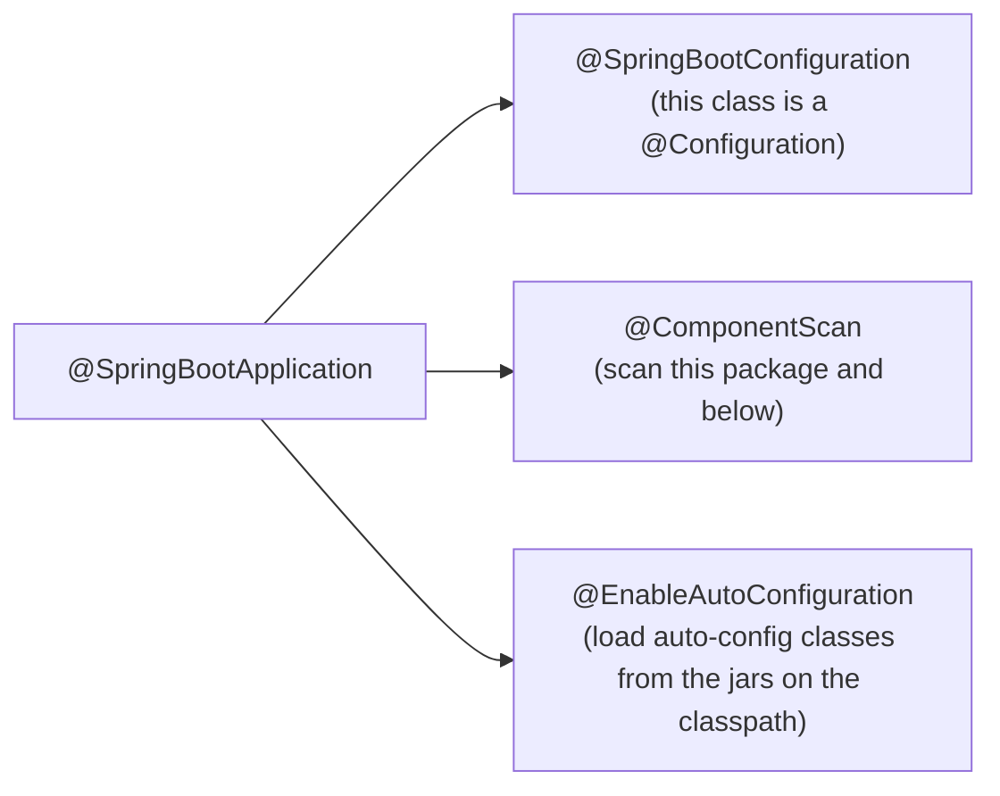
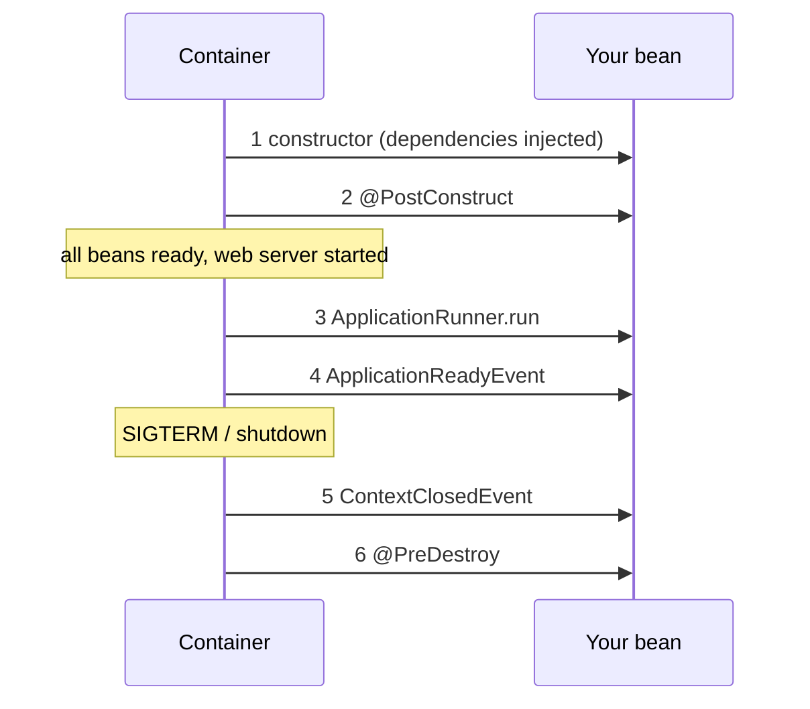
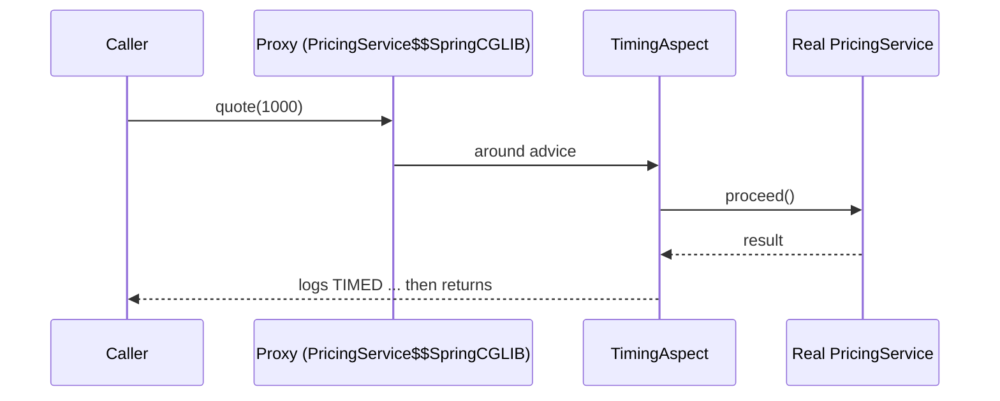
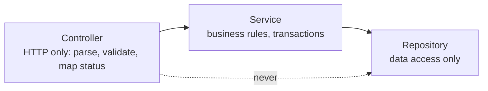
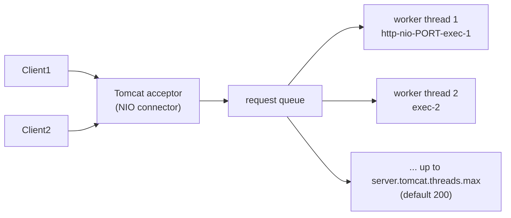
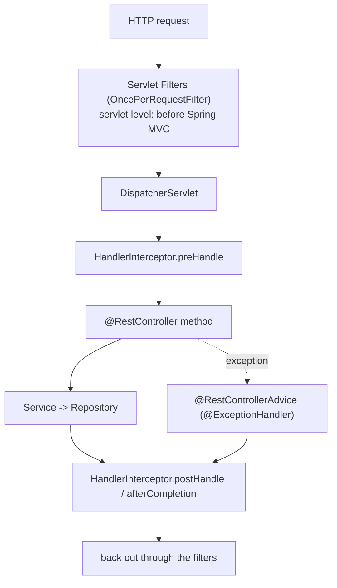

# Session 2 - Spring core, Spring Boot and REST (from zero)

Goal: take the Java you already know and learn what Spring actually does for you: the container (IoC/DI), auto-configuration, configuration, proxies (AOP), and then build a clean, defensive REST API (`com.example.shopflow`: products, stock, orders, a fake payment gateway, coupons) with validation, one consistent error format, request ids in the logs, and a real understanding of how Tomcat serves requests. Every code block in this article was built and run on Java 21 + Spring Boot 4.0.8 (Spring Framework 7, Tomcat 11, Jackson 3); the output you see is pasted from those runs.

Real-world mapping: this is the day-1 skill set for owning a backend. "Why is this bean null?", "why did my @Transactional/@Cacheable/@Async not fire?", "why does production return 500 with a stack trace?", "why does one slow dependency freeze the whole service?" are all answered here. The scenarios used: order placement with stock reservation and compensation (e-commerce core), flash-sale stock counter races (stateful singleton bug), idempotent order POST (client retries), coupon validation (custom constraint), payment-gateway latency vs Tomcat threads, order-number collision retry, hosted-checkout redirect (302), catalog pagination and PUT/PATCH.

## How to use this article

1. Generate a project at https://start.spring.io (section 1) or just copy the `pom.xml` below into an empty folder `shopflow/`. Package: `com.example.shopflow`.
2. Type the code yourself, in order, into `src/main/java/com/example/shopflow/...` (the `// file:` header tells you where). Imports are omitted to save space: let the IDE add them (IntelliJ: Alt+Enter; VS Code: "Organize imports"). Where a Spring Boot 4 import is surprising, it is shown.
3. Build and run: `mvn -q -DskipTests package` then `java -jar target\shopflow.jar` (or `mvn spring-boot:run`). Pick any free port with `--server.port=18237`.
4. Some demos are gated by a property so they do not interfere: run them with `--demo=di`, `--demo=singleton`, etc. They print and exit if you add `--spring.main.web-application-type=none`.
5. curl on Windows PowerShell mangles inline JSON quotes. Save request bodies to files and use `curl.exe -d "@order1.json"`. All bodies used are listed in section 8. Use `curl.exe`, not `curl` (an alias of Invoke-WebRequest in Windows PowerShell 5).
6. Break things on purpose at every "Try it".

## Topics

| # | Topic | You will be able to |
|---|---|---|
| 1 | Project + Boot 4 names | Generate the project and know which starter/artifact names changed from 3.x |
| 2 | `@SpringBootApplication` and auto-config | Read the `--debug` conditions report and explain why a bean exists |
| 3 | IoC / DI | Prefer constructor injection, prove why singletons must be stateless, use `@Qualifier`/`@Primary`, choose `@Configuration` vs `@Component` |
| 4 | Config, profiles | `application.yml`, dev/prod, `@ConfigurationProperties` record with validation (fail fast) |
| 5 | Bean lifecycle, events | Know the order: constructor -> `@PostConstruct` -> runner -> ready -> `@PreDestroy` |
| 6 | AOP / proxies | Write a `@Timed` aspect, see the proxy class, hit and fix the self-invocation pitfall |
| 7 | Layering | controller -> service -> repository, thread-safe in-memory repo, order-number generator with collision retry |
| 8 | Spring MVC REST | Mappings, `ResponseEntity`, 201 + `Location`, 204, 302 |
| 9 | Jackson 3 | Know what changed (`tools.jackson`, defaults) and what it does to your JSON |
| 10 | DTO vs entity | Reproduce a mass-assignment bug, fix it with request/response records |
| 11 | Bean Validation | `@Valid`, custom `@ValidCoupon`, validating params and path variables |
| 12 | Errors | `@RestControllerAdvice` + `ProblemDetail` (RFC 9457): one error body for 400/404/409/422/500 |
| 13 | API design | Pagination, PUT vs PATCH, idempotency keys, `/api/v1` and native versioning |
| 14 | Servlet model | Prove thread-per-request with `threads.max=2`; filter vs interceptor vs advice; request-id in MDC; structured logs |
| 15 | The complete slice + checklist | Run everything together; read a company controller methodically |

---

## 1. Generate the project and learn the Spring Boot 4 names

Go to https://start.spring.io: Project Maven, Language Java, Spring Boot 4.0.8, Group `com.example`, Artifact `shopflow`, Java 21, Packaging Jar. Dependencies: Spring Web, Validation, Spring Boot Actuator, Spring Configuration Processor (and AspectJ/AOP support; section 6).

Boot 4 split the old "fat" starters into smaller modules, so the artifact names differ from what most tutorials (and many companies) show:

| What you need | Spring Boot 4.0.x artifact | Spring Boot 3.5.x artifact |
|---|---|---|
| Spring MVC + Tomcat + Jackson | `spring-boot-starter-webmvc` | `spring-boot-starter-web` |
| Bean Validation | `spring-boot-starter-validation` | same |
| Actuator | `spring-boot-starter-actuator` | same |
| AOP / AspectJ (`@Aspect`) | `spring-boot-starter-aspectj` | `spring-boot-starter-aop` |
| Typed-config metadata | `spring-boot-configuration-processor` (annotation processor) | same |
| MVC tests (Part G) | `spring-boot-starter-webmvc-test` | `spring-boot-starter-test` covers it |
| JSON | Jackson 3: `tools.jackson.databind.*` (annotations remain `com.fasterxml.jackson.annotation`) | Jackson 2: `com.fasterxml.jackson.databind.*` |

I checked `spring-boot-starter-aop` against Maven Central for 4.0.8: it does not exist. The AOP starter is now `spring-boot-starter-aspectj`.

```xml
<!-- file: pom.xml -->
<?xml version="1.0" encoding="UTF-8"?>
<project xmlns="http://maven.apache.org/POM/4.0.0" xmlns:xsi="http://www.w3.org/2001/XMLSchema-instance"
         xsi:schemaLocation="http://maven.apache.org/POM/4.0.0 https://maven.apache.org/xsd/maven-4.0.0.xsd">
  <modelVersion>4.0.0</modelVersion>

  <parent>
    <groupId>org.springframework.boot</groupId>
    <artifactId>spring-boot-starter-parent</artifactId>
    <version>4.0.8</version>
    <relativePath/>
  </parent>

  <groupId>com.example</groupId>
  <artifactId>shopflow</artifactId>
  <version>0.0.1-SNAPSHOT</version>
  <name>shopflow</name>

  <properties>
    <java.version>21</java.version>
  </properties>

  <dependencies>
    <dependency><groupId>org.springframework.boot</groupId><artifactId>spring-boot-starter-webmvc</artifactId></dependency>
    <dependency><groupId>org.springframework.boot</groupId><artifactId>spring-boot-starter-validation</artifactId></dependency>
    <dependency><groupId>org.springframework.boot</groupId><artifactId>spring-boot-starter-actuator</artifactId></dependency>
    <dependency><groupId>org.springframework.boot</groupId><artifactId>spring-boot-starter-aspectj</artifactId></dependency>
  </dependencies>

  <build>
    <finalName>shopflow</finalName>
    <plugins>
      <plugin>
        <groupId>org.springframework.boot</groupId>
        <artifactId>spring-boot-maven-plugin</artifactId>
      </plugin>
      <plugin>
        <groupId>org.apache.maven.plugins</groupId>
        <artifactId>maven-compiler-plugin</artifactId>
        <configuration>
          <parameters>true</parameters>   <!-- keep parameter names so Spring can name them in errors -->
          <annotationProcessorPaths>
            <path>
              <groupId>org.springframework.boot</groupId>
              <artifactId>spring-boot-configuration-processor</artifactId>
              <version>${project.parent.version}</version>
            </path>
          </annotationProcessorPaths>
        </configuration>
      </plugin>
    </plugins>
  </build>
</project>
```

The `-parameters` flag matters: the Spring Boot parent already enables it, but being explicit documents the dependency of `@PathVariable long id` (no name given) on it.

> If your company is on Spring Boot 3.5.x: use `spring-boot-starter-web` and `spring-boot-starter-aop`; everything else in this pom is identical. Java package names for most Spring classes are the same; the differences are listed in each section.

```java
// file: src/main/java/com/example/shopflow/ShopflowApplication.java
@SpringBootApplication
@ConfigurationPropertiesScan
public class ShopflowApplication {
    public static void main(String[] args) {
        SpringApplication.run(ShopflowApplication.class, args);
    }
}
```

React/Express equivalent: `pom.xml` is `package.json`; a starter is a meta-package that pulls a curated, version-matched set of libraries (the parent pom is the lockfile for ~150 versions). `SpringApplication.run` is `app.listen(...)` plus building the whole dependency graph.

---

## 2. What `@SpringBootApplication` does, and reading the conditions report

`@SpringBootApplication` is three annotations in one:



- Component scan: every class under `com.example.shopflow` annotated `@Component` (or `@Service`, `@Repository`, `@RestController`, `@Configuration`, which are all `@Component` underneath) becomes a bean. Classes outside this package tree are NOT scanned: the number one reason for "No qualifying bean".
- Auto-configuration: each library ships `*AutoConfiguration` classes full of `@Bean` methods guarded by conditions (`@ConditionalOnClass`, `@ConditionalOnMissingBean`, `@ConditionalOnProperty`, `@ConditionalOnWebApplication`). Put Tomcat on the classpath and a `TomcatServletWebServerFactory` appears; define your own `JsonMapper` bean and the default backs off (`@ConditionalOnMissingBean`).

Ask Spring to explain itself:

```text
java -jar target\shopflow.jar --debug
```

Excerpt of the output (real, shortened):

```text
============================
CONDITIONS EVALUATION REPORT
============================

Positive matches:
-----------------
   JacksonAutoConfiguration matched:
      - @ConditionalOnClass found required class 'tools.jackson.databind.json.JsonMapper' (OnClassCondition)

   JacksonAutoConfiguration#jacksonJsonMapper matched:
      - @ConditionalOnMissingBean (types: tools.jackson.databind.json.JsonMapper; SearchStrategy: all) did not find any beans (OnBeanCondition)

Negative matches:
-----------------
   AppOpticsMetricsExportAutoConfiguration:
      Did not match:
         - @ConditionalOnClass did not find required class 'io.micrometer.appoptics.AppOpticsMeterRegistry' (OnClassCondition)
```

How to use it: "why do I have bean X?" -> search the Positive matches. "Why did Spring NOT create the DataSource I expected?" -> search the Negative matches; the reason is printed. Startup also logs `Exposing 1 endpoint beneath base path '/actuator'` and `Started ShopflowApplication`; check `GET /actuator/health`:

```text
curl.exe -s http://localhost:18237/actuator/health
{"groups":["liveness","readiness"],"status":"UP"}
```

Try it: add `--spring.main.web-application-type=none` and rerun `--debug`; see `TomcatServletWebServerAutoConfiguration` flip to "Did not match: not a servlet web application". Delete the `starter-actuator` dependency and `/actuator/health` disappears (404).

> If your company is on Spring Boot 3.x: auto-configuration classes lived in `org.springframework.boot.autoconfigure.*` (e.g. `...autoconfigure.jackson.JacksonAutoConfiguration`). Boot 4 moved them into per-module packages such as `org.springframework.boot.jackson.autoconfigure` and `org.springframework.boot.webmvc.autoconfigure`. Your own code rarely imports them; you notice it in `exclude = ...` lists and in stack traces. `@ConditionalOnProperty` stayed in `org.springframework.boot.autoconfigure.condition`.

C++ equivalent: think CMake `find_package` + `#ifdef` feature flags, except the flags are evaluated at startup from what is on the classpath.

---

## 3. IoC and Dependency Injection

IoC (inversion of control): you do not `new` your collaborators; a container (the `ApplicationContext`) builds the object graph and hands each object what it needs. DI is how it hands them over.

Beans are registered by stereotype annotations:

| Annotation | Meaning | Extra behavior |
|---|---|---|
| `@Component` | generic bean | none |
| `@Service` | business logic | none (documentation) |
| `@Repository` | data access | translates persistence exceptions |
| `@RestController` | HTTP adapter | `@Controller` + `@ResponseBody` |
| `@Configuration` | bean factory class | CGLIB-proxied so `@Bean` methods are singletons (3.4) |

### 3.1 Constructor vs field injection (broken -> fixed)

```java
// file: src/main/java/com/example/shopflow/demo/DiDemo.java
interface TaxCalculator {
    long taxCents(long netCents);
}

@Component
class FlatTaxCalculator implements TaxCalculator {
    public long taxCents(long netCents) { return netCents * 18 / 100; }
}

@Service
class FieldInjectedCheckout {
    @Autowired
    private TaxCalculator tax;             // hidden dependency: invisible in the constructor

    long total(long netCents) { return netCents + tax.taxCents(netCents); }
}

@Service
class ConstructorInjectedCheckout {
    private final TaxCalculator tax;       // final: cannot be null, cannot change

    ConstructorInjectedCheckout(TaxCalculator tax) {   // single constructor: @Autowired not needed
        this.tax = tax;
    }

    long total(long netCents) { return netCents + tax.taxCents(netCents); }
}

@Component
@ConditionalOnProperty(name = "demo", havingValue = "di")
class DiDemo implements ApplicationRunner {
    private final FieldInjectedCheckout field;
    private final ConstructorInjectedCheckout ctor;

    DiDemo(FieldInjectedCheckout field, ConstructorInjectedCheckout ctor) { this.field = field; this.ctor = ctor; }

    @Override
    public void run(ApplicationArguments args) {
        System.out.println("spring-made field   : " + field.total(10_000));
        System.out.println("spring-made ctor    : " + ctor.total(10_000));
        System.out.println("hand-made ctor      : " + new ConstructorInjectedCheckout(net -> 0).total(10_000) + " (zero-tax fake)");
        try {
            new FieldInjectedCheckout().total(10_000);
        } catch (NullPointerException e) {
            System.out.println("hand-made field     : NullPointerException (nobody injected the TaxCalculator)");
        }
    }
}
```

Run: `java -jar target\shopflow.jar --demo=di --spring.main.web-application-type=none`

```text
spring-made field   : 11800
spring-made ctor    : 11800
hand-made ctor      : 10000 (zero-tax fake)
hand-made field     : NullPointerException (nobody injected the TaxCalculator)
```

Why constructor injection wins:

- The class cannot exist without its dependencies (no half-built objects, no NPE), fields can be `final`.
- Dependencies are visible in the signature: ten constructor parameters is a loud smell that the class does too much; ten `@Autowired` fields hide it.
- You can unit-test with `new ConstructorInjectedCheckout(fakeTax)`, with no Spring at all (a lambda as the fake above). Field injection forces reflection or `@SpringBootTest`.
- Circular dependencies fail fast at startup instead of lazily.

Rule: one constructor, `final` fields, no `@Autowired` needed. Field `@Autowired` in a company codebase is a signal to refactor opportunistically, not to rewrite everything.

### 3.2 Singleton beans must be stateless (the thread-safety bug)

Default scope is singleton: ONE instance for the whole application, shared by every request thread (Tomcat runs requests in parallel, section 14). A mutable field in a singleton is shared mutable state. Two classic bugs, both reproduced:

```java
// file: src/main/java/com/example/shopflow/demo/SingletonDemo.java (part 1: the bugs)
@Component
class BrokenSalesCounter {               // singleton + mutable field = shared by every request thread
    private int unitsSold;
    void sold() { unitsSold++; }         // read, add, write: three steps, not atomic
    int unitsSold() { return unitsSold; }
}

@Component
class SafeSalesCounter {
    private final AtomicInteger unitsSold = new AtomicInteger();
    void sold() { unitsSold.incrementAndGet(); }
    int unitsSold() { return unitsSold.get(); }
}

@Component
class BrokenReceiptBuilder {             // per-request data stored in a singleton field
    private String customerName;

    String build(String name, long thinkMillis) throws InterruptedException {
        this.customerName = name;
        Thread.sleep(thinkMillis);       // pretend to load the order lines
        return "Receipt for " + this.customerName;
    }
}
```

```java
// part 2: the runner that hammers them from 8 threads (inside the demo class)
ExecutorService pool = Executors.newFixedThreadPool(8);
List<Future<?>> fs = new ArrayList<>();
for (int t = 0; t < 8; t++) {
    fs.add(pool.submit(() -> {
        for (int i = 0; i < 100_000; i++) { broken.sold(); safe.sold(); }
    }));
}
for (Future<?> f : fs) f.get();
System.out.println("expected 800000 | broken counter = " + broken.unitsSold() + " | atomic counter = " + safe.unitsSold());

Future<String> a = pool.submit(() -> receipts.build("Asha", 200));
Thread.sleep(50);
Future<String> b = pool.submit(() -> receipts.build("Bilal", 0));
System.out.println("request for Asha  got: " + a.get());
System.out.println("request for Bilal got: " + b.get());
```

```text
expected 800000 | broken counter = 584920 | atomic counter = 800000
request for Asha  got: Receipt for Bilal
request for Bilal got: Receipt for Bilal
```

(The broken counter number differs on every run: that is the bug.) Asha received Bilal's name on a receipt: a privacy incident. In production it appears only under load, never in your local single-user testing, which makes it nasty to diagnose. This is the "flash-sale lost update" pattern: two requests read `unitsSold = 10`, both write 11.

Fixes, in order of preference: (1) make the bean stateless: pass data as method parameters and return values; keep state in a database or a concurrent structure behind a repository; (2) if you must keep in-memory state, use `AtomicInteger`, `ConcurrentHashMap`, or locks; (3) never keep a request-scoped value (user, request id, locale) in a singleton field. Immutable config (`final` fields set in the constructor) is fine: that is "stateless" in the practical sense.

C++ equivalent: a global/static object accessed from multiple threads without a mutex: same data race, same undefined-ish results. Express equivalent: a module-level `let counter` is fine there because Node is single-threaded; Java is not.

### 3.3 Scopes

| Scope | Instances | Use |
|---|---|---|
| `singleton` (default) | 1 per container | services, repositories, controllers |
| `prototype` | new one per request to the container | stateful helper objects |
| `request` / `session` | 1 per HTTP request / session | web-only; rare in REST APIs |

The prototype trap: a prototype injected into a singleton is injected ONCE when the singleton is created, so it is effectively a singleton too. Use `ObjectProvider<T>` to ask for a fresh one each time:

```java
@Component @Scope("prototype") class Cart { }

@Component class HoldsCartWrongly { @Autowired Cart cart; }       // frozen at startup

@Component class HoldsCartRight {
    private final ObjectProvider<Cart> carts;
    HoldsCartRight(ObjectProvider<Cart> carts) { this.carts = carts; }
    Cart fresh() { return carts.getObject(); }                    // asks the container each time
}
```

```text
getBean(Cart) twice, same object? false
field-injected Cart is what the container hands out now? false (frozen at startup)
via ObjectProvider, same each time? false
```

(The second "false" means the injected Cart is NOT the one the container would give you today: it is stale.)

### 3.4 `@Primary`, `@Qualifier` and ambiguity

When two beans match a type, Spring refuses to guess:

```java
// file: src/main/java/com/example/shopflow/demo/WiringDemo.java (part 1)
interface PaymentMethod { String describe(); }

@Component
@Primary                                          // the default when someone just asks for a PaymentMethod
class CardMethod implements PaymentMethod { public String describe() { return "card via fake gateway"; } }

@Component("walletMethod")                        // explicit bean name, usable in @Qualifier
class WalletMethod implements PaymentMethod { public String describe() { return "customer wallet balance"; } }

// consumer
WiringDemo(PaymentMethod byDefault, @Qualifier("walletMethod") PaymentMethod chosen, Map<String, PaymentMethod> all, ...)
```

```text
default (@Primary)         : card via fake gateway
@Qualifier("walletMethod") : customer wallet balance
Map<String, PaymentMethod> : [cardMethod, walletMethod]
```

Injecting `Map<String, PaymentMethod>` or `List<PaymentMethod>` gives you ALL implementations: the strategy pattern with zero registry code. Now the failure when there is no `@Primary` (two `NotificationChannel` beans, `EmailChannel` and `SmsChannel`, one consumer asking for a single one):

```text
***************************
APPLICATION FAILED TO START
***************************

Description:

Parameter 0 of constructor in com.example.shopflow.demo.AmbiguousHolder required a single bean, but 2 were found:
	- emailChannel: defined in file [...]
	- smsChannel: defined in file [...]

Action:

Consider marking one of the beans as @Primary, updating the consumer to accept multiple beans, or using @Qualifier to identify the bean that should be consumed
```

Read these "FAILED TO START" reports: Spring tells you the cause and the fix. Most DI errors are `NoSuchBeanDefinitionException` (not scanned / not a bean), `NoUniqueBeanDefinitionException` (ambiguity), or a circular dependency.

### 3.5 `@Component` vs `@Bean`, and `@Configuration` proxying

- `@Component` (and friends) goes on YOUR class; scanned automatically.
- `@Bean` goes on a METHOD of a `@Configuration` class; use it for third-party classes you cannot annotate (a `Clock`, a `RestClient`, a `SecureRandom`) or when construction needs logic.

```java
// file: src/main/java/com/example/shopflow/config/InfraConfig.java
@Configuration
public class InfraConfig {
    @Bean Clock clock() { return Clock.systemUTC(); }            // tests can replace it with Clock.fixed(...)
    @Bean SecureRandom secureRandom() { return new SecureRandom(); }
}
```

The subtle part: `@Configuration` classes are CGLIB-proxied so that calling one `@Bean` method from another returns the container's singleton, not a fresh object. A plain `@Component` holding `@Bean` methods ("lite mode") has no such interception:

```java
class TaxTable { }   class PriceEngine { final TaxTable table; PriceEngine(TaxTable t) { table = t; } }

@Configuration
class FullConfig {
    @Bean TaxTable taxTable() { return new TaxTable(); }
    @Bean PriceEngine priceEngine() { return new PriceEngine(taxTable()); }   // intercepted: the singleton
}

@Component                                        // "lite" mode
class LiteConfig {
    @Bean DiscountTable discountTable() { return new DiscountTable(); }
    @Bean DiscountEngine discountEngine() { return new DiscountEngine(discountTable()); } // really runs new again
}
```

```text
@Configuration : engine.table is the container's bean? true
@Component     : engine.table is the container's bean? false
FullConfig class: FullConfig$$SpringCGLIB$$0
LiteConfig class: LiteConfig
```

Rule: `@Bean` methods go in `@Configuration` classes; and notice the first hint of what Section 6 explains: Spring's trick is to hand you a generated subclass (a proxy).

---

## 4. `application.yml`, profiles and `@ConfigurationProperties`

```yaml
# file: src/main/resources/application.yml
spring:
  application:
    name: shopflow

logging:
  pattern:
    level: "%5p [%X{requestId:-}]"      # every log line shows the request id (section 14)

shopflow:
  base-url: http://localhost:8080
  order-number-prefix: SF
  order-number-length: 8
  max-items-per-order: 20
  limits:
    max-page-size: 50
```

```yaml
# file: src/main/resources/application-dev.yml
logging:
  level:
    com.example.shopflow: DEBUG
```

```yaml
# file: src/main/resources/application-prod.yml
shopflow:
  base-url: https://shop.example.com
  order-number-length: 10
  max-items-per-order: 10
logging:
  level:
    root: WARN
```

Precedence, highest first (the useful subset): command-line args (`--x=1`) > OS environment variables > `application-{profile}.yml` > `application.yml` > defaults in code. This is why containers configure by env vars (12-factor): the same jar runs in dev, staging and prod. Activate a profile with `--spring.profiles.active=prod` or env `SPRING_PROFILES_ACTIVE=prod`.

### Typed config: a record with validation

Scattered `@Value("${shopflow.order-number-length}")` strings are untyped, unvalidated, and easy to typo. Bind the whole `shopflow.*` tree to one immutable record instead:

```java
// file: src/main/java/com/example/shopflow/config/ShopflowProperties.java
@ConfigurationProperties(prefix = "shopflow")
@Validated
public record ShopflowProperties(
        @NotBlank @Pattern(regexp = "https?://.+", message = "must start with http:// or https://") String baseUrl,
        @NotBlank @Pattern(regexp = "[A-Z]{2,4}") String orderNumberPrefix,
        @Min(4) @Max(16) int orderNumberLength,
        @DefaultValue("20") @Min(1) @Max(100) int maxItemsPerOrder,
        @DefaultValue("5") @Min(1) int maxCollisionRetries,
        @DefaultValue("0") @Min(0) int gatewayLatencyMs,
        @DefaultValue("https://pay.example-gateway.test/checkout") @Pattern(regexp = "https?://.+") String hostedCheckoutUrl,
        @Valid @DefaultValue Limits limits) {

    public record Limits(@DefaultValue("20") @Min(1) int maxPageSize) { }
}
```

`@ConfigurationPropertiesScan` on the application class registers it (alternatively `@EnableConfigurationProperties(ShopflowProperties.class)`). Inject it like any bean: `OrderService(ShopflowProperties props, ...)`.

```text
# default profile
ShopflowProperties[baseUrl=http://localhost:8080, orderNumberPrefix=SF, orderNumberLength=8, ...]
# --spring.profiles.active=prod
baseUrl=https://shop.example.com, orderNumberLength=10
# env var SHOPFLOW_ORDERNUMBERLENGTH=9 (relaxed binding: ORDERNUMBERLENGTH, order-number-length, orderNumberLength all work)
orderNumberLength=9
```

Now break it: `--shopflow.order-number-length=2` -> the app refuses to start (fail fast beats a 3 a.m. surprise):

```text
APPLICATION FAILED TO START

Binding to target ... ShopflowProperties failed:

    Property: shopflow.orderNumberLength
    Value: "2"
    Origin: "shopflow.order-number-length" from property source "commandLineArgs"
    Reason: must be greater than or equal to 4
```

Note how precise the error is: which property, which value, which source. With the `spring-boot-configuration-processor`, IDEs also autocomplete `shopflow.*` in YAML.

Try it: remove `@Validated`; the bad value is silently accepted. Set `SHOPFLOW_BASEURL=ftp://x` and watch the pattern fail.

> If your company is on Spring Boot 3.x: `@ConfigurationProperties` records work the same (3.0+); in 3.x with a single record constructor you may see `@ConstructorBinding` in older code: no longer needed.

---

## 5. Bean lifecycle and events



```java
// file: src/main/java/com/example/shopflow/demo/LifecycleDemo.java (essentials)
record DemoOrderPlaced(long orderId, String email) { }   // any object can be an event

@Component
@ConditionalOnProperty(name = "demo", havingValue = "lifecycle")
class LifecycleBean implements ApplicationRunner {
    private static final Logger log = LoggerFactory.getLogger(LifecycleBean.class);
    private final ApplicationEventPublisher events;
    private final Environment env;

    LifecycleBean(ShopflowProperties props, ApplicationEventPublisher events, Environment env) {
        this.events = events; this.env = env;
        log.info("1 constructor: dependencies injected, props.baseUrl={}", props.baseUrl());
    }

    @PostConstruct
    void init() { log.info("2 @PostConstruct: bean fully wired, safe to validate or warm up a cache"); }

    @Override
    public void run(ApplicationArguments args) {
        log.info("4 ApplicationRunner.run: context is up, profiles={}", Arrays.toString(env.getActiveProfiles()));
        events.publishEvent(new DemoOrderPlaced(1001, "asha@example.com"));
        log.info("   publishEvent returned (listeners run synchronously, on the same thread, by default)");
    }

    @PreDestroy
    void cleanup() { log.info("7 @PreDestroy: flush buffers and release resources here"); }
}

@Component
@ConditionalOnProperty(name = "demo", havingValue = "lifecycle")
class LifecycleListeners {
    @EventListener void onReady(ApplicationReadyEvent e) { log.info("5 ApplicationReadyEvent: ready to serve traffic"); }
    @EventListener void onOrderPlaced(DemoOrderPlaced e) { log.info("   OrderPlaced listener on thread {}: send confirmation mail to {}", Thread.currentThread().getName(), e.email()); }
    @EventListener void onClose(ContextClosedEvent e) { log.info("6 ContextClosedEvent: shutdown started"); }
}
```

```text
INFO  c.e.s.d.LifecycleBean : 1 constructor: dependencies injected, props.baseUrl=http://localhost:8080
INFO  c.e.s.d.LifecycleBean : 2 @PostConstruct: bean fully wired, safe to validate or warm up a cache
INFO  c.e.s.ShopflowApplication : Started ShopflowApplication in 8.945 seconds (process running for 10.834)
INFO  c.e.s.d.LifecycleBean : 4 ApplicationRunner.run: context is up, profiles=[]
INFO  c.e.s.d.LifecycleListeners :    OrderPlaced listener on thread main: send confirmation mail to asha@example.com
INFO  c.e.s.d.LifecycleBean :    publishEvent returned (listeners run synchronously, on the same thread, by default)
INFO  c.e.s.d.LifecycleListeners : 5 ApplicationReadyEvent: ready to serve traffic
INFO  c.e.s.d.LifecycleListeners : 6 ContextClosedEvent: shutdown started
INFO  c.e.s.d.LifecycleBean : 7 @PreDestroy: flush buffers and release resources here
```

Takeaways:

- Do not use dependencies in a constructor beyond storing them; use `@PostConstruct` for init that needs the wired bean; `ApplicationRunner`/`CommandLineRunner` for "after startup, once" work (seed data, warm caches).
- Events are in-process pub/sub. The listener ran on thread `main`, synchronously, INSIDE the publisher's call stack: if the listener throws, the publisher's transaction/request fails; if it is slow, the publisher is slow. Real decoupling needs `@Async` (Part H) or `@TransactionalEventListener` (Part C) or a message broker. In shopflow, `OrderService.place` publishes `OrderPlaced` and a `NotificationListener` queues the confirmation mail: the service does not know the mail exists.
- `@PreDestroy` + `ContextClosedEvent` are your graceful-shutdown hooks (see `server.shutdown=graceful`, Part H).

> Boot 4 note: `ApplicationRunner`, `ApplicationReadyEvent`, `@DefaultValue` and `@ConditionalOnProperty` kept their 3.x packages (`org.springframework.boot` and `...boot.context.properties.bind`).

---

## 6. AOP and proxies: how `@Transactional`, `@Cacheable`, `@Async` really work

Spring does not edit your class. For beans that need extra behavior, the container hands out a proxy: a generated subclass (CGLIB) or JDK interface proxy that wraps the real object. Every external call goes caller -> proxy -> (advice: start transaction / check cache / time it) -> real method.



This is exactly how `@Transactional` works: a transaction interceptor begins the transaction before `proceed()`, commits after, rolls back if a RuntimeException escapes. Same for `@Cacheable` (check cache first, else proceed and store) and `@Async` (submit proceed() to an executor).

### 6.1 Write your own `@Timed`

```java
// file: src/main/java/com/example/shopflow/aop/Timed.java
@Target(ElementType.METHOD)
@Retention(RetentionPolicy.RUNTIME)
public @interface Timed { }
```

```java
// file: src/main/java/com/example/shopflow/aop/TimingAspect.java
@Aspect
@Component
public class TimingAspect {
    private static final Logger log = LoggerFactory.getLogger(TimingAspect.class);

    @Around("@annotation(com.example.shopflow.aop.Timed)")
    public Object time(ProceedingJoinPoint pjp) throws Throwable {
        long start = System.nanoTime();
        try {
            return pjp.proceed();                      // call the real method
        } finally {
            long ms = (System.nanoTime() - start) / 1_000_000;
            log.info("TIMED {} took {} ms", pjp.getSignature().toShortString(), ms);
        }
    }
}
```

`org.aspectj.lang.*` comes from the `spring-boot-starter-aspectj` dependency. Without that starter, the aspect class does not compile (no AspectJ annotations) in a Boot 4 project.

### 6.2 See the proxy, then fall into the self-invocation trap

```java
// file: src/main/java/com/example/shopflow/demo/AopDemo.java (part 1: the trap)
@Service
class PricingService {

    @Timed
    public long quote(long netCents) {
        sleep(30);                                   // pretend to call a tax service
        return netCents * 118 / 100;
    }

    public long quoteAll(List<Long> nets) {
        return nets.stream().mapToLong(this::quote).sum();   // BUG: this.quote() skips the proxy
    }

    static void sleep(long ms) { try { Thread.sleep(ms); } catch (InterruptedException e) { Thread.currentThread().interrupt(); } }
}
```

Runner prints `pricing.getClass().getName()`, calls `quote` from outside, then `quoteAll(List.of(1000L, 2000L, 3000L))`:

```text
class of the injected bean : com.example.shopflow.demo.PricingService$$SpringCGLIB$$0
superclass                 : PricingService
--- 1. call quote() from outside: aspect runs
INFO  c.e.s.a.TimingAspect : TIMED PricingService.quote(..) took 59 ms
--- 2. quoteAll() calls this.quote() 3 times: expect 3 TIMED lines, get:
total = 7080
```

Two key observations: (1) the injected bean is NOT `PricingService`, it is a generated `PricingService$$SpringCGLIB$$0` that extends it (this is why proxied classes cannot be `final` and why you never `new` them); (2) calling `quote` from `quoteAll` through `this` goes straight to the real object. The proxy never sees it, so there are ZERO TIMED lines for the 3 inner calls. Replace `@Timed` with `@Transactional`, and the "inner" method runs without a transaction, silently. Same with `@Cacheable` (no caching) and `@Async` (runs synchronously). No exception, no warning: the worst kind of bug. It also hits `private` and (for proxy-based AOP) `final` methods, and methods on beans you `new` yourself.

### 6.3 Fixes

Fix 1 (best): move the inner method to ANOTHER bean. The call crosses a bean boundary, so it goes through the proxy. This is almost always also the cleaner design.

```java
@Service
class BulkPricer {
    private final PricingService pricing;
    BulkPricer(PricingService pricing) { this.pricing = pricing; }

    public long quoteAll(List<Long> nets) {
        return nets.stream().mapToLong(pricing::quote).sum();
    }
}
```

Fix 2: inject yourself (you receive the proxy) and call through it. `@Lazy` breaks the circular dependency:

```java
@Service
class SelfInjectingPricer {
    @Autowired @Lazy
    private SelfInjectingPricer self;

    @Timed
    public long quote(long netCents) { PricingService.sleep(30); return netCents * 118 / 100; }

    public long quoteAll(List<Long> nets) { return nets.stream().mapToLong(self::quote).sum(); }
}
```

```text
--- 3. fix 1, other bean:
INFO  c.e.s.a.TimingAspect : TIMED PricingService.quote(..) took 38 ms
INFO  c.e.s.a.TimingAspect : TIMED PricingService.quote(..) took 31 ms
INFO  c.e.s.a.TimingAspect : TIMED PricingService.quote(..) took 42 ms
total = 7080
--- 4. fix 2, self-injection:
INFO  c.e.s.a.TimingAspect : TIMED SelfInjectingPricer.quote(..) took 41 ms
INFO  c.e.s.a.TimingAspect : TIMED SelfInjectingPricer.quote(..) took 44 ms
INFO  c.e.s.a.TimingAspect : TIMED SelfInjectingPricer.quote(..) took 44 ms
total = 7080
```

(A third option is AspectJ compile-time/load-time weaving, which does not use proxies at all; rarely worth it.) Fix 2 is a workaround, mention it in code review, prefer fix 1.

> If your company is on Spring Boot 3.x: add `spring-boot-starter-aop` instead; the `@Aspect` code is identical. Also remember `spring.aop.proxy-target-class` defaults to true (CGLIB) in all Boot versions.

Interview-ready summary of `@Transactional`: "a transaction interceptor on a proxy opens a transaction, runs the method, commits or rolls back on RuntimeException; so a self-call, a private method, or a bean created with `new` is not transactional." Part C goes deep.

---

## 7. Layering: controller -> service -> repository



Rules: controllers know HTTP and nothing about storage; services know business rules and nothing about HTTP (no `ResponseEntity`, no `HttpServletRequest`); repositories only load/save. Entities/domain objects stay inside; the controller maps to/from DTOs (section 10). This is what you will read in your company's code, so internalize it.

Domain (immutable records; money in integer cents, never `double`):

```java
// file: src/main/java/com/example/shopflow/domain/*.java (one public type per file)
public record Product(long id, String sku, String name, long priceCents, boolean active) {
    public Product withId(long newId) { return new Product(newId, sku, name, priceCents, active); }
}
public record Customer(long id, String name, String email) { }
public record Address(String line1, String city, String postalCode) { }
public enum OrderStatus { PENDING_PAYMENT, PAID, CANCELLED }
public record OrderItem(long productId, int quantity, long unitPriceCents) {
    public long lineTotalCents() { return quantity * unitPriceCents; }
}
public record Order(long id, String orderNumber, long customerId, OrderStatus status, List<OrderItem> items,
                    long subtotalCents, long discountCents, long totalCents, Address shipping, Instant createdAt) {
    public Order withId(long newId) { return new Order(newId, orderNumber, customerId, status, items, subtotalCents, discountCents, totalCents, shipping, createdAt); }
    public Order withStatus(OrderStatus s) { return new Order(id, orderNumber, customerId, s, items, subtotalCents, discountCents, totalCents, shipping, createdAt); }
}
public record PageResult<T>(List<T> content, int page, int size, long totalElements) {
    public int totalPages() { return (int) Math.ceil((double) totalElements / size); }
}
public record OrderPlaced(long orderId, String orderNumber, String customerEmail) { }   // package events
```

Repositories (in-memory now, thread-safe because they are singletons shared by all request threads; in Part C they become Spring Data JPA interfaces with the same method names):

```java
// file: src/main/java/com/example/shopflow/repo/ProductRepository.java
public interface ProductRepository {
    Optional<Product> findById(long id);
    boolean existsBySku(String sku);
    PageResult<Product> findPage(int page, int size);
    Product save(Product product);      // id == 0 means insert, otherwise replace
}

// file: src/main/java/com/example/shopflow/repo/InMemoryProductRepository.java
@Repository
class InMemoryProductRepository implements ProductRepository {
    private final ConcurrentSkipListMap<Long, Product> rows = new ConcurrentSkipListMap<>();
    private final AtomicLong ids = new AtomicLong();

    public Optional<Product> findById(long id) { return Optional.ofNullable(rows.get(id)); }
    public boolean existsBySku(String sku) { return rows.values().stream().anyMatch(p -> p.sku().equalsIgnoreCase(sku)); }
    public PageResult<Product> findPage(int page, int size) {
        List<Product> all = List.copyOf(rows.values());
        int from = Math.min(page * size, all.size());
        int to = Math.min(from + size, all.size());
        return new PageResult<>(all.subList(from, to), page, size, all.size());
    }
    public Product save(Product product) {
        Product saved = product.id() == 0 ? product.withId(ids.incrementAndGet()) : product;
        rows.put(saved.id(), saved);
        return saved;
    }
}
```

```java
// file: src/main/java/com/example/shopflow/repo/OrderRepository.java  (+ InMemoryOrderRepository, same style)
public interface OrderRepository {
    Optional<Order> findById(long id);
    Optional<Order> findByOrderNumber(String orderNumber);
    boolean claimOrderNumber(String orderNumber);     // false if somebody already owns it (a unique index later)
    Order save(Order order);                          // id == 0 means insert
}
// InMemoryOrderRepository: ConcurrentHashMap<Long,Order> rows, Set<String> numbers = ConcurrentHashMap.newKeySet(),
// AtomicLong ids starting at 1000; claimOrderNumber returns numbers.add(orderNumber); save assigns ids.incrementAndGet().

// file: src/main/java/com/example/shopflow/repo/CustomerRepository.java
@Repository
public class CustomerRepository {
    private final Map<Long, Customer> rows = new ConcurrentHashMap<>();
    public void save(Customer c) { rows.put(c.id(), c); }
    public Optional<Customer> findById(long id) { return Optional.ofNullable(rows.get(id)); }
}

// file: src/main/java/com/example/shopflow/repo/StockRepository.java
@Repository
public class StockRepository {
    private final Map<Long, AtomicInteger> stock = new ConcurrentHashMap<>();
    public void set(long productId, int quantity) { stock.put(productId, new AtomicInteger(quantity)); }
    public Optional<Integer> available(long productId) { return Optional.ofNullable(stock.get(productId)).map(AtomicInteger::get); }

    /** Atomic check-and-decrement: two buyers can never both take the last unit. */
    public boolean tryReserve(long productId, int quantity) {
        AtomicInteger units = stock.get(productId);
        if (units == null) return false;
        while (true) {
            int current = units.get();
            if (current < quantity) return false;
            if (units.compareAndSet(current, current - quantity)) return true;   // retry if someone raced us
        }
    }
    public void release(long productId, int quantity) { stock.computeIfAbsent(productId, id -> new AtomicInteger()).addAndGet(quantity); }
}
```

`tryReserve` is a compare-and-swap loop: the same idea as C++ `std::atomic::compare_exchange_weak`. A naive `if (available >= qty) available -= qty;` is the flash-sale oversell bug; in a database the equivalent is a conditional `UPDATE stock SET qty = qty - ? WHERE qty >= ?` (Part C).

Seed data, replaced by Flyway migrations in Part C:

```java
// file: src/main/java/com/example/shopflow/config/DataSeeder.java
@Component
class DataSeeder implements ApplicationRunner {
    // constructor injects ProductRepository, StockRepository, CustomerRepository
    @Override
    public void run(ApplicationArguments args) {
        seed("KB-100", "Mechanical keyboard", 4_999_00, 50);
        seed("MS-200", "Wireless mouse", 1_299_00, 100);
        seed("HD-300", "USB-C hub", 2_499_00, 3);           // scarce on purpose: stock-out demos
        seed("MN-400", "27 inch monitor", 18_999_00, 10);
        seed("CB-500", "HDMI cable", 399_00, 500);
        customers.save(new Customer(1, "Asha Rao", "asha@example.com"));
        customers.save(new Customer(2, "Bilal Khan", "bilal@example.com"));
    }
    private void seed(String sku, String name, long priceCents, int units) {
        Product p = products.save(new Product(0, sku, name, priceCents, true));
        stock.set(p.id(), units);
    }
}
```

### 7.1 Order numbers: random code, collision, retry

Customers see `SF-NQAXQMDR`, not row id 1001 (ids leak your volume and are guessable). Random codes can collide, so claim atomically and retry a bounded number of times:

```java
// file: src/main/java/com/example/shopflow/service/OrderNumberGenerator.java
@Component
public class OrderNumberGenerator {
    private static final Logger log = LoggerFactory.getLogger(OrderNumberGenerator.class);
    private static final String ALPHABET = "0123456789ABCDEFGHJKMNPQRSTVWXYZ";   // Crockford base32: no I L O U

    private final Random random;
    private final OrderRepository orders;
    private final ShopflowProperties props;

    public OrderNumberGenerator(Random random, OrderRepository orders, ShopflowProperties props) { ... }

    /** Random number, claimed atomically; on a collision try again, a bounded number of times. */
    public String next() {
        for (int attempt = 1; attempt <= props.maxCollisionRetries(); attempt++) {
            String candidate = props.orderNumberPrefix() + "-" + randomPart(props.orderNumberLength());
            if (orders.claimOrderNumber(candidate)) return candidate;
            log.warn("order number collision on attempt {}: {}", attempt, candidate);
        }
        throw new IllegalStateException("could not allocate an order number after " + props.maxCollisionRetries() + " attempts");
    }

    private String randomPart(int length) {
        StringBuilder sb = new StringBuilder(length);
        for (int i = 0; i < length; i++) sb.append(ALPHABET.charAt(random.nextInt(ALPHABET.length())));
        return sb.toString();
    }
}
```

`Random` is satisfied by the `SecureRandom` bean from `InfraConfig`. To PROVE the retry works, feed two generators the same seed so they propose identical candidates:

```java
OrderNumberGenerator first  = new OrderNumberGenerator(new Random(42), orders, props);
OrderNumberGenerator second = new OrderNumberGenerator(new Random(42), orders, props);
System.out.println("first  got: " + first.next());
System.out.println("second got: " + second.next());
OrderNumberGenerator third = new OrderNumberGenerator(new Random(42), orders, props);
try { third.next(); } catch (IllegalStateException e) { System.out.println("gave up   : " + e.getMessage()); }
```

Run with `--demo=collision --shopflow.max-collision-retries=2`:

```text
first  got: SF-Q1N19Y8P
WARN  c.e.s.s.OrderNumberGenerator : order number collision on attempt 1: SF-Q1N19Y8P
second got: SF-N2WEBC8P
WARN  c.e.s.s.OrderNumberGenerator : order number collision on attempt 1: SF-Q1N19Y8P
WARN  c.e.s.s.OrderNumberGenerator : order number collision on attempt 2: SF-N2WEBC8P
gave up   : could not allocate an order number after 2 attempts
```

Why `claimOrderNumber` instead of "check `exists`, then insert"? Between the check and the insert another thread can take the same value (check-then-act race). In Part C this is a UNIQUE index plus catching the constraint violation: the database is the arbiter. 32^8 is about 10^12 combinations, so real collisions are rare, but "rare" at scale means "monthly": always handle it.

### 7.2 Services

The business rules live here. `OrderService.place` validates, reserves stock line by line, and COMPENSATES (gives stock back) if a later line fails; with a database this is a transaction rollback (Part C). Everything an HTTP layer should not know is in here:

```java
// file: src/main/java/com/example/shopflow/service/OrderService.java (core, constructor and getters shortened)
@Service
public class OrderService {
    public record NewItem(long productId, int quantity) { }
    public record NewOrder(long customerId, List<NewItem> items, Address shipping, String couponCode) { }
    public record Placed(Order order, boolean replayed) { }

    // constructor-injected finals: OrderRepository orders, CustomerRepository customers, ProductService products,
    // StockRepository stock, CouponService coupons, OrderNumberGenerator numbers, IdempotencyStore idempotency,
    // ApplicationEventPublisher events, ShopflowProperties props, Clock clock

    public Placed place(NewOrder cmd, String idempotencyKey) {
        if (idempotencyKey == null) return new Placed(doPlace(cmd), false);
        IdempotencyStore.Outcome outcome = idempotency.execute(idempotencyKey, fingerprint(cmd), () -> doPlace(cmd));
        return new Placed(outcome.order(), outcome.replayed());
    }

    private Order doPlace(NewOrder cmd) {
        Customer customer = customers.findById(cmd.customerId())
                .orElseThrow(() -> new NotFoundException("customer", cmd.customerId()));
        if (cmd.items().size() > props.maxItemsPerOrder())
            throw new BusinessRuleException("too-many-items", "an order may contain at most " + props.maxItemsPerOrder() + " lines");
        int percentOff = 0;
        if (cmd.couponCode() != null) {
            percentOff = coupons.percentOff(cmd.couponCode(), LocalDate.now(clock.withZone(ZoneOffset.UTC)))
                    .orElseThrow(() -> new BusinessRuleException("coupon-expired", "coupon " + cmd.couponCode() + " is expired"));
        }
        List<OrderItem> lines = new ArrayList<>();
        List<OrderItem> reserved = new ArrayList<>();
        try {
            for (NewItem item : cmd.items()) {
                Product p = products.get(item.productId());
                if (!p.active()) throw new BusinessRuleException("product-inactive", "product " + p.id() + " is not for sale");
                if (!stock.tryReserve(p.id(), item.quantity()))
                    throw new InsufficientStockException(p.id(), item.quantity(), products.available(p.id()));
                OrderItem line = new OrderItem(p.id(), item.quantity(), p.priceCents());   // price snapshot at order time
                reserved.add(line);
                lines.add(line);
            }
        } catch (RuntimeException e) {
            reserved.forEach(l -> stock.release(l.productId(), l.quantity()));      // compensate: give stock back
            throw e;
        }
        long subtotal = lines.stream().mapToLong(OrderItem::lineTotalCents).sum();
        long discount = subtotal * percentOff / 100;
        Order saved = orders.save(new Order(0, numbers.next(), customer.id(), OrderStatus.PENDING_PAYMENT, List.copyOf(lines),
                subtotal, discount, subtotal - discount, cmd.shipping(), Instant.now(clock)));
        events.publishEvent(new OrderPlaced(saved.id(), saved.orderNumber(), customer.email()));
        return saved;
    }

    public Order get(long id) { return orders.findById(id).orElseThrow(() -> new NotFoundException("order", id)); }
    public Order getByNumber(String n) { return orders.findByOrderNumber(n).orElseThrow(() -> new NotFoundException("order", n)); }

    public void cancel(long id) {
        Order order = get(id);
        if (order.status() == OrderStatus.CANCELLED) return;               // DELETE is idempotent: second call is a no-op
        if (order.status() != OrderStatus.PENDING_PAYMENT)
            throw new BusinessRuleException("order-not-cancellable", "only unpaid orders can be cancelled");
        order.items().forEach(i -> stock.release(i.productId(), i.quantity()));
        orders.save(order.withStatus(OrderStatus.CANCELLED));
    }

    public Order markPaid(long id) { return orders.save(get(id).withStatus(OrderStatus.PAID)); }
}
```

Supporting classes (short): exceptions carry business meaning, not HTTP codes; the advice (section 12) maps them.

```java
// file: src/main/java/com/example/shopflow/service/*.java
public class NotFoundException extends RuntimeException {
    public NotFoundException(String resource, Object id) { super(resource + " " + id + " not found"); }
}
public class InsufficientStockException extends RuntimeException {      // fields productId, requested, available + accessors
    public InsufficientStockException(long productId, int requested, int available) { super("product " + productId + ": requested " + requested + ", available " + available); ... }
}
public class BusinessRuleException extends RuntimeException {           // 422: well-formed but the rules say no
    private final String code;
    public BusinessRuleException(String code, String message) { super(message); this.code = code; }
    public String code() { return code; }
}
public class SkuTakenException extends RuntimeException {
    public SkuTakenException(String sku) { super("sku " + sku + " already exists"); }
}

@Service
public class CouponService {
    record Coupon(int percentOff, LocalDate validUntil) { }
    private final Map<String, Coupon> coupons = Map.of(
            "WELCOME10", new Coupon(10, LocalDate.of(2099, 12, 31)),
            "BLACKFRI", new Coupon(30, LocalDate.of(2020, 11, 30)));     // exists but expired
    public boolean exists(String code) { return coupons.containsKey(code); }
    public Optional<Integer> percentOff(String code, LocalDate today) {
        return Optional.ofNullable(coupons.get(code)).filter(c -> !today.isAfter(c.validUntil())).map(Coupon::percentOff);
    }
}

@Service
public class ProductService {          // constructor: ProductRepository, StockRepository, ShopflowProperties
    public PageResult<Product> list(int page, int size) {
        int cappedSize = Math.min(size, props.limits().maxPageSize());    // server-side cap, whatever the client asks
        return products.findPage(page, cappedSize);
    }
    public Product get(long id) { return products.findById(id).orElseThrow(() -> new NotFoundException("product", id)); }
    public int available(long productId) { return stock.available(productId).orElse(0); }
    public Product create(Product draft, int initialStock) {
        if (products.existsBySku(draft.sku())) throw new SkuTakenException(draft.sku());
        Product saved = products.save(draft);
        stock.set(saved.id(), initialStock);
        return saved;
    }
    public Product replace(long id, Product r) {       // PUT: new representation replaces the old one completely
        Product existing = get(id);
        return products.save(new Product(existing.id(), r.sku(), r.name(), r.priceCents(), r.active()));
    }
    public Product patch(long id, Optional<String> name, Optional<Long> priceCents, Optional<Boolean> active) {   // PATCH
        Product p = get(id);
        return products.save(new Product(p.id(), p.sku(), name.orElse(p.name()), priceCents.orElse(p.priceCents()), active.orElse(p.active())));
    }
}
```

The idempotency store, the payment gateway and the payment service:

```java
// file: src/main/java/com/example/shopflow/service/IdempotencyStore.java
/** In-memory idempotency store. In production this is a table with a unique key (Part C) or Redis (Part E). */
@Component
public class IdempotencyStore {
    private record Entry(String fingerprint, Order order) { }
    public record Outcome(Order order, boolean replayed) { }
    private final ConcurrentHashMap<String, Entry> entries = new ConcurrentHashMap<>();

    /** Runs action at most once per key. computeIfAbsent is atomic per key, so two concurrent
     *  requests with the same key cannot both place an order. A failed action stores nothing, so the client may retry. */
    public Outcome execute(String key, String fingerprint, Supplier<Order> action) {
        AtomicBoolean ran = new AtomicBoolean(false);
        Entry entry = entries.computeIfAbsent(key, k -> { ran.set(true); return new Entry(fingerprint, action.get()); });
        if (!entry.fingerprint().equals(fingerprint))
            throw new BusinessRuleException("idempotency-key-reuse", "Idempotency-Key was already used with a different request body");
        return new Outcome(entry.order(), !ran.get());
    }
}

// file: src/main/java/com/example/shopflow/service/FakePaymentGateway.java
/** Stands in for Stripe/Razorpay. The sleep is the network round trip. */
@Component
public class FakePaymentGateway {
    // constructor: ShopflowProperties props
    @Timed
    public String charge(String orderNumber, long amountCents) {
        log.info("charging {} cents for {} on thread {}", amountCents, orderNumber, Thread.currentThread().getName());
        try { Thread.sleep(props.gatewayLatencyMs()); } catch (InterruptedException e) { Thread.currentThread().interrupt(); }
        return "ch_" + UUID.randomUUID().toString().substring(0, 8);
    }
}

// file: src/main/java/com/example/shopflow/service/PaymentService.java
@Service
public class PaymentService {
    public record Receipt(String chargeId, Order order) { }
    // constructor: OrderService orders, FakePaymentGateway gateway
    public Receipt pay(long orderId) {
        Order order = orders.get(orderId);
        if (order.status() != OrderStatus.PENDING_PAYMENT)
            throw new BusinessRuleException("order-not-payable", "order is " + order.status() + ", not PENDING_PAYMENT");
        String chargeId = gateway.charge(order.orderNumber(), order.totalCents());
        return new Receipt(chargeId, orders.markPaid(orderId));
    }
}

// file: src/main/java/com/example/shopflow/events/NotificationListener.java
@Component
class NotificationListener {
    @EventListener
    void onOrderPlaced(OrderPlaced event) { log.info("confirmation mail queued for {} (order {})", event.customerEmail(), event.orderNumber()); }
}
```

(The idempotency and the payment-fake are explained in sections 13 and 14.) Notice `PaymentService.pay` is a read-check-act sequence: two parallel `pay` calls on the same order could both charge. In a real system the fix is a database row lock or a unique constraint on the payment (Part C, Part E). Remember this as the next bug to look for.

---

## 8. Spring MVC REST: controllers, status codes, redirects

First the happy path controllers, WITHOUT a global error handler yet (so you can see what Spring does by default, then why you want one).

```java
// file: src/main/java/com/example/shopflow/web/CreateOrderRequest.java
/** What the client may send. No id, status, totals or timestamps: the server owns those. */
public record CreateOrderRequest(
        @NotNull @Positive Long customerId,
        @NotEmpty @Size(max = 100) List<@Valid ItemRequest> items,
        @NotNull @Valid AddressRequest shipping,
        @ValidCoupon String couponCode) {

    public record ItemRequest(@NotNull @Positive Long productId, @Min(1) @Max(100) int quantity) { }

    public record AddressRequest(@NotBlank @Size(max = 120) String line1,
                                 @NotBlank @Size(max = 60) String city,
                                 @NotBlank @Pattern(regexp = "\\d{6}", message = "must be 6 digits") String postalCode) { }

    public OrderService.NewOrder toCommand() {
        return new OrderService.NewOrder(customerId,
                items.stream().map(i -> new OrderService.NewItem(i.productId(), i.quantity())).toList(),
                new Address(shipping.line1(), shipping.city(), shipping.postalCode()),
                couponCode);
    }
}

// file: src/main/java/com/example/shopflow/web/OrderResponse.java
public record OrderResponse(long id, String orderNumber, String status, long customerId, List<Line> items,
                            long subtotalCents, long discountCents, long totalCents, Address shipping, Instant createdAt) {
    public record Line(long productId, int quantity, long unitPriceCents) { }
    public static OrderResponse from(Order o) {
        return new OrderResponse(o.id(), o.orderNumber(), o.status().name(), o.customerId(),
                o.items().stream().map(i -> new Line(i.productId(), i.quantity(), i.unitPriceCents())).toList(),
                o.subtotalCents(), o.discountCents(), o.totalCents(), o.shipping(), o.createdAt());
    }
}
```

```java
// file: src/main/java/com/example/shopflow/web/OrderController.java
@RestController
@RequestMapping("/api/v1/orders")
public class OrderController {
    private static final Logger log = LoggerFactory.getLogger(OrderController.class);
    private final OrderService orders;
    private final PaymentService payments;

    public OrderController(OrderService orders, PaymentService payments) { this.orders = orders; this.payments = payments; }

    @PostMapping
    public ResponseEntity<OrderResponse> create(@Valid @RequestBody CreateOrderRequest request,
                                                @RequestHeader(value = "Idempotency-Key", required = false) String idempotencyKey) {
        OrderService.Placed placed = orders.place(request.toCommand(), idempotencyKey);
        OrderResponse body = OrderResponse.from(placed.order());
        URI location = URI.create("/api/v1/orders/" + body.id());
        if (placed.replayed()) {
            return ResponseEntity.ok().location(location).header("Idempotent-Replay", "true").body(body);
        }
        return ResponseEntity.created(location).body(body);                  // 201 + Location
    }

    @GetMapping("/{id}")
    public OrderResponse get(@PathVariable @Positive long id) { return OrderResponse.from(orders.get(id)); }

    @PostMapping("/{id}/pay")
    public PaymentResponse pay(@PathVariable @Positive long id) {
        log.info("pay request for order {} handled by {}", id, Thread.currentThread().getName());
        PaymentService.Receipt receipt = payments.pay(id);
        return new PaymentResponse(receipt.chargeId(), receipt.order().orderNumber(), receipt.order().totalCents(), receipt.order().status().name());
    }

    @DeleteMapping("/{id}")
    @ResponseStatus(HttpStatus.NO_CONTENT)                                   // 204, empty body
    public void cancel(@PathVariable @Positive long id) { orders.cancel(id); }

    public record PaymentResponse(String chargeId, String orderNumber, long amountCents, String orderStatus) { }
}
```

The annotation map (memorize):

| Annotation | Reads from | Example |
|---|---|---|
| `@PathVariable` | URL path segment | `/orders/{id}` |
| `@RequestParam` | query string (`?page=1`) or form field | `@RequestParam(defaultValue = "20") int size` |
| `@RequestBody` | JSON body -> Java object (Jackson) | `@Valid @RequestBody CreateOrderRequest r` |
| `@RequestHeader` | header | `Idempotency-Key` |
| `ResponseEntity<T>` | you control status + headers + body | 201 + `Location` |
| `@ResponseStatus` | fixed status on a method/exception | 204 |

Request body files for curl (save in your project folder):

```json
// file: order1.json
{"customerId":1,"items":[{"productId":1,"quantity":2},{"productId":2,"quantity":1}],"shipping":{"line1":"1 MG Road","city":"Pune","postalCode":"411001"},"couponCode":"WELCOME10"}
// file: bad1.json
{"customerId":-5,"items":[{"productId":1,"quantity":0}],"shipping":{"line1":"","city":"Pune","postalCode":"41"}}
// file: stockout.json   (product 3 = HD-300 has 3 units)
{"customerId":1,"items":[{"productId":3,"quantity":5}],"shipping":{"line1":"1 MG Road","city":"Pune","postalCode":"411001"}}
// file: badcoupon.json  (same as order but "couponCode":"NOPE", product 5, quantity 1)
// file: expired.json    (same but "couponCode":"BLACKFRI")
// file: idem1.json      (product 5, quantity 2, no coupon)   idem2.json = same with quantity 9
```

(The `//` lines are labels for this article: the real files must contain only the JSON.)

```text
curl.exe -s -i -X POST http://localhost:18237/api/v1/orders -H "Content-Type: application/json" -d "@order1.json"

HTTP/1.1 201
Location: /api/v1/orders/1001
Content-Type: application/json

{"id":1001,"orderNumber":"SF-NQAXQMDR","status":"PENDING_PAYMENT","customerId":1,"items":[{"productId":1,"quantity":2,"unitPriceCents":499900},{"productId":2,"quantity":1,"unitPriceCents":129900}],"subtotalCents":1129700,"discountCents":112970,"totalCents":1016730,"shipping":{"line1":"1 MG Road","city":"Pune","postalCode":"411001"},"createdAt":"2026-10-19T03:43:26.383353900Z"}
```

Status codes you must use correctly:

| Code | When | Shopflow example |
|---|---|---|
| 200 | success with body | GET order; idempotent replay |
| 201 + `Location` | resource created | POST order |
| 204 | success, no body | DELETE (cancel) |
| 302 | redirect (temporary) | GET /checkout/{orderNumber} |
| 400 | malformed / invalid input | validation errors |
| 404 | not found | unknown order |
| 409 | state conflict | out of stock, duplicate SKU |
| 422 | well-formed but violates business rule | expired coupon |
| 500 | our bug | never leak details |

### 8.1 The 302 redirect (hosted checkout)

The customer clicks "Pay now" in an email; we bounce them to the payment provider's hosted page:

```java
// file: src/main/java/com/example/shopflow/web/CheckoutController.java
@RestController
public class CheckoutController {
    // constructor: OrderService orders, ShopflowProperties props
    @GetMapping("/checkout/{orderNumber}")
    public ResponseEntity<Void> checkout(@PathVariable String orderNumber) {
        Order order = orders.getByNumber(orderNumber);
        if (order.status() != OrderStatus.PENDING_PAYMENT)
            throw new BusinessRuleException("order-not-payable", "order " + orderNumber + " is " + order.status());
        URI target = URI.create(props.hostedCheckoutUrl() + "?ref=" + order.orderNumber() + "&amount=" + order.totalCents());
        return ResponseEntity.status(HttpStatus.FOUND).header(HttpHeaders.LOCATION, target.toString()).build();   // 302
    }
}
```

```text
curl.exe -s -i http://localhost:18237/checkout/SF-W3QTGSXX
HTTP/1.1 302
X-Request-Id: f493beaa
Location: https://pay.example-gateway.test/checkout?ref=SF-W3QTGSXX&amount=980730
Content-Length: 0
```

302 vs 301: 301 is permanent and browsers cache it forever (you can't take it back); use 302/307 for anything that may change. (307/308 preserve the HTTP method, 302 historically lets clients switch POST to GET.) Open-redirect warning: only redirect to URLs YOU build or allow-list, never to a user-supplied `?next=` URL.

### 8.2 Default error bodies (the "before")

Without any advice, what does a client see?

```text
POST /api/v1/orders (bad1.json)      -> HTTP 400  {"timestamp":"2026-10-19T03:43:26.945Z","status":400,"error":"Bad Request","path":"/api/v1/orders"}
GET  /api/v1/orders/999              -> HTTP 500  {"timestamp":"...","status":500,"error":"Internal Server Error","path":"/api/v1/orders/999"}
```

Two problems: (1) a missing order is a 500, because Spring knows nothing about our `NotFoundException` (the stack trace goes to the log as an ERROR; alerting fires for what is really a client mistake); (2) the 400 says nothing about WHICH field is wrong. Section 12 fixes both. Controllers also never save their own order: `OrderController` has no business rules at all, just HTTP translation.

---

## 9. Jackson 3: what changed and what it does

Spring Boot 4 uses Jackson 3: core packages moved from `com.fasterxml.jackson.*` to `tools.jackson.*` (annotations like `@JsonProperty`, `@JsonIgnore` stay in `com.fasterxml.jackson.annotation`). `ObjectMapper` is now `JsonMapper` (immutable, built with a builder). Verified in a runner that injects it:

```java
// file: src/main/java/com/example/shopflow/demo/JacksonDemo.java
import tools.jackson.databind.json.JsonMapper;

@Component
@ConditionalOnProperty(name = "demo", havingValue = "jackson")
class JacksonDemo implements ApplicationRunner {
    private final JsonMapper mapper;
    JacksonDemo(JsonMapper mapper) { this.mapper = mapper; }

    record Line(long productId, int quantity) { }
    record Snapshot(String orderNumber, Instant createdAt, BigDecimal total, List<Line> lines) { }

    @Override
    public void run(ApplicationArguments args) throws Exception {
        System.out.println("mapper class      : " + mapper.getClass().getName());
        Snapshot s = new Snapshot("SF-ABCD1234", Instant.parse("2026-10-19T03:50:27.634Z"), new BigDecimal("9807.30"), List.of(new Line(5, 2)));
        System.out.println("record -> json    : " + mapper.writeValueAsString(s));

        String withExtra = "{\"orderNumber\":\"SF-X\",\"createdAt\":\"2026-10-19T03:50:27Z\",\"total\":1,\"lines\":[],\"hacker\":true}";
        Snapshot back = mapper.readValue(withExtra, Snapshot.class);
        System.out.println("unknown property  : accepted -> " + back);

        try { mapper.readValue("{\"productId\":5}", Line.class); }
        catch (Exception e) { System.out.println("missing primitive : " + e.getClass().getName() + " -> " + e.getMessage().lines().findFirst().orElse("")); }

        ProblemDetail pd = ProblemDetail.forStatusAndDetail(HttpStatus.CONFLICT, "demo");
        pd.setProperty("productId", 3);
        System.out.println("ProblemDetail     : " + mapper.writeValueAsString(pd));
    }
}
```

```text
mapper class      : tools.jackson.databind.json.JsonMapper
record -> json    : {"orderNumber":"SF-ABCD1234","createdAt":"2026-10-19T03:50:27.634Z","total":9807.30,"lines":[{"productId":5,"quantity":2}]}
unknown property  : accepted -> Snapshot[orderNumber=SF-X, createdAt=2026-10-19T03:50:27Z, total=1, lines=[]]
missing primitive : tools.jackson.databind.exc.MismatchedInputException -> Cannot map `null` into type `int` (set `DeserializationFeature.FAIL_ON_NULL_FOR_PRIMITIVES` to 'false' to allow)
ProblemDetail     : {"detail":"demo","status":409,"title":"Conflict","productId":3}
```

What to remember:

- Records work as request/response types with no annotations.
- `Instant` is written as ISO-8601 text (not a numeric timestamp) with no extra module: the Java time support is built in to Jackson 3.
- Unknown JSON properties are IGNORED under Spring Boot (Boot turns `FAIL_ON_UNKNOWN_PROPERTIES` off). Good for forward-compat, but it also means a client typo (`"quantiy"`) is silently dropped: validation must catch missing required values.
- Jackson 3 FAILS on a missing JSON value for a primitive (`int`, `long`, `boolean`) with HTTP 400 "Failed to read request"; Jackson 2 silently used 0/false. I hit this for real: a `PUT /products/1` body without `priceCents` (a `long`) returned 400 "Failed to read request", with the cause logged at DEBUG as `JSON parse error: Cannot map `null` into type `long``. Practical rule: use boxed types (`Long`, `Integer`, `Boolean`) + `@NotNull` on request DTOs when you want a field-level validation error, or accept that primitives mean "required" with a generic 400.
- Money: `BigDecimal` serialized as a JSON number (9807.30) can lose precision in JavaScript clients; this is another reason we send integer cents.
- `ProblemDetail`'s `setProperty` values are flattened to top-level JSON fields (`productId` above): the RFC 9457 "extension members".

> If your company is on Spring Boot 3.x: Jackson 2, `com.fasterxml.jackson.databind.ObjectMapper`, `Jackson2ObjectMapperBuilderCustomizer`, `@JsonComponent` (`org.springframework.boot.jackson`). In Boot 4 the equivalents are `JsonMapper`, `JsonMapperBuilderCustomizer` (`org.springframework.boot.jackson.autoconfigure`) and `@JacksonComponent`. `spring.jackson.*` properties still exist. Missing primitives default to 0/false in Jackson 2.

---

## 10. DTOs vs entities: the mass-assignment bug

Using a persistence-style class directly as the request body is the classic API vulnerability ("mass assignment"). Reproduce it with a deliberately broken endpoint:

```java
// file: src/main/java/com/example/shopflow/demo/MassAssignmentDemo.java  (BROKEN ON PURPOSE)
class BadOrder {
    private Long id;
    private Long customerId;
    private String status = "PENDING_PAYMENT";
    private long totalCents;                          // should be computed by the server
    private List<BadLine> items = new ArrayList<>();
    // getters + setters for every field (needed for Jackson to bind)
}
class BadLine { private long productId; private int quantity; /* getters + setters */ }

@RestController
@RequestMapping("/demo/bad-orders")
@ConditionalOnProperty(name = "demo", havingValue = "massassign")
class BadOrderController {
    @PostMapping
    BadOrder create(@RequestBody BadOrder order) {
        order.setId(9001L);                           // "save" it: whatever the client sent is now the truth
        return order;
    }
}
```

```text
curl.exe -s -i -X POST http://localhost:18237/demo/bad-orders -H "Content-Type: application/json" -d "{\"customerId\":1,\"status\":\"PAID\",\"totalCents\":1,\"items\":[{\"productId\":1,\"quantity\":1}]}"

HTTP/1.1 200
{"customerId":1,"id":9001,"items":[{"productId":1,"quantity":1}],"status":"PAID","totalCents":1}
```

The client just bought a Rs 4,999 keyboard for 1 paisa and marked it PAID. Every field on the class was bindable.

The fix is what we already built: `CreateOrderRequest` has ONLY the fields a client may choose; `status`, `totalCents`, `id`, `createdAt` do not exist on it, so they cannot be set (and Jackson ignores unknown JSON keys as seen in section 9). The server computes everything else in `OrderService`. `OrderResponse` is the mirror image: it exposes only what the client should see (never `passwordHash`, internal flags, lazy collections).

Why DTO (records) instead of entities, in one table:

| Concern | Entity as API | DTO records |
|---|---|---|
| Mass assignment / over-posting | possible | impossible by construction |
| Internal fields leaking | yes (`@JsonIgnore` whack-a-mole) | only what you list |
| Schema evolution | DB change = API break | decoupled; map in one place |
| Lazy loading in JSON (Part C) | `LazyInitializationException` / N+1 during serialization | n/a: data is already loaded |
| Validation rules | same class mixes persistence and input rules | input rules live with input |

Mapping is manual here (`toCommand()` / `from(order)`); at scale teams use MapStruct (generated mappers, compile-time, no reflection). Do not use a reflection "copy all properties" utility on request objects: it re-creates the bug.

React/Express equivalent: never `new Order(req.body)` / `Object.assign(order, req.body)`; pick the allowed keys explicitly.

---

## 11. Bean Validation

Add `spring-boot-starter-validation` (Hibernate Validator). Annotate the DTO (see `CreateOrderRequest` above), add `@Valid` on the `@RequestBody` parameter, and Spring validates before your method runs; failures throw `MethodArgumentNotValidException` (-> 400).

| Annotation | Checks | Note |
|---|---|---|
| `@NotNull` | not null | numbers/objects |
| `@NotBlank` | non-null, not only whitespace | strings |
| `@NotEmpty` | non-null, size > 0 | collections/strings |
| `@Size(min,max)` | length / collection size | |
| `@Min/@Max/@Positive/@PositiveOrZero` | numeric range | |
| `@Pattern(regexp)` | regex | postal code: `\d{6}` |
| `@Email`, `@Past`, `@Future` | self-explanatory | |
| `@Valid` | cascade into nested objects/list elements | required on nested fields: `List<@Valid ItemRequest>` |

Nothing happens to nested objects without `@Valid` on the field: a very common hole.

### 11.1 Custom constraint: `@ValidCoupon`

```java
// file: src/main/java/com/example/shopflow/web/ValidCoupon.java
@Documented
@Constraint(validatedBy = CouponValidator.class)
@Target({ElementType.FIELD, ElementType.PARAMETER, ElementType.RECORD_COMPONENT})
@Retention(RetentionPolicy.RUNTIME)
public @interface ValidCoupon {
    String message() default "unknown coupon code";
    Class<?>[] groups() default {};
    Class<? extends Payload>[] payload() default {};
}

// file: src/main/java/com/example/shopflow/web/CouponValidator.java
/** Spring builds validators as beans, so constructor injection works here. */
@Component
public class CouponValidator implements ConstraintValidator<ValidCoupon, String> {
    private final CouponService coupons;
    public CouponValidator(CouponService coupons) { this.coupons = coupons; }

    @Override
    public boolean isValid(String code, ConstraintValidatorContext context) {
        return code == null || coupons.exists(code);          // null = "no coupon", that is allowed
    }
}
```

Design rule: "unknown coupon code" is a SYNTAX-level fact about the input (400). "Coupon exists but expired" is a BUSINESS rule that depends on today's date, so it lives in the service (`BusinessRuleException` -> 422). Keep validators pure and cheap: no side effects, no heavy DB calls.

### 11.2 Validating `@RequestParam` and `@PathVariable`

```java
// file: ProductController.java (excerpt)
@GetMapping
public PageResponse<ProductResponse> list(@RequestParam(defaultValue = "0") @Min(0) int page,
                                          @RequestParam(defaultValue = "20") @Min(1) @Max(100) int size) { ... }

@GetMapping("/{id}")
public ProductResponse get(@PathVariable @Positive long id) { ... }
```

In Spring 6.1+/7, this works on a plain `@RestController` with no `@Validated`: failures raise `HandlerMethodValidationException`. If you put `@Validated` on the controller CLASS (older style, common in company code) the AOP-proxy based mechanism kicks in and you get `jakarta.validation.ConstraintViolationException` instead. Your error handler must handle BOTH (section 12). I verified both with `GET /demo/validated?size=0` on a class-level-`@Validated` controller; both end up in the same error body.

Common mistake: forgetting `-parameters`, then error messages say `arg0`; and putting `@Valid` on a service-layer parameter without `@Validated` on the service class (nothing happens).

> If your company is on Spring Boot 3.x: identical (`jakarta.validation`, Hibernate Validator 8 under Boot 3.x; 9 under Boot 4). `@Valid @RequestBody` unchanged; built-in method validation exists since Spring 6.1 (Boot 3.2+).

---

## 12. One error format: `@RestControllerAdvice` + `ProblemDetail`

RFC 9457 ("Problem Details for HTTP APIs") defines a standard JSON error body: `type`, `title`, `status`, `detail`, `instance`, plus your own extension members. Content type `application/problem+json`. Spring has the `ProblemDetail` class; extending `ResponseEntityExceptionHandler` converts all built-in MVC exceptions (wrong method, bad JSON, unsupported media type, missing parameter...) to it automatically. We add our domain exceptions and the validation shape.

```java
// file: src/main/java/com/example/shopflow/web/ApiExceptionHandler.java
@RestControllerAdvice
public class ApiExceptionHandler extends ResponseEntityExceptionHandler {
    private static final Logger log = LoggerFactory.getLogger(ApiExceptionHandler.class);
    private static final String BASE = "https://shop.example.com/problems/";

    public record FieldProblem(String field, String message) { }

    @ExceptionHandler(NotFoundException.class)
    ProblemDetail notFound(NotFoundException ex) {
        return problem(HttpStatus.NOT_FOUND, "not-found", "Resource not found", ex.getMessage());
    }

    @ExceptionHandler(InsufficientStockException.class)
    ProblemDetail outOfStock(InsufficientStockException ex) {
        ProblemDetail pd = problem(HttpStatus.CONFLICT, "out-of-stock", "Not enough stock", ex.getMessage());
        pd.setProperty("productId", ex.productId());
        pd.setProperty("requested", ex.requested());
        pd.setProperty("available", ex.available());
        return pd;
    }

    @ExceptionHandler(SkuTakenException.class)
    ProblemDetail skuTaken(SkuTakenException ex) {
        return problem(HttpStatus.CONFLICT, "sku-taken", "Duplicate SKU", ex.getMessage());
    }

    @ExceptionHandler(BusinessRuleException.class)
    ProblemDetail businessRule(BusinessRuleException ex) {
        ProblemDetail pd = problem(HttpStatus.UNPROCESSABLE_ENTITY, "business-rule", "Business rule violated", ex.getMessage());
        pd.setProperty("code", ex.code());
        return pd;
    }

    /** @Valid @RequestBody failed. */
    @Override
    protected ResponseEntity<Object> handleMethodArgumentNotValid(MethodArgumentNotValidException ex,
            HttpHeaders headers, HttpStatusCode status, WebRequest request) {
        List<FieldProblem> errors = new ArrayList<>();
        ex.getBindingResult().getFieldErrors().forEach(fe -> errors.add(new FieldProblem(fe.getField(), fe.getDefaultMessage())));
        ex.getBindingResult().getGlobalErrors().forEach(ge -> errors.add(new FieldProblem(ge.getObjectName(), ge.getDefaultMessage())));
        return ResponseEntity.badRequest().body(validationProblem(errors));
    }

    /** @RequestParam / @PathVariable constraints on a controller WITHOUT class-level @Validated (Spring 6.1+). */
    @Override
    protected ResponseEntity<Object> handleHandlerMethodValidationException(HandlerMethodValidationException ex,
            HttpHeaders headers, HttpStatusCode status, WebRequest request) {
        List<FieldProblem> errors = new ArrayList<>();
        ex.getParameterValidationResults().forEach(r -> {
            String name = r.getMethodParameter().getParameterName();
            r.getResolvableErrors().forEach(e -> errors.add(new FieldProblem(name, e.getDefaultMessage())));
        });
        return ResponseEntity.badRequest().body(validationProblem(errors));
    }

    /** Same thing on a class annotated @Validated (the older, AOP-proxy based mechanism). */
    @ExceptionHandler(ConstraintViolationException.class)
    ProblemDetail constraintViolation(ConstraintViolationException ex) {
        List<FieldProblem> errors = ex.getConstraintViolations().stream()
                .map(v -> new FieldProblem(lastNode(v.getPropertyPath().toString()), v.getMessage())).toList();
        return validationProblem(errors);
    }

    /** Last resort: log the stack trace, tell the client nothing sensitive. */
    @ExceptionHandler(Exception.class)
    ProblemDetail unexpected(Exception ex) {
        log.error("unhandled exception", ex);
        return problem(HttpStatus.INTERNAL_SERVER_ERROR, "internal", "Internal error",
                "Something went wrong. Quote the requestId when you contact support.");
    }

    /** Make Spring's built-in problems (404 route, 405, 400 bad JSON, 415 ...) carry requestId too. */
    @Override
    protected ResponseEntity<Object> createResponseEntity(Object body, HttpHeaders headers, HttpStatusCode statusCode, WebRequest request) {
        if (body instanceof ProblemDetail pd && pd.getProperties() == null) decorate(pd);
        return super.createResponseEntity(body, headers, statusCode, request);
    }

    private ProblemDetail validationProblem(List<FieldProblem> errors) {
        ProblemDetail pd = problem(HttpStatus.BAD_REQUEST, "validation", "Validation failed", errors.size() + " field(s) are invalid");
        pd.setProperty("errors", errors);
        return pd;
    }

    private ProblemDetail problem(HttpStatus status, String type, String title, String detail) {
        ProblemDetail pd = ProblemDetail.forStatusAndDetail(status, detail);
        pd.setType(URI.create(BASE + type));
        pd.setTitle(title);
        return decorate(pd);
    }

    private ProblemDetail decorate(ProblemDetail pd) {
        pd.setProperty("requestId", MDC.get(RequestIdFilter.MDC_KEY));
        pd.setProperty("timestamp", Instant.now().toString());
        return pd;
    }

    private static String lastNode(String path) { int dot = path.lastIndexOf('.'); return dot < 0 ? path : path.substring(dot + 1); }
}
```

Exception -> status mapping used (a good template for your own service):

| Exception | HTTP | Meaning |
|---|---|---|
| `MethodArgumentNotValidException`, `HandlerMethodValidationException`, `ConstraintViolationException`, unreadable JSON | 400 | the request is malformed |
| `NotFoundException` | 404 | no such resource |
| `InsufficientStockException`, `SkuTakenException` | 409 | conflicts with current state; the client may retry later or change the request |
| `BusinessRuleException` | 422 | syntactically fine, but a rule forbids it (expired coupon, idempotency-key misuse) |
| anything else | 500 | our bug: log with stack trace, hide details |

Real responses (`application/problem+json`):

```text
POST /api/v1/orders  (bad1.json)           -> HTTP 400
{"detail":"4 field(s) are invalid","instance":"/api/v1/orders","status":400,"title":"Validation failed","type":"https://shop.example.com/problems/validation","requestId":"5cb1df18","timestamp":"2026-10-19T03:46:20.026569200Z","errors":[{"field":"customerId","message":"must be greater than 0"},{"field":"shipping.line1","message":"must not be blank"},{"field":"items[0].quantity","message":"must be greater than or equal to 1"},{"field":"shipping.postalCode","message":"must be 6 digits"}]}

GET /api/v1/orders/999                     -> HTTP 404
{"detail":"order 999 not found","instance":"/api/v1/orders/999","status":404,"title":"Resource not found","type":"https://shop.example.com/problems/not-found","requestId":"cb1cbc3a","timestamp":"2026-10-19T03:46:20.509892500Z"}

GET /api/v1/orders/-1                      -> HTTP 400  (@PathVariable @Positive)
{"detail":"1 field(s) are invalid","instance":"/api/v1/orders/-1","status":400,"title":"Validation failed",...,"errors":[{"field":"id","message":"must be greater than 0"}]}

GET /api/v1/products?size=500              -> HTTP 400  (@RequestParam @Max(100))
{"detail":"1 field(s) are invalid",...,"errors":[{"field":"size","message":"must be less than or equal to 100"}]}

POST /api/v1/orders (stockout.json)        -> HTTP 409
{"detail":"product 3: requested 5, available 3","instance":"/api/v1/orders","status":409,"title":"Not enough stock","type":"https://shop.example.com/problems/out-of-stock","requestId":"d2f2301a","timestamp":"2026-10-19T03:50:26.556448500Z","productId":3,"requested":5,"available":3}

POST /api/v1/orders (badcoupon.json)       -> HTTP 400
{"detail":"1 field(s) are invalid",...,"errors":[{"field":"couponCode","message":"unknown coupon code"}]}

POST /api/v1/orders (expired.json)         -> HTTP 422
{"detail":"coupon BLACKFRI is expired","instance":"/api/v1/orders","status":422,"title":"Business rule violated","type":"https://shop.example.com/problems/business-rule","requestId":"f0fb77a0","timestamp":"2026-10-19T03:50:27.388926900Z","code":"coupon-expired"}

POST /api/v1/products (dup sku)            -> HTTP 409
{"detail":"sku KB-100 already exists",...,"title":"Duplicate SKU","type":"https://shop.example.com/problems/sku-taken",...}

DELETE /api/v1/products                    -> HTTP 405 (built-in, decorated by createResponseEntity)
{"detail":"Method 'DELETE' is not supported.","instance":"/api/v1/products","status":405,"title":"Method Not Allowed","requestId":"636cf142","timestamp":"2026-10-19T03:50:06.633929400Z"}

POST /api/v1/products with body {oops      -> HTTP 400
{"detail":"Failed to read request","instance":"/api/v1/products","status":400,"title":"Bad Request","requestId":"1b56d045",...}

GET /nope                                  -> HTTP 404 (no handler / static resource)
{"detail":"No static resource nope.","instance":"/nope","status":404,"title":"Not Found","requestId":"26b7eda3",...}

GET /demo/validated/boom (throws IllegalStateException("db password is hunter2")) -> HTTP 500
{"detail":"Something went wrong. Quote the requestId when you contact support.","instance":"/demo/validated/boom","status":500,"title":"Internal error","type":"https://shop.example.com/problems/internal","requestId":"ac119bd7",...}
```

Note that the 500 does NOT contain "db password is hunter2": the secret stays in the server log. Also note how the 409 carries machine-readable extension members (`productId`, `requested`, `available`): a frontend can show "only 3 left" without parsing English. Frontend note (React): branch on `response.status` and `type`, display `errors[]` next to form fields by `field`, and show `requestId` in a "something went wrong" dialog; that single id lets support find the exact log lines (section 14).

Pitfalls: (1) `@ExceptionHandler(Exception.class)` also catches Spring's own exceptions unless `ResponseEntityExceptionHandler` handles them first (it does, more specific handlers win); (2) never return `e.getMessage()` for unexpected exceptions; (3) do not use a 200 with `{"success":false}`; (4) enable `spring.mvc.problemdetails.enabled=true` (not run here; check the property name in your Boot version's reference) if you want the built-in conversion WITHOUT writing an advice (it is a good first step in a service that has none, but you still need the domain mappings).

Trace of one failing request: filter -> interceptor.preHandle -> controller -> service throws `InsufficientStockException` -> `HandlerExceptionResolver` finds the matching `@ExceptionHandler` in the advice -> body written -> interceptor.afterCompletion -> filter finishes. The exception never leaks out as a 500.

---

## 13. API design: PUT vs PATCH, pagination, idempotency, versioning

### 13.1 PUT vs PATCH

- `PUT /products/{id}`: replace the whole representation; all fields required; idempotent.
- `PATCH /products/{id}`: partial update; only the fields sent change. In our DTO every field is optional (boxed type, null = "not sent").

```java
// file: ProductController.java (excerpt)
public record ProductRequest(@NotBlank @Size(max = 40) String sku, @NotBlank @Size(max = 120) String name,
                             @Positive long priceCents, boolean active, @PositiveOrZero Integer initialStock) { }

/** Every field optional: null means "not sent, leave it alone". */
public record ProductPatch(@Size(min = 1, max = 120) String name, @Positive Long priceCents, Boolean active) { }

@PutMapping("/{id}")
public ProductResponse replace(@PathVariable @Positive long id, @Valid @RequestBody ProductRequest r) {
    return toResponse(products.replace(id, new Product(id, r.sku(), r.name(), r.priceCents(), r.active())));
}

@PatchMapping("/{id}")
public ProductResponse patch(@PathVariable @Positive long id, @Valid @RequestBody ProductPatch p) {
    return toResponse(products.patch(id, Optional.ofNullable(p.name()), Optional.ofNullable(p.priceCents()), Optional.ofNullable(p.active())));
}
```

```text
PUT   /api/v1/products/1  {"sku":"KB-100","name":"Mechanical keyboard v2","priceCents":529900,"active":true,"initialStock":0}
{"id":1,"sku":"KB-100","name":"Mechanical keyboard v2","priceCents":529900,"active":true,"available":50}

PATCH /api/v1/products/1  {"priceCents":479900}
{"id":1,"sku":"KB-100","name":"Mechanical keyboard v2","priceCents":479900,"active":true,"available":50}

PUT   /api/v1/products/1  {"sku":"KB-100","name":"Broken"}     (missing priceCents/active)
HTTP 400  {"detail":"Failed to read request",...}              (Jackson 3: missing primitive -> error, see section 9)
```

Limitation of this PATCH style: you cannot distinguish "field not sent" from "field sent as null" (to CLEAR a value). For that you need JSON Merge Patch (`application/merge-patch+json`) or JSON Patch (RFC 6902) with a library; most internal APIs accept this limitation and document it.

### 13.2 Pagination

Never return unbounded lists. Plain version used here: `?page=0&size=20`, with a server-side cap:

```java
// ProductService
public PageResult<Product> list(int page, int size) {
    int cappedSize = Math.min(size, props.limits().maxPageSize());    // server-side cap, whatever the client asks
    return products.findPage(page, cappedSize);
}
// response envelope
public record PageResponse<T>(List<T> content, int page, int size, long totalElements, int totalPages) { }
```

```text
GET /api/v1/products?page=1&size=2
{"content":[{"id":3,"sku":"HD-300",...,"available":3},{"id":4,"sku":"MN-400",...,"available":10}],"page":1,"size":2,"totalElements":5,"totalPages":3}

GET /api/v1/products?page=9&size=2     (beyond the end: empty page, not an error)
{"content":[],"page":9,"size":2,"totalElements":5,"totalPages":3}
```

In Spring Data (Part C) the same idea is `Pageable` (an interface holding page, size, `Sort`) accepted directly as a controller parameter (`?page=0&size=20&sort=priceCents,desc`) and `Page<T>` as the result, which Spring Data JPA turns into `LIMIT/OFFSET` plus a `COUNT(*)`. Deep pages with OFFSET get slow on big tables: keyset ("seek") pagination (`WHERE id > :lastId ORDER BY id LIMIT 20`) is the scalable alternative (HLD note below).

### 13.3 Idempotency key on POST

Networks retry. A mobile client that times out on `POST /orders` and retries creates two orders (and charges twice). The fix: the client sends `Idempotency-Key: <uuid>`; the server remembers the result per key. The code is `IdempotencyStore` (section 7.2) and the `Idempotent-Replay: true` header in `OrderController`. Verified:

```text
POST /orders  Idempotency-Key: abc-123  (idem1.json)  -> HTTP 201, Location: /api/v1/orders/1001, orderNumber SF-NDW28SXS
POST /orders  Idempotency-Key: abc-123  (idem1.json)  -> HTTP 200, Location: /api/v1/orders/1001, Idempotent-Replay: true, SAME orderNumber SF-NDW28SXS
POST /orders  Idempotency-Key: abc-123  (idem2.json, different body) -> HTTP 422
{"detail":"Idempotency-Key was already used with a different request body",...,"code":"idempotency-key-reuse"}

GET /api/v1/products/5  -> "available":498     (stock was reserved ONCE, 500 - 2, despite two POSTs)
```

Design points: the key is scoped per client in real systems (key + user id); store the response (or the order id) for 24h; reject a reused key with a different payload (a client bug); `computeIfAbsent` makes concurrent duplicates safe within one JVM. With several instances you need a shared store: a table with a unique key (Part C) or Redis `SET NX` (Part E). The same pattern protects payment webhooks (Part H).

Verb semantics reminder: GET/PUT/DELETE are idempotent by definition (our `cancel` returns 204 on the second call too); POST is not, which is exactly why the key exists.

```text
DELETE /api/v1/orders/1001 -> HTTP 204 (no body); repeating it also returns 204
```

### 13.4 Versioning: `/api/v1`

All our routes begin with `/api/v1`: the simplest, most visible scheme. When you must break the contract, add `/api/v2` for the changed resources and keep v1 until clients move. Non-breaking additions (new optional fields) do not need a version (our Jackson config ignores unknown fields on input; clients should ignore unknown fields on output).

Spring Framework 7 (Boot 4) also has NATIVE API versioning, which I verified:

```java
// file: src/main/java/com/example/shopflow/demo/VersionDemo.java
@RestController
@ConditionalOnProperty(name = "demo", havingValue = "version")
class VersionedController {
    @GetMapping(path = "/demo/{version}/products/{id}", version = "1")
    Map<String, Object> v1(@PathVariable long id) { return Map.of("id", id, "price", 4999); }

    @GetMapping(path = "/demo/{version}/products/{id}", version = "2")
    Map<String, Object> v2(@PathVariable long id) { return Map.of("id", id, "priceCents", 499900, "currency", "INR"); }
}
```

```text
java -jar target\shopflow.jar --demo=version --spring.mvc.apiversion.use.path-segment=1 --spring.mvc.apiversion.supported=1,2

GET /demo/v1/products/7 -> {"id":7,"price":4999}
GET /demo/v2/products/7 -> {"currency":"INR","id":7,"priceCents":499900}
GET /demo/v3/products/7 -> HTTP 400 {"detail":"Invalid API version: '3.0.0'.",...}
```

Other strategies (header, query parameter, media type) are configured with `spring.mvc.apiversion.use.*`. For this to be useful, your company must be on Boot 4 / Spring 7.

> If your company is on Spring Boot 3.x: the `version` attribute on `@GetMapping` and `spring.mvc.apiversion.*` do NOT exist. Use literal `/api/v1` prefixes (as in this article), or a header you check yourself.

---

## 14. The servlet model, Tomcat threads, filters, request ids and logging

### 14.1 Thread-per-request



One worker thread per in-flight request, from a pool (default max 200). While your code waits for the database or `FakePaymentGateway`, that thread is blocked and unavailable to anyone else. Capacity of one instance is roughly: `threads.max / average request time`; 200 threads at 200 ms each is about 1000 requests/second; when every request waits 2 seconds, it is about 100/s, and when the downstream gets slower the pool exhausts first and the whole service looks "down" while CPU is idle. This single fact explains most production incidents in blocking Spring services (Parts E and H).

PROVE it. Run with a deliberately tiny pool and a slow gateway (2 seconds per charge):

```text
java -jar target\shopflow.jar --server.port=18238 --server.tomcat.threads.max=2 --shopflow.gateway-latency-ms=2000
```

Create 6 orders (POST /api/v1/orders with idem1.json six times, no key), then fire 6 `POST /api/v1/orders/{id}/pay` calls at the same instant. A PowerShell helper using `HttpClient`:

```powershell
# file: pay-parallel.ps1
param([int]$Port, [int]$FirstId, [int]$Count = 6)
Add-Type -AssemblyName System.Net.Http
$client = New-Object System.Net.Http.HttpClient
$client.Timeout = [TimeSpan]::FromSeconds(60)
$sw = [Diagnostics.Stopwatch]::StartNew()
$tasks = @()
for ($i = 0; $i -lt $Count; $i++) {
    $tasks += $client.PostAsync("http://localhost:$Port/api/v1/orders/$($FirstId + $i)/pay", $null)
}
$done = @{}
while ($done.Count -lt $Count) {
    for ($i = 0; $i -lt $Count; $i++) {
        if (-not $done.ContainsKey($i) -and $tasks[$i].IsCompleted) {
            $done[$i] = $true
            "{0:N1}s  order {1} -> HTTP {2}" -f ($sw.Elapsed.TotalSeconds), ($FirstId + $i), [int]$tasks[$i].Result.StatusCode
        }
    }
    Start-Sleep -Milliseconds 50
}
```

```text
2.2s  order 1011 -> HTTP 200
2.3s  order 1012 -> HTTP 200
4.3s  order 1008 -> HTTP 200
4.3s  order 1009 -> HTTP 200
6.3s  order 1007 -> HTTP 200
6.4s  order 1010 -> HTTP 200
```

Finishing times arrive in PAIRS two seconds apart: two threads, two seconds each, six requests = 6 seconds. And the server log (with the `%X{requestId}` pattern) shows who did the work:

```text
INFO [6b6f2e0c] ... [io-18238-exec-1] OrderController : pay request for order 1002 handled by http-nio-18238-exec-1
INFO [3867d9a8] ... [io-18238-exec-2] OrderController : pay request for order 1003 handled by http-nio-18238-exec-2
INFO [4d152d96] ... [io-18238-exec-2] OrderController : pay request for order 1006 handled by http-nio-18238-exec-2
INFO [1162ab7c] ... [io-18238-exec-1] OrderController : pay request for order 1005 handled by http-nio-18238-exec-1
INFO [aff24915] ... [io-18238-exec-2] OrderController : pay request for order 1001 handled by http-nio-18238-exec-2
INFO [e3c0c419] ... [io-18238-exec-1] OrderController : pay request for order 1004 handled by http-nio-18238-exec-1
```

Only `exec-1` and `exec-2` ever appear: the other four requests waited in the queue (`server.tomcat.accept-count`, default 100, then connections are refused). Set `threads.max` back to the default and all six finish in about 2 seconds. Try it: also request `GET /actuator/health` while the six are running with max=2; it queues too, which is why health checks can fail during overload.

Fixes at this level (details in Parts E and H): timeouts on every outbound call, bulkheads/circuit breakers, moving slow work off the request thread (async + 202 polling, queues), and (Java 21) virtual threads via `spring.threads.virtual.enabled=true`, which makes blocking cheap but does NOT remove the need for timeouts or connection-pool limits.

React/Express equivalent: Node has one event-loop thread and never blocks on I/O; Tomcat has N blocking threads. Different failure mode: Node dies from a CPU-bound loop; Tomcat dies from slow dependencies.

C++ equivalent: a thread-pool server with a bounded work queue; same capacity math.

### 14.2 Filter vs interceptor vs `@ControllerAdvice`



| | Servlet Filter | HandlerInterceptor | `@ControllerAdvice` |
|---|---|---|---|
| Layer | servlet container (before/after Spring MVC) | Spring MVC | Spring MVC |
| Sees which controller method? | no | yes (`handler`) | yes (for `@ExceptionHandler` context) |
| Can modify raw request/response (wrapping body, compression)? | yes | limited | no |
| Typical use | request id, auth (Spring Security is a filter chain), CORS, rate limit, logging | per-handler timing, handler-specific checks | exceptions -> error body; `@ModelAttribute`/`@InitBinder` helpers |
| Runs for static files/errors outside MVC? | yes | no | no |

Pick by need: cross-cutting and independent of Spring MVC -> filter; needs the handler -> interceptor; turn exceptions into responses -> advice.

### 14.3 `OncePerRequestFilter`: request-id in MDC, header and log lines

```java
// file: src/main/java/com/example/shopflow/web/RequestIdFilter.java
@Component
@Order(Ordered.HIGHEST_PRECEDENCE)
public class RequestIdFilter extends OncePerRequestFilter {
    public static final String HEADER = "X-Request-Id";
    public static final String MDC_KEY = "requestId";
    private static final Pattern SAFE = Pattern.compile("[A-Za-z0-9._-]{8,64}");
    private static final Logger log = LoggerFactory.getLogger(RequestIdFilter.class);

    @Override
    protected void doFilterInternal(HttpServletRequest request, HttpServletResponse response, FilterChain chain)
            throws ServletException, IOException {
        String incoming = request.getHeader(HEADER);
        // never trust a client-supplied value blindly: it ends up in logs (log forging)
        String id = incoming != null && SAFE.matcher(incoming).matches() ? incoming : UUID.randomUUID().toString().substring(0, 8);
        MDC.put(MDC_KEY, id);
        response.setHeader(HEADER, id);
        try {
            log.debug("filter  -> before chain {} {}", request.getMethod(), request.getRequestURI());
            chain.doFilter(request, response);
        } finally {
            log.debug("filter  <- after chain, status {}", response.getStatus());
            MDC.remove(MDC_KEY);                       // threads are pooled: always clean up
        }
    }
}
```

MDC (Mapped Diagnostic Context) is a per-thread map that Logback can print in every line. Because a request runs on one thread, putting the id there tags EVERY log line of that request (controller, service, repository) without passing the id around. The `finally` is crucial: the pooled thread will serve another user next, and a stale id would mislead you. (Caveat: MDC does not follow work you hand to another thread pool; propagate it explicitly in async code, Part H.) The log pattern from `application.yml`: `logging.pattern.level: "%5p [%X{requestId:-}]"` (`:-` = blank when absent, e.g. during startup).

An interceptor registered only for `/api/**`, to see the handler and timing:

```java
// file: src/main/java/com/example/shopflow/web/TimingInterceptor.java
public class TimingInterceptor implements HandlerInterceptor {
    private static final Logger log = LoggerFactory.getLogger(TimingInterceptor.class);
    private static final String START = TimingInterceptor.class.getName() + ".start";

    @Override
    public boolean preHandle(HttpServletRequest request, HttpServletResponse response, Object handler) {
        request.setAttribute(START, System.nanoTime());
        log.debug("interceptor.preHandle  handler={}", handler);
        return true;                                   // false would stop the request right here
    }
    @Override
    public void postHandle(HttpServletRequest request, HttpServletResponse response, Object handler, ModelAndView mav) {
        log.debug("interceptor.postHandle (controller returned normally)");
    }
    @Override
    public void afterCompletion(HttpServletRequest request, HttpServletResponse response, Object handler, Exception ex) {
        long ms = (System.nanoTime() - (Long) request.getAttribute(START)) / 1_000_000;
        log.debug("interceptor.afterCompletion status={} took={}ms ex={}", response.getStatus(), ms, ex == null ? "none" : ex.getClass().getSimpleName());
    }
}

// file: src/main/java/com/example/shopflow/web/WebConfig.java
@Configuration
public class WebConfig implements WebMvcConfigurer {
    @Override
    public void addInterceptors(InterceptorRegistry registry) {
        registry.addInterceptor(new TimingInterceptor()).addPathPatterns("/api/**");
    }
}
```

Run with `--logging.level.com.example.shopflow=DEBUG` and call with your own id:

```text
curl.exe -s -i -H "X-Request-Id: trace-abc-12345" http://localhost:18237/api/v1/products/2

HTTP/1.1 200
X-Request-Id: trace-abc-12345
...
DEBUG [trace-abc-12345] ... RequestIdFilter   : filter  -> before chain GET /api/v1/products/2
DEBUG [trace-abc-12345] ... TimingInterceptor : interceptor.preHandle  handler=com.example.shopflow.web.ProductController#get(long)
DEBUG [trace-abc-12345] ... TimingInterceptor : interceptor.postHandle (controller returned normally)
DEBUG [trace-abc-12345] ... TimingInterceptor : interceptor.afterCompletion status=200 took=22ms ex=none
DEBUG [trace-abc-12345] ... RequestIdFilter   : filter  <- after chain, status 200
```

That output IS the diagram: filter wraps interceptor wraps controller. A bad id (`X-Request-Id: bad id with spaces`) is discarded and a fresh one (`edc9a367`) is generated and returned. The error responses of section 12 carry the same `requestId`, so a user quoting "ac119bd7" lets you grep the logs.

### 14.4 Logging: SLF4J, levels, structured output

- API: SLF4J (`LoggerFactory.getLogger`), implementation: Logback (Boot default). Never `System.out.println` in services, never string-concatenate: `log.info("order {} placed", number)` (placeholders; skipped work when the level is off).
- Levels: ERROR (needs a human, something failed), WARN (unexpected but handled: our order-number collision), INFO (business events: order placed, paid), DEBUG (diagnostics, dev only), TRACE. Production usually runs INFO for your packages and WARN for the root (our `application-prod.yml`).
- Change levels at runtime without redeploy via Actuator `loggers` (Part H) or `--logging.level.com.example.shopflow=DEBUG`.
- Never log secrets or personal data (card numbers, tokens, passwords, full request bodies on auth endpoints).
- Log the stack trace ONCE, where you handle the exception (our advice's `log.error("unhandled exception", ex)`), not at every layer.

Structured (JSON) logs are what log platforms index. Spring Boot supports them natively (3.4+): `--logging.structured.format.console=ecs` (Elastic Common Schema; also `logstash`, `gelf`). Real line from the same app, and note that the MDC `requestId` is included automatically:

```text
{"@timestamp":"2026-10-19T04:03:32.801529400Z","log":{"level":"INFO","logger":"com.example.shopflow.web.OrderController"},"process":{"pid":43664,"thread":{"name":"http-nio-18239-exec-8"}},"service":{"name":"shopflow","version":"0.0.1-SNAPSHOT","node":{}},"message":"pay request for order 1001 handled by http-nio-18239-exec-8","requestId":"ba565e09","ecs":{"version":"8.11"}}
```

Now one field search (`requestId:ba565e09`) in Kibana/Loki/CloudWatch returns the whole story of that request. In a microservice chain you forward the same `X-Request-Id` (or W3C `traceparent`, Part H) to downstream calls.

---

## 15. The complete slice, and how to read your company's controller

Project tree to end up with:

```text
shopflow/
  pom.xml
  order1.json bad1.json stockout.json ...
  src/main/resources/application.yml, application-dev.yml, application-prod.yml
  src/main/java/com/example/shopflow/
    ShopflowApplication.java
    config/   InfraConfig, ShopflowProperties, DataSeeder
    domain/   Product Customer Address OrderStatus OrderItem Order PageResult
    events/   OrderPlaced NotificationListener
    repo/     ProductRepository InMemoryProductRepository OrderRepository InMemoryOrderRepository CustomerRepository StockRepository
    service/  ProductService OrderService PaymentService FakePaymentGateway CouponService IdempotencyStore OrderNumberGenerator
              NotFoundException InsufficientStockException BusinessRuleException SkuTakenException
    aop/      Timed TimingAspect
    web/      OrderController ProductController CheckoutController CreateOrderRequest OrderResponse
              ValidCoupon CouponValidator ApiExceptionHandler RequestIdFilter TimingInterceptor WebConfig
    demo/     (the gated teaching demos: DiDemo, SingletonDemo, WiringDemo, ConfigDemo, LifecycleDemo, AopDemo, JacksonDemo, CollisionDemo, MassAssignmentDemo, ValidatedDemo, VersionDemo)
```

(`ProductController` is shown in sections 11 and 13; its remaining pieces are `list`, `get`, `create` returning 201 + `Location`, and the records `ProductResponse(long id, String sku, String name, long priceCents, boolean active, int available)` and `PageResponse<T>`.)

End-to-end script (all verified against the running app):

```text
1. POST /api/v1/orders order1.json            -> 201 Location /api/v1/orders/1001   (WELCOME10: discountCents 112970 of 1129700)
2. GET  /checkout/SF-W3QTGSXX                 -> 302 Location https://pay.example-gateway.test/checkout?ref=...&amount=980730
3. POST /api/v1/orders/1002/pay               -> {"chargeId":"ch_fe011055","orderNumber":"SF-W3QTGSXX","amountCents":980730,"orderStatus":"PAID"}
4. GET  /checkout/SF-NDW28SXS (cancelled)     -> 422 {"code":"order-not-payable","detail":"order SF-NDW28SXS is CANCELLED"}
5. POST bad1.json                             -> 400 with errors[] for 4 fields and a requestId
6. POST stockout.json                         -> 409 out-of-stock with available=3
7. POST with Idempotency-Key twice            -> 201 then 200 + Idempotent-Replay; stock reserved once
8. GET  /actuator/health                      -> {"groups":["liveness","readiness"],"status":"UP"}
```

### Read your company's controller: checklist (the "work task")

Take ONE endpoint and fill this in on paper. For each line write the class, method and file:

1. Entry: which `@RequestMapping` path/verb? Which filters run first (security, request id, CORS)? Search for `OncePerRequestFilter`, `SecurityFilterChain`, `FilterRegistrationBean`.
2. Binding: what do `@PathVariable`/`@RequestParam`/`@RequestBody` bind to? Is the body an entity (smell) or a DTO? Is it `@Valid`? Is nested validation `@Valid` present? Is the class `@Validated`?
3. Controller: any business logic here (smell)? Which status does it return on success (200/201/204)? Is `Location` set on create?
4. Service: which beans are injected (constructor or field)? Any mutable fields in the singleton? `@Transactional` where, and are there self-invocations? Any call to another service/HTTP client inside (timeouts?)
5. Repository: Spring Data interface or custom SQL? Any N+1 risk (Part C)? Pagination (`Pageable`) or `findAll()`?
6. Errors: find the `@RestControllerAdvice`/`@ControllerAdvice`: which exceptions map to which status? Is there a catch-all? What does the 500 body leak? Is there a `ProblemDetail`? Is `requestId`/trace id in the body?
7. Config: which `@ConfigurationProperties`/`@Value` keys; which profile files (`application-*.yml`) override them; which env vars in the deployment manifest?
8. Cross-cutting: `@Aspect`s (logging, metrics), `@Cacheable`/`@Async`/`@Scheduled` annotations; which of them are bypassed by self-invocation?
9. Observability: log lines per request (level, MDC id), metrics, health endpoint.
10. Draw: client -> filter(s) -> DispatcherServlet -> interceptor(s) -> controller -> service -> repository -> DB, and mark where validation and error translation happen.

---

HLD notes to read alongside (in `C:\Users\neerajj\personal\SystemDesign\Notes\HLD\A-Fundamentals\`): `A2-Request-Flow.md` (what happens between browser and thread pool), `A6-API-Design.md` (REST semantics, pagination, idempotency, versioning), `A7-Scaling-Basics.md` (thread-per-request capacity math, stateless services).

## Practice tasks

1. In a fresh start.spring.io project with exactly the dependencies from section 1, run `--debug` and find (a) the bean `jacksonJsonMapper`, (b) three negative matches and their reasons. Then add a `@Bean JsonMapper` of your own and confirm the default backs off.
2. Reproduce the `BrokenSalesCounter` race and the `BrokenReceiptBuilder` mix-up; then fix the receipt builder WITHOUT any field (pure function) and prove with the same test that Asha gets Asha's receipt.
3. Add `@Qualifier` selection for a `ShippingRateStrategy` with `StandardShipping` and `ExpressShipping`; inject `Map<String, ShippingRateStrategy>` and choose by the request's `"shippingMethod"` string. What happens for an unknown key (return 422, not NPE)?
4. Make `ShopflowProperties` also bind a `List<String> allowedCountries` and a `Duration reservationHold` (`15m`); show both in a startup log. Break it with `reservationHold: abc` and read the error.
5. Write `@Timed` for a method that returns `Optional`/throws exceptions: log the exception type but rethrow. Then add `@Loggable` using `@Around("within(com.example.shopflow.service..*)")` and observe that self-invocation still bypasses it. Fix with the "other bean" approach.
6. Make `OrderService.place` run `stock.tryReserve` for the same product from 20 threads against 3 units; verify exactly 3 succeed. Replace `tryReserve` with the naive `if (available >= q) available -= q` and show overselling.
7. Add `GET /api/v1/orders?customerId=1&page=0&size=10` with a `PageResponse<OrderResponse>`; reject `size > 50` with a 400 ProblemDetail; sort newest first.
8. Add an `@Valid` cross-field rule: a custom class-level `@ValidShippingWindow` (earliest delivery date must be before latest) and see how it appears in `errors[]` (global errors use the object name).
9. Add `X-Request-Id` propagation to a `RestClient` call to a fake downstream and show the same id in both log streams.
10. Add `@ExceptionHandler(HttpMessageNotReadableException.class)` that distinguishes "malformed JSON" from "missing/invalid field" with a better `detail`. Verify with `{oops` and with a missing `quantity`.
11. Using `--server.tomcat.threads.max=2`, measure how `GET /actuator/health` behaves while 6 slow payments run. Then try `spring.threads.virtual.enabled=true` and repeat the 6-parallel-pay experiment; explain the difference in thread names and timings.
12. Run with `--spring.profiles.active=prod` and confirm which values change; then override one with an env var and one with a CLI arg and write down the precedence you observed.

## Interview questions

1. What does `@SpringBootApplication` do, and how does auto-config decide what to create?
   Model answer: it combines `@Configuration`, `@ComponentScan` (package of the class and below) and `@EnableAutoConfiguration`. Auto-config classes from the classpath (listed in `META-INF/spring/...AutoConfiguration.imports`) contain `@Bean` methods guarded by conditions (`@ConditionalOnClass`, `@ConditionalOnMissingBean`, `@ConditionalOnProperty`), so your own beans win. You inspect decisions with `--debug` (conditions report).
2. Constructor vs field injection? Why must singleton beans be stateless?
   Model answer: constructor injection makes dependencies explicit, allows `final`, and enables plain `new` in unit tests; field injection hides dependencies and needs reflection/Spring. Singletons are shared by all request threads, so mutable fields create data races and cross-request leaks (the counter and the receipt demos); keep state in DB/concurrent structures, pass per-request data as parameters.
3. How does `@Transactional` work internally? What is the self-invocation problem?
   Model answer: Spring wraps the bean in a proxy (CGLIB or JDK); the proxy's interceptor starts/commits/rolls back around the call (rollback on RuntimeException/Error by default). A call via `this.method()` never goes through the proxy, so no transaction (same for `@Cacheable`, `@Async`). Fixes: move the method to another bean, self-inject the proxy, or restructure; private/final methods can't be proxied.
4. `@Component` vs `@Bean`; what does `@Configuration` proxying do?
   Model answer: `@Component` is on your class and found by scanning; `@Bean` is a factory method, used for third-party types or complex construction. `@Configuration` classes are CGLIB-subclassed so inter-bean method calls return the container's singleton instead of creating new objects (a plain `@Component` with `@Bean` methods, "lite mode", does not).
5. Filter vs interceptor vs `@ControllerAdvice`?
   Model answer: filters are servlet-level, run before/after Spring MVC, can wrap request/response (auth, request id, CORS); interceptors are Spring MVC, know the handler method, run `preHandle/postHandle/afterCompletion`; advice turns exceptions raised in controllers into responses (and global binders). Order: filter -> interceptor -> controller -> (advice on exception) -> interceptor.afterCompletion -> filter.
6. How do you return consistent errors? What is ProblemDetail?
   Model answer: one `@RestControllerAdvice` (extending `ResponseEntityExceptionHandler`) mapping domain exceptions to statuses and a single body. `ProblemDetail` implements RFC 9457: `type/title/status/detail/instance` + extension members, `application/problem+json`. Include field errors and a request id; never leak internals on 500.
7. Why DTOs rather than entities in the API?
   Model answer: prevents mass assignment and leaking internal/sensitive fields, decouples the DB schema from the API contract (evolve independently), avoids lazy-loading and serialization cycles, and lets input validation differ from persistence rules.
8. What happens to a request in Tomcat? How many requests can one instance handle?
   Model answer: acceptor thread -> queue -> worker thread from the pool (default 200) which runs filters, controller, service, DB calls; the thread is blocked during I/O. Throughput ~ threads / latency; when downstream slows, threads exhaust and requests queue (`accept-count`) then fail. Proof: `threads.max=2` with a 2 s call finishes 6 requests in 6 s. Mitigate with timeouts, bulkheads, async offload, virtual threads, horizontal scaling.
9. How does Spring Boot resolve a property when it is defined in `application.yml`, a profile file, an env var and the command line?
   Model answer: command-line > env vars > profile-specific files > `application.yml` > code defaults; relaxed binding maps `SHOPFLOW_ORDERNUMBERLENGTH` to `shopflow.order-number-length`. `@ConfigurationProperties` + `@Validated` fails fast at startup on bad values.
10. PUT vs PATCH, 201 vs 200, 409 vs 422?
    Model answer: PUT replaces and is idempotent; PATCH changes only listed fields. 201 + `Location` for created resources, 204 for no body. 409 when the request conflicts with the CURRENT STATE (stock, duplicate), 422 when the request is understood and well-formed but violates a business rule.

## Done when

- [ ] I generated a Boot 4.0.8 project and can name the changed starters (`webmvc`, `aspectj`) and what Jackson 3 changed.
- [ ] I read a `--debug` conditions report and explained one positive and one negative match.
- [ ] I reproduced the stateful-singleton bug (counter and receipt) and fixed both.
- [ ] I can explain `@Primary` vs `@Qualifier` and `@Configuration` vs plain `@Component` with the demo output.
- [ ] My `ShopflowProperties` record fails startup on a bad value, and I switched behavior with `dev`/`prod` profiles and an env var.
- [ ] I printed the proxy class of a bean, reproduced the self-invocation pitfall, and fixed it two ways.
- [ ] `POST /api/v1/orders` returns 201 + `Location`; `GET /checkout/{n}` returns 302; `DELETE` returns 204.
- [ ] I demonstrated mass assignment on an entity-as-body endpoint and fixed it with request/response records.
- [ ] My `@RestControllerAdvice` returns one ProblemDetail body for 400 (with `errors[]`), 404, 409, 422 and 500, including `requestId`.
- [ ] Idempotency-Key replay returns the same order and reserves stock once; a changed body with the same key returns 422.
- [ ] I proved thread-per-request with `threads.max=2` (pairs of responses 2 s apart) and can explain queuing.
- [ ] Every log line shows the request id, and I traced one request filter -> interceptor -> controller.
- [ ] I filled in the "read your company's controller" checklist for one real endpoint and can explain interview questions 2, 3 and 8 without notes.

## Reading

- Spring Boot reference: https://docs.spring.io/spring-boot/reference/index.html
- Spring Framework core / beans: https://docs.spring.io/spring-framework/reference/core/beans.html
- Spring MVC: https://docs.spring.io/spring-framework/reference/web/webmvc.html
- Spring MVC error responses (ProblemDetail): https://docs.spring.io/spring-framework/reference/web/webmvc/mvc-ann-rest-exceptions.html
- Servlet web applications in Boot: https://docs.spring.io/spring-boot/reference/web/servlet.html
- Profiles: https://docs.spring.io/spring-boot/reference/features/profiles.html
- Externalized configuration: https://docs.spring.io/spring-boot/reference/features/external-config.html
- Actuator endpoints: https://docs.spring.io/spring-boot/reference/actuator/endpoints.html
- Web server how-to (thread pool, ports): https://docs.spring.io/spring-boot/how-to/webserver.html
- Spring initializr: https://start.spring.io
- Spring Data JPA reference (for `Pageable` in Part C): https://docs.spring.io/spring-data/jpa/reference/index.html
- Java tutorials: https://dev.java/learn/
