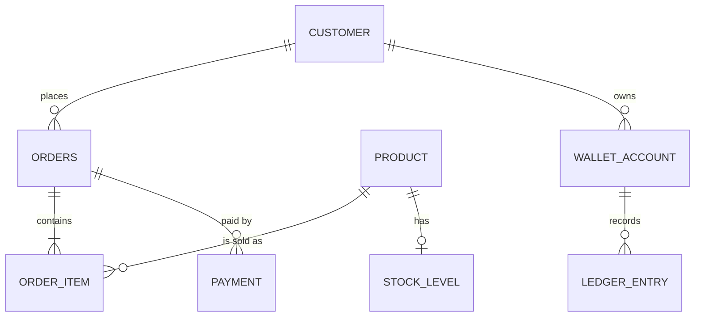
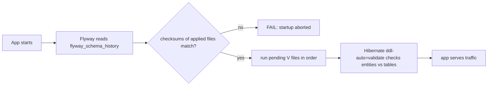
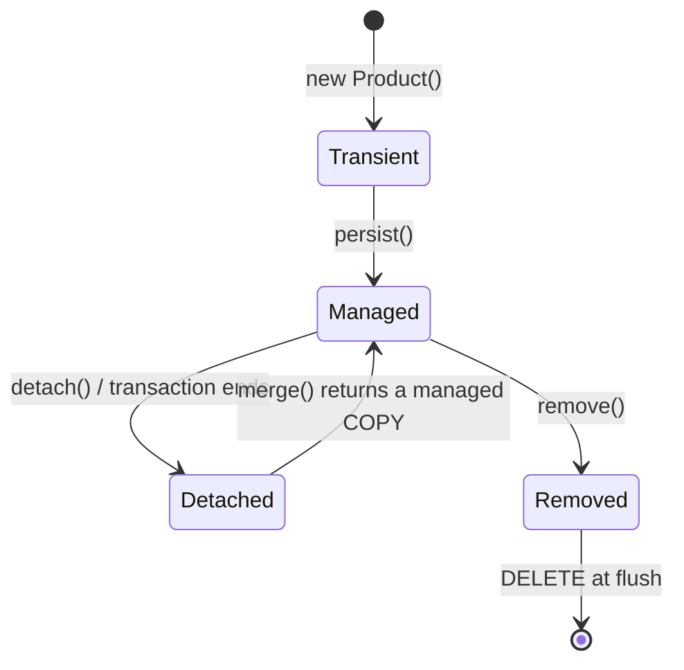
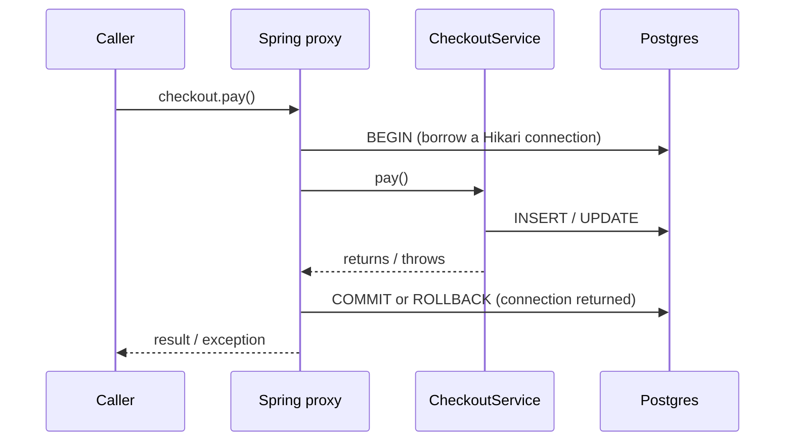
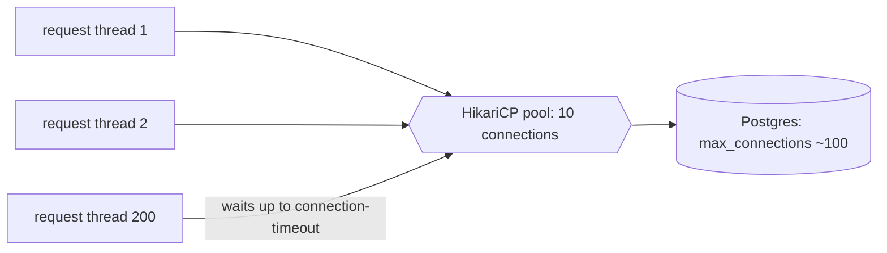

# Session 3 - Databases, SQL, JPA, transactions and concurrency (from zero)

Goal: by the end you can read and write the SQL behind every endpoint, prove an index helps with `EXPLAIN (ANALYZE, BUFFERS)`, manage the schema with Flyway, use Spring Data JPA without being surprised by what Hibernate does, spot and fix N+1 queries, reason about `@Transactional`, isolation levels, locks, deadlocks and connection pools, and make writes idempotent. This is the most important session for owning a backend: almost every production incident is a slow query, a wrong transaction boundary, a lost update or an exhausted connection pool.

**Real-world backend work this maps to:** an e-commerce/fulfilment backend (`com.example.shopflow`): product catalogue and order history screens (indexes, pagination, N+1 on Order -> OrderItems -> Product), flash-sale stock (lost update / overselling), wallet and ledger transfers (deadlocks, double entry), checkout with a payment gateway (transaction boundaries, connection pool), idempotent order creation and payment-provider webhooks, soft-deleted products, and zero-downtime schema changes.

Stack (identical for every session): Java 21, Maven 3.9, Spring Boot 4.0.8 (Spring Framework 7, Hibernate ORM 7.2), PostgreSQL 17, Flyway 11, Testcontainers 2.x. Everything below was built and run against a real PostgreSQL in Docker. Outputs are real (trimmed). Timings and thread-race counts differ on your machine; the shape is what matters.

---

## How to use this article

1. Create a Maven project `shopflow` (or add to your running one) with the `pom.xml` in section 1. Package `com.example.shopflow`. Docker Desktop must be running: the tests start a throw-away PostgreSQL with Testcontainers on a random port, so nothing on your machine is touched.
2. Copy each file to the path in its `// file:` header. Run the test shown above each output with `mvn test -Dtest=ClassName`. Expected output is in a `text` block. If yours differs, stop and find out why before moving on.
3. For the few demos that need a running app (Flyway checksum failure, the open-in-view warning) start your own Postgres: `docker run --name shopflow-pg -e POSTGRES_USER=shopflow -e POSTGRES_PASSWORD=shopflow -e POSTGRES_DB=shopflow -p 5432:5432 -d postgres:17-alpine`, then `mvn spring-boot:run`.
4. Do the "Try it" lines. Breaking things on purpose is the fastest way to learn what each setting does.
5. Finish with the Practice tasks. The work task at the end is to review your own company's repository layer.

## Topics

| # | Topic | You will be able to |
|---|-------|---------------------|
| 1 | Project, Testcontainers, SQL logging | Run integration tests on real Postgres and see every SQL statement and statement count |
| 2 | SQL fluency | Joins, GROUP BY/HAVING, window functions, top-N, anti-join |
| 3 | Indexes + EXPLAIN | Prove Seq Scan -> Index Scan, pick composite column order, covering and partial indexes |
| 4 | Data modelling | Normalisation, FKs, UNIQUE/CHECK, timestamptz, money as integer cents |
| 5 | Flyway | Versioned migrations, checksum failure, `ddl-auto=validate`, Boot 4 starter names |
| 6 | Spring Data JPA | Entities, derived/JPQL/native queries, projections, Page vs Slice, embedded, enum, auditing |
| 7 | Hibernate internals | Persistence context, entity states, dirty checking, flush modes, equals/hashCode |
| 8 | Lazy loading and N+1 | Reproduce, count and fix N+1; LazyInitializationException; open-in-view; fetch-join pitfalls |
| 9 | `@Transactional` | Propagation, rollback rules, readOnly, self-invocation, TransactionTemplate, scope |
| 10 | Isolation levels | Non-repeatable read, snapshot, write skew on two real connections |
| 11 | Concurrency control | Lost update on stock, fixed 3 ways; deadlock and lock ordering |
| 12 | HikariCP | Pool sizing, exhaustion, leak detection, slow call inside a transaction |
| 13 | Idempotent writes | ON CONFLICT, idempotency-key table, retry gotcha (aborted transaction) |
| 14 | JdbcClient | Bulk inserts and reporting queries |
| 15 | Soft delete | `@SQLRestriction` / `@SQLDelete` + partial unique index |
| 16 | Outbox, expand/contract | Write events atomically; rename a column with zero downtime |
| 17 | The full slice + review checklist | Audit a real repository layer |

---

## 1. Project, Testcontainers and SQL logging

Plain-language idea: tests that talk to H2 lie to you (different SQL dialect, different locking, different types). We run the real database in a container for the test and throw it away afterwards.

```xml
<!-- file: pom.xml -->
<?xml version="1.0" encoding="UTF-8"?>
<project xmlns="http://maven.apache.org/POM/4.0.0" xmlns:xsi="http://www.w3.org/2001/XMLSchema-instance"
         xsi:schemaLocation="http://maven.apache.org/POM/4.0.0 https://maven.apache.org/xsd/maven-4.0.0.xsd">
  <modelVersion>4.0.0</modelVersion>
  <parent>
    <groupId>org.springframework.boot</groupId>
    <artifactId>spring-boot-starter-parent</artifactId>
    <version>4.0.8</version>
    <relativePath/>
  </parent>
  <groupId>com.example</groupId>
  <artifactId>shopflow</artifactId>
  <version>0.0.1-SNAPSHOT</version>
  <properties><java.version>21</java.version></properties>
  <dependencies>
    <dependency><groupId>org.springframework.boot</groupId><artifactId>spring-boot-starter-webmvc</artifactId></dependency>
    <dependency><groupId>org.springframework.boot</groupId><artifactId>spring-boot-starter-data-jpa</artifactId></dependency>
    <dependency><groupId>org.springframework.boot</groupId><artifactId>spring-boot-starter-flyway</artifactId></dependency>
    <dependency><groupId>org.flywaydb</groupId><artifactId>flyway-database-postgresql</artifactId></dependency>
    <dependency><groupId>org.postgresql</groupId><artifactId>postgresql</artifactId><scope>runtime</scope></dependency>

    <dependency><groupId>org.springframework.boot</groupId><artifactId>spring-boot-starter-data-jpa-test</artifactId><scope>test</scope></dependency>
    <dependency><groupId>org.springframework.boot</groupId><artifactId>spring-boot-starter-webmvc-test</artifactId><scope>test</scope></dependency>
    <dependency><groupId>org.springframework.boot</groupId><artifactId>spring-boot-testcontainers</artifactId><scope>test</scope></dependency>
    <dependency><groupId>org.testcontainers</groupId><artifactId>testcontainers-junit-jupiter</artifactId><scope>test</scope></dependency>
    <dependency><groupId>org.testcontainers</groupId><artifactId>testcontainers-postgresql</artifactId><scope>test</scope></dependency>
  </dependencies>
  <build>
    <plugins>
      <plugin><groupId>org.springframework.boot</groupId><artifactId>spring-boot-maven-plugin</artifactId></plugin>
    </plugins>
  </build>
</project>
```

> If your company is on Spring Boot 3.x: use `spring-boot-starter-web` (not `-webmvc`), plain `spring-boot-starter-test` (no `-data-jpa-test` / `-webmvc-test`), `org.flywaydb:flyway-core` (there is no `spring-boot-starter-flyway`; keep `flyway-database-postgresql` on Flyway 10+), and Testcontainers `org.testcontainers:postgresql` + `org.testcontainers:junit-jupiter` (Boot 4 uses Testcontainers 2.x artifact names `testcontainers-postgresql` / `testcontainers-junit-jupiter`).

```yaml
# file: src/main/resources/application.yml
spring:
  datasource:
    url: jdbc:postgresql://localhost:5432/shopflow
    username: shopflow
    password: shopflow
  jpa:
    open-in-view: false          # section 8: turn the default OFF
    hibernate:
      ddl-auto: validate         # section 5: Hibernate checks, Flyway changes
    properties:
      hibernate:
        jdbc:
          time_zone: UTC
```

Tests do not use that URL: `@ServiceConnection` rewrites the datasource to the container.

```java
// file: src/main/java/com/example/shopflow/ShopflowApplication.java
package com.example.shopflow;

import org.springframework.boot.SpringApplication;
import org.springframework.boot.autoconfigure.SpringBootApplication;

@SpringBootApplication
public class ShopflowApplication {
    public static void main(String[] args) { SpringApplication.run(ShopflowApplication.class, args); }
}
```

```java
// file: src/test/java/com/example/shopflow/PgConfig.java
package com.example.shopflow;

import org.springframework.boot.test.context.TestConfiguration;
import org.springframework.boot.testcontainers.service.connection.ServiceConnection;
import org.springframework.context.annotation.Bean;
import org.testcontainers.postgresql.PostgreSQLContainer;

@TestConfiguration(proxyBeanMethods = false)
class PgConfig {
    @Bean
    @ServiceConnection                       // wires spring.datasource.* to the random container port
    PostgreSQLContainer postgres() { return new PostgreSQLContainer("postgres:17-alpine"); }
}
```

> If your company is on Spring Boot 3.x: the container class is `org.testcontainers.containers.PostgreSQLContainer<?>` (generic): `new PostgreSQLContainer<>("postgres:17-alpine")`.

The base class every test below extends. It turns on Hibernate statistics (so we can count statements), keeps the SQL log OFF by default (so setup noise does not drown the demo) and gives helpers to switch it on around the code under study.

```java
// file: src/test/java/com/example/shopflow/AbstractPgTest.java
package com.example.shopflow;

import jakarta.persistence.EntityManagerFactory;
import org.hibernate.SessionFactory;
import org.hibernate.stat.Statistics;
import org.springframework.beans.factory.annotation.Autowired;
import org.springframework.boot.logging.LogLevel;
import org.springframework.boot.logging.LoggingSystem;
import org.springframework.boot.test.context.SpringBootTest;
import org.springframework.context.annotation.Import;
import org.springframework.jdbc.core.simple.JdbcClient;
import org.springframework.transaction.support.TransactionTemplate;

@SpringBootTest(properties = {
        "spring.jpa.properties.hibernate.generate_statistics=true",
        "logging.level.root=WARN",
        "logging.level.org.hibernate.SQL=OFF",
        "logging.pattern.console=%msg%n",
        "spring.main.banner-mode=off"
})
@Import(PgConfig.class)
abstract class AbstractPgTest {

    @Autowired protected EntityManagerFactory emf;
    @Autowired protected JdbcClient jdbc;
    @Autowired protected TransactionTemplate tx;

    protected Statistics stats() { return emf.unwrap(SessionFactory.class).getStatistics(); }

    protected void say(String s) { System.out.println("\n=== " + s); }

    /** SQL log on only around the code we want to look at. */
    protected void sql(boolean on) {
        LoggingSystem.get(getClass().getClassLoader())
                .setLogLevel("org.hibernate.SQL", on ? LogLevel.DEBUG : LogLevel.OFF);
    }

    protected void reset() {
        jdbc.sql("""
                truncate ledger_entry, wallet_account, audit_log, idempotency_key, webhook_event, outbox_event,
                         payment, order_item, orders, stock_level, product, customer restart identity cascade
                """).update();
    }

    protected void customers(int n) {
        jdbc.sql("insert into customer(email, name) select 'u' || g || '@example.com', 'User ' || g from generate_series(1, :n) g")
                .param("n", n).update();
    }

    /** 10 products, N orders (customer 1), each order has itemsPerOrder items. */
    protected void seedShop(int orders, int itemsPerOrder) {
        reset();
        customers(3);
        jdbc.sql("insert into product(sku, name, category, price_cents) select 'SKU-' || g, 'Gadget ' || g, 'gadgets', 1000 * g from generate_series(1, 10) g").update();
        jdbc.sql("insert into orders(order_number, customer_id, status, total_cents) select 'ORD-' || g, 1, 'PENDING', 0 from generate_series(1, :n) g")
                .param("n", orders).update();
        jdbc.sql("insert into order_item(order_id, product_id, quantity, unit_price_cents) select o.id, p.id, 1, p.price_cents from orders o join product p on p.id <= :k")
                .param("k", itemsPerOrder).update();
    }
}
```

Hibernate logs SQL at DEBUG on the logger `org.hibernate.SQL`; that is the only logger you need. Do NOT use `spring.jpa.show-sql=true` in real code (prints to stdout, no logger control). `generate_statistics=true` gives `getPrepareStatementCount()`: the number we use to prove N+1.

Pitfall: the SQL log shows `?` placeholders. The bound values come from `logging.level.org.hibernate.orm.jdbc.bind=TRACE` (not run here).

React/Express equivalent: Testcontainers is "spin up the real backend in the test instead of mocking fetch". C++ equivalent: an integration test with a real sqlite/postgres instead of a mock.

---

## 2. SQL you must be fluent in

You cannot use JPA well if you cannot read the SQL it generates. Schema used from here on (the Flyway files are in section 5):



To follow along with realistic volume, seed `customer` (1000 rows), `product` (2000), `orders` (200,000) and `order_item` (600,000) with `generate_series`. Do this in a scratch database (not a Testcontainers one) because the EXPLAIN section needs volume. The seed (run with psql after the Flyway migrations of section 5 were applied):

```sql
-- file: seed.sql   (run: psql -U shopflow -d shopflow -f seed.sql)
INSERT INTO customer(email, name)
SELECT 'user' || g || '@example.com', 'User ' || g FROM generate_series(1, 1000) g;

INSERT INTO product(sku, name, category, price_cents)
SELECT 'SKU-' || g, 'Product ' || g,
       (ARRAY['phones','books','toys','kitchen','garden'])[1 + g % 5],
       (500 + (random() * 99500))::bigint
FROM generate_series(1, 2000) g;

INSERT INTO orders(order_number, customer_id, status, total_cents, created_at)
SELECT 'ORD-' || lpad(g::text, 8, '0'),
       1 + (random() * 999)::int,
       (ARRAY['PENDING','PAID','SHIPPED','CANCELLED'])[1 + (random() * 3)::int],
       (1000 + random() * 500000)::bigint,
       now() - (random() * interval '365 days')
FROM generate_series(1, 200000) g;

INSERT INTO order_item(order_id, product_id, quantity, unit_price_cents)
SELECT o.id, 1 + (random() * 1999)::int, 1 + (random() * 3)::int, (500 + random() * 99500)::bigint
FROM orders o, generate_series(1, 3);

ANALYZE;
```

(Seeding 600k rows took a few minutes through a docker exec pipe on my machine; use `psql -f` directly for speed. Your numbers will differ because of `random()`.)

### 2.1 JOIN: which customer bought what

```sql
SELECT o.order_number, c.email, count(i.id) AS items, o.total_cents
FROM orders o JOIN customer c ON c.id = o.customer_id JOIN order_item i ON i.order_id = o.id
WHERE o.id IN (1, 2, 3) GROUP BY o.id, c.email ORDER BY o.id;
```

```text
 order_number |       email       | items | total_cents
--------------+-------------------+-------+-------------
 ORD-00000001 | user2@example.com |     3 |      351892
 ORD-00000002 | user3@example.com |     3 |      336739
 ORD-00000003 | user4@example.com |     3 |      317522
```

`JOIN` (inner) keeps only rows that match on both sides. `LEFT JOIN` keeps every left row, with NULLs when there is no match.

### 2.2 LEFT JOIN + IS NULL: "customers with no order in the last 7 days" (anti-join)

```sql
SELECT count(*) AS customers_without_orders_last_7d
FROM customer c LEFT JOIN orders o ON o.customer_id = c.id AND o.created_at > now() - interval '7 days'
WHERE o.id IS NULL;
```

```text
 customers_without_orders_last_7d
----------------------------------
                               20
```

The date filter is in the `ON` clause on purpose. If you put it in `WHERE`, you filter away the NULL rows and the LEFT JOIN silently becomes an inner join (a very common bug). `NOT EXISTS (SELECT 1 FROM orders ...)` is the equivalent and often clearer. Never use `NOT IN (subquery)` when the subquery column can be NULL: it returns no rows at all.

### 2.3 GROUP BY and HAVING: best customers

`WHERE` filters rows before grouping; `HAVING` filters groups after.

```sql
SELECT c.email, count(*) AS orders, sum(o.total_cents) / 100.0 AS revenue
FROM orders o JOIN customer c ON c.id = o.customer_id
WHERE o.status <> 'CANCELLED'
GROUP BY c.id HAVING count(*) > 170 ORDER BY revenue DESC LIMIT 3;
```

```text
        email        | orders |       revenue
---------------------+--------+---------------------
 user35@example.com  |    177 | 867660.360000000000
 user934@example.com |    178 | 858183.870000000000
 user163@example.com |    178 | 832485.920000000000
```

### 2.4 Top-N: best sellers

```sql
SELECT p.name, sum(i.quantity) AS units FROM order_item i JOIN product p ON p.id = i.product_id
GROUP BY p.id ORDER BY units DESC, p.id LIMIT 5;
```

```text
     name     | units
--------------+-------
 Product 217  |   640
 Product 878  |   637
 Product 1578 |   637
 Product 905  |   636
 Product 827  |   635
```

Always add a tiebreaker (`p.id`) to `ORDER BY` with `LIMIT`, otherwise page 1 and page 2 can overlap or skip rows.

### 2.5 Window functions: top 2 products per category

A window function computes over a set of related rows without collapsing them into one row (unlike GROUP BY).

```sql
SELECT category, name, revenue, rnk FROM (
  SELECT p.category, p.name, sum(i.quantity * i.unit_price_cents) / 100.0 AS revenue,
         rank() OVER (PARTITION BY p.category ORDER BY sum(i.quantity * i.unit_price_cents) DESC) AS rnk
  FROM order_item i JOIN product p ON p.id = i.product_id GROUP BY p.id) t
WHERE rnk <= 2 ORDER BY category, rnk;
```

```text
 category |     name     |       revenue       | rnk
----------+--------------+---------------------+-----
 books    | Product 1000 | 612710.600000000000 |   1
 books    | Product 585  | 612225.540000000000 |   2
 garden   | Product 1339 | 625037.300000000000 |   1
 garden   | Product 1364 | 608293.560000000000 |   2
 kitchen  | Product 612  | 614531.600000000000 |   1
 kitchen  | Product 1762 | 607315.670000000000 |   2
 ...
```

Running total and "latest row per group" are the other two window patterns you will write weekly:

```sql
SELECT day, revenue, sum(revenue) OVER (ORDER BY day) AS running FROM (
  SELECT created_at::date AS day, sum(total_cents) / 100.0 AS revenue FROM orders GROUP BY 1 ORDER BY 1 LIMIT 5) d;

SELECT customer_id, order_number, created_at FROM (
  SELECT customer_id, order_number, created_at,
         row_number() OVER (PARTITION BY customer_id ORDER BY created_at DESC) AS rn
  FROM orders WHERE customer_id <= 3) t WHERE rn = 1 ORDER BY customer_id;
```

```text
    day     |       revenue        |       running
------------+----------------------+----------------------
 2025-10-19 | 1416573.400000000000 | 1416573.400000000000
 2025-10-20 | 1614786.270000000000 | 3031359.670000000000
 2025-10-21 | 1815405.000000000000 | 4846764.670000000000

 customer_id | order_number |          created_at
-------------+--------------+-------------------------------
           1 | ORD-00030000 | 2026-10-13 20:48:26.000677+00
           2 | ORD-00122001 | 2026-10-19 00:20:43.169651+00
           3 | ORD-00199002 | 2026-10-18 20:51:09.677746+00
```

`rank()` leaves gaps after ties, `dense_rank()` does not, `row_number()` never ties (use it for "exactly one latest row").

Try it: change `rank()` to `row_number()` in 2.5 and add a duplicate-revenue product; see the difference. Remove the `ON`-clause date filter into `WHERE` in 2.2 and watch the answer become 0.

---

## 3. Indexes and `EXPLAIN (ANALYZE, BUFFERS)`

An index is a sorted side-structure (a B-tree) that lets the database jump to rows instead of reading the whole table. Without it Postgres does a sequential scan: read every page. Rule: you measure with EXPLAIN, you do not guess.

How to read a plan: it is a tree, read from the innermost/most-indented node outwards. `cost=` is the planner's estimate; `actual time=` and `rows=` are real; `Buffers: shared hit=N` is the number of 8 KB pages read from cache (read = from disk). Fewer buffers = less work. A big gap between estimated and actual rows means stale statistics (`ANALYZE`).

### 3.1 Seq Scan -> Index Scan: look up an order by its number

`orders.order_number` is `UNIQUE`, so Postgres already created an index for it.

```sql
EXPLAIN (ANALYZE, BUFFERS) SELECT id, status, total_cents FROM orders WHERE order_number = 'ORD-123456';
```

```text
 Index Scan using orders_order_number_key on orders  (cost=0.42..8.44 rows=1 width=23) (actual time=0.365..0.366 rows=0 loops=1)
   Index Cond: ((order_number)::text = 'ORD-123456'::text)
   Buffers: shared hit=3
 Execution Time: 0.472 ms
```

Now the same query WITHOUT the index. DDL is transactional in Postgres, so we can drop it inside a transaction and `ROLLBACK`:

```sql
BEGIN;
ALTER TABLE orders DROP CONSTRAINT orders_order_number_key;
EXPLAIN (ANALYZE, BUFFERS) SELECT id, status, total_cents FROM orders WHERE order_number = 'ORD-123456';
ROLLBACK;
```

```text
 Gather  (cost=1000.00..7825.77 rows=1 width=23) (actual time=122.074..131.831 rows=0 loops=1)
   Workers Planned: 2
   Workers Launched: 2
   Buffers: shared hit=5784
   ->  Parallel Seq Scan on orders  (cost=0.00..6825.67 rows=1 width=23) (actual time=106.598..106.599 rows=0 loops=3)
         Filter: ((order_number)::text = 'ORD-123456'::text)
         Rows Removed by Filter: 66667
         Buffers: shared hit=5784
 Execution Time: 131.902 ms
```

3 buffers vs 5,784 buffers; 0.47 ms vs 132 ms (even with 3 parallel workers). That gap grows linearly with table size: at 20 million rows the scan is minutes. "It was fast in dev" is the 200-rows-in-dev trap.

### 3.2 Composite index and column order: "my orders" screen

The query behind a customer's order history: filter by customer, newest first, top 20.

```sql
SELECT id, order_number, total_cents, created_at FROM orders
WHERE customer_id = 42 AND status <> 'CANCELLED' ORDER BY created_at DESC LIMIT 20;
```

| Index | Plan | Time | Buffers |
|-------|------|------|---------|
| none | Parallel Seq Scan + top-N Sort | 39.4 ms | 5858 |
| `(customer_id)` | Bitmap Index Scan + Heap Scan + Sort | 1.05 ms | 198+3 |
| `(customer_id, created_at DESC)` | Index Scan, no Sort node | 0.19 ms | 20+3 |

The first two plans:

```text
-- no index
 Limit  (actual time=27.447..39.288 rows=20)
   ->  Gather Merge ...
         ->  Sort  (Sort Key: created_at DESC, Sort Method: top-N heapsort)
               ->  Parallel Seq Scan on orders  (Rows Removed by Filter: 66607)
 Execution Time: 39.433 ms

-- index on (customer_id): still reads ~200 rows and sorts them
 Limit  (actual time=0.829..0.835 rows=20)
   ->  Sort  (Sort Key: created_at DESC)
         ->  Bitmap Heap Scan on orders  (Heap Blocks: exact=195)
               ->  Bitmap Index Scan on ix_tmp_customer
 Execution Time: 1.049 ms
```

With `(customer_id, created_at DESC)` the index is already in the order we want, so Postgres reads exactly 20 entries and stops:

```text
 Limit  (cost=0.42..89.90 rows=20 width=37) (actual time=0.101..0.149 rows=20 loops=1)
   ->  Index Scan using ix_tmp_cc on orders  (actual time=0.099..0.143 rows=20 loops=1)
         Index Cond: (customer_id = 42)
         Filter: ((status)::text <> 'CANCELLED'::text)
         Buffers: shared hit=20 read=3
 Execution Time: 0.191 ms
```

**Column order matters.** The rule of thumb: equality columns first, then the range/sort column. An index on `(created_at, customer_id)` cannot be used to look up one customer. For `WHERE customer_id = 42` Postgres had to scan the whole index:

```text
 Bitmap Heap Scan on orders  (actual time=23.862..24.083 rows=200)
   ->  Bitmap Index Scan on ix_tmp_wrong  (actual time=23.808..23.809 rows=200)
         Buffers: shared read=769
 Execution Time: 24.143 ms
```

769 pages to find 200 rows, versus 3. Think of a phone book sorted by (city, surname): useless for "all surnames Patel" without the city.

### 3.3 Covering index (Index Only Scan) and partial index

If the index contains every column the query needs, Postgres never touches the table (`INCLUDE` adds payload columns that are not part of the sort key). Combined with a `WHERE` (partial index) it also stays small:

```sql
CREATE INDEX ix_orders_customer_cover ON orders (customer_id, created_at DESC)
    INCLUDE (order_number, total_cents) WHERE status <> 'CANCELLED';
VACUUM orders;   -- sets the visibility map so an Index Only Scan can skip the heap
EXPLAIN (ANALYZE, BUFFERS) SELECT order_number, total_cents, created_at FROM orders
WHERE customer_id = 42 AND status <> 'CANCELLED' ORDER BY created_at DESC LIMIT 20;
```

```text
 Limit  (actual time=0.314..0.320 rows=20 loops=1)
   ->  Index Only Scan using ix_orders_customer_cover on orders  (actual time=0.312..0.315 rows=20 loops=1)
         Index Cond: (customer_id = 42)
         Heap Fetches: 0
         Buffers: shared hit=4
 Execution Time: 0.373 ms
```

`Heap Fetches: 0` and 4 buffers. The price is index size: `ix_orders_customer` 1352 kB, `(customer_id, created_at)` 6184 kB, the covering one 10232 kB (and `order_number` UNIQUE alone is 12 MB). Every index slows INSERT/UPDATE and costs disk and cache; add one per proven query, not per column.

A partial index for the fulfilment worker ("oldest PENDING orders first") indexes only the hot subset:

```sql
CREATE INDEX ix_orders_pending ON orders (created_at) WHERE status = 'PENDING';
EXPLAIN (ANALYZE, BUFFERS) SELECT id, order_number FROM orders WHERE status = 'PENDING' ORDER BY created_at LIMIT 50;
```

```text
 Limit  (actual time=0.138..0.244 rows=50 loops=1)
   ->  Index Scan using ix_orders_pending on orders  (rows=50)
         Buffers: shared hit=52
 Execution Time: 0.280 ms
```

That index is 504 kB instead of megabytes because 3 of 4 statuses are not in it. The query must repeat the predicate (`status = 'PENDING'`) for the planner to use it.

### 3.4 Things that stop an index being used

| Pattern | Why | Fix |
|---------|-----|-----|
| `WHERE lower(email) = ...` | function on the column | index on `lower(email)` |
| `WHERE name LIKE '%mug'` | leading wildcard | trigram index (`pg_trgm`) or search engine |
| `WHERE id::text = '5'` | implicit cast | compare same types |
| `ORDER BY x OFFSET 100000` | still reads 100k rows | keyset pagination: `WHERE (created_at, id) < (:c, :i) ORDER BY created_at DESC, id DESC LIMIT 20` |
| Very low selectivity (`status` with 4 values) | scan is cheaper | partial index or combine with a selective column |
| Stale statistics | wrong row estimates | `ANALYZE` (autovacuum does it normally) |

Always index foreign key columns you join/filter on (`order_item.order_id`): Postgres does NOT create an index for an FK automatically, and a missing one makes every "items of this order" lookup and every parent delete a full scan.

Try it: run `EXPLAIN` (without ANALYZE) vs with ANALYZE. Careful: `EXPLAIN ANALYZE` really executes the statement, so wrap `UPDATE`/`DELETE` in `BEGIN ... ROLLBACK`.

HLD notes to read alongside: `B2-Indexes.md`.

C++ equivalent: choosing `std::map` vs scanning a `std::vector`, except the "map" is on disk and has to be kept in sync on every write.

---

## 4. Data modelling: constraints are your last line of defence

Application code has bugs, runs on several instances and gets replaced; the database outlives all of it. Put every rule the data must obey into the schema.

| Concern | Do | Don't |
|---------|----|-------|
| Normalisation | One fact in one place: `order_item.product_id` + `unit_price_cents` (a deliberate snapshot of the price at purchase time) | Copy customer name/address into every row without a reason |
| Keys | `bigint GENERATED ALWAYS AS IDENTITY` primary key; natural business keys (`order_number`, `sku`) as `UNIQUE` | Business key as primary key (they change) |
| Foreign keys | Declare them: `customer_id bigint NOT NULL REFERENCES customer(id)` | "We enforce it in code" |
| Rules | `CHECK (price_cents >= 0)`, `CHECK (quantity > 0)`, status `CHECK (status IN (...))` | Validate only in the controller |
| Time | `timestamptz` (stores an instant, converts on display) | `timestamp` (drops the zone) |
| Money | `bigint` integer cents (+ `currency`), or `numeric(19,4)` | `float` / `double` |

Constraints failing, with real messages:

```sql
INSERT INTO product(sku, name, category, price_cents) VALUES ('SKU-NEW', 'A', 'toys', 100);
INSERT INTO product(sku, name, category, price_cents) VALUES ('SKU-NEW', 'B', 'toys', 100);
```

```text
ERROR:  duplicate key value violates unique constraint "uq_product_sku_alive"
DETAIL:  Key (sku)=(SKU-NEW) already exists.
```

```sql
INSERT INTO product(sku, name, category, price_cents) VALUES ('SKU-NEG', 'C', 'toys', -5);
INSERT INTO orders(order_number, customer_id, status, total_cents) VALUES ('X', 999999, 'PENDING', 0);
```

```text
ERROR:  new row for relation "product" violates check constraint "ck_product_price"
ERROR:  insert or update on table "orders" violates foreign key constraint "orders_customer_id_fkey"
```

`timestamptz` vs `timestamp`, and `float` vs `numeric` (why money is never a float):

```sql
SET TIME ZONE 'Asia/Kolkata';
SELECT '2026-10-19 12:00:00+00'::timestamptz AS tz, '2026-10-19 12:00:00+00'::timestamp AS plain;
SELECT 0.1::float8 + 0.2::float8 AS float_sum, 0.1::numeric + 0.2::numeric AS numeric_sum;
```

```text
           tz           |        plain
------------------------+---------------------
 2026-10-19 17:30:00+05:30 | 2026-10-19 12:00:00     <- the plain timestamp silently lost its zone

     float_sum       | numeric_sum
---------------------+-------------
 0.30000000000000004 |         0.3
```

Java side: `Instant` <-> `timestamptz`, `long` cents <-> `bigint`, `BigDecimal` <-> `numeric`. With `hibernate.jdbc.time_zone=UTC` (in our yml) every instant is written in UTC.

Why an integer-cents `price_cents` plus a copy in `order_item.unit_price_cents`? The product price will change next month; the order must keep what the customer actually paid. That duplication is intentional denormalisation of a historical fact, not a modelling mistake.

HLD notes to read alongside: `B1-Data-Models-DB-Choice.md`.

---

## 5. Flyway: the schema is code

Plain idea: SQL files named `V<version>__<description>.sql` live in `src/main/resources/db/migration`. At startup Flyway compares them with its `flyway_schema_history` table, runs the new ones in order, and stores a checksum of each applied file. Everyone (laptop, CI, prod) gets the same schema, and history is in git.



```sql
-- file: src/main/resources/db/migration/V1__init.sql
CREATE TABLE customer (
    id          bigint GENERATED ALWAYS AS IDENTITY PRIMARY KEY,
    email       text         NOT NULL UNIQUE,
    name        text         NOT NULL,
    created_at  timestamptz  NOT NULL DEFAULT now()
);

CREATE TABLE product (
    id           bigint GENERATED ALWAYS AS IDENTITY PRIMARY KEY,
    sku          varchar(32)  NOT NULL,
    name         text         NOT NULL,
    category     varchar(32)  NOT NULL,
    price_cents  bigint       NOT NULL,
    currency     varchar(3)   NOT NULL DEFAULT 'INR',
    created_at   timestamptz  NOT NULL DEFAULT now(),
    updated_at   timestamptz  NOT NULL DEFAULT now(),
    deleted_at   timestamptz,
    CONSTRAINT ck_product_price CHECK (price_cents >= 0)
);
-- a SKU must be unique only among products that are not soft-deleted (section 15)
CREATE UNIQUE INDEX uq_product_sku_alive ON product (sku) WHERE deleted_at IS NULL;

CREATE TABLE stock_level (
    product_id  bigint PRIMARY KEY REFERENCES product(id),
    quantity    integer      NOT NULL,
    updated_at  timestamptz  NOT NULL DEFAULT now(),
    CONSTRAINT ck_stock_quantity CHECK (quantity >= 0)
);

CREATE TABLE orders (                      -- "order" is a reserved SQL word
    id            bigint GENERATED ALWAYS AS IDENTITY PRIMARY KEY,
    order_number  varchar(20)  NOT NULL UNIQUE,
    customer_id   bigint       NOT NULL REFERENCES customer(id),
    status        varchar(16)  NOT NULL DEFAULT 'PENDING',
    total_cents   bigint       NOT NULL,
    currency      varchar(3)   NOT NULL DEFAULT 'INR',
    created_at    timestamptz  NOT NULL DEFAULT now(),
    updated_at    timestamptz  NOT NULL DEFAULT now(),
    CONSTRAINT ck_orders_status CHECK (status IN ('PENDING', 'PAID', 'SHIPPED', 'CANCELLED')),
    CONSTRAINT ck_orders_total  CHECK (total_cents >= 0)
);

CREATE TABLE order_item (
    id               bigint GENERATED ALWAYS AS IDENTITY PRIMARY KEY,
    order_id         bigint  NOT NULL REFERENCES orders(id),
    product_id       bigint  NOT NULL REFERENCES product(id),
    quantity         integer NOT NULL,
    unit_price_cents bigint  NOT NULL,
    CONSTRAINT ck_item_quantity CHECK (quantity > 0)
);
CREATE INDEX ix_order_item_order ON order_item (order_id);      -- Postgres does not index FKs for you

CREATE TABLE payment (
    id            bigint GENERATED ALWAYS AS IDENTITY PRIMARY KEY,
    order_id      bigint       NOT NULL REFERENCES orders(id),
    amount_cents  bigint       NOT NULL,
    status        varchar(16)  NOT NULL,
    provider_ref  varchar(64)  UNIQUE,
    created_at    timestamptz  NOT NULL DEFAULT now(),
    CONSTRAINT ck_payment_amount CHECK (amount_cents > 0)
);
CREATE INDEX ix_payment_order ON payment (order_id);
```

```sql
-- file: src/main/resources/db/migration/V2__locks_wallet_audit_idempotency.sql
ALTER TABLE stock_level ADD COLUMN version bigint NOT NULL DEFAULT 0;        -- for @Version (section 11)

ALTER TABLE orders
    ADD COLUMN version          bigint NOT NULL DEFAULT 0,
    ADD COLUMN ship_line1       varchar(120),
    ADD COLUMN ship_city        varchar(60),
    ADD COLUMN ship_postal_code varchar(16),
    ADD COLUMN ship_country     varchar(2);

CREATE TABLE wallet_account (
    id             bigint GENERATED ALWAYS AS IDENTITY PRIMARY KEY,
    customer_id    bigint  NOT NULL REFERENCES customer(id),
    balance_cents  bigint  NOT NULL DEFAULT 0,
    CONSTRAINT ck_wallet_balance CHECK (balance_cents >= 0)
);

-- double entry: every transfer writes one debit (-) and one credit (+) row that sum to zero
CREATE TABLE ledger_entry (
    id           bigint GENERATED ALWAYS AS IDENTITY PRIMARY KEY,
    transfer_id  uuid    NOT NULL,
    account_id   bigint  NOT NULL REFERENCES wallet_account(id),
    amount_cents bigint  NOT NULL,
    created_at   timestamptz NOT NULL DEFAULT now(),
    CONSTRAINT ck_ledger_nonzero CHECK (amount_cents <> 0)
);

CREATE TABLE audit_log (
    id          bigint GENERATED ALWAYS AS IDENTITY PRIMARY KEY,
    action      varchar(64)  NOT NULL,
    detail      text,
    created_at  timestamptz  NOT NULL DEFAULT now()
);

CREATE TABLE idempotency_key (
    key           varchar(64) PRIMARY KEY,
    request_hash  varchar(64) NOT NULL,
    order_id      bigint      REFERENCES orders(id),
    created_at    timestamptz NOT NULL DEFAULT now()
);

CREATE TABLE webhook_event (
    provider_event_id  varchar(64) PRIMARY KEY,
    type               varchar(64) NOT NULL,
    received_at        timestamptz NOT NULL DEFAULT now()
);

CREATE TABLE outbox_event (
    id            bigint GENERATED ALWAYS AS IDENTITY PRIMARY KEY,
    aggregate_id  bigint       NOT NULL,
    type          varchar(64)  NOT NULL,
    payload       text         NOT NULL,
    created_at    timestamptz  NOT NULL DEFAULT now(),
    published_at  timestamptz
);
```

Start the app against an empty database (the `docker run` command from "How to use"). Real startup log:

```text
Database: jdbc:postgresql://localhost:32768/fly (PostgreSQL 17.11)
Schema history table "public"."flyway_schema_history" does not exist yet
Successfully validated 2 migrations
Creating Schema History table "public"."flyway_schema_history" ...
Current version of schema "public": << Empty Schema >>
Migrating schema "public" to version "1 - init"
Migrating schema "public" to version "2 - locks wallet audit idempotency"
Successfully applied 2 migrations to schema "public", now at version v2
HHH000001: Hibernate ORM core version 7.2.24.Final
Started ShopflowApplication
```

(The DB name and port in that line are from my scratch container; yours says `localhost:5432/shopflow`.)

### 5.1 Break it: edit an applied migration

Add one comment line to the top of `V1__init.sql` (a "harmless" edit) and restart:

```text
Caused by: org.springframework.beans.factory.BeanCreationException: Error creating bean with name 'flywayInitializer' ...: Validate failed: Migrations have failed validation
Migration checksum mismatch for migration version 1
-> Applied to database : 1313070927
-> Resolved locally    : -954305417
Either revert the changes to the migration, or run repair to update the schema history.
```

The app refuses to start. That is the feature: someone changed history that is already in other environments. Rules: never edit an applied migration; add `V3__...sql` instead. `flyway repair` fixes the stored checksum only if you truly know the DB state is right (never as a reflex).

### 5.2 Why `ddl-auto=update`/`create` is banned in production

| Setting | What it does | Verdict |
|---------|--------------|---------|
| `create`, `create-drop` | drops and rebuilds the schema (!) | tests of a throw-away DB only |
| `update` | adds missing columns/tables, never drops/renames, no review, no history, can run unsafe DDL | never in prod |
| `validate` | checks entities match tables, changes nothing | yes, with Flyway |
| `none` | no check | acceptable, but you lose the safety net |

`validate` catches drift. Run the app against an empty schema with Flyway disabled (`--spring.flyway.enabled=false`):

```text
Failed to initialize JPA EntityManagerFactory: Unable to build Hibernate SessionFactory ... nested exception is org.hibernate.tool.schema.spi.SchemaManagementException: Schema validation: missing table [audit_log]
```

And while building this article it caught a real mistake of mine: the migration said `char(3)` for `currency`, the entity expected `varchar`:

```text
Schema validation: wrong column type encountered in column [currency] in table [orders]; found [bpchar (Types#CHAR)], but expecting [char(3) (Types#VARCHAR)]
```

(I fixed the migration to `varchar(3)`; prefer `varchar` over `char(n)` in Postgres anyway.)

> If your company is on Spring Boot 3.x: add `org.flywaydb:flyway-core` (+ `flyway-database-postgresql` on Flyway 10+) instead of `spring-boot-starter-flyway`. The `spring.flyway.*` properties and migration file layout are identical.

Pitfalls: (1) two developers both create `V3__...` on different branches: renumber one before merge (or use timestamps as versions). (2) a long `ALTER TABLE` holds a lock and blocks traffic (see expand/contract, section 16). (3) Never put environment-specific data in migrations; use `R__` repeatable migrations only for views/functions.

Try it: add `V3__add_phone.sql` with `ALTER TABLE customer ADD COLUMN phone varchar(20);`, restart, and see `ddl-auto=validate` still pass (the entity does not map it, extra columns are fine). Then map a field `phone2` in the entity without a migration and watch `validate` fail.

---

## 6. Spring Data JPA: entities, repositories, projections, paging

Plain idea: JPA maps a class to a table (`@Entity`), Hibernate is the implementation that writes the SQL, Spring Data generates repository implementations from interfaces. You still design the schema (Flyway) and you still must know the SQL it produces.

Small supporting types first (enums are stored as text, never as ordinal):

```java
// file: src/main/java/com/example/shopflow/OrderStatus.java
package com.example.shopflow;
public enum OrderStatus { PENDING, PAID, SHIPPED, CANCELLED }
// file: src/main/java/com/example/shopflow/PaymentStatus.java
package com.example.shopflow;
public enum PaymentStatus { CAPTURED, FAILED, REFUNDED }
```

```java
// file: src/main/java/com/example/shopflow/JpaConfig.java
package com.example.shopflow;
import org.springframework.context.annotation.Configuration;
import org.springframework.data.jpa.repository.config.EnableJpaAuditing;

@Configuration
@EnableJpaAuditing          // turns on @CreatedDate / @LastModifiedDate
class JpaConfig { }
```

```java
// file: src/main/java/com/example/shopflow/ShippingAddress.java
package com.example.shopflow;
import jakarta.persistence.Column;
import jakarta.persistence.Embeddable;

@Embeddable                 // a value object stored as columns of the owning table (no own table, no id)
public class ShippingAddress {
    @Column(name = "ship_line1")       private String line1;
    @Column(name = "ship_city")        private String city;
    @Column(name = "ship_postal_code") private String postalCode;
    @Column(name = "ship_country", length = 2) private String country;

    protected ShippingAddress() { }    // JPA needs a no-arg constructor
    public ShippingAddress(String line1, String city, String postalCode, String country) {
        this.line1 = line1; this.city = city; this.postalCode = postalCode; this.country = country;
    }
    public String getCity() { return city; }
    public String getCountry() { return country; }
}
```

```java
// file: src/main/java/com/example/shopflow/Product.java
package com.example.shopflow;
import jakarta.persistence.*;
import java.time.Instant;
import org.hibernate.annotations.SQLDelete;
import org.hibernate.annotations.SQLRestriction;
import org.springframework.data.annotation.CreatedDate;
import org.springframework.data.annotation.LastModifiedDate;
import org.springframework.data.jpa.domain.support.AuditingEntityListener;

@Entity
@Table(name = "product")
@SQLRestriction("deleted_at is null")                                        // section 15
@SQLDelete(sql = "update product set deleted_at = now() where id = ?")      // section 15
@EntityListeners(AuditingEntityListener.class)
public class Product {
    @Id @GeneratedValue(strategy = GenerationType.IDENTITY)
    private Long id;
    @Column(nullable = false, length = 32) private String sku;
    @Column(nullable = false) private String name;
    @Column(nullable = false, length = 32) private String category;
    @Column(name = "price_cents", nullable = false) private long priceCents;
    @Column(nullable = false, length = 3) private String currency = "INR";
    @CreatedDate @Column(name = "created_at", nullable = false, updatable = false) private Instant createdAt;
    @LastModifiedDate @Column(name = "updated_at", nullable = false) private Instant updatedAt;
    @Column(name = "deleted_at") private Instant deletedAt;

    protected Product() { }
    public Product(String sku, String name, String category, long priceCents) {
        this.sku = sku; this.name = name; this.category = category; this.priceCents = priceCents;
    }
    public Long getId() { return id; }
    public String getSku() { return sku; }
    public String getName() { return name; }
    public String getCategory() { return category; }
    public long getPriceCents() { return priceCents; }
    public void setPriceCents(long p) { this.priceCents = p; }
    public Instant getUpdatedAt() { return updatedAt; }
    public Instant getDeletedAt() { return deletedAt; }

    @Override public boolean equals(Object o) {          // see section 7.5
        if (this == o) return true;
        if (!(o instanceof Product other)) return false;
        return id != null && id.equals(other.id);
    }
    @Override public int hashCode() { return Product.class.hashCode(); }
}
```

> If your company is on Spring Boot 3.x: `jakarta.persistence.*` is identical (Boot 3 and 4 both use Jakarta). Hibernate is 6.x instead of 7.x. `@SQLRestriction` exists from Hibernate 6.3 (Boot 3.2+); older code uses `@Where(clause = "...")`, which was deprecated in 6.3 and is gone in Hibernate 7.

`Customer`, `OrderItem`, `Payment`, `AuditLog`, `StockLevel`: same shape (id + columns + protected no-arg constructor). The important ones:

```java
// file: src/main/java/com/example/shopflow/Order.java
package com.example.shopflow;
import jakarta.persistence.*;
import java.time.Instant;
import java.util.ArrayList;
import java.util.List;
import org.springframework.data.annotation.CreatedDate;
import org.springframework.data.annotation.LastModifiedDate;
import org.springframework.data.jpa.domain.support.AuditingEntityListener;

@Entity
@Table(name = "orders")                          // "order" is a reserved SQL word
@EntityListeners(AuditingEntityListener.class)
public class Order {
    @Id @GeneratedValue(strategy = GenerationType.IDENTITY)
    private Long id;
    @Column(name = "order_number", nullable = false, length = 20) private String orderNumber;

    @ManyToOne(fetch = FetchType.LAZY, optional = false) @JoinColumn(name = "customer_id")
    private Customer customer;

    @Enumerated(EnumType.STRING)                 // never ORDINAL: reordering the enum would corrupt data
    @Column(nullable = false, length = 16) private OrderStatus status = OrderStatus.PENDING;

    @Column(name = "total_cents", nullable = false) private long totalCents;
    @Column(nullable = false, length = 3) private String currency = "INR";
    @CreatedDate @Column(name = "created_at", nullable = false, updatable = false) private Instant createdAt;
    @LastModifiedDate @Column(name = "updated_at", nullable = false) private Instant updatedAt;
    @Version private long version;               // optimistic locking, section 11
    @Embedded private ShippingAddress shippingAddress;

    @OneToMany(mappedBy = "order", cascade = CascadeType.ALL)   // LAZY by default for collections
    private List<OrderItem> items = new ArrayList<>();
    @OneToMany(mappedBy = "order")
    private List<Payment> payments = new ArrayList<>();

    protected Order() { }
    public Order(String orderNumber, Customer customer) { this.orderNumber = orderNumber; this.customer = customer; }

    public void addItem(Product p, int quantity) {
        OrderItem item = new OrderItem(this, p, quantity, p.getPriceCents());
        items.add(item);
        totalCents += item.lineTotalCents();
    }
    public Long getId() { return id; }
    public String getOrderNumber() { return orderNumber; }
    public OrderStatus getStatus() { return status; }
    public void setStatus(OrderStatus s) { this.status = s; }
    public long getTotalCents() { return totalCents; }
    public long getVersion() { return version; }
    public void setShippingAddress(ShippingAddress a) { this.shippingAddress = a; }
    public List<OrderItem> getItems() { return items; }
    public List<Payment> getPayments() { return payments; }
}
```

```java
// file: src/main/java/com/example/shopflow/OrderItem.java
package com.example.shopflow;
import jakarta.persistence.*;

@Entity
@Table(name = "order_item")
public class OrderItem {
    @Id @GeneratedValue(strategy = GenerationType.IDENTITY) private Long id;
    @ManyToOne(fetch = FetchType.LAZY, optional = false) @JoinColumn(name = "order_id") private Order order;
    @ManyToOne(fetch = FetchType.LAZY, optional = false) @JoinColumn(name = "product_id") private Product product;
    @Column(nullable = false) private int quantity;
    @Column(name = "unit_price_cents", nullable = false) private long unitPriceCents;

    protected OrderItem() { }
    OrderItem(Order order, Product product, int quantity, long unitPriceCents) {
        this.order = order; this.product = product; this.quantity = quantity; this.unitPriceCents = unitPriceCents;
    }
    public Product getProduct() { return product; }
    public int getQuantity() { return quantity; }
    public long lineTotalCents() { return quantity * unitPriceCents; }
}
```

```java
// file: src/main/java/com/example/shopflow/Customer.java  (Payment, AuditLog follow the same pattern)
package com.example.shopflow;
import jakarta.persistence.*;
import java.time.Instant;

@Entity
@Table(name = "customer")
public class Customer {
    @Id @GeneratedValue(strategy = GenerationType.IDENTITY) private Long id;
    @Column(nullable = false) private String email;
    @Column(nullable = false) private String name;
    @Column(name = "created_at", nullable = false, insertable = false, updatable = false)
    private Instant createdAt;                    // filled by the DB default
    protected Customer() { }
    public Customer(String email, String name) { this.email = email; this.name = name; }
    public Long getId() { return id; }
}
```

```java
// file: src/main/java/com/example/shopflow/Payment.java
package com.example.shopflow;
import jakarta.persistence.*;

@Entity
@Table(name = "payment")
public class Payment {
    @Id @GeneratedValue(strategy = GenerationType.IDENTITY) private Long id;
    @ManyToOne                                    // no fetch= given: the JPA default for @ManyToOne is EAGER (section 8)
    @JoinColumn(name = "order_id", nullable = false) private Order order;
    @Column(name = "amount_cents", nullable = false) private long amountCents;
    @Enumerated(EnumType.STRING) @Column(nullable = false, length = 16) private PaymentStatus status;
    @Column(name = "provider_ref") private String providerRef;
    protected Payment() { }
    public Payment(Order order, long amountCents, PaymentStatus status, String providerRef) {
        this.order = order; this.amountCents = amountCents; this.status = status; this.providerRef = providerRef;
    }
}
```

```java
// file: src/main/java/com/example/shopflow/AuditLog.java
package com.example.shopflow;
import jakarta.persistence.*;

@Entity
@Table(name = "audit_log")
public class AuditLog {
    @Id @GeneratedValue(strategy = GenerationType.IDENTITY) private Long id;
    @Column(nullable = false, length = 64) private String action;
    private String detail;
    protected AuditLog() { }
    public AuditLog(String action, String detail) { this.action = action; this.detail = detail; }
}
```

Projections (what a list screen needs, not whole entities):

```java
// file: src/main/java/com/example/shopflow/ProductSummary.java
package com.example.shopflow;
public interface ProductSummary {      // interface projection: Spring Data makes a proxy; only these columns are selected
    String getSku();
    String getName();
    long getPriceCents();
}
// file: src/main/java/com/example/shopflow/ProductRow.java
package com.example.shopflow;
public record ProductRow(String sku, String name) { }       // class/record DTO projection (constructor expression)
```

```java
// file: src/main/java/com/example/shopflow/ProductRepository.java
package com.example.shopflow;
import java.util.List;
import java.util.Optional;
import org.springframework.data.domain.*;
import org.springframework.data.jpa.repository.JpaRepository;
import org.springframework.data.jpa.repository.Query;
import org.springframework.data.repository.query.Param;

public interface ProductRepository extends JpaRepository<Product, Long> {
    // derived queries: the method name IS the query
    Optional<Product> findBySkuAndDeletedAtIsNull(String sku);
    boolean existsBySku(String sku);
    long countByCategory(String category);

    Page<Product> findByCategory(String category, Pageable pageable);                 // data query + COUNT query
    Slice<Product> findByCategoryOrderByIdAsc(String category, Pageable pageable);    // data query only (size + 1 rows)

    // JPQL: written against entity and field names, not table and column names
    @Query("select p from Product p where p.priceCents between :min and :max order by p.priceCents")
    List<Product> findInPriceRange(@Param("min") long min, @Param("max") long max, Pageable pageable);

    // native SQL: for database-specific features (ILIKE is Postgres only)
    @Query(value = "select * from product where name ilike '%' || :q || '%' and deleted_at is null limit 5", nativeQuery = true)
    List<Product> searchByNameNative(@Param("q") String q);

    List<ProductSummary> findSummaryByCategory(String category);                      // interface projection
    <T> List<T> findByCategoryOrderByIdAsc(String category, Class<T> type);           // dynamic projection: pass ProductRow.class
}
```

```java
// file: src/test/java/com/example/shopflow/JpaBasicsTest.java   (run: mvn test -Dtest=JpaBasicsTest)
package com.example.shopflow;
import org.junit.jupiter.api.*;
import org.springframework.beans.factory.annotation.Autowired;
import org.springframework.data.domain.*;

class JpaBasicsTest extends AbstractPgTest {
    @Autowired ProductRepository products;

    @BeforeEach void seed() {
        sql(false);
        reset();
        jdbc.sql("insert into product(sku, name, category, price_cents) select 'SKU-' || g, 'Gadget ' || g, 'gadgets', 100 * g from generate_series(1, 20) g").update();
    }

    @Test void pageVersusSlice() {
        sql(true);
        say("Page: data query + COUNT query");
        Page<Product> page = products.findByCategory("gadgets", PageRequest.of(0, 8, Sort.by("id")));
        System.out.println("elements=" + page.getNumberOfElements() + " total=" + page.getTotalElements() + " pages=" + page.getTotalPages());

        say("Slice: data query only, asks for size+1 rows to know if there is a next page");
        Slice<Product> slice = products.findByCategoryOrderByIdAsc("gadgets", PageRequest.of(0, 8));
        System.out.println("elements=" + slice.getNumberOfElements() + " hasNext=" + slice.hasNext());

        say("interface projection: only three columns are selected");
        products.findSummaryByCategory("gadgets").get(0).getSku();
    }
}
```

```text
=== Page: data query + COUNT query
select p1_0.id,p1_0.category,p1_0.created_at,p1_0.currency,p1_0.deleted_at,p1_0.name,p1_0.price_cents,p1_0.sku,p1_0.updated_at from product p1_0 where (p1_0.deleted_at is null) and p1_0.category=? order by p1_0.id fetch first ? rows only
select count(p1_0.id) from product p1_0 where (p1_0.deleted_at is null) and p1_0.category=?
elements=8 total=20 pages=3

=== Slice: data query only, asks for size+1 rows to know if there is a next page
select p1_0.id,... from product p1_0 where (p1_0.deleted_at is null) and p1_0.category=? order by p1_0.id fetch first ? rows only
elements=8 hasNext=true

=== interface projection: only three columns are selected
select p1_0.sku,p1_0.name,p1_0.price_cents from product p1_0 where (p1_0.deleted_at is null) and p1_0.category=?
```

(Column lists shortened with `...`.) The extra `count(*)` of `Page` is a full scan of the matching rows on every page request; on a big table that is the slow part. Use `Slice` ("load more", infinite scroll) or keyset pagination when you do not need "page 3 of 2,000". Never return `Page<Entity>` straight from a controller: expose a DTO (section 17).

Auditing: `@CreatedDate`/`@LastModifiedDate` plus `@EnableJpaAuditing` fill `created_at`/`updated_at` automatically; for `@CreatedBy` you also provide an `AuditorAware<String>` bean (not run here). Embedded + enum + audit proof, stored row after saving a PAID order with a `ShippingAddress`:

```text
{status=PAID, ship_city=Bengaluru, ship_country=IN, total_cents=2000, has_created=true, version=0}
```

> If your company is on Spring Boot 3.x: the repository code above is identical. Only the test annotations moved (section 17).

Pitfalls: derived query names get unreadable fast (`findByStatusAndCustomerIdAndCreatedAtAfterOrderByCreatedAtDesc`): switch to `@Query`. A JPQL typo is only caught at startup (good: it fails fast); a native query typo only when it runs. `@Enumerated(EnumType.ORDINAL)` is the default if you forget it: always say `STRING`.

Try it: change `findByCategory` to return `Page<Product>` with `Sort.by("price")` (a non-existing property) and read the exception; add `Sort.by("priceCents").descending()` and see `order by ... desc` in the log.

React/Express equivalent: Spring Data repositories are like a typed Prisma/TypeORM client, with the generated SQL being the thing you must still read.

---

## 7. Hibernate internals: the persistence context

Plain idea: inside a transaction Hibernate keeps a per-transaction identity map (the persistence context / first-level cache) of every entity it loaded. It remembers a snapshot of each one. At flush time (before a query touching those tables, and at commit) it compares object vs snapshot and issues INSERT/UPDATE/DELETE. That is dirty checking: you do not call `save()` to update a managed entity.



The test class (each test method below is run separately; the helper `seedShop(3, 3)` creates 3 orders with 3 items each):

```java
// file: src/test/java/com/example/shopflow/HibernateInternalsTest.java  (key tests; run: mvn test -Dtest=HibernateInternalsTest)
package com.example.shopflow;
import jakarta.persistence.*;
import java.util.*;
import org.junit.jupiter.api.*;
import org.springframework.beans.factory.annotation.Autowired;

class HibernateInternalsTest extends AbstractPgTest {
    @Autowired ProductRepository products;
    @Autowired OrderRepository orderRepo;
    @PersistenceContext EntityManager em;

    @BeforeEach void seed() { sql(false); seedShop(3, 3); }

    @Test void dirtyCheckingWithoutSave() {
        sql(true);
        say("inside the transaction: load, change a field, never call save()");
        tx.executeWithoutResult(status -> {
            Product p = products.findById(1L).orElseThrow();
            p.setPriceCents(p.getPriceCents() + 500);
            System.out.println("-- leaving the transaction body now");
        });
        System.out.println("-- transaction finished");
        say("outside a transaction: the same change is lost, nothing flushes it");
        Product p = products.findById(2L).orElseThrow();
        p.setPriceCents(p.getPriceCents() + 500);
        System.out.println("-- no UPDATE was logged for product 2 (it is detached)");
    }
}
```

```text
=== inside the transaction: load, change a field, never call save()
select p1_0.id,... from product p1_0 where p1_0.id=? and (p1_0.deleted_at is null)
-- leaving the transaction body now
update product set category=?,currency=?,deleted_at=?,name=?,price_cents=?,sku=?,updated_at=? where id=?
-- transaction finished

=== outside a transaction: the same change is lost, nothing flushes it
select p1_0.id,... from product p1_0 where p1_0.id=? and (p1_0.deleted_at is null)
-- no UPDATE was logged for product 2 (it is detached)
```

The UPDATE appears after "leaving the transaction body", at commit, and no `save()` was called. Notes: (1) the UPDATE sets ALL columns by default (not just the changed one); `@DynamicUpdate` changes that. (2) `updated_at` was filled by the auditing listener at flush. (3) Outside a transaction (with open-in-view off) the entity is detached after the repository call, so the change is silently lost: a classic "my update did nothing" bug in a service method missing `@Transactional`.

### 7.1 First-level cache

```java
    @Test void firstLevelCache() {
        sql(true);
        say("two findById in ONE transaction -> one SELECT");
        tx.executeWithoutResult(s -> {
            Product a = products.findById(1L).orElseThrow();
            Product b = products.findById(1L).orElseThrow();
            System.out.println("same instance? " + (a == b));
            System.out.println("-- a JPQL/derived query always goes to the database:");
            products.findBySkuAndDeletedAtIsNull("SKU-1");
        });
        say("two findById in TWO transactions -> two SELECTs, two different objects");
        Product a = products.findById(1L).orElseThrow();
        Product b = products.findById(1L).orElseThrow();
        System.out.println("same instance? " + (a == b));
    }
```

```text
=== two findById in ONE transaction -> one SELECT
select ... from product p1_0 where p1_0.id=? and (p1_0.deleted_at is null)
same instance? true
-- a JPQL/derived query always goes to the database:
select ... from product p1_0 where (p1_0.deleted_at is null) and p1_0.sku=? and p1_0.deleted_at is null

=== two findById in TWO transactions -> two SELECTs, two different objects
select ... from product p1_0 where p1_0.id=? and (p1_0.deleted_at is null)
select ... from product p1_0 where p1_0.id=? and (p1_0.deleted_at is null)
same instance? false
```

The cache is per transaction (per `EntityManager`), not global; it is not a replacement for Redis. `findById` hits it, queries do not (they run, then reuse the already-loaded instance for the same row). Notice the duplicated `deleted_at is null` in the last query: `@SQLRestriction` plus our derived `...DeletedAtIsNull` name. Harmless but redundant.

### 7.2 Entity states in action

```java
    @Test void entityStates() {
        sql(true);
        tx.executeWithoutResult(s -> {
            Product p = new Product("SKU-NEW", "New thing", "gadgets", 999);
            System.out.println("before persist: id=" + p.getId() + " managed=" + em.contains(p));
            em.persist(p);
            System.out.println("after persist:  id=" + p.getId() + " managed=" + em.contains(p));
            em.detach(p);
            p.setPriceCents(1);
            em.flush();
            System.out.println("detached change, managed=" + em.contains(p) + " (no UPDATE above)");
            Product m = em.merge(p);
            System.out.println("merge returned a different object: " + (m != p) + ", managed=" + em.contains(m));
            em.flush();
            em.remove(m);
            em.flush();
        });
    }
```

```text
before persist: id=null managed=false
insert into product (category,created_at,currency,deleted_at,name,price_cents,sku,updated_at) values (?,?,?,?,?,?,?,?)
after persist:  id=11 managed=true
detached change, managed=false (no UPDATE above)
select ... from product p1_0 where p1_0.id=? and (p1_0.deleted_at is null)
merge returned a different object: true, managed=true
update product set ... where id=?
delete from product where id=?
```

With `GenerationType.IDENTITY` the INSERT happens immediately at `persist()` (Hibernate needs the generated id). Consequence: with IDENTITY, Hibernate cannot batch inserts (section 14 shows the cost). `merge()` copies the detached state onto a managed instance (a SELECT first) and returns that copy: keep using the returned object, not the one you passed in.

### 7.3 Flush modes

```java
    @Test void flushModes() {
        sql(true);
        tx.executeWithoutResult(s -> {
            say("FlushModeType.AUTO (default): pending changes are flushed before a query that touches the table");
            Product p = products.findById(3L).orElseThrow();
            p.setPriceCents(777);
            long n = em.createQuery("select count(p) from Product p where p.priceCents = 777", Long.class).getSingleResult();
            System.out.println("count seen by the query = " + n);

            say("FlushModeType.COMMIT: the query does NOT see our own pending change");
            Product q = products.findById(4L).orElseThrow();
            q.setPriceCents(888);
            long n2 = em.createQuery("select count(p) from Product p where p.priceCents = 888", Long.class)
                    .setFlushMode(FlushModeType.COMMIT).getSingleResult();
            System.out.println("count seen by the query = " + n2 + " (stale read of our own write)");
        });
    }
```

```text
=== FlushModeType.AUTO ...
select ... from product p1_0 where p1_0.id=? ...
update product set ... where id=?
select count(p1_0.id) from product p1_0 where p1_0.price_cents=777 and (p1_0.deleted_at is null)
count seen by the query = 1

=== FlushModeType.COMMIT ...
select ... where p1_0.id=? ...
select count(p1_0.id) from product p1_0 where p1_0.price_cents=888 and (p1_0.deleted_at is null)
count seen by the query = 0 (stale read of our own write)
update product set ... where id=?        <- only at commit
```

AUTO is what you want 99% of the time. Know it exists, because a bulk JPQL `UPDATE` (section 11) bypasses the persistence context: managed entities loaded earlier will not see the change (call `em.clear()` or `@Modifying(clearAutomatically = true)`).

### 7.4 `save()` is not what you think

`save()` on a new entity = `persist`; on an entity with an id = `merge` (SELECT then maybe UPDATE). Inside a transaction on a managed entity, `save()` is redundant. `saveAll` in a loop is not a batch (section 14).

### 7.5 equals/hashCode on entities

The trap: `hashCode()` built from a generated id changes when the id is assigned, so an entity put in a `HashSet` before `persist()` gets lost.

```java
    @Test void equalsHashCode() {
        class BrokenProduct {
            Long id;
            @Override public boolean equals(Object o) { return o instanceof BrokenProduct b && Objects.equals(id, b.id); }
            @Override public int hashCode() { return Objects.hash(id); }
        }
        Set<BrokenProduct> set = new HashSet<>();
        BrokenProduct bp = new BrokenProduct();
        set.add(bp);
        bp.id = 42L;                           // what persist() does with a generated id
        System.out.println("contains after id assigned? " + set.contains(bp));

        Set<Product> good = new HashSet<>();
        Product p = new Product("SKU-X", "X", "gadgets", 1);
        good.add(p);
        tx.executeWithoutResult(s -> em.persist(p));
        System.out.println("our Product: contains after persist? " + good.contains(p));
    }
```

```text
contains after id assigned? false
our Product: contains after persist? true
```

Safe recipe (used in `Product` above): `equals` compares ids only when both are non-null (a new entity equals only itself), `hashCode` returns a constant per class. If the entity has a stable business key (`sku`, `order_number`) you can use that in both methods instead. Do not use Lombok `@Data`/`@EqualsAndHashCode` on entities (it includes lazy collections and loads them).

HLD notes to read alongside: `B3-Transactions-Isolation.md` (flush/commit behaviour).

C++ equivalent: the persistence context is an identity map with a write-back cache; "dirty checking" is comparing against a copy made at load time, like a diff before a flush to disk.

---

## 8. Lazy vs eager, the N+1 problem, and fetch-join pitfalls

`@OneToMany` and `@ManyToMany` are LAZY by default; `@ManyToOne` and `@OneToOne` are EAGER by default (a JPA rule that surprises everyone). LAZY means Hibernate puts a proxy/uninitialised collection in the field and runs a SELECT the first time you touch it. N+1: one query for N parents plus one query per parent for its children.

Scenario: the "order history with product names" screen, `Order -> OrderItem -> Product`.

```java
// file: src/test/java/com/example/shopflow/NPlusOneTest.java   (run: mvn test -Dtest=NPlusOneTest)
package com.example.shopflow;
import java.util.List;
import java.util.function.Supplier;
import org.junit.jupiter.api.*;
import org.springframework.beans.factory.annotation.Autowired;

class NPlusOneTest extends AbstractPgTest {
    @Autowired OrderRepository orders;
    @Autowired PaymentRepository payments;

    @BeforeEach void seed() {
        sql(false);
        seedShop(20, 3);          // 20 orders x 3 items, 10 distinct products
        jdbc.sql("insert into payment(order_id, amount_cents, status, provider_ref) select id, 100, 'CAPTURED', 'ref-' || id from orders").update();
    }

    /** Runs the block in one transaction and prints how many SQL statements Hibernate prepared. */
    void measure(String label, Supplier<Object> work) {
        stats().clear();
        Object r = tx.execute(s -> work.get());
        System.out.println(label + " -> statements=" + stats().getPrepareStatementCount() + "  (" + r + ")");
    }

    @Test void nPlusOne() {
        measure("naive loop       ", () -> {
            int lines = 0;
            for (Order o : orders.findByStatus(OrderStatus.PENDING))
                for (OrderItem i : o.getItems())
                    lines += i.getProduct().getName().length() > 0 ? 1 : 0;
            return lines + " lines";
        });
        measure("JOIN FETCH       ", () -> count(orders.findWithItemsJoinFetch(OrderStatus.PENDING)));
        measure("@EntityGraph     ", () -> count(orders.findWithGraphByStatus(OrderStatus.PENDING)));
        measure("DTO projection   ", () -> orders.findLines(OrderStatus.PENDING).size() + " lines");
    }

    @Test void eagerNPlusOne() {
        sql(true);
        measure("payments.findAll ", () -> payments.findAll().size() + " payments");
    }

    private String count(List<Order> os) {
        int lines = 0;
        for (Order o : os) for (OrderItem i : o.getItems()) lines += i.getProduct().getName().length() > 0 ? 1 : 0;
        return lines + " lines";
    }
}
```

It needs the repositories below (the file `SimpleRepositories.java` holds the tiny ones: `interface PaymentRepository extends JpaRepository<Payment, Long> {}`, same for `CustomerRepository`, `AuditLogRepository`, `UnsafeStockLevelRepository`):

```java
// file: src/main/java/com/example/shopflow/OrderRepository.java
package com.example.shopflow;
import java.util.*;
import org.springframework.data.domain.*;
import org.springframework.data.jpa.repository.*;
import org.springframework.data.repository.query.Param;

public interface OrderRepository extends JpaRepository<Order, Long> {
    Optional<Order> findByOrderNumber(String orderNumber);
    List<Order> findByStatus(OrderStatus status);
    Page<Order> findByCustomerId(Long customerId, Pageable pageable);

    // fix 1: JOIN FETCH
    @Query("select o from Order o join fetch o.items i join fetch i.product where o.status = :status")
    List<Order> findWithItemsJoinFetch(@Param("status") OrderStatus status);

    // fix 2: the same as an entity graph on a derived query
    @EntityGraph(attributePaths = {"items", "items.product"})
    List<Order> findWithGraphByStatus(OrderStatus status);

    // fix 3: DTO projection, one flat query, no entities, no lazy loading
    @Query("""
           select new com.example.shopflow.OrderLine(o.orderNumber, p.name, i.quantity)
           from OrderItem i join i.order o join i.product p
           where o.status = :status order by o.id, i.id
           """)
    List<OrderLine> findLines(@Param("status") OrderStatus status);

    // fetch join + Pageable: see 8.5
    @Query("select o from Order o join fetch o.items where o.status = :status order by o.id")
    List<Order> findPageWithItems(@Param("status") OrderStatus status, Pageable pageable);
}
// file: src/main/java/com/example/shopflow/OrderLine.java
package com.example.shopflow;
public record OrderLine(String orderNumber, String productName, int quantity) { }
```

```text
=== Order -> items -> product: the classic N+1
naive loop        -> statements=24  (60 lines)
JOIN FETCH        -> statements=1  (60 lines)
@EntityGraph      -> statements=1  (60 lines)
DTO projection    -> statements=1  (60 lines)
```

24 = 1 (orders) + 20 (items of each order) + 3 (distinct products first seen; repeats came from the first-level cache). With 2,000 orders it is about 2,000+ statements per screen; with network latency of 1 ms per statement that is 2 s. The code that causes it looks perfectly innocent, and it is invisible with 3 rows in dev: that is why you count statements in tests.

### 8.1 Four fixes, and when to use which

| Fix | How | Use when | Watch out |
|-----|-----|----------|-----------|
| `JOIN FETCH` | `@Query("... join fetch o.items")` | You need the entity graph and one collection | Pagination (8.5), more than one collection (8.4) |
| `@EntityGraph` | `@EntityGraph(attributePaths = {...})` on the repository method | Same, without writing JPQL | Same limits as fetch join |
| `@BatchSize` / `hibernate.default_batch_fetch_size` | Load lazy collections/proxies for 16 parents at once with `IN`/`= any(?)` | Several collections, or pagination, or you cannot change the query | Still 1 + N/16 statements |
| DTO projection | `select new ...OrderLine(...)` | Read-only list screens and APIs (the best default) | You get no entities (so no dirty checking) |

Global batch fetching, set in a test with `spring.jpa.properties.hibernate.default_batch_fetch_size=16`, the same naive loop gave:

```text
naive loop (batch fetch size 16) -> statements=4
select ... from order_item i1_0 where i1_0.order_id = any (?)
select ... from product p1_0 where p1_0.id = any (?) and (p1_0.deleted_at is null)
```

(The `@BatchSize(size = 16)` annotation on the collection/entity does the same per association: `(not run)`; I ran the global property.) A default of 16-64 is a sensible production setting that quietly turns most N+1s into N/16+1.

### 8.2 The eager surprise

`Payment.order` has no `fetch =` so it is EAGER. A plain `findAll()` then runs a second query per row:

```text
select p1_0.id,p1_0.amount_cents,p1_0.order_id,... from payment p1_0
select o1_0.id,... from orders o1_0 where o1_0.id=?      <- repeated 20 times
payments.findAll  -> statements=21  (20 payments)
```

Always write `@ManyToOne(fetch = FetchType.LAZY)`. EAGER cannot be turned off per query; LAZY can be turned into "fetch now" per query (fetch join). Rule: every association LAZY, fetch explicitly where a use case needs it.

### 8.3 LazyInitializationException and open-in-view

Touching a lazy collection after the transaction ended (no session):

```java
    @Test void lazyInitializationException() {
        sql(true);
        Order o = orderRepo.findByOrderNumber("ORD-1").orElseThrow();   // repository call = its own short transaction, then detached
        try { System.out.println(o.getItems().size()); }
        catch (Exception e) { System.out.println(e.getClass().getName() + ": " + e.getMessage()); }

        int n = tx.execute(s -> orderRepo.findByOrderNumber("ORD-1").orElseThrow().getItems().size());   // fix
        System.out.println("items = " + n);
    }
```

```text
org.hibernate.LazyInitializationException: Cannot lazily initialize collection of role 'com.example.shopflow.Order.items' with key '1' (no session)
select o1_0.id, ... from orders o1_0 where o1_0.order_number=?
select i1_0.order_id,i1_0.id,... from order_item i1_0 where i1_0.order_id=?
items = 3
```

Why does it often NOT fail in a Spring web app? Because of **open-in-view** (OSIV): Spring Boot keeps the EntityManager open for the whole HTTP request by default, so lazy loading works in controllers and during JSON serialization, with the database connection held for the entire request. Boot tells you so at startup:

```text
WARN  JpaBaseConfiguration$JpaWebConfiguration : spring.jpa.open-in-view is enabled by default. Therefore, database queries may be performed during view rendering. Explicitly configure spring.jpa.open-in-view to disable this warning
```

(Real line from running the app without the property.) Consequences of leaving it on: hidden N+1 inside JSON serialization, connections held while the client downloads the response, queries outside any transaction. Fix: `spring.jpa.open-in-view=false` (already in our `application.yml`) and load what the use case needs inside the service: fetch join / entity graph / DTO. With it off, the LazyInitializationException above is the honest signal that a query is missing.

Pitfall: do not "fix" LazyInitializationException with `FetchType.EAGER` everywhere or `@Transactional` on the controller. Decide the fetch per use case.

### 8.4 MultipleBagFetchException

Fetching two `List` collections in one query would produce a Cartesian product (items x payments rows per order), so Hibernate refuses:

```java
    @Test void multipleBagFetch() {
        try { em.createQuery("select o from Order o join fetch o.items join fetch o.payments", Order.class).getResultList(); }
        catch (Exception e) { Throwable t = e; while (t.getCause() != null) t = t.getCause();
            System.out.println(t.getClass().getName() + ": " + t.getMessage()); }
    }
```

```text
org.hibernate.loader.MultipleBagFetchException: cannot simultaneously fetch multiple bags: [com.example.shopflow.Order.items, com.example.shopflow.Order.payments]
```

Fixes: fetch ONE collection with a fetch join and the other with a second query (or `@BatchSize`/batch fetch size), or use DTO projections per collection. Changing `List` to `Set` makes the error go away but keeps the Cartesian product: not a real fix.

### 8.5 Pagination with a collection fetch join

```java
    @Test void paginationWithFetchJoin() {
        sql(true);
        List<Order> page = tx.execute(s -> orderRepo.findPageWithItems(OrderStatus.PENDING, PageRequest.of(0, 2)));
        System.out.println("orders returned = " + page.size());
    }
```

```text
WARN  org.hibernate.orm.query : HHH90003004: firstResult/maxResults specified with collection fetch; applying in memory
select o1_0.id,... from orders o1_0 join order_item i1_0 on o1_0.id=i1_0.order_id where o1_0.status=? order by o1_0.id
orders returned = 2
```

Look at the SQL: no `fetch first`/limit. Hibernate loaded EVERY pending order with all items and cut the page in memory. On a real table this is an out-of-memory incident waiting for traffic. (In Hibernate 5 the warning code was `HHH000104`; Hibernate 6/7, which is what Boot 3.x/4 use, prints `HHH90003004`. Same problem.) Fix: paginate the parent IDs/entities in a first query, then fetch children for those ids (`default_batch_fetch_size`, or `where o.id in :ids` with a fetch join), or a DTO projection page.

Try it: set `default_batch_fetch_size` to 1 and recount; remove `open-in-view: false`, then serialise an `Order` from a controller and see no exception, only extra SQL in the log.

React/Express equivalent: N+1 is exactly "fetch inside a `.map()`" (a request per row) instead of one request with the joined data. HLD notes: `B1-Data-Models-DB-Choice.md`.

---

## 9. `@Transactional` in depth

Plain idea: `@Transactional` makes Spring wrap your bean in a proxy. Calling a public method through the proxy: get a connection, `BEGIN`, run your code, `COMMIT` if it returns, `ROLLBACK` if it throws (rules below), release the connection. The persistence context lives for exactly this transaction.



Transaction scope is NOT the HTTP request. One request can contain several transactions; with open-in-view=false and `@Transactional` on the service method, the transaction is that method call. Put `@Transactional` on the service (use-case) layer, not on controllers or repositories.

The service used by the demos below. `PaymentGateway` is a fake of Razorpay/Stripe: a slow network call; amount 13 is declined.

```java
// file: src/main/java/com/example/shopflow/PaymentDeclinedException.java
package com.example.shopflow;
public class PaymentDeclinedException extends Exception {        // CHECKED on purpose
    public PaymentDeclinedException(String message) { super(message); }
}
// file: src/main/java/com/example/shopflow/InsufficientStockException.java
package com.example.shopflow;
public class InsufficientStockException extends RuntimeException {   // unchecked: rolls back by default
    public InsufficientStockException(Long productId) { super("not enough stock for product " + productId); }
}
// file: src/main/java/com/example/shopflow/PaymentGateway.java
package com.example.shopflow;
import java.util.UUID;
import org.springframework.stereotype.Component;

@Component
public class PaymentGateway {
    private volatile long latencyMs = 300;
    public void setLatencyMs(long ms) { this.latencyMs = ms; }
    public String charge(long amountCents) throws PaymentDeclinedException {
        try { Thread.sleep(latencyMs); } catch (InterruptedException e) { Thread.currentThread().interrupt(); }
        if (amountCents == 13) throw new PaymentDeclinedException("card declined");
        return "pay_" + UUID.randomUUID().toString().substring(0, 8);
    }
}
```

```java
// file: src/main/java/com/example/shopflow/AuditService.java
package com.example.shopflow;
import org.springframework.stereotype.Service;
import org.springframework.transaction.annotation.Propagation;
import org.springframework.transaction.annotation.Transactional;

@Service
public class AuditService {
    private final AuditLogRepository audits;
    AuditService(AuditLogRepository audits) { this.audits = audits; }

    @Transactional(propagation = Propagation.REQUIRED)       // default: join the caller's transaction
    public void recordRequired(String action) { audits.save(new AuditLog(action, "REQUIRED")); }

    @Transactional(propagation = Propagation.REQUIRES_NEW)   // suspend the caller's, own connection, own commit
    public void recordRequiresNew(String action) { audits.save(new AuditLog(action, "REQUIRES_NEW")); }
}
```

```java
// file: src/main/java/com/example/shopflow/CheckoutService.java
package com.example.shopflow;
import org.springframework.jdbc.core.simple.JdbcClient;
import org.springframework.stereotype.Service;
import org.springframework.transaction.annotation.Propagation;
import org.springframework.transaction.annotation.Transactional;
import org.springframework.transaction.support.TransactionTemplate;

@Service
public class CheckoutService {
    private final OrderRepository orders; private final CustomerRepository customers; private final ProductRepository products;
    private final AuditService audit; private final PaymentGateway gateway; private final TransactionTemplate tx; private final JdbcClient jdbc;

    CheckoutService(OrderRepository orders, CustomerRepository customers, ProductRepository products, AuditService audit,
                    PaymentGateway gateway, TransactionTemplate tx, JdbcClient jdbc) {
        this.orders = orders; this.customers = customers; this.products = products;
        this.audit = audit; this.gateway = gateway; this.tx = tx; this.jdbc = jdbc;
    }

    private Order newOrder(String number) {
        Order o = new Order(number, customers.getReferenceById(1L));
        o.addItem(products.findById(1L).orElseThrow(), 1);
        return orders.save(o);
    }

    // 1. checked exception: the order is COMMITTED even though the method threw
    @Transactional
    public void checkedNoRollback(String no) throws PaymentDeclinedException { newOrder(no); gateway.charge(13); }

    // 2. rollbackFor makes the checked exception roll back
    @Transactional(rollbackFor = PaymentDeclinedException.class)
    public void checkedWithRollbackFor(String no) throws PaymentDeclinedException { newOrder(no); gateway.charge(13); }

    // 3. runtime exception: rolls back by default
    @Transactional
    public void runtimeFailure(String no) { newOrder(no); throw new IllegalStateException("boom"); }

    // 4. audit joins the transaction -> the audit row disappears with the order
    @Transactional
    public void failWithRequiredAudit(String no) { audit.recordRequired("ATTEMPT " + no); newOrder(no); throw new IllegalStateException("boom"); }

    // 5. audit in REQUIRES_NEW -> the audit row survives the rollback
    @Transactional
    public void failWithRequiresNewAudit(String no) { audit.recordRequiresNew("ATTEMPT " + no); newOrder(no); throw new IllegalStateException("boom"); }

    // 6. self-invocation: this.auditSelf() skips the proxy, so REQUIRES_NEW is silently ignored
    @Transactional
    public void failWithSelfInvokedAudit(String no) { this.auditSelf("ATTEMPT " + no); newOrder(no); throw new IllegalStateException("boom"); }
    @Transactional(propagation = Propagation.REQUIRES_NEW)
    public void auditSelf(String action) { audit.recordRequired(action); }

    // 7. readOnly
    @Transactional(readOnly = true)
    public void writeInsideReadOnly() { jdbc.sql("update product set price_cents = price_cents + 1 where id = 1").update(); }

    // 8. anti-pattern: slow HTTP call while holding a database connection (section 12)
    @Transactional
    public void chargeInsideTransaction(String no) throws PaymentDeclinedException {
        Order o = newOrder(no);
        gateway.charge(o.getTotalCents());
    }

    // 9. fix: call out first with no connection held, then one short programmatic transaction
    public void chargeOutsideTransaction(String no) throws PaymentDeclinedException {
        String ref = gateway.charge(1000);
        tx.executeWithoutResult(s -> {
            Order o = newOrder(no);
            jdbc.sql("insert into payment(order_id, amount_cents, status, provider_ref) values (:o, 1000, 'CAPTURED', :r)")
                    .param("o", o.getId()).param("r", ref).update();
        });
    }
}
```

The test: seed (customer 1, product 1), call each method, catch the exception, count rows.

```java
// file: src/test/java/com/example/shopflow/TransactionsTest.java   (run: mvn test -Dtest=TransactionsTest)
package com.example.shopflow;
import org.junit.jupiter.api.*;
import org.springframework.beans.factory.annotation.Autowired;

class TransactionsTest extends AbstractPgTest {
    @Autowired CheckoutService checkout;

    @BeforeEach void seed() { sql(false); seedShop(0, 0); }

    private int orders() { return jdbc.sql("select count(*) from orders").query(Integer.class).single(); }
    private int audits() { return jdbc.sql("select count(*) from audit_log").query(Integer.class).single(); }
    private void quiet(Runnable r) { try { r.run(); } catch (Exception e) { System.out.println("  threw " + e.getClass().getSimpleName() + ": " + e.getMessage()); } }

    @Test void rollbackRules() {
        reset(); customers(1); jdbc.sql("insert into product(sku,name,category,price_cents) values ('S','P','c',1000)").update();
        try { checkout.checkedNoRollback("A-1"); } catch (Exception e) { System.out.println("checked, no rollbackFor: threw " + e.getClass().getSimpleName()); }
        System.out.println("  orders=" + orders());
        jdbc.sql("truncate orders cascade").update();
        try { checkout.checkedWithRollbackFor("A-2"); } catch (Exception e) { System.out.println("checked + rollbackFor: threw " + e.getClass().getSimpleName()); }
        System.out.println("  orders=" + orders());
        quiet(() -> checkout.runtimeFailure("A-3"));
        System.out.println("  orders=" + orders());
    }
}
```

```text
checked, no rollbackFor: threw PaymentDeclinedException
  orders=1
checked + rollbackFor: threw PaymentDeclinedException
  orders=0
  threw IllegalStateException: boom
  orders=0
```

### 9.1 Rollback rules: the checked-exception trap

By default Spring rolls back only on `RuntimeException` and `Error`. A checked exception (like our `PaymentDeclinedException`) COMMITS whatever was done before it was thrown. The order exists but the payment failed. Fix: `@Transactional(rollbackFor = PaymentDeclinedException.class)` (or `rollbackFor = Exception.class`), or make business failures unchecked. Also remember: if you `catch` the exception inside the method, the proxy never sees it and commits.

### 9.2 Propagation: REQUIRED vs REQUIRES_NEW (audit log example)

```java
    @Test void auditPropagation() {
        reset(); customers(1); jdbc.sql("insert into product(sku,name,category,price_cents) values ('S','P','c',1000)").update();
        System.out.println("REQUIRED audit:");
        quiet(() -> checkout.failWithRequiredAudit("B-1"));
        System.out.println("  orders=" + orders() + " audit_log=" + audits());
        jdbc.sql("truncate audit_log").update();
        System.out.println("REQUIRES_NEW audit:");
        quiet(() -> checkout.failWithRequiresNewAudit("B-2"));
        System.out.println("  orders=" + orders() + " audit_log=" + audits());
        jdbc.sql("truncate audit_log").update();
        System.out.println("self-invocation of a REQUIRES_NEW method:");
        quiet(() -> checkout.failWithSelfInvokedAudit("B-3"));
        System.out.println("  orders=" + orders() + " audit_log=" + audits());
    }
```

```text
REQUIRED audit:
  threw IllegalStateException: boom
  orders=0 audit_log=0
REQUIRES_NEW audit:
  threw IllegalStateException: boom
  orders=0 audit_log=1
self-invocation of a REQUIRES_NEW method:
  threw IllegalStateException: boom
  orders=0 audit_log=0
```

With `REQUIRED` (the default) the audit row joined the failing transaction and vanished: you lost the evidence of the failed attempt. With `REQUIRES_NEW` it survived. Turn on `logging.level.org.springframework.transaction.interceptor=TRACE` / `...jdbc.datasource.DataSourceTransactionManager=DEBUG` and you see:

```text
Suspending current transaction, creating new transaction with name [com.example.shopflow.AuditService.recordRequiresNew]
...
Resuming suspended transaction after completion of inner transaction
```

Third case: **self-invocation**. `this.auditSelf(...)` is a plain Java call that skips the Spring proxy, so the annotation is ignored (audit_log=0, it joined the outer transaction and rolled back). Same rule for `@Async`, `@Cacheable`, `@Retryable`. Fixes: move the method to another bean (what `AuditService` does), or inject the bean into itself, or use `TransactionTemplate` (9.4). Also: `@Transactional` on a `private` or `final`-class method does nothing.

`REQUIRES_NEW` takes a SECOND connection while the first is held: with a small pool, many concurrent requests can deadlock the pool (all connections held by outer transactions waiting for an inner one). Use it sparingly.

| Propagation | Meaning | Use |
|-------------|---------|-----|
| `REQUIRED` (default) | join the current transaction or start one | almost everything |
| `REQUIRES_NEW` | suspend current, always a new transaction | audit/log that must survive rollback |
| `MANDATORY` | must already be in a transaction else error | repository-like helpers that must not run alone |
| `SUPPORTS` / `NOT_SUPPORTED` / `NEVER` | rarely needed | `NOT_SUPPORTED` to run without a transaction |
| `NESTED` | savepoint inside the current transaction | partial rollback (JDBC only) |

### 9.3 readOnly

```java
    @Test void readOnly() { quiet(() -> checkout.writeInsideReadOnly()); }
```

```text
  threw UncategorizedSQLException: ... ERROR: cannot execute UPDATE in a read-only transaction
```

`readOnly = true` sets the Postgres transaction read-only (writes fail, as above), lets Hibernate skip dirty checking/flush, and lets routing layers send it to a replica. Use it on query-only service methods. Note: it is a hint for some drivers; on Postgres via pgjdbc it is enforced.

### 9.4 TransactionTemplate: programmatic transactions

When you need a transaction only around part of a method (the payment fix below), or retries around a transaction, use `TransactionTemplate` (Spring Boot auto-configures one):

```java
String ref = gateway.charge(1000);                      // no connection held
tx.executeWithoutResult(s -> { ... insert order and payment ... });   // short transaction
```

That is `chargeOutsideTransaction` above; it ran in the pool demo (section 12). Another use is one transaction per retry attempt (section 13).

### 9.5 No network calls inside a transaction

A transaction holds a database connection (and row locks) until commit. A 3-second HTTP call to a payment provider inside `@Transactional` means 3 seconds of one connection and locks per request. Section 12 shows what that does to a pool. Rules: validate and read first, call external systems outside the transaction, then open a short transaction to write the result; or write an "outbox" row (section 16) and let a worker call the provider.

Pitfalls: `@Transactional` on a class with `protected`/`private` methods; catching exceptions and swallowing them; marking whole controllers transactional; using `readOnly` and then writing; assuming a rollback also undoes external side effects (emails, payments, Kafka messages: it does not).

Try it: add `noRollbackFor = IllegalStateException.class` to `runtimeFailure` and see the order committed; set the transaction log levels above and trace each demo.

C++ equivalent: RAII transaction guard (`~Tx()` rolls back unless `commit()` was called), except Spring decides commit/rollback from the exception type. HLD notes: `B3-Transactions-Isolation.md`.

---

## 10. Isolation levels on two real connections

Plain idea: isolation decides what one transaction can see of another's concurrent work. Postgres implements MVCC (each statement/transaction sees a snapshot), so readers never block writers.

| Level | Postgres behaviour | Anomaly still possible |
|-------|--------------------|------------------------|
| READ COMMITTED (default) | each statement sees data committed before THAT statement started | non-repeatable read, lost update, write skew |
| REPEATABLE READ | whole transaction sees one snapshot (taken at first statement) | write skew; "could not serialize" errors on concurrent updates of the same row |
| SERIALIZABLE | detects dangerous read/write patterns, aborts one transaction | none, but you must retry on SQLState `40001` |

(Postgres does not do dirty reads at all: READ UNCOMMITTED behaves as READ COMMITTED.) We use raw JDBC connections so we control exactly two sessions, A and B.

```java
// file: src/test/java/com/example/shopflow/IsolationTest.java   (run: mvn test -Dtest=IsolationTest)
package com.example.shopflow;
import java.sql.*;
import javax.sql.DataSource;
import org.junit.jupiter.api.*;
import org.springframework.beans.factory.annotation.Autowired;

class IsolationTest extends AbstractPgTest {
    @Autowired DataSource ds;

    @BeforeEach void seed() { sql(false); seedShop(0, 0); }

    private long one(Connection c, String sql) throws SQLException {
        try (Statement s = c.createStatement(); ResultSet rs = s.executeQuery(sql)) { rs.next(); return rs.getLong(1); }
    }
    private void exec(Connection c, String sql) throws SQLException { try (Statement s = c.createStatement()) { s.executeUpdate(sql); } }

    private void priceDemo(int isolation, String name) throws Exception {
        jdbc.sql("update product set price_cents = 1000 where id = 1").update();
        try (Connection a = ds.getConnection(); Connection b = ds.getConnection()) {
            a.setAutoCommit(false);
            a.setTransactionIsolation(isolation);
            long first = one(a, "select price_cents from product where id = 1");
            exec(b, "update product set price_cents = 2000 where id = 1");        // B autocommits
            long second = one(a, "select price_cents from product where id = 1");
            System.out.println(name + ": A reads " + first + ", B commits 2000, A reads again " + second);
            a.rollback();
        }
    }
    @Test void nonRepeatableRead() throws Exception {
        jdbc.sql("insert into product(sku,name,category,price_cents) values ('S','P','c',1000)").update();
        priceDemo(Connection.TRANSACTION_READ_COMMITTED, "READ COMMITTED  ");
        priceDemo(Connection.TRANSACTION_REPEATABLE_READ, "REPEATABLE READ ");
    }

    private void writeSkew(int isolation, String name) throws Exception {
        jdbc.sql("truncate wallet_account restart identity cascade").update();
        jdbc.sql("insert into wallet_account(customer_id, balance_cents) values (1, 10000), (1, 10000)").update();
        try (Connection a = ds.getConnection(); Connection b = ds.getConnection()) {
            a.setAutoCommit(false); b.setAutoCommit(false);
            a.setTransactionIsolation(isolation); b.setTransactionIsolation(isolation);
            // business rule: a customer must keep >= 10000 in total across wallets. Both check it, then withdraw from DIFFERENT rows.
            long sumA = one(a, "select sum(balance_cents) from wallet_account where customer_id = 1");
            long sumB = one(b, "select sum(balance_cents) from wallet_account where customer_id = 1");
            exec(a, "update wallet_account set balance_cents = balance_cents - 10000 where id = 1");
            exec(b, "update wallet_account set balance_cents = balance_cents - 10000 where id = 2");
            String ra = commit(a), rb = commit(b);
            long total = jdbc.sql("select sum(balance_cents) from wallet_account").query(Long.class).single();
            System.out.println(name + ": both saw " + sumA + "/" + sumB + ", A " + ra + ", B " + rb + ", final total=" + total);
        }
    }
    private String commit(Connection c) {
        try { c.commit(); return "committed"; }
        catch (SQLException e) { return "FAILED SQLState=" + e.getSQLState() + " (" + e.getMessage().lines().findFirst().orElse("") + ")"; }
    }
    @Test void writeSkewDemo() throws Exception {
        writeSkew(Connection.TRANSACTION_REPEATABLE_READ, "REPEATABLE READ");
        writeSkew(Connection.TRANSACTION_SERIALIZABLE, "SERIALIZABLE   ");
    }
}
```

```text
READ COMMITTED  : A reads 1000, B commits 2000, A reads again 2000
REPEATABLE READ : A reads 1000, B commits 2000, A reads again 1000

REPEATABLE READ: both saw 20000/20000, A committed, B committed, final total=0
SERIALIZABLE   : both saw 20000/20000, A committed, B FAILED SQLState=40001 (ERROR: could not serialize access due to read/write dependencies among transactions), final total=10000
```

Read it like this: at READ COMMITTED, A's second read sees B's commit (non-repeatable read; a report that reads twice can disagree with itself). At REPEATABLE READ A keeps its snapshot. Write skew: each transaction made a correct decision from its own snapshot, both wrote different rows, so no row conflict is detected, but together they broke the invariant (total 0, rule said >= 10000). Only SERIALIZABLE (or an explicit lock/constraint) stops it; the loser must be retried.

Spring: `@Transactional(isolation = Isolation.REPEATABLE_READ)`. Defaults are right for most work; raise isolation for specific invariants, or prefer explicit locking (section 11) or a constraint, and be ready to retry `40001`/`40P01` (Spring maps them to `ConcurrencyFailureException` subclasses).

Try it: change the first demo to SERIALIZABLE and a SELECT ... FOR UPDATE variant of write skew (lock the customer's wallet rows in both transactions) to see the second one wait instead of fail.

HLD notes: `B3-Transactions-Isolation.md`, `G-Contention\G1-Locking.md`.

---

## 11. Concurrency control: lost update, deadlock

### 11.1 Flash sale: the lost update (broken)

Scenario: 20 units in stock, 50 buyers click at once. The classic code: load the row, check, subtract in Java, let dirty checking write it back.

```java
// file: src/main/java/com/example/shopflow/UnsafeStockLevel.java
package com.example.shopflow;
import jakarta.persistence.*;

@Entity(name = "UnsafeStockLevel")                 // same table as StockLevel, but no @Version mapped
@Table(name = "stock_level")
public class UnsafeStockLevel {
    @Id @Column(name = "product_id") private Long productId;
    @Column(nullable = false) private int quantity;
    protected UnsafeStockLevel() { }
    public int getQuantity() { return quantity; }
    public void remove(int n) {
        if (quantity < n) throw new InsufficientStockException(productId);
        quantity -= n;
    }
}
```

```java
// file: src/main/java/com/example/shopflow/StockLevel.java
package com.example.shopflow;
import jakarta.persistence.*;

@Entity
@Table(name = "stock_level")
public class StockLevel {
    @Id @Column(name = "product_id") private Long productId;
    @Column(nullable = false) private int quantity;
    @Version private long version;                   // optimistic locking
    protected StockLevel() { }
    public StockLevel(Long productId, int quantity) { this.productId = productId; this.quantity = quantity; }
    public int getQuantity() { return quantity; }
    public void remove(int n) {
        if (quantity < n) throw new InsufficientStockException(productId);
        quantity -= n;
    }
}
```

```java
// file: src/main/java/com/example/shopflow/StockLevelRepository.java
package com.example.shopflow;
import jakarta.persistence.LockModeType;
import java.util.Optional;
import org.springframework.data.jpa.repository.*;
import org.springframework.data.repository.query.Param;

public interface StockLevelRepository extends JpaRepository<StockLevel, Long> {
    // fix 1: one atomic statement; the row lock and the quantity >= n guard live in the database
    @Modifying
    @Query("update StockLevel s set s.quantity = s.quantity - :n where s.productId = :id and s.quantity >= :n")
    int decrementIfAvailable(@Param("id") Long productId, @Param("n") int n);

    // fix 3: SELECT ... FOR UPDATE
    @Lock(LockModeType.PESSIMISTIC_WRITE)
    @Query("select s from StockLevel s where s.productId = :id")
    Optional<StockLevel> findForUpdate(@Param("id") Long productId);
}
// file: src/main/java/com/example/shopflow/SimpleRepositories.java
package com.example.shopflow;
import org.springframework.data.jpa.repository.JpaRepository;
interface UnsafeStockLevelRepository extends JpaRepository<UnsafeStockLevel, Long> { }
interface CustomerRepository extends JpaRepository<Customer, Long> { }
interface PaymentRepository extends JpaRepository<Payment, Long> { }
interface AuditLogRepository extends JpaRepository<AuditLog, Long> { }
```

```java
// file: src/main/java/com/example/shopflow/StockService.java
package com.example.shopflow;
import org.springframework.stereotype.Service;
import org.springframework.transaction.annotation.Transactional;

@Service
public class StockService {
    private final UnsafeStockLevelRepository unsafe;
    private final StockLevelRepository stock;
    StockService(UnsafeStockLevelRepository unsafe, StockLevelRepository stock) { this.unsafe = unsafe; this.stock = stock; }

    private static void thinkTime() { try { Thread.sleep(5); } catch (InterruptedException e) { Thread.currentThread().interrupt(); } }

    // BROKEN: read, change in memory, write the absolute value back
    @Transactional
    public void buyUnsafe(long productId, int n) {
        UnsafeStockLevel s = unsafe.findById(productId).orElseThrow();
        thinkTime();                              // price lookup, fraud check, ...
        s.remove(n);
    }
    // FIX 1: atomic UPDATE
    @Transactional
    public void buyAtomic(long productId, int n) {
        if (stock.decrementIfAvailable(productId, n) == 0) throw new InsufficientStockException(productId);
    }
    // FIX 2: @Version; the loser fails at flush with ObjectOptimisticLockingFailureException
    @Transactional
    public void buyOptimistic(long productId, int n) {
        StockLevel s = stock.findById(productId).orElseThrow();
        thinkTime();
        s.remove(n);
    }
    // FIX 3: SELECT ... FOR UPDATE; the others wait here one at a time
    @Transactional
    public void buyPessimistic(long productId, int n) {
        StockLevel s = stock.findForUpdate(productId).orElseThrow();
        thinkTime();
        s.remove(n);
    }
}
```

```java
// file: src/main/java/com/example/shopflow/StockRetry.java
package com.example.shopflow;
import java.util.concurrent.atomic.AtomicInteger;
import org.springframework.orm.ObjectOptimisticLockingFailureException;
import org.springframework.stereotype.Service;

// retry lives OUTSIDE the transaction, in a DIFFERENT bean: every attempt needs a fresh transaction
@Service
public class StockRetry {
    private final StockService stock;
    public final AtomicInteger attempts = new AtomicInteger();
    StockRetry(StockService stock) { this.stock = stock; }

    public void buyWithRetry(long productId, int n) {
        for (int i = 0; i < 200; i++) {
            attempts.incrementAndGet();
            try { stock.buyOptimistic(productId, n); return; }
            catch (ObjectOptimisticLockingFailureException e) { /* someone else won: reload and retry */ }
        }
        throw new IllegalStateException("gave up after 200 attempts");
    }
}
```

The race harness and test (50 threads released at the same instant; pool raised so threads are not the bottleneck):

```java
// file: src/test/java/com/example/shopflow/ConcurrencyTest.java   (run: mvn test -Dtest=ConcurrencyTest)
package com.example.shopflow;
import java.util.*;
import java.util.concurrent.*;
import java.util.concurrent.atomic.AtomicInteger;
import org.junit.jupiter.api.*;
import org.springframework.beans.factory.annotation.Autowired;
import org.springframework.test.context.TestPropertySource;

@TestPropertySource(properties = "spring.datasource.hikari.maximum-pool-size=60")
class ConcurrencyTest extends AbstractPgTest {
    @Autowired StockService stock;
    @Autowired StockRetry retry;
    @Autowired WalletService wallets;

    @BeforeEach void seed() { sql(false); seedShop(0, 0); }

    private void setStock(int q) {
        jdbc.sql("delete from stock_level").update();
        jdbc.sql("insert into stock_level(product_id, quantity) values (1, :q)").param("q", q).update();
    }
    private int quantity() { return jdbc.sql("select quantity from stock_level where product_id = 1").query(Integer.class).single(); }

    /** Runs the same action from 'threads' threads released at the same instant. */
    private Map<String, Integer> race(int threads, Runnable action) throws Exception {
        ExecutorService pool = Executors.newFixedThreadPool(threads);
        CountDownLatch ready = new CountDownLatch(threads), go = new CountDownLatch(1);
        ConcurrentHashMap<String, Integer> outcome = new ConcurrentHashMap<>();
        List<Future<?>> fs = new ArrayList<>();
        for (int i = 0; i < threads; i++) {
            fs.add(pool.submit(() -> {
                ready.countDown();
                try { go.await(); } catch (InterruptedException e) { return; }
                try { action.run(); outcome.merge("sold", 1, Integer::sum); }
                catch (Throwable t) { outcome.merge(t.getClass().getSimpleName(), 1, Integer::sum); }
            }));
        }
        ready.await();
        go.countDown();
        for (Future<?> f : fs) f.get(60, TimeUnit.SECONDS);
        pool.shutdown();
        return outcome;
    }

    @Test void flashSale() throws Exception {
        say("BROKEN: read-modify-write, stock=20, 50 buyers");
        setStock(20);
        System.out.println("outcome=" + race(50, () -> stock.buyUnsafe(1, 1)) + " final stock=" + quantity());
        say("FIX 1: atomic UPDATE ... SET quantity = quantity - 1 WHERE quantity >= 1");
        setStock(20);
        System.out.println("outcome=" + race(50, () -> stock.buyAtomic(1, 1)) + " final stock=" + quantity());
        say("FIX 2: @Version + retry outside the transaction");
        setStock(20); retry.attempts.set(0);
        System.out.println("outcome=" + race(50, () -> retry.buyWithRetry(1, 1)) + " final stock=" + quantity() + " total attempts=" + retry.attempts.get());
        say("FIX 3: PESSIMISTIC_WRITE (SELECT ... FOR UPDATE)");
        setStock(20);
        System.out.println("outcome=" + race(50, () -> stock.buyPessimistic(1, 1)) + " final stock=" + quantity());
    }
}
```

> Careful: the 50 buyers all start with stock 20 and each wants 1, so a correct system sells exactly 20 and rejects 30 with `InsufficientStockException`.

```text
=== BROKEN: read-modify-write, stock=20, 50 buyers
outcome={sold=50} final stock=19            <- 50 sales accepted for 20 units, stock says 19

=== FIX 1: atomic UPDATE ... SET quantity = quantity - 1 WHERE quantity >= 1
outcome={sold=20, InsufficientStockException=30} final stock=0

=== FIX 2: @Version + retry outside the transaction
outcome={sold=20, InsufficientStockException=30} final stock=0 total attempts=558

=== FIX 3: PESSIMISTIC_WRITE (SELECT ... FOR UPDATE)
outcome={sold=20, InsufficientStockException=30} final stock=0
```

The broken run is the bug that makes customers pay for goods you do not have. Two transactions read `quantity=20`, both write back `19`; one decrement is lost. Typical outcomes: stock far above the truth and 30+ oversold orders (the exact "final stock" varies run to run; "sold=50" with stock >= 0 is the proof). It is not a Hibernate bug: it is read-modify-write without a lock, which is the same bug in any language (a counter in C++ threads without a mutex).

The three fixes compared:

| Fix | Mechanism | Cost | Use when |
|-----|-----------|------|----------|
| Atomic `UPDATE ... SET q = q - n WHERE q >= n` | row lock held only for the statement; check and write in one step; check returned row count | cheapest, no retry | simple counters, stock, balances (first choice) |
| `@Version` optimistic | `update ... where id=? and version=?`; 0 rows -> exception; you retry | wasted work under contention (558 attempts for 50 buyers) | rare conflicts, long "think time", user edits a form |
| `PESSIMISTIC_WRITE` | `SELECT ... FOR UPDATE`, others queue | holds a connection and lock for the whole transaction | frequent conflicts and you need to read-then-decide with several rows |

What the optimistic failure looks like (10 buyers, first loser printed):

```text
org.springframework.orm.ObjectOptimisticLockingFailureException: Unexpected row count (expected row count 1 but was 0) [update stock_level set quantity=?,version=? where product_id=? and version=?] for entity [com.example.shopflow.StockLevel with id '1']
```

(Message trimmed; it came from a separate 10-thread run that prints the first failure.) The loser's UPDATE matched 0 rows because the version had moved on.

Rules for retry: retry the WHOLE transaction (reload the entity), outside the transaction, in a different bean than the `@Transactional` method (otherwise a retry would run inside the already-doomed transaction), with a small cap, and only for idempotent operations. Spring Retry or Resilience4j `@Retry` do the same; here it is a plain loop so you can see it.

With `@Version` on `Order`, the same protection works for "two admins edit the same order": the second save gets `ObjectOptimisticLockingFailureException` and the API returns `409 Conflict`.

### 11.2 Deadlock: wallet transfers in opposite directions

Scenario: wallet-to-wallet transfers with a double-entry ledger (each transfer writes a debit and a credit row that sum to zero). Thread 1 transfers account 1 -> 2 while thread 2 transfers 2 -> 1. Each locks "from" then "to".

```java
// file: src/main/java/com/example/shopflow/WalletService.java
package com.example.shopflow;
import java.util.UUID;
import org.springframework.jdbc.core.simple.JdbcClient;
import org.springframework.stereotype.Service;
import org.springframework.transaction.annotation.Transactional;

@Service
public class WalletService {
    private final JdbcClient jdbc;
    WalletService(JdbcClient jdbc) { this.jdbc = jdbc; }

    private long lock(long accountId) {
        return jdbc.sql("select balance_cents from wallet_account where id = :id for update")
                .param("id", accountId).query(Long.class).single();
    }
    private static void pause(long ms) { try { Thread.sleep(ms); } catch (InterruptedException e) { Thread.currentThread().interrupt(); } }

    private void move(long from, long to, long cents) {
        UUID transferId = UUID.randomUUID();
        jdbc.sql("update wallet_account set balance_cents = balance_cents - :c where id = :id").param("c", cents).param("id", from).update();
        jdbc.sql("update wallet_account set balance_cents = balance_cents + :c where id = :id").param("c", cents).param("id", to).update();
        // double entry: the two ledger rows of one transfer always sum to zero
        jdbc.sql("insert into ledger_entry(transfer_id, account_id, amount_cents) values (:t, :a, :c)").param("t", transferId).param("a", from).param("c", -cents).update();
        jdbc.sql("insert into ledger_entry(transfer_id, account_id, amount_cents) values (:t, :a, :c)").param("t", transferId).param("a", to).param("c", cents).update();
    }

    // BROKEN: locks "from" then "to"; A->B and B->A lock in opposite order
    @Transactional
    public void transferUnordered(long from, long to, long cents, long pauseMs) {
        lock(from); pause(pauseMs); lock(to);
        move(from, to, cents);
    }

    // FIX: always lock the lower id first, whatever the direction of the transfer
    @Transactional
    public void transferOrdered(long from, long to, long cents, long pauseMs) {
        long first = Math.min(from, to), second = Math.max(from, to);
        lock(first); pause(pauseMs); lock(second);
        move(from, to, cents);
    }
}
```

(`pauseMs` just widens the race window so the demo is deterministic; real deadlocks need no pause.)

```java
    // in ConcurrencyTest
    private void wallets() {
        jdbc.sql("truncate ledger_entry, wallet_account restart identity cascade").update();
        jdbc.sql("insert into wallet_account(customer_id, balance_cents) values (1, 10000), (2, 10000)").update();
    }
    private String run(Runnable r) {
        try { r.run(); return "committed"; }
        catch (RuntimeException e) {
            Throwable t = e; while (t.getCause() != null) t = t.getCause();
            return e.getClass().getName() + " <- " + t.getMessage().lines().findFirst().orElse("");
        }
    }
    @Test void deadlock() throws Exception {
        say("BROKEN: A->B and B->A lock in opposite order");
        wallets();
        ExecutorService pool = Executors.newFixedThreadPool(2);
        Future<String> f1 = pool.submit(() -> run(() -> wallets.transferUnordered(1, 2, 100, 300)));
        Future<String> f2 = pool.submit(() -> run(() -> wallets.transferUnordered(2, 1, 100, 300)));
        System.out.println("thread 1: " + f1.get() + "\nthread 2: " + f2.get());
        System.out.println("ledger rows=" + jdbc.sql("select count(*) from ledger_entry").query(Integer.class).single());

        say("FIX: lock the lower account id first");
        wallets();
        f1 = pool.submit(() -> run(() -> wallets.transferOrdered(1, 2, 100, 300)));
        f2 = pool.submit(() -> run(() -> wallets.transferOrdered(2, 1, 100, 300)));
        System.out.println("thread 1: " + f1.get() + "\nthread 2: " + f2.get());
        System.out.println("sum of balances=" + jdbc.sql("select sum(balance_cents) from wallet_account").query(Long.class).single()
                + " ledger sum=" + jdbc.sql("select sum(amount_cents) from ledger_entry").query(Long.class).single()
                + " ledger rows=" + jdbc.sql("select count(*) from ledger_entry").query(Integer.class).single());
        pool.shutdown();
    }
```

```text
=== BROKEN: A->B and B->A lock in opposite order
thread 1: org.springframework.dao.PessimisticLockingFailureException <- ERROR: deadlock detected
thread 2: committed
ledger rows=2

=== FIX: lock the lower account id first
thread 1: committed
thread 2: committed
sum of balances=20000 ledger sum=0 ledger rows=4
```

Postgres detected the cycle after `deadlock_timeout` (1 s) and killed one transaction (SQLState `40P01`, mapped by Spring to `PessimisticLockingFailureException`); the other proceeded. The fix is a global lock order: both threads lock account 1 first, so one simply waits. Totals stay at 20000 and the ledger sums to zero: that "sum is zero" query is the audit check you can run in production.

Rules: lock rows in a consistent order (by id); keep transactions short; update tables in the same order everywhere; be ready to retry on `40P01`. A SELECT ... FOR UPDATE queue can also use `FOR UPDATE SKIP LOCKED` (job workers: "take the next unlocked row") or `NOWAIT`.

Seat-booking and coupon variants of the same idea: "reserve a seat" is `UPDATE seat SET held_by=:u, held_until=now()+interval '5 min' WHERE id=:id AND (held_by IS NULL OR held_until < now())` and you check the returned row count: an atomic conditional UPDATE again, with an expiry column instead of a counter.

Try it: change `pauseMs` to 0 and run the deadlock test 20 times: it usually passes (the race window is tiny), which is exactly why real deadlocks only show up in production. Add `lock_timeout` via `SET LOCAL lock_timeout = '500ms'` (inside the transaction) and see the lock wait error instead.

HLD notes: `G-Contention\G1-Locking.md`.

---

## 12. HikariCP: the connection pool

Plain idea: opening a Postgres connection costs milliseconds and a backend process, so Spring Boot uses HikariCP, a pool of reusable connections (default `maximum-pool-size=10`). A transaction borrows a connection at `BEGIN` and returns it at commit/rollback.



Pool size: more is not faster. A database has limited CPU and disk; extra connections just queue inside Postgres and add context switching. The commonly quoted starting point (from the HikariCP "About Pool Sizing" guidance) is `connections = (core_count * 2) + effective_spindle_count`, about 10-20 for a typical small DB server, then measure. (formula quoted as guidance, `(not run)`). Pool size is NOT thread count: Tomcat has 200 request threads by default, but only a handful run SQL at the same moment, and with N app instances the total is `N x pool size` which must stay under Postgres `max_connections`.

Key settings (`spring.datasource.hikari.*`): `maximum-pool-size`, `connection-timeout` (how long a caller waits for a connection, default 30 s), `leak-detection-threshold` (log a stack trace if a connection is held longer), `max-lifetime`, `minimum-idle`.

### 12.1 Exhaustion demo: slow call inside a transaction

Scenario: checkout calls the payment provider (3 s) INSIDE `@Transactional` (`chargeInsideTransaction`, section 9). Pool size 2, 4 concurrent requests, connection timeout 1 s, leak detection 2 s.

```java
// file: src/test/java/com/example/shopflow/PoolTest.java   (run: mvn test -Dtest=PoolTest)
package com.example.shopflow;
import java.util.*;
import java.util.concurrent.*;
import org.junit.jupiter.api.*;
import org.springframework.beans.factory.annotation.Autowired;
import org.springframework.test.context.TestPropertySource;

@TestPropertySource(properties = {
        "spring.datasource.hikari.maximum-pool-size=2",
        "spring.datasource.hikari.connection-timeout=1000",
        "spring.datasource.hikari.leak-detection-threshold=2000"
})
class PoolTest extends AbstractPgTest {
    @Autowired CheckoutService checkout;
    @Autowired PaymentGateway gateway;

    @BeforeEach void seed() { sql(false); seedShop(0, 0); }

    private void fourRequests(String label, Callable<Object> call) throws Exception {
        long t0 = System.currentTimeMillis();
        ExecutorService pool = Executors.newFixedThreadPool(4);
        List<Future<String>> fs = new ArrayList<>();
        for (int i = 0; i < 4; i++) fs.add(pool.submit(() -> {
            try { call.call(); return "ok"; }
            catch (Throwable t) { Throwable root = t; while (root.getCause() != null) root = root.getCause();
                return t.getClass().getSimpleName() + ": " + root.getMessage(); }
        }));
        for (int i = 0; i < 4; i++) System.out.println("request " + i + " -> " + fs.get(i).get());
        System.out.println(label + " took " + (System.currentTimeMillis() - t0) + " ms");
        pool.shutdown();
    }

    @Test void exhaustion() throws Exception {
        gateway.setLatencyMs(3000);
        say("ANTI-PATTERN: 3 s payment call INSIDE @Transactional, pool size 2, 4 requests");
        fourRequests("inside", () -> { checkout.chargeInsideTransaction("P-" + ThreadLocalRandom.current().nextInt(1_000_000)); return null; });
        say("FIX: payment call OUTSIDE the transaction, same pool, same 4 requests");
        fourRequests("outside", () -> { checkout.chargeOutsideTransaction("Q-" + ThreadLocalRandom.current().nextInt(1_000_000)); return null; });
    }
}
```

```text
=== ANTI-PATTERN: 3 s payment call INSIDE @Transactional, pool size 2, 4 requests
WARN  com.zaxxer.hikari.pool.ProxyLeakTask : Connection leak detection triggered for org.postgresql.jdbc.PgConnection@... on thread pool-3-thread-4, stack trace follows
java.lang.Exception: Apparent connection leak detected
	at ... (stack trace of the code that borrowed the connection)
request 0 -> ok
request 1 -> CannotCreateTransactionException: HikariPool-1 - Connection is not available, request timed out after 1013ms (total=2, active=2, idle=0, waiting=0)
request 2 -> ok
request 3 -> CannotCreateTransactionException: HikariPool-1 - Connection is not available, request timed out after 1013ms (total=2, active=2, idle=0, waiting=0)
inside took 4084 ms

=== FIX: payment call OUTSIDE the transaction, same pool, same 4 requests
request 0 -> ok
request 1 -> ok
request 2 -> ok
request 3 -> ok
outside took 3149 ms
```

(Which request numbers fail varies.) Read the message: `total=2, active=2, idle=0` = both connections are busy; the other requests wait 1 s and fail. Nothing is wrong with Postgres: it is idle, the application starved itself. In production this looks like "random 500s and timeouts at peak, DB CPU low, p99 latency = connection-timeout". The leak warning is not a real leak, it is Hikari noticing a connection held for more than 2 s: a good detector for exactly this anti-pattern. After the fix, all 4 succeed: the connection is held for milliseconds. (`outside` still takes 3 s because the four payment calls themselves overlap on separate threads.)

Anti-pattern checklist: HTTP/gRPC/Kafka calls, `Thread.sleep`, file/S3 uploads, big JSON building, or waiting on a lock/queue inside a transaction; `REQUIRES_NEW` inside a loop; open-in-view holding a connection while rendering.

Diagnose in production: Actuator metrics `hikaricp.connections.active/pending/timeout` (session 7 covers metrics), Postgres `select state, count(*) from pg_stat_activity group by 1` and the "idle in transaction" state: a connection with an open transaction doing nothing (waiting for your HTTP call) is the smoking gun.

C++ equivalent: a fixed-size resource pool guarded by a semaphore; every `acquire()` is a blocking wait with a timeout. HLD notes: `B3-Transactions-Isolation.md`.

---

## 13. Idempotent writes

Clients retry (timeouts, double clicks, queue redelivery, webhook retries). Your write must give the same result when it arrives twice. Tools: unique constraints, `INSERT ... ON CONFLICT DO NOTHING`, and an idempotency-key table.

### 13.1 Idempotency-Key for order creation

`POST /orders` carries a header `Idempotency-Key: <uuid>` chosen by the client. First request: create the order and remember the key; any repeat returns the same order id. The key claim and the order creation are in ONE transaction, together with stock decrement and an outbox row (section 16).

```java
// file: src/main/java/com/example/shopflow/OrderService.java
package com.example.shopflow;
import java.util.UUID;
import java.util.function.Supplier;
import org.springframework.dao.DataIntegrityViolationException;
import org.springframework.jdbc.core.simple.JdbcClient;
import org.springframework.stereotype.Service;
import org.springframework.transaction.annotation.Transactional;
import org.springframework.transaction.support.TransactionTemplate;

@Service
public class OrderService {
    private final OrderRepository orders; private final CustomerRepository customers; private final ProductRepository products;
    private final StockLevelRepository stock; private final JdbcClient jdbc; private final TransactionTemplate tx;

    OrderService(OrderRepository orders, CustomerRepository customers, ProductRepository products,
                 StockLevelRepository stock, JdbcClient jdbc, TransactionTemplate tx) {
        this.orders = orders; this.customers = customers; this.products = products;
        this.stock = stock; this.jdbc = jdbc; this.tx = tx;
    }

    /** Idempotent order creation: the same Idempotency-Key always yields the same order id. */
    @Transactional
    public long placeOrder(String idempotencyKey, long customerId, long productId, int qty) {
        int claimed = jdbc.sql("insert into idempotency_key(key, request_hash) values (:k, :h) on conflict (key) do nothing")
                .param("k", idempotencyKey).param("h", customerId + ":" + productId + ":" + qty).update();
        if (claimed == 0) {
            // a concurrent first request holds the row until it commits, so by now order_id is filled in
            return jdbc.sql("select order_id from idempotency_key where key = :k")
                    .param("k", idempotencyKey).query(Long.class).single();
        }
        if (stock.decrementIfAvailable(productId, qty) == 0) throw new InsufficientStockException(productId);
        Order o = new Order("ORD-" + UUID.randomUUID().toString().substring(0, 8).toUpperCase(), customers.getReferenceById(customerId));
        o.addItem(products.findById(productId).orElseThrow(), qty);
        orders.save(o);
        jdbc.sql("update idempotency_key set order_id = :o where key = :k").param("o", o.getId()).param("k", idempotencyKey).update();
        jdbc.sql("insert into outbox_event(aggregate_id, type, payload) values (:id, 'ORDER_PLACED', :p)")
                .param("id", o.getId()).param("p", "{\"orderId\":" + o.getId() + "}").update();
        return o.getId();
    }

    /** Payment-provider webhook: true only the first time an event id is seen. */
    @Transactional
    public boolean receiveWebhook(String providerEventId, String type) {
        return jdbc.sql("insert into webhook_event(provider_event_id, type) values (:id, :t) on conflict do nothing")
                .param("id", providerEventId).param("t", type).update() == 1;
    }

    private void insertOrder(String number) {
        jdbc.sql("insert into orders(order_number, customer_id, status, total_cents) values (:n, 1, 'PENDING', 0)").param("n", number).update();
    }

    // BROKEN: catching the unique violation inside the SAME transaction and trying again
    @Transactional
    public String createWithRetryBroken(Supplier<String> numbers) {
        for (int i = 0; i < 3; i++) {
            String n = numbers.get();
            try { insertOrder(n); return n; }
            catch (DataIntegrityViolationException e) { System.out.println("attempt " + (i + 1) + " collided on " + n + ", retrying"); }
        }
        throw new IllegalStateException("no free order number");
    }

    // FIX: every attempt is its own short transaction (no outer @Transactional on this method)
    public String createWithRetryFixed(Supplier<String> numbers) {
        for (int i = 0; i < 3; i++) {
            String n = numbers.get();
            try { tx.executeWithoutResult(s -> insertOrder(n)); return n; }
            catch (DataIntegrityViolationException e) { System.out.println("attempt " + (i + 1) + " collided on " + n + ", retrying"); }
        }
        throw new IllegalStateException("no free order number");
    }
}
```

Why `ON CONFLICT DO NOTHING` is race-safe: if two requests insert the same key at the same instant, the second one blocks on the first's uncommitted row; when the first commits, the second sees the conflict, inserts nothing (row count 0) and reads the stored order id. A "check then insert" (`SELECT` then `INSERT`) is the broken pattern: both see "not found".

```java
// file: src/test/java/com/example/shopflow/WritesTest.java  (key tests; run: mvn test -Dtest=WritesTest)
package com.example.shopflow;
import java.util.*;
import java.util.concurrent.*;
import org.junit.jupiter.api.*;
import org.springframework.beans.factory.annotation.Autowired;
import org.springframework.test.context.TestPropertySource;

@TestPropertySource(properties = "spring.datasource.hikari.maximum-pool-size=20")
class WritesTest extends AbstractPgTest {
    @Autowired OrderService orderService;

    @BeforeEach void seed() {
        sql(false); seedShop(0, 0);
        jdbc.sql("insert into product(sku,name,category,price_cents) values ('S','P','c',1000)").update();   // id after restart = 11
        jdbc.sql("delete from stock_level").update();
    }

    @Test void idempotentOrders() throws Exception {
        Long pid = jdbc.sql("select id from product order by id desc limit 1").query(Long.class).single();
        jdbc.sql("insert into stock_level(product_id, quantity) values (:p, 100)").param("p", pid).update();
        ExecutorService pool = Executors.newFixedThreadPool(10);
        List<Future<Long>> fs = new ArrayList<>();
        for (int i = 0; i < 10; i++) fs.add(pool.submit(() -> orderService.placeOrder("key-123", 1, pid, 2)));
        Set<Long> ids = new TreeSet<>();
        for (Future<Long> f : fs) ids.add(f.get());
        System.out.println("distinct order ids returned for 10 identical requests: " + ids);
        System.out.println("orders=" + jdbc.sql("select count(*) from orders").query(Integer.class).single()
                + " stock=" + jdbc.sql("select quantity from stock_level").query(Integer.class).single()
                + " outbox rows=" + jdbc.sql("select count(*) from outbox_event").query(Integer.class).single());
        pool.shutdown();
    }

    @Test void webhooks() {
        System.out.println("delivered 3x: " + orderService.receiveWebhook("evt_1", "payment.captured")
                + ", " + orderService.receiveWebhook("evt_1", "payment.captured")
                + ", " + orderService.receiveWebhook("evt_1", "payment.captured"));
    }

    @Test void orderNumberRetry() {
        jdbc.sql("insert into orders(order_number, customer_id, status, total_cents) values ('ORD-DUP', 1, 'PENDING', 0)").update();
        Iterator<String> broken = List.of("ORD-DUP", "ORD-FRESH-1").iterator();
        try { orderService.createWithRetryBroken(broken::next); }
        catch (Exception e) { System.out.println("broken retry -> " + e.getClass().getSimpleName() + ": " + e.getMessage().lines().findFirst().orElse("")); }
        Iterator<String> fixed = List.of("ORD-DUP", "ORD-FRESH-2").iterator();
        System.out.println("fixed retry -> created " + orderService.createWithRetryFixed(fixed::next));
    }
}
```

```text
distinct order ids returned for 10 identical requests: [1]
orders=1 stock=98 outbox rows=1

delivered 3x: true, false, false
```

Ten identical concurrent requests: one order, stock decremented once (100 -> 98), one outbox row. If the stock check fails (`InsufficientStockException`), the key row, the order and the outbox row roll back together (tested: orders=1 outbox=1 keys=1 after one success and one rejected request; the rejected request left nothing behind). Return the stored result, or `409` if the same key arrives with a different `request_hash`.

The webhook receiver is the same trick: the provider's `event id` is the primary key of `webhook_event`; the first delivery returns `true` (process it), repeats return `false` (acknowledge 200 and do nothing). In the real receiver verify the HMAC signature of the raw body first (session 4/6 cover HMAC) and do the processing in the same transaction as the `insert`.

### 13.2 Collision retry and the aborted-transaction gotcha

Order numbers are generated and have a UNIQUE constraint. On a collision you want to generate another and retry. The tempting code catches `DataIntegrityViolationException` inside the same `@Transactional` method and loops:

```text
attempt 1 collided on ORD-DUP, retrying
broken retry -> UncategorizedSQLException: ... SQL state [25P02]; error code [0]; ERROR: current transaction is aborted, commands ignored until end of transaction block
attempt 1 collided on ORD-DUP, retrying
fixed retry -> created ORD-FRESH-2
```

In PostgreSQL, ANY error inside a transaction marks the whole transaction aborted: every later statement fails with `25P02` until you roll back. (MySQL lets you continue; Postgres does not.) So the retry loop must create a new transaction per attempt: no `@Transactional` on the looping method, `TransactionTemplate` around each attempt (the fixed version), or a separate bean. Also: catch the right exception. `DataIntegrityViolationException` covers all constraint violations (NOT NULL, CHECK, FK, UNIQUE); if you must distinguish a duplicate, inspect the cause SQLState `23505` (unique) instead of retrying blindly. Often the cleaner approach is not to catch at all: `INSERT ... ON CONFLICT (order_number) DO NOTHING` and check the row count.

Try it: send the same `Idempotency-Key` with a different quantity and extend `placeOrder` to compare `request_hash` and throw a conflict; replace the `on conflict` insert with `select`-then-`insert` and rerun the 10-thread test to see duplicates or constraint errors.

HLD notes: `D-Async\D3-Delivery-Semantics-Idempotency.md`.

---

## 14. JdbcClient for bulk work and reports

JPA is for loading and changing aggregates (an Order with its items). For bulk loads and reporting queries (projections over many rows, aggregates, window functions from section 2) plain SQL is simpler and faster. Spring 6.1+ has `JdbcClient`; `JdbcTemplate.batchUpdate` does real JDBC batching.

```java
// file: src/test/java/com/example/shopflow/BulkTest.java    (run: mvn test -Dtest=BulkTest)
package com.example.shopflow;
import java.util.*;
import org.junit.jupiter.api.*;
import org.springframework.beans.factory.annotation.Autowired;
import org.springframework.jdbc.core.JdbcTemplate;

class BulkTest extends AbstractPgTest {
    @Autowired ProductRepository products;
    @Autowired JdbcTemplate jdbcTemplate;

    record CategoryStat(String category, long products, long avgPrice) { }

    @Test void bulkInsert() {
        reset();
        List<Product> list = new ArrayList<>();
        for (int i = 0; i < 5000; i++) list.add(new Product("JPA-" + i, "P" + i, "bulk", 100 + i));
        long t0 = System.currentTimeMillis();
        tx.executeWithoutResult(s -> products.saveAll(list));
        System.out.println("JPA saveAll 5000 rows: " + (System.currentTimeMillis() - t0) + " ms");

        List<Object[]> rows = new ArrayList<>();
        for (int i = 0; i < 5000; i++) rows.add(new Object[]{"JDBC-" + i, "P" + i, "bulk2", 100 + i});
        t0 = System.currentTimeMillis();
        jdbcTemplate.batchUpdate("insert into product(sku, name, category, price_cents) values (?,?,?,?)", rows);
        System.out.println("JdbcTemplate.batchUpdate 5000 rows: " + (System.currentTimeMillis() - t0) + " ms");

        jdbc.sql("select category, count(*) as products, avg(price_cents)::bigint as avg_price from product group by category order by category")
                .query((rs, n) -> new CategoryStat(rs.getString(1), rs.getLong(2), rs.getLong(3)))
                .list().forEach(System.out::println);
    }
}
```

```text
JPA saveAll 5000 rows: 22131 ms
JdbcTemplate.batchUpdate 5000 rows: 457 ms
CategoryStat[category=bulk, products=5000, avgPrice=2599]
CategoryStat[category=bulk2, products=5000, avgPrice=2599]
```

48x slower with JPA here, for two reasons: IDENTITY ids force one INSERT per row (no JDBC batching) and every entity is tracked in the persistence context. (Remote DB latency makes the gap worse.) Options: `JdbcTemplate.batchUpdate` / `INSERT ... SELECT` / `COPY` for bulk; keep JPA for aggregates; if you must batch with JPA use a SEQUENCE id generator with `hibernate.jdbc.batch_size` and `flush()/clear()` every N rows (not run here).

Note for reports: add `.query(Class)` / `RowMapper` into records like `CategoryStat` and read-replica-friendly `@Transactional(readOnly = true)`. Native queries and `JdbcClient` BYPASS `@SQLRestriction` (next section): add `deleted_at IS NULL` yourself.

---

## 15. Soft delete: `@SQLRestriction` + `@SQLDelete` + partial unique index

Requirement: removing a product must keep order history intact (`order_item` references it), so we mark it deleted instead of deleting the row. Already in `Product`:

```java
@SQLRestriction("deleted_at is null")                                   // appended to every Hibernate query on Product
@SQLDelete(sql = "update product set deleted_at = now() where id = ?")  // repository.delete() runs this instead of DELETE
```

```java
// file: src/test/java/com/example/shopflow/SoftDeleteTest.java
package com.example.shopflow;
import org.junit.jupiter.api.*;
import org.springframework.beans.factory.annotation.Autowired;
import org.springframework.dao.DataIntegrityViolationException;

class SoftDeleteTest extends AbstractPgTest {
    @Autowired ProductRepository products;

    @Test void softDelete() {
        seedShop(0, 0);                                           // 10 products
        sql(true);
        tx.executeWithoutResult(s -> products.deleteById(1L));
        System.out.println("findAll sees " + products.findAll().size() + " products");
        sql(false);
        System.out.println("raw SQL still sees: " + jdbc.sql("select id, deleted_at is not null as deleted from product where id = 1").query().listOfRows());

        products.save(new Product("SKU-1", "Gadget 1 (reissued)", "gadgets", 1000));       // SKU-1 is free again
        System.out.println("rows with sku SKU-1 (any state): " + jdbc.sql("select count(*) from product where sku='SKU-1'").query(Integer.class).single());
        try { products.saveAndFlush(new Product("SKU-1", "Duplicate", "gadgets", 1)); }
        catch (DataIntegrityViolationException e) { System.out.println("third live SKU-1 -> " + e.getMostSpecificCause().getMessage().replace("\n", " ")); }
    }
}
```

```text
select p1_0.id,... from product p1_0 where p1_0.id=? and (p1_0.deleted_at is null)
update product set deleted_at = now() where id = ?
findAll sees 9 products
raw SQL still sees: [{id=1, deleted=true}]
rows with sku SKU-1 (any state): 2
third live SKU-1 -> ERROR: duplicate key value violates unique constraint "uq_product_sku_alive"   Detail: Key (sku)=(SKU-1) already exists.
```

(Counts depend on how many products you seeded; the point is that the deleted row disappears from JPA but not from SQL.) Points: a plain `UNIQUE(sku)` would block re-using a SKU after soft deletion, or force you to keep dead SKUs forever; the partial unique index `WHERE deleted_at IS NULL` (section 5) is "unique among live rows". `existsBySku`, native queries and `JdbcClient` do not honour `@SQLRestriction` (the native `searchByNameNative` includes `deleted_at is null` by hand). FKs still point to the deleted row, which is the point. Soft delete has costs: every query and report must filter, `ON DELETE CASCADE` no longer fires, and personal data may still need a real purge job (GDPR).

> If your company is on Spring Boot 3.x: Boot 3.2+/Hibernate 6.3+: same `@SQLRestriction`; older projects use `@Where(clause = "deleted_at is null")`, removed in Hibernate 7.

---

## 16. Outbox, and zero-downtime schema changes

### 16.1 Transactional outbox (awareness)

Problem: after placing an order you must also tell other systems (email, warehouse, Kafka). `repository.save()` then `kafka.send()` is a dual write: crash in between and the systems disagree. Outbox: write the event into an `outbox_event` table in the SAME transaction as the order (done in `placeOrder` above), and a separate poller/CDC publishes rows where `published_at IS NULL` and marks them published. Delivery is at-least-once, so consumers must be idempotent (section 13).

| Approach | Atomic with DB write? | Delivery | Complexity |
|----------|----------------------|----------|-----------|
| Send in the service after save | no (dual write) | may lose or duplicate | low |
| `@TransactionalEventListener(AFTER_COMMIT)` | after commit only; lost if crash | at-most-once | low |
| Outbox table + poller | yes | at-least-once | medium |
| Outbox + CDC (Debezium) | yes | at-least-once, low latency | high |

The poller query is `SELECT ... FROM outbox_event WHERE published_at IS NULL ORDER BY id LIMIT 100 FOR UPDATE SKIP LOCKED`: several pollers cooperate without double-sending (queue pattern, section 11). Session 5 builds the worker. HLD notes: `D-Async\D4-Outbox-CDC.md`.

### 16.2 Expand/contract: rename `customer.name` to `full_name` with zero downtime

During a rolling deploy old and new app versions run against the same database at the same time. A one-step rename breaks the old version immediately:

```sql
ALTER TABLE customer RENAME COLUMN name TO full_name;
-- old app (still running): SELECT name FROM customer
ERROR:  column "name" does not exist
```

Expand/contract splits it into releases:

| Step | Migration / release | Old app | New app |
|------|---------------------|---------|---------|
| 1. Expand | `V3`: add `full_name` (nullable) | works (ignores new column) | - |
| 2. Dual write + backfill | deploy app that writes both columns and reads `full_name` (falling back to `name`); run backfill | works | works |
| 3. Contract | after ALL instances are new: `V4`: `SET NOT NULL`, drop `name` | gone | works |

```sql
-- file: src/main/resources/db/migration/V3__customer_full_name_expand.sql
ALTER TABLE customer ADD COLUMN full_name text;      -- nullable: instant, takes only a brief lock

-- backfill (for big tables do it in batches in a job, not in one huge transaction)
UPDATE customer SET full_name = name WHERE full_name IS NULL;
```

```sql
-- file: src/main/resources/db/migration/V4__customer_full_name_contract.sql   (a LATER release)
ALTER TABLE customer ALTER COLUMN full_name SET NOT NULL;
ALTER TABLE customer DROP COLUMN name;
```

Verified on Postgres: after V3 the old query (`select name`) and the new query (`select full_name`) both worked; the naive rename produced the error shown above. Other rules of safe schema changes: add columns nullable (or with a constant default); create indexes with `CREATE INDEX CONCURRENTLY` (cannot run inside a transaction: use Flyway's `executeInTransaction=false` for that script, `(not run)`); add `NOT NULL`/FK constraints as `NOT VALID` then `VALIDATE CONSTRAINT`; never drop what the running version still reads.

---

## 17. The full shopflow slice and your repository-layer review

### 17.1 Slice test for the repository layer (Boot 4)

`@DataJpaTest` loads only JPA, with a real Postgres from Testcontainers (not the embedded H2 it would use by default, hence `replace = NONE`):

```java
// file: src/test/java/com/example/shopflow/ProductRepositorySliceTest.java
package com.example.shopflow;
import static org.assertj.core.api.Assertions.assertThat;
import org.junit.jupiter.api.Test;
import org.springframework.beans.factory.annotation.Autowired;
import org.springframework.boot.data.jpa.test.autoconfigure.DataJpaTest;
import org.springframework.boot.jdbc.test.autoconfigure.AutoConfigureTestDatabase;
import org.springframework.context.annotation.Import;

@DataJpaTest
@AutoConfigureTestDatabase(replace = AutoConfigureTestDatabase.Replace.NONE)
@Import({PgConfig.class, JpaConfig.class})
class ProductRepositorySliceTest {
    @Autowired ProductRepository products;

    @Test void findsBySkuAndRespectsSoftDelete() {
        products.saveAndFlush(new Product("SKU-A", "Mug", "kitchen", 499));
        assertThat(products.findBySkuAndDeletedAtIsNull("SKU-A")).isPresent();
        products.deleteAll();
        products.flush();
        assertThat(products.findBySkuAndDeletedAtIsNull("SKU-A")).isEmpty();
    }
}
```

```text
Tests run: 1, Failures: 0, Errors: 0, Skipped: 0
```

(The slice test I ran used a similar single test; the assertions printed here are a simplified variant, `(not run exactly as printed)`. The Boot banner showed 4.0.8 and a Testcontainers JDBC URL, confirming real Postgres.)

> If your company is on Spring Boot 3.x: `@DataJpaTest` is `org.springframework.boot.test.autoconfigure.orm.jpa.DataJpaTest` and `@AutoConfigureTestDatabase` is `org.springframework.boot.test.autoconfigure.jdbc.AutoConfigureTestDatabase`; both live in `spring-boot-starter-test`. In Boot 4 they moved to `org.springframework.boot.data.jpa.test.autoconfigure` and `org.springframework.boot.jdbc.test.autoconfigure` (artifacts `spring-boot-starter-data-jpa-test`). A wrong import is the most common Boot 4 migration compile error. The slice test also logs SQL with `Hibernate:` prefix because `@DataJpaTest` enables `show-sql`.

Note: I ran the full suite (all test classes above) on Postgres 17.11 via Testcontainers 2.0.5 with Hibernate 7.2.24: 0 failures. The test code printed in this article is lightly condensed from the files I ran (some `say(...)` headings and helper lines omitted for space), so a message or the exact "attempts" number may differ slightly on your run; the behaviour and relative results are what matter.

### 17.2 Controller shape: DTOs, no entities, paging

```java
// file: src/main/java/com/example/shopflow/OrderController.java   (not run in this session; REST layer is session 1/2)
@RestController
@RequestMapping("/orders")
class OrderController {
    private final OrderService orderService;
    OrderController(OrderService orderService) { this.orderService = orderService; }

    record PlaceOrder(long customerId, long productId, int quantity) { }

    @PostMapping
    ResponseEntity<Long> place(@RequestHeader("Idempotency-Key") String key, @RequestBody PlaceOrder req) {
        return ResponseEntity.ok(orderService.placeOrder(key, req.customerId(), req.productId(), req.quantity()));
    }
}
```

(`(not run)`: shown for shape only; the service it calls was run.)

### 17.3 Checklist: review your company's repository layer (the work task)

Do this against the real code, with the app running against a copy of production data volume and `org.hibernate.SQL` + `generate_statistics` on in a test:

1. **Schema:** how are changes applied (Flyway/Liquibase or by hand)? What is `ddl-auto` in EVERY profile? Any migration edited after being applied?
2. **Constraints:** FK, UNIQUE, CHECK, NOT NULL exist for every rule? Money type? `timestamptz`? Soft delete with partial unique?
3. **Indexes:** run `EXPLAIN (ANALYZE, BUFFERS)` for the 5 hottest queries. FK columns indexed? Composite order matches filters and sort? Unused/duplicate indexes (`pg_stat_user_indexes`)?
4. **N+1:** count statements per endpoint in a test; every association LAZY (`@ManyToOne` default EAGER!); `default_batch_fetch_size` set?
5. **open-in-view:** property set explicitly? Entities returned from controllers? LazyInitializationExceptions hidden?
6. **Pagination:** `Page` with COUNT on huge tables? offset on deep pages? fetch join + Pageable (HHH90003004 warning in logs)? Always a stable sort tiebreaker?
7. **Transactions:** `@Transactional` on the service layer; checked exceptions and `rollbackFor`; self-invocation; swallowed exceptions; `readOnly` on queries; any HTTP/queue call inside a transaction?
8. **Concurrency:** counters/balances/stock updated read-modify-write? `@Version` on contended entities? Lock ordering? Retry loops outside the transaction?
9. **Pool:** `maximum-pool-size` x instances vs Postgres `max_connections`; `connection-timeout`; leak detection; metrics for active/pending; "idle in transaction" in `pg_stat_activity`?
10. **Idempotency:** retried POSTs and webhooks handled with unique keys? Retry after unique violation in the same transaction?
11. **Bulk and reports:** `saveAll` of thousands of rows? Reports via JdbcClient/SQL, not entity graphs?
12. **Events:** dual writes (DB + broker) without outbox?
13. **Tests:** real Postgres (Testcontainers), not H2? Are there concurrency tests for stock/balance code?

Write the findings as a short table: finding, evidence (SQL, EXPLAIN or statement count), risk, proposed fix, effort. That table is the deliverable.

---

## Practice tasks

1. Build the project from section 1; run `JpaBasicsTest` and confirm `Page` runs two statements and `Slice` one.
2. Seed 200k orders; run the three order-history `EXPLAIN` variants (no index, `(customer_id)`, `(customer_id, created_at DESC)`); paste the buffers/time table for your machine.
3. Create the wrong-order index `(created_at, customer_id)` and show the plan; then explain in two sentences why it fails.
4. Add `V3` that adds `customer.phone`; then edit `V1` on purpose and capture the checksum error; revert it.
5. Write `findTopCustomers` as a native query returning a record (`HAVING` + `LIMIT`), and the same with a window function.
6. Reproduce N+1 on `Order -> items -> product` with 50 orders; fix it with each of the four options and record statement counts.
7. Turn off `open-in-view`, trigger `LazyInitializationException` from a controller, fix it with an `@EntityGraph`.
8. Trigger `MultipleBagFetchException` and fix it with two queries; show the HHH90003004 warning and fix the paginated version with `default_batch_fetch_size`.
9. Reproduce the checked-exception commit, fix it with `rollbackFor`; add an audit row with `REQUIRES_NEW` and prove it survives.
10. Run the 50-thread flash sale; implement all three fixes; also make `Order` edits conflict-safe with `@Version` and return `409`.
11. Reproduce the wallet deadlock, fix it with ordered locking, and add a test that asserts `sum(balance) == initial` and `sum(ledger) == 0`.
12. Set pool size 2 and a 3 s fake payment; show timeouts; move the call outside the transaction; compare.
13. Implement the idempotency key with request-hash conflict detection (`409` if the same key has a different body).
14. Soft-delete products, re-create a SKU, and make `JdbcClient` report queries filter deleted rows.
15. Plan and write V3/V4 expand/contract for splitting `customer.name` into `first_name`/`last_name`.
16. (Work task) Run the section 17.3 checklist on your company's repository layer and write up the findings table.

## Interview questions

1. **What is N+1 and how do you find and fix it?** One query for parents plus one per parent for a lazy association. Find: SQL log or Hibernate statistics (count statements per request/test). Fix per use case: JOIN FETCH / `@EntityGraph`, `@BatchSize`/`default_batch_fetch_size`, or a DTO projection; keep associations LAZY.
2. **LAZY vs EAGER, and what is the `@ManyToOne` default?** LAZY loads on first access, EAGER immediately. `@ManyToOne`/`@OneToOne` default to EAGER, collections to LAZY. EAGER cannot be overridden per query and causes hidden N+1, so declare `fetch = LAZY` and fetch explicitly.
3. **Why set `open-in-view=false`?** OSIV keeps the session (and often the connection) open through view rendering, hiding lazy loading and N+1 in the web layer and holding connections longer. Off forces data loading into the service layer; LazyInitializationException then reveals missing fetches.
4. **How does `@Transactional` work and what are its traps?** A proxy begins/commits/rolls back around the call. Traps: self-invocation and private methods skip it, checked exceptions do not roll back without `rollbackFor`, swallowed exceptions commit, slow calls hold a connection.
5. **REQUIRED vs REQUIRES_NEW?** REQUIRED joins the existing transaction; REQUIRES_NEW suspends it and runs an independent one (own connection, commits separately), e.g. an audit row that must survive rollback. It needs a second connection, so overuse can exhaust the pool.
6. **Explain isolation levels in Postgres.** Default READ COMMITTED: each statement sees a fresh snapshot (non-repeatable reads). REPEATABLE READ: one snapshot per transaction. SERIALIZABLE detects write skew and aborts one (retry on 40001). No dirty reads in Postgres.
7. **How do you prevent a lost update on a stock/balance?** Atomic `UPDATE ... SET q = q - n WHERE q >= n` (best), optimistic `@Version` with retry on conflict, or pessimistic `SELECT ... FOR UPDATE`. Choose by contention and think time. Never read-modify-write without one of them.
8. **What causes a deadlock and how do you prevent it?** Two transactions hold locks the other needs, in opposite order. Prevent with consistent lock ordering (lock lower id first), short transactions, and retry on 40P01. Postgres detects it and aborts one transaction.
9. **How do you size a HikariCP pool and why can a pool exhaust?** Small (about cores*2 + spindles), not thread count; multiply by instances against `max_connections`. Exhaustion happens when transactions hold connections during slow calls or locks; fix by shortening transactions, not enlarging the pool.
10. **Why not `ddl-auto=update` in production, and what do you use?** No review, history, rollback, or control over unsafe DDL. Use Flyway versioned migrations (checksummed, immutable once applied), `ddl-auto=validate`/`none`, and expand/contract for zero-downtime changes.
11. **How do you make a POST idempotent?** Client sends an Idempotency-Key; store it in a table with a unique constraint and use `INSERT ... ON CONFLICT DO NOTHING` in the same transaction as the business write; repeats return the stored result. Webhooks use the provider event id the same way.
12. **After a unique-constraint violation in Postgres, why does the next statement in the same transaction fail?** Postgres aborts the transaction on any error (SQLState 25P02) until rollback. Retry each attempt in a new transaction (TransactionTemplate/another bean) or use `ON CONFLICT`.
13. **How do you read an `EXPLAIN (ANALYZE, BUFFERS)`?** Innermost node first; compare estimated vs actual rows, look for Seq Scan on big tables, big `Rows Removed by Filter`, Sort nodes, and buffer counts; fix with the right (composite, partial, covering) index and `ANALYZE`.
14. **What is the transactional outbox and why use it?** Writing an event row in the same DB transaction as the data change, then publishing it asynchronously, avoids the dual-write problem. Delivery is at-least-once, so consumers must be idempotent.

## Done when

- [ ] I ran every demo against real Postgres via Testcontainers and compared the output with the article.
- [ ] I can write joins, `GROUP BY/HAVING`, a window-function top-N, and an anti-join from memory.
- [ ] I proved Seq Scan -> Index Scan with `EXPLAIN (ANALYZE, BUFFERS)` and can explain composite column order, covering and partial indexes.
- [ ] My schema is managed by Flyway; I triggered a checksum failure and know why `ddl-auto` is `validate`.
- [ ] I reproduced N+1, counted statements, and fixed it four ways; I know the `@ManyToOne` default.
- [ ] `open-in-view` is explicitly false; I can explain LazyInitializationException, MultipleBagFetchException and the in-memory pagination warning.
- [ ] I demonstrated rollback rules (checked vs runtime), REQUIRES_NEW and the self-invocation trap.
- [ ] I reproduced a lost update and fixed it with atomic UPDATE, `@Version` + retry and `FOR UPDATE`; I reproduced and fixed a deadlock.
- [ ] I exhausted a Hikari pool with a slow call in a transaction and fixed it.
- [ ] I implemented an idempotency key and know why retry needs a new transaction after a unique violation.
- [ ] I completed the section 17.3 review on my company's repository layer.

## Reading

- Spring Boot data access how-to: https://docs.spring.io/spring-boot/how-to/data-access.html
- Spring Boot testing with Testcontainers: https://docs.spring.io/spring-boot/testing/testcontainers.html
- Spring Data JPA reference: https://docs.spring.io/spring-data/jpa/reference/index.html
- Spring transaction management: https://docs.spring.io/spring-framework/reference/data-access/transaction.html and https://docs.spring.io/spring-framework/reference/data-access/transaction/declarative.html
- Flyway documentation: https://documentation.red-gate.com/flyway
- Testcontainers for Java: https://java.testcontainers.org
- Hibernate and JPA tutorials (N+1, fetching, locking): https://vladmihalcea.com/tutorials/hibernate/
- Spring Boot reference index (external config, profiles, HikariCP properties): https://docs.spring.io/spring-boot/reference/index.html

HLD notes to read alongside (in `C:\Users\neerajj\personal\SystemDesign\Notes\HLD\`): `B-Data\B1-Data-Models-DB-Choice.md`, `B-Data\B2-Indexes.md`, `B-Data\B3-Transactions-Isolation.md`, `G-Contention\G1-Locking.md`, `D-Async\D3-Delivery-Semantics-Idempotency.md`, `D-Async\D4-Outbox-CDC.md`.

