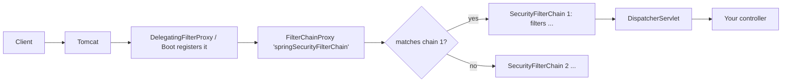
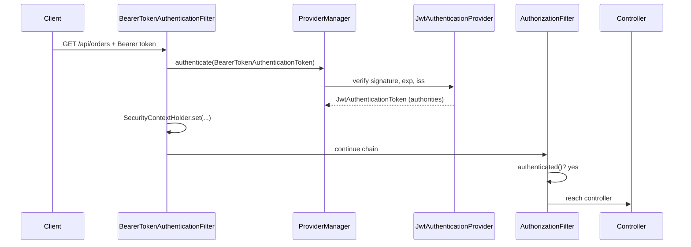
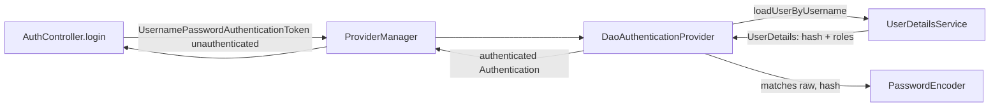
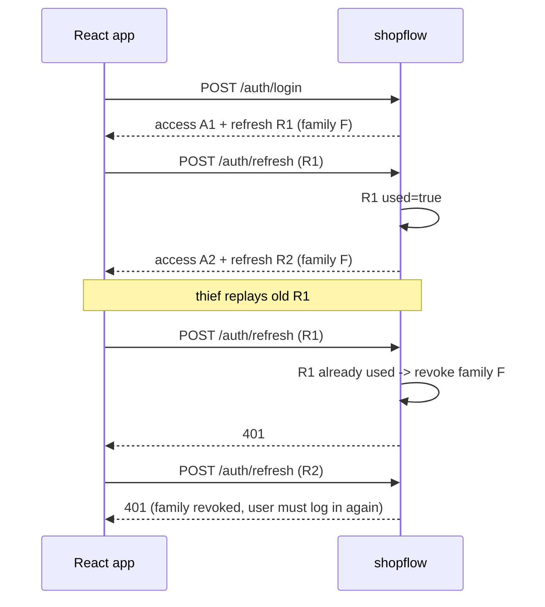
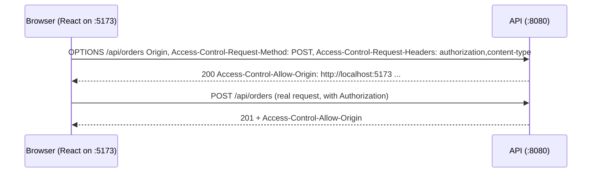

# Session 4 - Spring Security: authentication, JWT, authorization, and the attacks (from zero)

Goal: by the end you can (1) explain exactly what happens to an HTTP request between Tomcat and your controller when Spring Security is on the classpath, (2) build a stateless JWT login + refresh + logout flow without any magic starter, (3) protect data per customer (ownership checks, no IDOR), (4) show the classic attacks failing against your own code, and (5) open your company's Java backend and trace how it authenticates a request.

Real-world backend work this maps to: "customers log in to the shop, see only their own orders, support staff refund orders, and a partner registers a webhook URL". Domain used everywhere: `com.example.shopflow` (Products, Orders + OrderItems, Customers, an admin back-office). Orders belong to a customer; that ownership rule is what most real security bugs are about.

Tested with Java 21, Maven 3.9.11, Spring Boot 4.0.8 (Spring Framework 7, Spring Security 7, Jackson 3). Every code block below was built and run; outputs are real (ports, ids and long tokens shortened).

## How to use this article

1. Make a fresh project (https://start.spring.io, Maven, Java 21, Boot 4.0.8) or just use the `pom.xml` in section 3. Package `com.example.shopflow`.
2. Section 1 needs only the two starters. From section 3 on, add the files in the order shown ("in your running shopflow project, add this"). Each section says which files it touches.
3. Run with `JWT_SECRET` set (section 3 explains why it will refuse to start without it). Easiest for learning: run with the `dev` profile (`--spring.profiles.active=dev`), which supplies a throw-away secret.
4. The curl commands are bash style. On Windows PowerShell use `curl.exe` (not the `curl` alias) and put JSON into a file: `curl.exe -d "@body.json" ...`, or use `Invoke-RestMethod`.
5. Break things on purpose at every "Try it". Security only sticks when you have seen the failure.
6. Everything is in-memory (users, orders, tokens) so the project is standalone. Session 2 swaps in a database; the security code does not change.

> If your company is on Spring Boot 3.x: the concepts are identical. Differences are called out in `> If your company is on Spring Boot 3.x` boxes (starter names, Jackson package, test annotations, a few Spring Security 6 vs 7 API details).

## Topics

| # | Topic | You will be able to |
|---|---|---|
| 1 | What the starter gives for free | Explain the generated password, default 401, default headers |
| 2 | Filter chain architecture | Name the filters, print the chain, read the TRACE log of one request |
| 3 | Project setup and secrets | Fail fast when the JWT secret is missing or weak |
| 4 | SecurityFilterChain bean, rule order | Write the lambda DSL, avoid "first match wins" bugs |
| 5 | AuthN vs AuthZ, AuthenticationManager | Draw the ProviderManager -> DaoAuthenticationProvider flow |
| 6 | Passwords | Pick BCrypt/Argon2, use `{bcrypt}` prefix, see why not SHA-256 |
| 7 | Register + login + JWT issue | Mint HS256 tokens with Nimbus, read the claims |
| 8 | Validating tokens | Pin the algorithm, map claims to authorities, HS256 vs RS256 |
| 9 | Refresh rotation and revocation | Rotate refresh tokens, detect reuse, logout for real |
| 10 | Where the React app keeps tokens | Compare memory vs httpOnly cookie |
| 11 | Attacking your own JWTs | Expired, tampered, `alg=none`, weak secret |
| 12 | Resource server with an external IdP | Configure `issuer-uri` / `jwk-set-uri` (run against Keycloak) |
| 13 | Method security | `@PreAuthorize`, hasRole vs hasAuthority, bean checks, `@PostAuthorize` |
| 14 | IDOR / BOLA | Break it, fix it, choose 404 vs 403 |
| 15 | Mass assignment | Break it (price, role), fix with DTOs |
| 16 | 401 vs 403 JSON | Custom entry point + access-denied handler |
| 17 | CORS | Preflight curl demo, why CORS is not security |
| 18 | CSRF, session fixation, headers | Know when CSRF applies and what headers you get free |
| 19 | Login rate limit + audit log | Lockout counter, auth event listener |
| 20 | Common vulnerabilities | SQL injection, SSRF, URL scheme allow-list |
| 21 | Security tests | MockMvc `jwt()`, `@WithMockUser`, slice test with `@MockitoBean` |
| 22 | The complete slice and the work task | Trace how YOUR company authenticates a request |

---

## 1. What you get for free with just the starter

Two dependencies and one endpoint. No security code at all.

```xml
<!-- file: pom.xml (dependencies only) -->
<dependency>
  <groupId>org.springframework.boot</groupId>
  <artifactId>spring-boot-starter-webmvc</artifactId>
</dependency>
<dependency>
  <groupId>org.springframework.boot</groupId>
  <artifactId>spring-boot-starter-security</artifactId>
</dependency>
```

```java
// file: src/main/java/com/example/shopflow/ShopflowApplication.java
package com.example.shopflow;

import org.springframework.boot.SpringApplication;
import org.springframework.boot.autoconfigure.SpringBootApplication;
import org.springframework.web.bind.annotation.GetMapping;
import org.springframework.web.bind.annotation.RestController;

@SpringBootApplication
@RestController
public class ShopflowApplication {

    @GetMapping("/api/ping")
    String ping() {
        return "pong";
    }

    public static void main(String[] args) {
        SpringApplication.run(ShopflowApplication.class, args);
    }
}
```

```properties
# file: src/main/resources/application.properties
logging.level.org.springframework.security=DEBUG
```

> If your company is on Spring Boot 3.x: the web starter is `spring-boot-starter-web`. In Boot 4 it was renamed `spring-boot-starter-webmvc`, and every technology got its own `-test` starter (`spring-boot-starter-webmvc-test`, `spring-boot-starter-security-test`, ...). The security starter name is unchanged.

Start it and read the log:

```text
Using generated security password: da5d8460-734e-40de-8edd-80c297c8ee0f

This generated password is for development use only. Your security configuration must be updated before running your application in production.

Global AuthenticationManager configured with UserDetailsService bean with name inMemoryUserDetailsManager
```

Without writing anything, Boot created: an in-memory user named `user`, a random password printed once at startup, a login form, HTTP Basic, CSRF protection, and "everything requires authentication".

```text
$ curl -i http://localhost:8080/api/ping
HTTP/1.1 401
WWW-Authenticate: Basic realm="Realm"
Set-Cookie: JSESSIONID=...; Path=/; HttpOnly

$ curl -i -H "Accept: text/html" http://localhost:8080/api/ping
HTTP/1.1 302
Location: http://localhost:8080/login

$ curl -u user:da5d8460-734e-40de-8edd-80c297c8ee0f http://localhost:8080/api/ping
pong

$ curl -u user:wrong http://localhost:8080/api/ping        -> 401
```

Same URL, different answers: a browser (sends `Accept: text/html`) is redirected to a login page, an API client gets 401 + `WWW-Authenticate`. Also notice the `Set-Cookie: JSESSIONID`: the default setup creates an HTTP **session** (server-side state). For a JWT API we will turn that off.

Default response headers (you did not configure these):

```text
X-Content-Type-Options: nosniff
X-XSS-Protection: 0
Cache-Control: no-cache, no-store, max-age=0, must-revalidate
Pragma: no-cache
Expires: 0
X-Frame-Options: DENY
```

### The CSRF surprise (default config)

A POST with a *valid* password but no CSRF token:

```text
$ curl -i -u user:da5d8460-... -X POST http://localhost:8080/api/ping
HTTP/1.1 401
```

The server log says `Invalid CSRF token found` - so you would expect 403. You get **401**: the CSRF failure triggers an error dispatch to `/error`, which is itself secured, and the re-dispatch is anonymous. Remember this when a POST "mysteriously returns 401 although the password is right": it is often CSRF (section 18).

**Try it:** delete the `logging.level` line, restart, and notice the password still prints (that is an INFO log from Boot, not from the DEBUG setting). Then add `spring.security.user.name=shop` and `spring.security.user.password=pw12345678` to `application.properties`: you just replaced the generated user. Never do this in production; it is for demos.

**React/Express equivalent:** this is like adding `helmet()` + `passport` with a default strategy the moment you `npm install` it, versus Express where nothing is protected until you add middleware. Spring Security is "secure by default, then you open things".

---

## 2. The filter chain: how a request reaches your controller

Spring Security is **servlet filters**, not controllers/aspects. Filters run before Spring MVC's `DispatcherServlet`.



| Piece | What it is |
|---|---|
| `DelegatingFilterProxy` | A plain servlet filter registered with the container that forwards to a Spring bean (Boot wires this for you) |
| `FilterChainProxy` | The one bean named `springSecurityFilterChain`. Picks the FIRST `SecurityFilterChain` whose request matcher matches the URL |
| `SecurityFilterChain` | An ordered list of security filters (a bean you define; lambda DSL builds it) |
| Security filters | One job each: load the security context, check CSRF, read the token/credentials, translate exceptions, check authorization |

The default chain (printed at startup by `logging.level.org.springframework.security=DEBUG`, 16 filters):

```text
DisableEncodeUrlFilter, WebAsyncManagerIntegrationFilter, SecurityContextHolderFilter,
HeaderWriterFilter, CsrfFilter, LogoutFilter, UsernamePasswordAuthenticationFilter,
DefaultResourcesFilter, DefaultLoginPageGeneratingFilter, DefaultLogoutPageGeneratingFilter,
BasicAuthenticationFilter, RequestCacheAwareFilter, SecurityContextHolderAwareRequestFilter,
AnonymousAuthenticationFilter, ExceptionTranslationFilter, AuthorizationFilter
```

The chain of the finished shopflow app (section 22; CSRF off, CORS on, JWT bearer filter instead of form/basic):

```text
DisableEncodeUrlFilter, WebAsyncManagerIntegrationFilter, SecurityContextHolderFilter,
HeaderWriterFilter, CorsFilter, LogoutFilter, OAuth2ProtectedResourceMetadataFilter,
BearerTokenAuthenticationFilter, AuthenticationFilter, RequestCacheAwareFilter,
SecurityContextHolderAwareRequestFilter, AnonymousAuthenticationFilter, SessionManagementFilter,
ExceptionTranslationFilter, AuthorizationFilter                                  (15 filters)
```

The filters that matter for you, in the order they run:

1. `SecurityContextHolderFilter` - loads the "who is logged in" object (`SecurityContext`) for this request (from the session if there is one; empty for stateless).
2. `HeaderWriterFilter` - adds the security headers.
3. `CorsFilter` - answers CORS preflights before authentication (section 17).
4. `BearerTokenAuthenticationFilter` - reads `Authorization: Bearer ...`, asks the `AuthenticationManager` to verify, stores the result in the context.
5. `AnonymousAuthenticationFilter` - if nobody authenticated, puts an "anonymous" principal so later code never sees `null`.
6. `ExceptionTranslationFilter` - catches `AccessDeniedException`/`AuthenticationException` thrown *later in the chain* and turns them into 401 or 403 responses.
7. `AuthorizationFilter` - the last one: "may this principal call this URL?" (your `authorizeHttpRequests` rules).

Set `logging.level.org.springframework.security=TRACE` and call an authenticated endpoint to watch one request walk through (shortened):

```text
DEBUG FilterChainProxy : Securing GET /api/orders
TRACE FilterChainProxy : Invoking DisableEncodeUrlFilter (1/15)
TRACE FilterChainProxy : Invoking SecurityContextHolderFilter (3/15)
TRACE FilterChainProxy : Invoking CorsFilter (5/15)
TRACE FilterChainProxy : Invoking BearerTokenAuthenticationFilter (8/15)
TRACE ProviderManager  : Authenticating request with JwtAuthenticationProvider (1/3)
DEBUG JwtAuthenticationProvider : Authenticated token
DEBUG BearerTokenAuthenticationFilter : Set SecurityContextHolder to JwtAuthenticationToken [Principal=...Jwt@d3841ef1, ...]
TRACE FilterChainProxy : Invoking AnonymousAuthenticationFilter (12/15)
TRACE AnonymousAuthenticationFilter : Did not set SecurityContextHolder since already authenticated JwtAuthenticationToken
TRACE FilterChainProxy : Invoking ExceptionTranslationFilter (14/15)
TRACE FilterChainProxy : Invoking AuthorizationFilter (15/15)
TRACE RequestMatcherDelegatingAuthorizationManager : Authorizing GET /api/orders
TRACE RequestMatcherDelegatingAuthorizationManager : Checking authorization ... AuthenticatedAuthorizationManager
DEBUG FilterChainProxy : Secured GET /api/orders
```

Two observations from the real log: `OAuth2ProtectedResourceMetadataFilter` and `AuthenticationFilter` (which logs "Did not match request to ...DPoPAuthenticationConfigurer...") are new in Spring Security 7 / the resource server module (DPoP is a token-binding extension; you do not use it, the filter simply does not match). And `ProviderManager ... (1/3)` means the resource server registered three authentication providers.



> If your company is on Spring Boot 3.x: the filter list is the same minus `OAuth2ProtectedResourceMetadataFilter` and the DPoP `AuthenticationFilter` (those arrived with Spring Security 7).

**C++ equivalent:** a middleware pipeline / chain of responsibility where each handler may short-circuit. **React/Express equivalent:** `app.use(cors()); app.use(authMiddleware); app.use(roleCheck)`; the order of `app.use` matters exactly like the filter order here.

---

## 3. Project setup and secrets (fail-fast)

From here on we build the shopflow security slice. Add the dependencies:

```xml
<!-- file: pom.xml -->
<parent>
  <groupId>org.springframework.boot</groupId>
  <artifactId>spring-boot-starter-parent</artifactId>
  <version>4.0.8</version>
  <relativePath/>
</parent>
<properties><java.version>21</java.version></properties>
<dependencies>
  <dependency><groupId>org.springframework.boot</groupId><artifactId>spring-boot-starter-webmvc</artifactId></dependency>
  <dependency><groupId>org.springframework.boot</groupId><artifactId>spring-boot-starter-security</artifactId></dependency>
  <dependency><groupId>org.springframework.boot</groupId><artifactId>spring-boot-starter-security-oauth2-resource-server</artifactId></dependency>
  <dependency><groupId>org.springframework.boot</groupId><artifactId>spring-boot-starter-validation</artifactId></dependency>
  <!-- tests -->
  <dependency><groupId>org.springframework.boot</groupId><artifactId>spring-boot-starter-webmvc-test</artifactId><scope>test</scope></dependency>
  <dependency><groupId>org.springframework.boot</groupId><artifactId>spring-boot-starter-security-test</artifactId><scope>test</scope></dependency>
  <dependency><groupId>org.springframework.boot</groupId><artifactId>spring-boot-starter-security-oauth2-resource-server-test</artifactId><scope>test</scope></dependency>
</dependencies>
```

> If your company is on Spring Boot 3.x: use `spring-boot-starter-web`, `spring-boot-starter-security`, `spring-boot-starter-oauth2-resource-server`, `spring-boot-starter-validation`, and ONE test starter `spring-boot-starter-test` plus `spring-security-test`. The 4.x resource-server starter is named `spring-boot-starter-security-oauth2-resource-server`.

Why `oauth2-resource-server` when we issue the tokens ourselves? It brings Nimbus (the JWT library), `JwtEncoder`/`JwtDecoder`, and `BearerTokenAuthenticationFilter`. You do NOT need an OAuth2 server; "resource server" just means "an API that accepts bearer JWTs".

Configuration. The secret has **no default** on purpose:

```yaml
# file: src/main/resources/application.yml
server:
  port: ${PORT:8080}
app:
  jwt:
    issuer: shopflow
    access-ttl: 15m
    refresh-ttl: 7d
    secret: ${JWT_SECRET}          # no default: production must provide it
  security:
    login-max-attempts: 5
    login-lock: 1m
  cors:
    allowed-origins: http://localhost:5173
```

```yaml
# file: src/main/resources/application-dev.yml   (throw-away values, committed on purpose, dev only)
app:
  jwt:
    secret: dev-only-secret-at-least-32-bytes-long-0123456789
  dev-admin-password: admin-password-123
logging:
  level:
    org.springframework.security: DEBUG
```

```java
// file: src/main/java/com/example/shopflow/security/JwtProperties.java
package com.example.shopflow.security;

import java.time.Duration;
import org.springframework.boot.context.properties.ConfigurationProperties;
import org.springframework.validation.annotation.Validated;
import jakarta.validation.constraints.NotBlank;
import jakarta.validation.constraints.Size;

@Validated
@ConfigurationProperties(prefix = "app.jwt")
public record JwtProperties(
        @NotBlank String issuer,
        Duration accessTtl,
        Duration refreshTtl,
        @NotBlank @Size(min = 32, message = "JWT secret must be at least 32 characters (256 bits for HS256)") String secret) {
}
```

```java
// file: src/main/java/com/example/shopflow/ShopflowApplication.java  (replace the section-1 version)
@SpringBootApplication
@ConfigurationPropertiesScan
public class ShopflowApplication {
    public static void main(String[] args) {
        SpringApplication.run(ShopflowApplication.class, args);
    }
}
```

Start with no `JWT_SECRET` and no dev profile:

```text
APPLICATION FAILED TO START

Binding to target ... JwtProperties failed:

    Property: app.jwt.secret
    Value: "${JWT_SECRET}"
    Reason: JWT secret must be at least 32 characters (256 bits for HS256)
```

Surprise: Boot did NOT complain that `${JWT_SECRET}` is unresolved. Inside a bound property an unresolvable placeholder stays as the literal text `${JWT_SECRET}`, which is 13 characters long, so it is the `@Size(min = 32)` validation that stops the app. Without that annotation your app would happily sign tokens with the secret `${JWT_SECRET}`. `JWT_SECRET=tooshort` fails with the same message. Fail fast, never "default secret".

```powershell
# PowerShell: generate a 256-bit secret and run
$env:JWT_SECRET = [Convert]::ToBase64String((1..48 | % { Get-Random -Maximum 256 }) -as [byte[]])
mvn spring-boot:run
```

```bash
# bash
export JWT_SECRET=$(openssl rand -base64 48)
```

---

## 4. The SecurityFilterChain bean (lambda DSL) and rule order

You define security by exposing a `SecurityFilterChain` bean. There is no `WebSecurityConfigurerAdapter` any more (removed in Spring Security 6) and no `.and()` chaining (removed in 7): everything is lambdas.

The rules of shopflow:

| Request | Who |
|---|---|
| `POST /auth/register`, `/auth/login`, `/auth/refresh` | anyone |
| `GET /products`, `/products/{id}` (public catalog) | anyone |
| `/api/admin/**` | ADMIN role only |
| everything else under `/api/**`, and `POST /auth/logout` | any logged-in user |
| anything else | nobody (default deny) |

```java
// file: src/main/java/com/example/shopflow/security/SecurityConfig.java  (part 1: the chain)
package com.example.shopflow.security;

@Configuration
@EnableMethodSecurity                       // section 13
public class SecurityConfig {

    @Bean
    SecurityFilterChain apiSecurity(HttpSecurity http, ProblemDetailSecurityHandlers handlers,
                                    JwtAuthenticationConverter converter) throws Exception {
        http
            .csrf(csrf -> csrf.disable())                       // stateless bearer-token API, no cookies (section 18)
            .cors(Customizer.withDefaults())                    // uses the CorsConfigurationSource bean (section 17)
            .sessionManagement(s -> s.sessionCreationPolicy(SessionCreationPolicy.STATELESS))
            .authorizeHttpRequests(auth -> auth
                .requestMatchers(HttpMethod.POST, "/auth/register", "/auth/login", "/auth/refresh").permitAll()
                .requestMatchers(HttpMethod.GET, "/products", "/products/**").permitAll()   // public catalog
                .requestMatchers("/error").permitAll()
                .requestMatchers("/api/admin/**").hasRole("ADMIN")                          // specific BEFORE general
                .requestMatchers("/api/**", "/auth/logout").authenticated()
                .anyRequest().denyAll())                                                    // default-deny
            .oauth2ResourceServer(rs -> rs
                .jwt(jwt -> jwt.jwtAuthenticationConverter(converter))
                .authenticationEntryPoint(handlers)
                .accessDeniedHandler(handlers))
            .exceptionHandling(ex -> ex
                .authenticationEntryPoint(handlers)
                .accessDeniedHandler(handlers));
        return http.build();
    }
    // beans for sections 5-8, 17 follow in the same class
}
```

Imports (let the IDE add them): `org.springframework.security.config.annotation.web.builders.HttpSecurity`, `org.springframework.security.web.SecurityFilterChain`, `org.springframework.security.config.http.SessionCreationPolicy`, `org.springframework.security.config.Customizer`, `org.springframework.security.config.annotation.method.configuration.EnableMethodSecurity`, `org.springframework.http.HttpMethod`.

> If your company is on Spring Boot 3.x (Spring Security 6.x): the DSL is nearly identical. Differences: in 6.x `.and()` still compiles (deprecated); `PathPatternRequestMatcher.withDefaults()` replaces `AntPathRequestMatcher`/`MvcRequestMatcher` in new code. `requestMatchers("/path")` with strings works the same.

### The "first match wins" pitfall

Rules are checked **top to bottom and the first one that matches decides**. Here is the bug:

```java
// BROKEN: general rule first
.requestMatchers("/api/**", "/auth/logout").authenticated()
.requestMatchers("/api/admin/**").hasRole("ADMIN")      // never reached for /api/admin/...
```

Alice is a plain customer (role CUSTOMER). With the broken order:

```text
$ curl -i http://localhost:8080/api/admin/stats -H "Authorization: Bearer <alice-token>"
HTTP/1.1 200
{"orders":0}
```

A customer is reading admin statistics. No error, no warning: `/api/admin/stats` matched `/api/**` first. The fix is to put specific rules before general rules (the code above):

```text
HTTP/1.1 403
{"detail":"You do not have permission to do this","instance":"/api/admin/stats","status":403,"title":"Forbidden"}
```

Rule of thumb: most specific first, `anyRequest()` last, and make the last rule `denyAll()` so a URL you forgot is closed instead of open. Write one test per rule (section 21).

**Try it:** remove the `.anyRequest().denyAll()` line and add a controller at `/internal/dump`. Without the line, Spring Security 6/7 still requires an explicit rule for dispatcher types, but a forgotten URL under a permissive last rule (`anyRequest().permitAll()`) is exactly how "debug endpoints" leak in real systems.

**Express equivalent:** `app.use('/api', auth); app.use('/api/admin', adminOnly)`: order of registration decides, same trap.

---

## 5. Authentication vs authorization; the AuthenticationManager

| | Authentication (AuthN) | Authorization (AuthZ) |
|---|---|---|
| Question | Who are you? | What may you do? |
| Failure code | **401** Unauthorized (really "unauthenticated") | **403** Forbidden |
| Spring piece | `AuthenticationManager` -> providers | `AuthorizationFilter` (URLs), method security (methods) |
| Input | password, token, certificate | the authenticated principal + the rule |
| Result | an `Authentication` object with authorities | allow / deny |

The username+password flow, which we use at `POST /auth/login`:



`ProviderManager` holds a list of providers and asks each "do you support this kind of token?" (a DAO/password provider, a JWT provider, an LDAP provider...). The first that succeeds wins. This is the extension point: adding a new login method means adding a provider.

Our `UserDetailsService` loads a user from the (in-memory, for now) repository:

```java
// file: src/main/java/com/example/shopflow/user/AppUser.java
public record AppUser(long id, String username, String passwordHash, Set<String> roles) { }
```

```java
// file: src/main/java/com/example/shopflow/user/UserRepository.java
@Repository
public class UserRepository {
    private final ConcurrentMap<String, AppUser> byUsername = new ConcurrentHashMap<>();
    private final AtomicLong ids = new AtomicLong();

    /** Returns empty if the username is already taken. */
    public Optional<AppUser> create(String username, String passwordHash, Set<String> roles) {
        String key = username.toLowerCase(Locale.ROOT);
        AppUser user = new AppUser(ids.incrementAndGet(), key, passwordHash, Set.copyOf(roles));
        return byUsername.putIfAbsent(key, user) == null ? Optional.of(user) : Optional.empty();
    }
    public Optional<AppUser> findByUsername(String username) {
        return Optional.ofNullable(byUsername.get(username.toLowerCase(Locale.ROOT)));
    }
    public Optional<AppUser> findById(long id) {
        return byUsername.values().stream().filter(u -> u.id() == id).findFirst();
    }
    public AppUser replace(AppUser user) { byUsername.put(user.username(), user); return user; }
}
```

```java
// file: src/main/java/com/example/shopflow/user/AppUserDetailsService.java
@Service
public class AppUserDetailsService implements UserDetailsService {
    private final UserRepository users;
    public AppUserDetailsService(UserRepository users) { this.users = users; }

    @Override
    public UserDetails loadUserByUsername(String username) throws UsernameNotFoundException {
        AppUser u = users.findByUsername(username)
                .orElseThrow(() -> new UsernameNotFoundException("no such user"));
        return User.withUsername(u.username())
                .password(u.passwordHash())                       // already encoded, e.g. {bcrypt}$2a$10$...
                .roles(u.roles().toArray(String[]::new))          // roles("CUSTOMER") becomes authority ROLE_CUSTOMER
                .build();
    }
}
```

Wire the manager explicitly, with the event publisher so successes/failures reach our audit listener (section 19):

```java
// file: SecurityConfig.java (part 2)
@Bean
PasswordEncoder passwordEncoder() {
    return PasswordEncoderFactories.createDelegatingPasswordEncoder();   // stores "{bcrypt}$2a$10$..."
}

@Bean
AuthenticationManager authenticationManager(UserDetailsService users, PasswordEncoder encoder,
                                            ApplicationEventPublisher publisher) {
    DaoAuthenticationProvider provider = new DaoAuthenticationProvider(users);
    provider.setPasswordEncoder(encoder);
    ProviderManager manager = new ProviderManager(provider);
    manager.setAuthenticationEventPublisher(new DefaultAuthenticationEventPublisher(publisher));
    return manager;
}
```

> If your company is on Spring Boot 3.x (Spring Security 6.x): the constructor taking a `UserDetailsService` is new in 7; use `DaoAuthenticationProvider p = new DaoAuthenticationProvider(); p.setUserDetailsService(users);`. Also: if you define a single `UserDetailsService` bean and a `PasswordEncoder` bean, Boot already wires a `DaoAuthenticationProvider` for you; you only need the manager bean above because we call it from our own `/auth/login` controller.

`roles("CUSTOMER")` vs authority: **role** `CUSTOMER` is stored as the authority string `ROLE_CUSTOMER`. `hasRole("ADMIN")` checks `ROLE_ADMIN`; `hasAuthority("order:refund")` checks the literal string. Section 13 uses both.

---

## 6. Passwords: encoders, cost, and why not SHA-256

Never store passwords; store a slow, salted hash. Run this lab (a plain `main`, needs `spring-security-crypto`, `bcprov-jdk18on` for Argon2):

```java
// file: src/main/java/com/example/shopflow/lab/PasswordLab.java  (core of it)
PasswordEncoder delegating = PasswordEncoderFactories.createDelegatingPasswordEncoder();
String h1 = delegating.encode("s3cret-pass");
String h2 = delegating.encode("s3cret-pass");
System.out.println(h1);
System.out.println(h2);
System.out.println("matches: " + delegating.matches("s3cret-pass", h1));

for (int cost : new int[] {4, 8, 10, 12, 14}) {
    long t0 = System.nanoTime();
    new BCryptPasswordEncoder(cost).encode("s3cret-pass");
    System.out.printf("cost %2d -> %7.1f ms%n", cost, (System.nanoTime() - t0) / 1e6);
}
```

Real output:

```text
{bcrypt}$2a$10$sYrmuWI9iAILdHi2yKOKsuXIlcZynG5/lgl8MbtFnVQ89eMG.BO2i
{bcrypt}$2a$10$zCbZceQJAjfJun2mmUQ79./9YSHnmGjXEOjexFE2g62jP.i66Zbi2
same password, different hashes (random salt): true
matches: true / wrong: false
legacy {noop} hash: true
hash without {id} prefix -> Given that there is no default password encoder configured, each password must have a password encoding prefix. Please either prefix this password with '{noop}' or set a default password encoder in `DelegatingPasswordEncoder`.

cost  4 ->     2.5 ms
cost  8 ->    23.9 ms
cost 10 ->    92.0 ms
cost 12 ->   363.2 ms
cost 14 ->  1484.0 ms
```

(Timings vary by machine and load; the shape does not: each +1 cost doubles the time.)

Reading the hash `{bcrypt}$2a$10$sYrmuWI9iAILdHi2yKOKsu...`:

- `{bcrypt}` - the `DelegatingPasswordEncoder` prefix. It picks the right encoder by prefix, so you can later migrate old hashes to Argon2 without a big-bang reset (`upgradeEncoding`).
- `$2a$` - bcrypt version; `10` - cost (2^10 rounds); next 22 chars - the random salt; the rest - the hash. The salt is inside the string, that is why the same password gives two different hashes and `matches()` still works.

| Encoder | Notes |
|---|---|
| BCrypt (default) | Proven; cost 10-12 -> 100-400 ms per hash; ignores bytes after 72 (we cap the password at 72 chars) |
| Argon2id | Memory-hard (resists GPUs); `Argon2PasswordEncoder.defaultsForSpringSecurity_v5_8()` needs `org.bouncycastle:bcprov-jdk18on`; same API |
| `{noop}` | Plain text. Tests only |
| SHA-256 / MD5 | **Not password hashes**. Too fast |

Argon2 output (default parameters, first hash includes JIT warm-up, so 1.6 s here is pessimistic):

```text
$argon2id$v=19$m=16384,t=2,p=1$H+tC5cjEFT4LM8ornIKm9w$JHtBnPAooOyv8ZVzRgnNp/UfL+Eqzn0ddVVpobdy/+0
matches: true
```

Why not SHA-256? Attack speed. One CPU thread guessing passwords against a stolen hash table:

```text
SHA-256:  2,000,000 guesses in 2.47 s -> 810,500 guesses/s
BCrypt10: 20 guesses in 14.44 s -> 1.4 guesses/s      (machine was busy; a quiet machine does ~10/s)
ratio: SHA-256 is about 585,098x faster to attack
```

Even with the noisy machine the gap is five orders of magnitude. A fast hash is a feature for file checksums and a vulnerability for passwords. (We DO use SHA-256 for refresh tokens in section 9, because there the input is 256 random bits, not a guessable human password.)

Choose a cost so one login takes roughly 100-300 ms on your production hardware. Login is expensive by design; that is also why login must be rate limited (section 19).

**Register endpoint.** Note what the client can send: username and password only. No role, no id (see section 15).

```java
// file: src/main/java/com/example/shopflow/auth/AuthController.java  (part 1)
@RestController
@RequestMapping("/auth")
public class AuthController {

    // No roles, no id here: the client cannot even try to set them (mass assignment defence)
    public record RegisterRequest(
            @NotBlank @Size(min = 3, max = 30) @Pattern(regexp = "[A-Za-z0-9_.-]+") String username,
            @NotBlank @Size(min = 10, max = 72) String password) { }      // BCrypt only uses the first 72 bytes

    @PostMapping("/register")
    @ResponseStatus(HttpStatus.CREATED)
    public Map<String, Object> register(@Valid @RequestBody RegisterRequest req) {
        AppUser user = users.create(req.username(), encoder.encode(req.password()), Set.of("CUSTOMER"))
                .orElseThrow(() -> new ResponseStatusException(HttpStatus.CONFLICT, "username already taken"));
        return Map.of("id", user.id(), "username", user.username());
    }
    // login / refresh / logout in sections 7 and 9
}
```

```text
$ curl -s -X POST localhost:8080/auth/register -H 'Content-Type: application/json' -d '{"username":"alice","password":"alice-password-1"}'
{"id":2,"username":"alice"}                                          (201)
$ ... same again
{"detail":"username already taken","instance":"/auth/register","status":409,"title":"Conflict"}
$ ... "password":"short"
{"detail":"Invalid request content.","instance":"/auth/register","status":400,"title":"Bad Request"}
```

---

## 7. Login and issuing JWTs

A JWT is three base64url parts: `header.payload.signature`. The payload is **not encrypted**, anyone can read it; the signature only proves it was not changed. So: never put secrets in claims.

Our access token claims:

| Claim | Meaning |
|---|---|
| `iss` | who issued it (`shopflow`); validated on every request |
| `sub` | the user id (stable), not the username |
| `iat` / `exp` | issued-at / expiry (short: 15 minutes) |
| `jti` | unique token id; lets us revoke one token (section 9) |
| `roles` | `["CUSTOMER"]` or `["ADMIN","CUSTOMER"]` |
| `permissions` | fine-grained, e.g. `["order:refund"]` |

```java
// file: src/main/java/com/example/shopflow/auth/TokenService.java
@Service
public class TokenService {

    public record TokenResponse(String tokenType, String accessToken, long expiresInSeconds, String refreshToken) { }

    private final JwtEncoder encoder;
    private final JwtProperties props;
    private final RefreshTokenStore refreshTokens;
    private final Clock clock;

    public TokenService(JwtEncoder encoder, JwtProperties props, RefreshTokenStore refreshTokens, Clock clock) {
        this.encoder = encoder; this.props = props; this.refreshTokens = refreshTokens; this.clock = clock;
    }

    public TokenResponse issuePair(AppUser user, String familyId) {
        String family = familyId != null ? familyId : UUID.randomUUID().toString();
        Instant now = Instant.now(clock);
        List<String> permissions = user.roles().contains("ADMIN") ? List.of("order:refund", "product:write") : List.of();
        JwtClaimsSet claims = JwtClaimsSet.builder()
                .issuer(props.issuer())
                .subject(String.valueOf(user.id()))              // stable id, not the username
                .issuedAt(now)
                .expiresAt(now.plus(props.accessTtl()))
                .id(UUID.randomUUID().toString())                // jti, used by the denylist
                .claim("username", user.username())
                .claim("roles", List.copyOf(user.roles()))
                .claim("permissions", permissions)
                .build();
        // HS256 must be named explicitly: the encoder defaults to RS256 and fails for a secret key
        JwsHeader header = JwsHeader.with(MacAlgorithm.HS256).build();
        String access = encoder.encode(JwtEncoderParameters.from(header, claims)).getTokenValue();
        String refresh = refreshTokens.issue(user.id(), family, props.refreshTtl());
        return new TokenResponse("Bearer", access, props.accessTtl().toSeconds(), refresh);
    }
}
```

The signing/verifying beans (in `SecurityConfig`, part 3):

```java
private static SecretKey key(JwtProperties props) {
    return new SecretKeySpec(props.secret().getBytes(StandardCharsets.UTF_8), "HmacSHA256");
}

@Bean
JwtEncoder jwtEncoder(JwtProperties props) {
    return new NimbusJwtEncoder(new ImmutableSecret<>(key(props)));     // com.nimbusds.jose.jwk.source.ImmutableSecret
}
```

The login endpoint (AuthController part 2):

```java
@PostMapping("/login")
public TokenResponse login(@Valid @RequestBody LoginRequest req, HttpServletRequest http) {
    String key = req.username().toLowerCase() + "|" + http.getRemoteAddr();
    attempts.checkAllowed(key);                               // throws 429 while locked (section 19)
    try {
        authManager.authenticate(UsernamePasswordAuthenticationToken.unauthenticated(req.username(), req.password()));
    } catch (AuthenticationException e) {
        attempts.recordFailure(key);
        throw new BadCredentialsException("bad credentials");  // same answer for unknown user and wrong password
    }
    attempts.recordSuccess(key);
    AppUser user = users.findByUsername(req.username()).orElseThrow();
    return tokens.issuePair(user, null);
}
```

Two deliberate choices: the same 401 for "unknown user" and "wrong password" (otherwise attackers enumerate valid usernames), and the lock key includes the IP.

```text
$ curl -i -X POST localhost:8080/auth/login -H 'Content-Type: application/json' -d '{"username":"alice","password":"alice-password-1"}'
HTTP/1.1 200
Content-Type: application/json

{"tokenType":"Bearer","accessToken":"eyJhbGciOiJIUzI1NiJ9.eyJzdWIi...<285 chars>","expiresInSeconds":900,"refreshToken":"Pbl-9Z1yNIsClMJ67FmQ5yE0phvsRlUTjio2DilkLro"}
```

Decode it (any base64url decoder, or paste into jwt.io - but never paste PRODUCTION tokens into websites):

```text
header : {"alg":"HS256"}
payload: {"sub":"2","permissions":[],"roles":["CUSTOMER"],"iss":"shopflow","exp":1792382054,"iat":1792381154,"jti":"fdec1d03-b5cf-487d-8749-471424bd62de","username":"alice"}
```

`exp - iat = 900` seconds. Use it:

```text
$ curl -i localhost:8080/api/orders -H "Authorization: Bearer <accessToken>"
HTTP/1.1 200
[]
```

Wrong password and unknown user both give:

```text
HTTP/1.1 401
{"detail":"Authentication required or token invalid","instance":"/auth/login","status":401,"title":"Unauthorized"}
```

---

## 8. Validating tokens: pin the algorithm, map claims to authorities, HS256 vs RS256

```java
// SecurityConfig part 3
@Bean
JwtDecoder jwtDecoder(JwtProperties props, JwtDenylist denylist) {
    NimbusJwtDecoder decoder = NimbusJwtDecoder.withSecretKey(key(props))
            .macAlgorithm(MacAlgorithm.HS256)               // pin the algorithm: never trust the token's own header
            .build();
    OAuth2TokenValidator<Jwt> notRevoked = jwt -> denylist.isRevoked(jwt.getId())
            ? OAuth2TokenValidatorResult.failure(new OAuth2Error("invalid_token", "Token has been revoked", null))
            : OAuth2TokenValidatorResult.success();
    decoder.setJwtValidator(new DelegatingOAuth2TokenValidator<>(
            JwtValidators.createDefaultWithIssuer(props.issuer()),   // checks exp, nbf, iss
            notRevoked));
    return decoder;
}

/** Claims -> authorities. "roles": ["ADMIN"] becomes ROLE_ADMIN; "permissions": ["order:refund"] stays as is. */
@Bean
JwtAuthenticationConverter jwtAuthenticationConverter() {
    JwtAuthenticationConverter converter = new JwtAuthenticationConverter();
    converter.setJwtGrantedAuthoritiesConverter(jwt -> {
        Collection<GrantedAuthority> out = new ArrayList<>();
        List<String> roles = jwt.getClaimAsStringList("roles");
        if (roles != null) roles.forEach(r -> out.add(new SimpleGrantedAuthority("ROLE_" + r)));
        List<String> permissions = jwt.getClaimAsStringList("permissions");
        if (permissions != null) permissions.forEach(p -> out.add(new SimpleGrantedAuthority(p)));
        return out;
    });
    return converter;
}
```

Why the converter? By default Spring maps the `scope`/`scp` claim to authorities `SCOPE_xxx`. Our token has `roles` and `permissions` instead, so `hasRole("ADMIN")` would never be true without this converter. Every company's tokens differ (`roles`, `authorities`, `realm_access.roles`, `groups`...): this converter is the single place where "token vocabulary" meets "Spring vocabulary". It is the first thing to find in your company's code (section 22).

Access token revocation (a denylist keyed by `jti`) - remember that a JWT is self-contained, so "stateless" and "revocable" fight each other. Our compromise: short TTL + a tiny denylist that forgets entries once the token would have expired anyway:

```java
// file: src/main/java/com/example/shopflow/security/JwtDenylist.java
@Component
public class JwtDenylist {
    private final ConcurrentMap<String, Instant> revoked = new ConcurrentHashMap<>();
    private final Clock clock;
    public JwtDenylist(Clock clock) { this.clock = clock; }

    public void revoke(String jti, Instant tokenExpiry) {
        Instant now = Instant.now(clock);
        revoked.entrySet().removeIf(e -> e.getValue().isBefore(now));
        revoked.put(jti, tokenExpiry);
    }
    public boolean isRevoked(String jti) { return jti != null && revoked.containsKey(jti); }
}
```

(Multiple app instances need this in Redis; session 5.)

### HS256 (shared secret) vs RS256 (key pair)

| | HS256 | RS256 |
|---|---|---|
| Key | one shared secret | private key signs, public key verifies |
| Who can mint tokens | everyone who can verify | only the issuer |
| Good for | one app that both issues and checks | an auth server + many resource servers, third parties |
| Rotation | change secret everywhere at once | publish several public keys in a JWKS, select by `kid` |

Real run of the RS256 variant (`NimbusJwtEncoder` with an `RSAKey`, decoder with the public key only):

```java
KeyPairGenerator gen = KeyPairGenerator.getInstance("RSA");
gen.initialize(2048);
KeyPair kp = gen.generateKeyPair();
RSAKey jwk = new RSAKey.Builder((RSAPublicKey) kp.getPublic())
        .privateKey((RSAPrivateKey) kp.getPrivate()).keyID("shopflow-2026-01").build();

NimbusJwtEncoder encoder = new NimbusJwtEncoder(new ImmutableJWKSet<>(new JWKSet(jwk)));
JwsHeader header = JwsHeader.with(SignatureAlgorithm.RS256).keyId(jwk.getKeyID()).build();
Jwt jwt = encoder.encode(JwtEncoderParameters.from(header, claims));

NimbusJwtDecoder decoder = NimbusJwtDecoder.withPublicKey((RSAPublicKey) kp.getPublic()).build();
```

```text
header : {alg=RS256, kid=shopflow-2026-01}
claims : sub=2 roles=[CUSTOMER]
verified with PUBLIC key only: sub=2
what you publish at /.well-known/jwks.json (public part only):
{"keys":[{"kty":"RSA","e":"AQAB","kid":"shopflow-2026-01","n":"<modulus...>"}]}
verified with a different public key -> An error occurred while attempting to decode the Jwt: Signed JWT rejected: Invalid signature
```

The `kid` header lets a resource server pick the right public key from the JWKS during rotation. For HS256 the secret must be >= 32 bytes (256 bits): shorter ones are rejected by Nimbus and, more importantly, are brute-forceable (section 11).

---

## 9. Refresh tokens: rotation, reuse detection, logout

Short access tokens (15 min) limit damage if one leaks, but you do not want users to log in every 15 minutes. So login also returns a long-lived **refresh token**. Design rules we implement:

1. The refresh token is **opaque** (32 random bytes, not a JWT), so the server can always revoke it.
2. The server stores only its **hash** (SHA-256 of the raw value). A database leak then does not leak usable tokens.
3. **Rotation:** every refresh call consumes the old token and returns a new pair. Each token works once.
4. **Reuse detection:** if an already-used token shows up again, someone has a copy (thief or the real user after a theft). Revoke the whole **family** (the chain started by one login).
5. **Logout:** revoke the family, and denylist the current access token's `jti`.



```java
// file: src/main/java/com/example/shopflow/auth/RefreshTokenStore.java
@Component
public class RefreshTokenStore {

    public record Record(String hash, long userId, String familyId, Instant expiresAt, boolean used) { }

    public static class InvalidRefreshTokenException extends RuntimeException {
        public InvalidRefreshTokenException(String message) { super(message); }
    }

    private final SecureRandom random = new SecureRandom();
    private final Map<String, Record> byHash = new ConcurrentHashMap<>();
    private final Set<String> revokedFamilies = ConcurrentHashMap.newKeySet();
    private final Clock clock;
    public RefreshTokenStore(Clock clock) { this.clock = clock; }

    public String issue(long userId, String familyId, Duration ttl) {
        byte[] bytes = new byte[32];
        random.nextBytes(bytes);
        String raw = Base64.getUrlEncoder().withoutPadding().encodeToString(bytes);
        String hash = sha256(raw);
        byHash.put(hash, new Record(hash, userId, familyId, Instant.now(clock).plus(ttl), false));
        return raw;                                            // only the client ever sees the raw value
    }

    /** One-time use: returns the old record and marks it used. Presenting a used token kills the whole family. */
    public synchronized Record consume(String raw) {
        Record rec = byHash.get(sha256(raw));
        if (rec == null || revokedFamilies.contains(rec.familyId())) {
            throw new InvalidRefreshTokenException("unknown or revoked refresh token");
        }
        if (rec.used()) {
            revokedFamilies.add(rec.familyId());               // reuse detected: someone has a stolen copy
            throw new InvalidRefreshTokenException("refresh token reuse detected");
        }
        if (rec.expiresAt().isBefore(Instant.now(clock))) {
            throw new InvalidRefreshTokenException("refresh token expired");
        }
        byHash.put(rec.hash(), new Record(rec.hash(), rec.userId(), rec.familyId(), rec.expiresAt(), true));
        return rec;
    }

    public void revokeFamilyOf(String raw) {
        Record rec = byHash.get(sha256(raw));
        if (rec != null) revokedFamilies.add(rec.familyId());
    }

    // SHA-256 is fine here: the input is 256 random bits, not a guessable human password
    static String sha256(String raw) {
        try {
            byte[] d = MessageDigest.getInstance("SHA-256").digest(raw.getBytes(StandardCharsets.UTF_8));
            return HexFormat.of().formatHex(d);
        } catch (NoSuchAlgorithmException e) { throw new IllegalStateException(e); }
    }
}
```

In a real DB this is a table `refresh_token(hash PK, user_id, family_id, expires_at, used)` and `consume` becomes one `UPDATE ... SET used = true WHERE hash = ? AND used = false` (the update count tells you who won a race; see HLD G1 locking).

```java
// AuthController part 3
@PostMapping("/refresh")
public TokenResponse refresh(@Valid @RequestBody RefreshRequest req) {
    try {
        RefreshTokenStore.Record old = refreshStore.consume(req.refreshToken());
        AppUser user = users.findById(old.userId()).orElseThrow(() -> new InvalidRefreshTokenException("user gone"));
        return tokens.issuePair(user, old.familyId());        // rotation: new refresh token, same family
    } catch (InvalidRefreshTokenException e) {
        throw new BadCredentialsException(e.getMessage());
    }
}

@PostMapping("/logout")
@ResponseStatus(HttpStatus.NO_CONTENT)
public void logout(@Valid @RequestBody RefreshRequest req, @AuthenticationPrincipal Jwt jwt) {
    refreshStore.revokeFamilyOf(req.refreshToken());
    denylist.revoke(jwt.getId(), jwt.getExpiresAt());         // kill the current access token immediately too
}
```

Real run (alice logs in, refreshes, a thief replays the old token, bob logs out):

```text
== refresh #1                       -> new refresh token differs: True
== replay OLD refresh token         -> HTTP/1.1 401  (reuse detected, family revoked)
== now the NEW refresh token        -> HTTP/1.1 401  (family revoked: forced re-login)
== logout (bob)                     -> HTTP/1.1 204
== bob's access token after logout  -> HTTP/1.1 401  (jti is on the denylist)
== refresh after logout             -> HTTP/1.1 401
```

The client never learns *why* (all three reasons return the same 401); the reason only goes to the log.

**Try it:** comment out the `rec.used()` check and replay a refresh token: it works forever, which is exactly the "stolen token" scenario rotation prevents.

---

## 10. Where does the React app keep the tokens?

| Storage | XSS (injected script) | CSRF | Survives reload | Verdict |
|---|---|---|---|---|
| `localStorage` | script can read it and steal it | not affected | yes | Most common, weakest against XSS |
| JS memory (a variable / React state) | script cannot easily read it later, but can call the API while the page is open | not affected | no (user re-auths via refresh) | Good for the ACCESS token |
| httpOnly + Secure + SameSite cookie | script cannot read it | **affected** (browser sends it automatically), needs `SameSite` and often a CSRF token | yes | Good for the REFRESH token |

A widely used compromise: access token in memory, refresh token in an `httpOnly; Secure; SameSite=Strict` cookie scoped to `/auth/refresh`. On page load the app silently calls `/auth/refresh` to get an access token. Our API takes the refresh token in the request body to keep the demo simple; in the cookie variant you would read it with `@CookieValue` and set it with `ResponseCookie`.

There is no perfect answer: any token an XSS attacker can use *while the page is open* is lost. The real defence is not having XSS (React escapes by default; the risk is `dangerouslySetInnerHTML`, unsafe markdown, third-party scripts) plus a strict `Content-Security-Policy`.

---

## 11. Attacking your own JWTs

Run each against the real app. Every rejection is a 401 with a `WWW-Authenticate` header explaining why.

**1. Expired token.** Run the app with `--app.jwt.access-ttl=PT5S` and call after 6 seconds:

```text
t=6s   -> HTTP/1.1 200      (!)
t=50s  -> HTTP/1.1 200      (!)
t=70s  -> HTTP/1.1 401
WWW-Authenticate: Bearer error="invalid_token", error_description="An error occurred while attempting to decode the Jwt: Jwt expired at 2026-10-19T03:47:50Z", error_uri="https://tools.ietf.org/html/rfc6750#section-3.1", resource_metadata="http://localhost:8080/.well-known/oauth-protected-resource"
```

Surprise: the 5-second token still worked after 50 seconds. Spring's default `JwtTimestampValidator` allows **60 seconds of clock skew** (servers' clocks differ). So effective lifetime = `exp` + 60 s. If you need strict expiry, set a smaller skew: `new JwtTimestampValidator(Duration.ofSeconds(5))` inside a `DelegatingOAuth2TokenValidator` (the same place as our issuer validator).

**2. Tampered payload.** Take alice's token, decode the payload, change `"sub":"2"` -> `"1"` and `"roles":["CUSTOMER"]` -> `["ADMIN"]`, re-encode, keep the old signature:

```text
HTTP/1.1 401
WWW-Authenticate: Bearer error="invalid_token", error_description="An error occurred while attempting to decode the Jwt: Signed JWT rejected: Invalid signature", ...
```

The signature covers header+payload, so any change breaks it.

**3. `alg=none`.** The classic: craft a token whose header says "no signature needed":

```text
header  {"alg":"none","typ":"JWT"}
payload {"sub":"1","iss":"shopflow","roles":["ADMIN"],"exp":<in an hour>}
token   = base64url(header) + "." + base64url(payload) + "."          (empty signature)
```

```text
HTTP/1.1 401
WWW-Authenticate: Bearer error="invalid_token", error_description="Unsupported algorithm of none", ...
```

Why it is safe here: we built the decoder with `.macAlgorithm(MacAlgorithm.HS256)` - the **server** decides the algorithm, not the token header. Libraries (old ones, or code that does `alg = header.alg`) that trust the header were the source of real-world breaches. A related trick, "algorithm confusion" (sign an HS256 token using the server's RS256 PUBLIC key as the HMAC secret), also fails when the verifier is pinned to RS256.

**4. Garbage token:** `Authorization: Bearer abc.def.ghi` -> 401 with `Malformed token`.

**5. Weak secret brute force.** HS256 verification is a single HMAC, so an attacker with ONE captured token can guess the secret offline, with no server involvement and no rate limit:

```java
// file: src/main/java/com/example/shopflow/lab/JwtCrack.java  (core)
String token = signingInput + "." + sign(signingInput, "shopflow2024");     // the company's weak secret
for (String guess : List.of("secret", "password", "changeme", "jwtsecret", "shopflow", "shopflow123", "shopflow2024", "admin")) {
    if (sign(parts[0] + "." + parts[1], guess).equals(parts[2])) {
        System.out.println("CRACKED: secret = '" + guess + "' -> attacker can now mint ADMIN tokens");
        break;
    }
}
```

```text
captured token: eyJhbGciOiJIUzI1NiJ9.eyJzdWIi...
CRACKED: secret = 'shopflow2024' -> attacker can now mint ADMIN tokens
time: 12.62 ms for 8 guesses (each guess costs ~1 HMAC, i.e. millions per second on a laptop)
forged: eyJhbGciOiJIUzI1NiJ9.eyJzdWIi....
```

That is why `JwtProperties` demands >= 32 characters, and why the secret must be random (`openssl rand -base64 48`), not a word. Wordlist tools (hashcat mode 16500) crack human-chosen JWT secrets in seconds.

**6. Wrong issuer / wrong signing key** -> 401 as well (the issuer validator, and the signature check).

---

## 12. Resource server mode: validating tokens from an external IdP

In many companies you do not issue tokens at all. An identity provider (IdP) such as Keycloak, Okta, Auth0, Azure AD/Entra ID logs users in and issues RS256 JWTs. Your Spring app is only a **resource server**: it validates them. The whole configuration can be two lines of YAML:

```yaml
# file: src/main/resources/application.yml (resource-server-only variant)
spring:
  security:
    oauth2:
      resourceserver:
        jwt:
          issuer-uri: https://idp.example.com/realms/shop      # option A
          # jwk-set-uri: https://idp.example.com/realms/shop/protocol/openid-connect/certs   # option B
```

| Option | What Spring does |
|---|---|
| `issuer-uri` | At startup, fetches `<issuer>/.well-known/openid-configuration` (or the OAuth2 metadata endpoint), learns the `jwks_uri`, and validates the token's `iss` equals the configured value. The IdP must be reachable at startup |
| `jwk-set-uri` | Skips discovery; downloads the public keys (JWKS) straight from this URL (cached, refreshed when an unknown `kid` appears). Does NOT check `iss` unless you add a validator |
| `public-key-location` | A local PEM file for a single static public key |

Real run against a **Keycloak 26** container (random host port) with a tiny app that has no `SecurityFilterChain` bean and no `JwtDecoder` bean, only the YAML above plus `/api/whoami`:

```java
// file: src/main/java/com/example/shopflow/rs/ResourceServerApplication.java
@SpringBootApplication
@RestController
public class ResourceServerApplication {
    public static void main(String[] args) { SpringApplication.run(ResourceServerApplication.class, args); }

    @GetMapping("/api/whoami")
    Map<String, Object> whoami(@AuthenticationPrincipal Jwt jwt, Authentication auth) {
        return Map.of("sub", String.valueOf(jwt.getSubject()), "iss", jwt.getIssuer().toString(),
                "alg", String.valueOf(jwt.getHeaders().get("alg")), "authorities", auth.getAuthorities().toString());
    }
}
```

```powershell
docker run -d --name s4-keycloak -p 0:8080 -e KC_BOOTSTRAP_ADMIN_USERNAME=admin -e KC_BOOTSTRAP_ADMIN_PASSWORD=admin quay.io/keycloak/keycloak:26.0 start-dev
docker port s4-keycloak        # -> 8080/tcp -> 0.0.0.0:32799
$env:ISSUER_URI = "http://localhost:32799/realms/master"
# get a token (password grant against the built-in admin-cli client, for the demo only)
curl.exe -s -X POST http://localhost:32799/realms/master/protocol/openid-connect/token -d "client_id=admin-cli" -d "grant_type=password" -d "username=admin" -d "password=admin" -d "scope=openid"
```

```text
token header: {"alg":"RS256","typ":"JWT","kid":"zXM1u4_n34Rbpgoznw7WvaYZqDAEdqH60G0nfJrjAkg"}

$ curl -i localhost:8080/api/whoami                       -> 401
$ curl -i localhost:8080/api/whoami -H "Authorization: Bearer <keycloak token>"
HTTP/1.1 200
{"iss":"http://localhost:32799/realms/master","sub":"null","alg":"RS256","authorities":"[SCOPE_openid, SCOPE_email, FactorGrantedAuthority [authority=FACTOR_BEARER, issuedAt=2026-10-19T04:03:33Z], SCOPE_profile]"}
$ (last 4 chars of the signature replaced)                -> 401  "Signed JWT rejected: Invalid signature"
```

Observations: (1) the app trusted a token it never issued, by fetching Keycloak's public keys; (2) the default authorities are `SCOPE_...` from the `scope` claim (that is what the default converter does); (3) Spring Security 7 adds a `FACTOR_BEARER` authority recording how the user authenticated (part of the new multi-factor support); (4) `sub` was missing in this particular admin-cli token, so real IdP tokens can lack claims you assumed: never `Map.of(...)` a nullable claim.

Mapping IdP-specific claims. Keycloak puts roles in a nested claim `realm_access.roles`; Auth0 uses a namespaced claim; Entra ID uses `roles` or `groups`. You write a converter, like ours in section 8:

```java
// (not run) Keycloak realm roles -> ROLE_x
converter.setJwtGrantedAuthoritiesConverter(jwt -> {
    Map<String, Object> realm = jwt.getClaimAsMap("realm_access");
    Collection<String> roles = realm == null ? List.of() : (Collection<String>) realm.get("roles");
    return roles.stream().<GrantedAuthority>map(r -> new SimpleGrantedAuthority("ROLE_" + r)).toList();
});
```

Cleanup done after the demo: `docker rm -f s4-keycloak` (Keycloak is heavy; do not leave it running).

> If your company is on Spring Boot 3.x: the starter is `spring-boot-starter-oauth2-resource-server` and the same `spring.security.oauth2.resourceserver.jwt.*` properties apply. No `FACTOR_*` authority, and no `resource_metadata` parameter in `WWW-Authenticate` (new in 7).

**Interview-grade distinction:** OAuth2 *authorization server* issues tokens; *resource server* validates them; *client* obtains them on behalf of a user. Our shopflow app in sections 7-9 is simultaneously a tiny authorization server (it issues tokens) and the resource server.

---

## 13. Method security: `@PreAuthorize`, roles vs authorities, ownership beans

URL rules say "who may call this *path*". Method security says "who may call this *method* with *these arguments*", which is where ownership rules live. `@EnableMethodSecurity` (already on `SecurityConfig`) turns it on.

```java
// file: src/main/java/com/example/shopflow/shop/OrderController.java  (security-relevant parts)
@RestController
@RequestMapping("/api")
public class OrderController {

    // 403 style: ownership decided by a bean, before the method body runs
    @PostMapping("/orders/{id}/cancel")
    @PreAuthorize("@orderAccess.canModify(#id, authentication)")
    public OrderResponse cancel(@PathVariable long id) {
        return OrderResponse.from(service.cancel(id));
    }

    // permission-style check (an authority), not a role check
    @PostMapping("/admin/orders/{id}/refund")
    @PreAuthorize("hasAuthority('order:refund')")
    public OrderResponse refund(@PathVariable long id) {
        return OrderResponse.from(service.refund(id));
    }
    // ... create/list/get shown in section 14
}
```

```java
// file: src/main/java/com/example/shopflow/shop/OrderAccess.java
// Referenced from SpEL as @orderAccess
@Component("orderAccess")
public class OrderAccess {
    private final OrderRepository orders;
    public OrderAccess(OrderRepository orders) { this.orders = orders; }

    public boolean canModify(long orderId, Authentication auth) {
        if (auth == null || !auth.isAuthenticated()) return false;
        boolean admin = auth.getAuthorities().stream().anyMatch(a -> a.getAuthority().equals("ROLE_ADMIN"));
        if (admin) return true;
        // a missing order and someone else's order both give false -> the same 403, nothing leaks
        return orders.findById(orderId)
                .map(o -> String.valueOf(o.customerId()).equals(auth.getName()))
                .orElse(false);
    }
}
```

SpEL cheat sheet:

| Expression | Meaning |
|---|---|
| `hasRole('ADMIN')` | authority `ROLE_ADMIN` (Spring adds the `ROLE_` prefix) |
| `hasAuthority('order:refund')` | exact authority string, no prefix |
| `hasAnyRole('ADMIN','SUPPORT')` | either role |
| `#id` | the method parameter named `id` (needs `-parameters`, which the Boot parent enables) |
| `authentication.name` | for JWTs this is the `sub` claim, i.e. the user id |
| `@orderAccess.canModify(#id, authentication)` | call a Spring bean (the `@` refers to the bean name) |
| `returnObject` | only in `@PostAuthorize`: the method's result |

**Role vs authority:** a role is a coarse job title (ADMIN, CUSTOMER, SUPPORT); an authority/permission is one capability (`order:refund`). Real systems check **permissions** in code and map roles to permission sets in one place, so adding a "SUPPORT_LEAD" role does not mean hunting down 80 `hasRole` calls. In our tokens, `ADMIN` carries `order:refund`; a `SUPPORT` role without that claim cannot refund even though the URL rule `/api/admin/**` lets them in:

```text
alice (customer)  POST /api/admin/orders/1/refund -> 403   (URL rule: needs ROLE_ADMIN)
admin             POST /api/admin/orders/1/refund -> 200   {"id":1,...,"status":"REFUNDED",...}
```

`@PostAuthorize` runs AFTER the method and sees the result, which makes it perfect for "load it, then decide":

```java
// file: src/main/java/com/example/shopflow/shop/OrderService.java (excerpt)
@PostAuthorize("hasRole('ADMIN') or returnObject.customerId().toString() == authentication.name")
public Order getForView(long orderId) {
    return orders.findById(orderId).orElseThrow(OrderService::notFound);
}
```

Caveat: the method body has already executed (a DB read happened; for a state-changing method that would be too late, so use `@PreAuthorize` for writes).

Pitfalls:

- `@PreAuthorize` works through a **proxy**. A call from another method in the *same class* (`this.cancel(...)`) bypasses it, exactly like `@Transactional`. Put secured methods on beans called from outside.
- `@EnableMethodSecurity` is required; without it every `@PreAuthorize` is silently ignored. Test it (section 21).
- Denials throw `AccessDeniedException`, which `ExceptionTranslationFilter` converts into 403 (section 16). Do NOT add `@ExceptionHandler(Exception.class)` to your `@RestControllerAdvice`: it swallows `AccessDeniedException` and you get 200/500 instead of 403.

> If your company is on Spring Boot 3.x: `@EnableMethodSecurity` and `@PreAuthorize` are the same. Older code uses `@EnableGlobalMethodSecurity(prePostEnabled = true)` (deprecated) and `@Secured("ROLE_X")`/`@RolesAllowed`.

---

## 14. IDOR / Broken Object Level Authorization (the #1 API bug)

OWASP API Security Top 10 #1 (BOLA). Pattern: the endpoint checks that you are logged in but never checks that `/orders/{id}` is YOUR order. Because ids are guessable (1, 2, 3...), any customer reads or modifies everyone's data.

Real-world mapping: a customer app shows `GET /api/orders/18273`; an attacker loops over ids and downloads other people's addresses and purchases.

### Broken version (only with the `broken` profile, never in production)

```java
// file: src/main/java/com/example/shopflow/broken/BrokenController.java   (@Profile("broken"))
@RestController
@Profile("broken")
@RequestMapping("/api/broken")
public class BrokenController {

    // BUG 1 (IDOR / BOLA): authenticated, but never asks "is this YOUR order?"
    @GetMapping("/orders/{id}")
    public Order read(@PathVariable long id) {
        return orders.findById(id).orElseThrow();
    }

    @PostMapping("/orders/{id}/cancel")
    public Order cancel(@PathVariable long id) {
        Order o = orders.findById(id).orElseThrow();
        return orders.put(o.withStatus(OrderStatus.CANCELLED));
    }
    // ... (mass assignment bugs: section 15)
}
```

```text
# alice (customer id 2) creates order 1 through the safe endpoint:
{"id":1,"customerId":2,"status":"PENDING","totalCents":1999,"items":[{"productId":2,"productName":"Wireless mouse","quantity":1,"unitPriceCents":1999}],...}

# bob (customer id 3) -- a different customer:
$ curl -i localhost:8080/api/broken/orders/1 -H "Authorization: Bearer <bob-token>"
HTTP/1.1 200
{"id":1,"customerId":2,"status":"PENDING","totalCents":1999,...}                 <- alice's order

$ curl -i -X POST localhost:8080/api/broken/orders/1/cancel -H "Authorization: Bearer <bob-token>"
HTTP/1.1 200
{"id":1,"customerId":2,"status":"CANCELLED",...}                                 <- bob cancelled it
```

Authentication worked perfectly. Authorization of the *object* was missing.

### Fix 1 - scope the query to the caller (404 style)

```java
// OrderController
@GetMapping("/orders/{id}")
public OrderResponse one(@PathVariable long id, @AuthenticationPrincipal Jwt jwt) {
    return OrderResponse.from(service.getOwned(id, Long.parseLong(jwt.getSubject())));
}

// OrderService
public Order getOwned(long orderId, long customerId) {
    return orders.findByIdAndCustomer(orderId, customerId).orElseThrow(OrderService::notFound);
}
```

With a real DB this is `select * from orders where id = ? and customer_id = ?` (or Spring Data `findByIdAndCustomerId`). Someone else's order is simply "not found":

```text
$ bob GET /api/orders/1  -> HTTP/1.1 404 {"detail":"order not found","instance":"/api/orders/1","status":404,"title":"Not Found"}
```

### Fix 2 - decide after loading (403 style)

```text
$ bob GET  /api/orders/1/view   -> HTTP/1.1 403  (@PostAuthorize)
$ bob POST /api/orders/1/cancel -> HTTP/1.1 403  (@PreAuthorize with @orderAccess)
$ bob POST /api/orders/999/cancel (does not exist) -> HTTP/1.1 403   (same as someone else's: no leak)
$ alice GET /api/orders/1/view  -> HTTP/1.1 200
```

### 404 or 403?

| | 404 (scope the query) | 403 (check ownership) |
|---|---|---|
| Leaks that the id exists? | No | Yes, unless you also return 403 for missing ids (as `canModify` does) |
| Simple to implement | Yes, one query | Needs a second check |
| Easy for the client to debug | Less ("why 404, I know it exists?") | More |
| Best for | Customer-owned resources where existence is private (orders, invoices) | Resources whose existence is not secret (public product being edited by non-owner) |

A hybrid is common: 404 for "not yours" on reads, 403 on writes to things the user can see but may not change. What matters is that you decide per resource and test both cases. Also: random/UUID ids reduce enumeration but are NOT an authorization control. Authorization is the ownership check.

**Express equivalent:** `Order.findOne({ _id: req.params.id, customerId: req.user.id })` - always filter by owner in the query.

---

## 15. Mass assignment: the client sets fields it should not

If you bind request JSON directly onto your domain object, the client chooses **every** field. Two real bugs from the `broken` profile:

```java
// BUG 2: price tampering - the order is bound straight from JSON
@PostMapping("/orders")
public Order create(@RequestBody Order body) {
    return orders.put(new Order(orders.nextId(), body.customerId(), body.status(), body.totalCents(),
            body.items(), Instant.now()));
}

// BUG 3: privilege escalation - "update my profile" binds roles from the body
@PutMapping("/me")
public AppUser updateMe(@RequestBody AppUser body, @AuthenticationPrincipal Jwt jwt) {
    AppUser current = users.findById(Long.parseLong(jwt.getSubject())).orElseThrow();
    return users.replace(new AppUser(current.id(), current.username(), current.passwordHash(),
            body.roles() != null ? Set.copyOf(body.roles()) : current.roles()));
}
```

```text
# bob buys a 15999-cent monitor for 1 cent:
$ curl -X POST localhost:8080/api/broken/orders -H "Authorization: Bearer <bob>" -H 'Content-Type: application/json' \
   -d '{"id":0,"customerId":3,"status":"PENDING","totalCents":1,"items":[{"productId":3,"productName":"Monitor","quantity":1,"unitPriceCents":1}]}'
HTTP/1.1 200
{"id":2,"customerId":3,"status":"PENDING","totalCents":1,"items":[{"productId":3,"productName":"Monitor","quantity":1,"unitPriceCents":1}],...}

# bob makes himself ADMIN:
$ curl -X PUT localhost:8080/api/broken/me -H "Authorization: Bearer <bob>" -H 'Content-Type: application/json' -d '{"id":0,"username":"bob","roles":["ADMIN"]}'
HTTP/1.1 200
{"id":3,"username":"bob","passwordHash":"{bcrypt}$2a$10$8bHgOL1V5AabUyFaYIMGe.oQtpXhnxIhe2ym1qodAynfQV6YvR6MS","roles":["ADMIN"]}

$ curl -i localhost:8080/api/admin/stats -H "Authorization: Bearer <bob's OLD token>"   -> 403   (old token still says CUSTOMER)
# bob logs in again: the new token now carries roles ["ADMIN"]
$ curl -i localhost:8080/api/admin/stats -H "Authorization: Bearer <bob's NEW token>"   -> 200 {"orders":2}
$ POST /api/admin/orders/1/refund with that token -> 200 REFUNDED
```

Bonus bugs in the output: the response **leaked `passwordHash`** (never return your entity), and the escalation only showed after re-login because the role lives in the signed token (a reason tokens must be short-lived: stale permissions). Also note Jackson 3 rejected a body without `"id"`: `400 "Failed to read request"`, most likely because Jackson 3 turned `FAIL_ON_NULL_FOR_PRIMITIVES` on by default (a primitive `long id` cannot be null). So the attacker had to send `"id":0` - not a defence, just friction.

### The fix: input DTOs with only what the client may send

```java
// file: OrderController.java
// Input DTOs: only what a customer may legitimately send. No customerId, status, price or total.
public record ItemDto(@Min(1) long productId, @Min(1) @Max(100) int quantity) { }
public record CreateOrderRequest(@NotEmpty @Size(max = 50) List<@Valid ItemDto> items) { }

@PostMapping("/orders")
@ResponseStatus(HttpStatus.CREATED)
public OrderResponse create(@Valid @RequestBody CreateOrderRequest req, @AuthenticationPrincipal Jwt jwt) {
    List<ItemRequest> items = req.items().stream().map(i -> new ItemRequest(i.productId(), i.quantity())).toList();
    return OrderResponse.from(service.create(Long.parseLong(jwt.getSubject()), items));   // customer from the TOKEN
}
```

```java
// OrderService.create: price comes from OUR catalog, never from the request
items.add(new OrderItem(p.id(), p.name(), r.quantity(), p.priceCents()));
total += p.priceCents() * r.quantity();
```

Same malicious body against the real endpoint:

```text
$ curl -X POST localhost:8080/api/orders -H "Authorization: Bearer <alice>" -H 'Content-Type: application/json' \
   -d '{"customerId":1,"status":"REFUNDED","totalCents":1,"items":[{"productId":2,"quantity":1,"unitPriceCents":1}]}'
{"id":2,"customerId":2,"status":"PENDING","totalCents":1999,"items":[{"productId":2,"productName":"Wireless mouse","quantity":1,"unitPriceCents":1999}],...}
```

The extra fields are ignored (Boot's Jackson does not fail on unknown properties); customer id comes from the token, price from the catalog, status is server-controlled. Validation rejects nonsense: `quantity: 0` -> 400, ordering more stock than exists -> 409 `not enough stock for MN-300`.

The same rule applies to register: `RegisterRequest` has no role field, and the role is hard-coded to `CUSTOMER` server-side.

Rules: (1) never bind requests onto entities; use request DTOs, (2) never return entities; use response DTOs, (3) derive identity from the token, never from the body, (4) compute prices/totals/status on the server.

---

## 16. 401 vs 403 as clean JSON

| | 401 Unauthorized | 403 Forbidden |
|---|---|---|
| Meaning | I do not know who you are (no/invalid/expired token) | I know who you are and you may not do this |
| Client action | Log in or refresh the token | Show "no permission"; retrying will not help |
| Header | `WWW-Authenticate: Bearer ...` | none |
| Spring hook | `AuthenticationEntryPoint` | `AccessDeniedHandler` |

Default Spring responses are an empty body or HTML. We return `application/problem+json` (RFC 9457) for both, so the React app can handle every error the same way:

```java
// file: src/main/java/com/example/shopflow/security/ProblemDetailSecurityHandlers.java
@Component
public class ProblemDetailSecurityHandlers implements AuthenticationEntryPoint, AccessDeniedHandler {

    private final JsonMapper mapper;                               // tools.jackson.databind.json.JsonMapper
    private final BearerTokenAuthenticationEntryPoint bearer = new BearerTokenAuthenticationEntryPoint();
    public ProblemDetailSecurityHandlers(JsonMapper mapper) { this.mapper = mapper; }

    @Override
    public void commence(HttpServletRequest request, HttpServletResponse response, AuthenticationException ex)
            throws IOException {
        bearer.commence(request, response, ex);          // sets 401 + WWW-Authenticate: Bearer ...
        write(response, ProblemDetail.forStatusAndDetail(HttpStatus.UNAUTHORIZED,
                "Authentication required or token invalid"), request);
    }

    @Override
    public void handle(HttpServletRequest request, HttpServletResponse response, AccessDeniedException ex)
            throws IOException {
        write(response, ProblemDetail.forStatusAndDetail(HttpStatus.FORBIDDEN,
                "You do not have permission to do this"), request);
    }

    private void write(HttpServletResponse response, ProblemDetail pd, HttpServletRequest request) throws IOException {
        pd.setInstance(URI.create(request.getRequestURI()));
        response.setStatus(pd.getStatus());
        response.setContentType(MediaType.APPLICATION_PROBLEM_JSON_VALUE);
        mapper.writeValue(response.getOutputStream(), pd);
    }
}
```

> If your company is on Spring Boot 3.x: Jackson 2 - inject `com.fasterxml.jackson.databind.ObjectMapper` instead of `tools.jackson.databind.json.JsonMapper`. `ProblemDetail` itself is the same Spring class.

Registered in the chain in section 4 (`authenticationEntryPoint(handlers)` / `accessDeniedHandler(handlers)`), twice: once under `oauth2ResourceServer` (bad/missing bearer token) and once under `exceptionHandling` (anonymous access to a protected URL). Results seen in the runs above:

```text
GET /api/orders (no token)       -> 401 application/problem+json
{"detail":"Authentication required or token invalid","instance":"/api/orders","status":401,"title":"Unauthorized"}

WWW-Authenticate: Bearer resource_metadata="http://localhost:8080/.well-known/oauth-protected-resource"

alice GET /api/admin/stats       -> 403
{"detail":"You do not have permission to do this","instance":"/api/admin/stats","status":403,"title":"Forbidden"}
```

Do not put the reason ("password wrong", "user does not exist", "signature invalid") in the JSON body; put it in the audit log (section 19). The `WWW-Authenticate` header already gives standards-compliant error codes (`invalid_token`) without helping attackers.

---

## 17. CORS: a browser feature, not security

Your React dev server runs on `http://localhost:5173`, the API on `:8080`. Different **origin** (scheme + host + port), so the browser blocks the response unless the API says it is OK. For anything non-simple (JSON body, `Authorization` header) the browser first sends a **preflight** `OPTIONS` request.



```java
// SecurityConfig part 4
@Bean
CorsConfigurationSource corsConfigurationSource(@Value("${app.cors.allowed-origins}") List<String> origins) {
    CorsConfiguration cfg = new CorsConfiguration();
    cfg.setAllowedOrigins(origins);                          // exact origins, never "*" together with credentials
    cfg.setAllowedMethods(List.of("GET", "POST", "DELETE", "OPTIONS"));
    cfg.setAllowedHeaders(List.of("Authorization", "Content-Type"));
    cfg.setMaxAge(3600L);
    UrlBasedCorsConfigurationSource source = new UrlBasedCorsConfigurationSource();
    source.registerCorsConfiguration("/**", cfg);
    return source;
}
```

plus `.cors(Customizer.withDefaults())` in the chain (section 4), so `CorsFilter` runs BEFORE authentication: a preflight carries no token and must not get a 401.

Demo:

```text
$ curl -i -X OPTIONS localhost:8080/api/orders -H "Origin: http://localhost:5173" -H "Access-Control-Request-Method: POST" -H "Access-Control-Request-Headers: authorization,content-type"
HTTP/1.1 200
Access-Control-Allow-Origin: http://localhost:5173
Access-Control-Allow-Methods: GET,POST,DELETE,OPTIONS
Access-Control-Allow-Headers: authorization, content-type
Access-Control-Max-Age: 3600

$ ... -H "Origin: http://evil.example"
HTTP/1.1 403
Invalid CORS request

$ ... -H "Origin: http://localhost:5173" -H "Access-Control-Request-Method: PUT"      (method not allowed)
HTTP/1.1 403
```

Why CORS is **not security**: it only tells a *browser* whether JavaScript from page X may read the response. `curl`, Postman, a script, or a malicious server just do not send an `Origin` header or ignore the answer, and your API still answers them (the earlier calls without `Origin` returned 200). Spring even rejects requests that carry a disallowed `Origin`, but an attacker simply omits it. Real protection is authentication + authorization. CORS misconfig that IS dangerous: `Access-Control-Allow-Origin` reflecting any origin together with `Allow-Credentials: true` on a cookie-authenticated API.

Common React pitfall: "CORS error" in the console is often really a 401/500 that has no CORS headers. Check the Network tab for the actual status.

Alternative in development: Vite proxy (`server.proxy['/api'] = 'http://localhost:8080'`) removes the cross-origin hop entirely; production usually puts both behind one domain via a reverse proxy.

---

## 18. CSRF, session fixation, and security headers

**CSRF** (Cross-Site Request Forgery): you are logged in to shop.example (a *cookie* identifies you). You visit evil.example, which contains a form posting to `shop.example/api/orders/1/cancel`. The browser attaches your cookie automatically, so the request looks legitimate.

| API style | CSRF needed? |
|---|---|
| Cookie-based session (classic server-rendered or SPA with session cookie) | **Yes** - keep it on (Spring default), plus `SameSite` cookies |
| Stateless `Authorization: Bearer` header only (our API) | No - the browser never adds that header by itself, so a forged cross-site request has no credential |
| Bearer token stored in a cookie | Yes again - cookies are automatic |

That is why section 4 has `csrf.disable()` *together with* `STATELESS` and no cookies. Disabling CSRF on an app that uses cookie auth is a vulnerability; "I disabled CSRF because my POST returned 401/403" (section 1) is the wrong reaction unless you are truly cookie-free.

**Session fixation:** an attacker plants a known session id in the victim's browser *before* login; if the server keeps that id after login, the attacker shares the session. Spring's default for session-based apps is to change the session id on login (`ChangeSessionIdAuthenticationStrategy`); the TRACE log in section 2 showed it: `Preparing session with ChangeSessionIdAuthenticationStrategy (1/1)`. We are stateless, so there is nothing to fixate, but you should know it exists for apps with sessions.

**Security headers** you get free (shown at the start of section 1; the same six appear on the JWT API):

| Header | What it does |
|---|---|
| `X-Content-Type-Options: nosniff` | browser must not guess content types (blocks some XSS via mislabelled uploads) |
| `X-Frame-Options: DENY` | the page cannot be embedded in an iframe (clickjacking) |
| `Cache-Control: no-store` etc. | do not cache authenticated responses in shared proxies/browsers |
| `X-XSS-Protection: 0` | disables the obsolete browser XSS filter on purpose (it had its own bugs) |
| `Strict-Transport-Security` | only sent over HTTPS (the TRACE log said "Not injecting HSTS header since it did not match request to [Is Secure]") |

You add `Content-Security-Policy` yourself if you serve HTML:

```java
.headers(h -> h.contentSecurityPolicy(csp -> csp.policyDirectives("default-src 'self'")))
```

---

## 19. Login rate limiting and audit logging

Login is the target of **credential stuffing** (leaked password lists replayed against your site) and brute force. BCrypt slows each guess; you still need to cap guesses. A simple in-memory counter keyed by username+IP with a temporary lock:

```java
// file: src/main/java/com/example/shopflow/auth/LoginAttemptService.java
/** Per (username, ip) failure counter with a temporary lock. In-memory: one instance only. Session 5 moves it to Redis. */
@Component
public class LoginAttemptService {

    public static class TooManyAttemptsException extends RuntimeException {
        private final long retryAfterMillis;
        public TooManyAttemptsException(long retryAfterMillis) { super("too many failed attempts"); this.retryAfterMillis = retryAfterMillis; }
        public long retryAfterMillis() { return retryAfterMillis; }
    }

    private record State(int failures, Instant lockedUntil) { }

    private final ConcurrentMap<String, State> states = new ConcurrentHashMap<>();
    private final Clock clock;
    private final int maxAttempts;
    private final Duration lock;

    public LoginAttemptService(Clock clock,
                               @Value("${app.security.login-max-attempts}") int maxAttempts,
                               @Value("${app.security.login-lock}") Duration lock) {
        this.clock = clock; this.maxAttempts = maxAttempts; this.lock = lock;
    }

    public void checkAllowed(String key) {
        State s = states.get(key);
        Instant now = Instant.now(clock);
        if (s != null && s.lockedUntil() != null && s.lockedUntil().isAfter(now)) {
            throw new TooManyAttemptsException(Duration.between(now, s.lockedUntil()).toMillis());
        }
    }

    public void recordFailure(String key) {
        Instant now = Instant.now(clock);
        states.compute(key, (k, s) -> {
            int failures = (s == null || (s.lockedUntil() != null && !s.lockedUntil().isAfter(now))) ? 1 : s.failures() + 1;
            return failures >= maxAttempts ? new State(0, now.plus(lock)) : new State(failures, null);
        });
    }

    public void recordSuccess(String key) { states.remove(key); }
}
```

The advice maps it to 429 with `Retry-After`:

```java
// file: src/main/java/com/example/shopflow/web/GlobalExceptionHandler.java (excerpt)
@RestControllerAdvice
public class GlobalExceptionHandler extends ResponseEntityExceptionHandler {

    @ExceptionHandler(TooManyAttemptsException.class)
    ResponseEntity<ProblemDetail> tooMany(TooManyAttemptsException e) {
        ProblemDetail pd = ProblemDetail.forStatusAndDetail(HttpStatus.TOO_MANY_REQUESTS, "Too many failed logins. Try again later.");
        long seconds = Math.max(1, Duration.ofMillis(e.retryAfterMillis()).toSeconds());
        return ResponseEntity.status(HttpStatus.TOO_MANY_REQUESTS).header(HttpHeaders.RETRY_AFTER, String.valueOf(seconds)).body(pd);
    }

    @ExceptionHandler(ResponseStatusException.class)
    ProblemDetail status(ResponseStatusException e) {
        return ProblemDetail.forStatusAndDetail(e.getStatusCode(), e.getReason());
    }
    // Extending ResponseEntityExceptionHandler turns Spring MVC's own exceptions (validation, bad JSON...) into ProblemDetail.
    // Do NOT add @ExceptionHandler(Exception.class) here: it would swallow AccessDeniedException and break 401/403.
}
```

```text
attempt 1..5 (wrong password)   -> HTTP/1.1 401
attempt 6                        -> HTTP/1.1 429 {"detail":"Too many failed logins. Try again later.",...,"status":429}
correct password while locked    -> HTTP/1.1 429
Retry-After: 37
other user (bob)                 -> HTTP/1.1 200   (key is username|ip)
```

Weaknesses to know: it is per-JVM (two instances = double the allowance), memory grows with distinct keys, and a per-username lock lets an attacker lock a victim out (denial of service). Production versions use Redis counters, exponential backoff, CAPTCHA after N failures, and alerts (session 5 and the HLD rate-limiting notes).

**Audit logging.** Spring publishes events for every authentication result and every authorization denial. Listen once, log in a dedicated logger:

```java
// file: src/main/java/com/example/shopflow/auth/AuditListener.java
@Component
public class AuditListener {

    private static final Logger audit = LoggerFactory.getLogger("AUDIT");

    @EventListener
    void onSuccess(AuthenticationSuccessEvent e) {
        audit.info("login_success user={}", e.getAuthentication().getName());
    }

    @EventListener
    void onFailure(AbstractAuthenticationFailureEvent e) {
        // for bearer-token failures the "name" is the raw token itself - never write that to logs
        String user = e.getAuthentication() instanceof BearerTokenAuthenticationToken
                ? "<bearer-token>"
                : String.valueOf(e.getAuthentication().getName()).replaceAll("[\\r\\n]", "_");
        audit.warn("login_failure user={} reason={}", user, e.getException().getClass().getSimpleName());
    }

    @EventListener
    void onDenied(AuthorizationDeniedEvent<?> e) {
        audit.warn("access_denied user={}", e.getAuthentication().get().getName());
    }
}
```

The success/failure events come from the `DefaultAuthenticationEventPublisher` we passed to `ProviderManager` in section 5; the denied event needs a bean:

```java
@Bean
AuthorizationEventPublisher authorizationEventPublisher(ApplicationEventPublisher publisher) {
    return new SpringAuthorizationEventPublisher(publisher);
}
```

Real log lines:

```text
INFO  AUDIT : login_success user=alice
WARN  AUDIT : login_failure user=alice reason=BadCredentialsException      (x5, then locked)
WARN  AUDIT : login_failure user=<bearer-token> reason=InvalidBearerTokenException
WARN  AUDIT : access_denied user=3
```

A genuine bug found while testing: my first version logged `e.getAuthentication().getName()` for every failure, and for a bad *bearer* token the "name" is the token itself: the log showed `login_failure user=abc.def.ghi`. Putting credentials in logs is a classic leak; the `instanceof BearerTokenAuthenticationToken` guard above is the fix. Also strip `\r\n` from user-supplied strings before logging (log forging). Note: a rejected bearer token produced two failure events in my log (two layers publish); dedupe by request if you alert on counts.

---

## 20. Common vulnerabilities checklist

### 20.1 SQL injection

Concatenating user input into SQL lets the input become SQL. Real run against an in-memory H2 table `customers` (3 rows):

```java
// BROKEN
String evil = "x' OR '1'='1";
String sql = "select id, email from customers where email = '" + evil + "'";
ResultSet rs = st.executeQuery(sql);

// FIXED
PreparedStatement ps = c.prepareStatement("select id, email from customers where email = ?");
ps.setString(1, evil);
```

```text
BROKEN sql: select id, email from customers where email = 'x' OR '1'='1'
  leaked row: 1 alice@shop.test
  leaked row: 2 bob@shop.test
  leaked row: 3 carol@shop.test
  rows returned: 3
FIXED (PreparedStatement) rows returned: 0
```

The parameter is sent separately from the SQL text, so it can only ever be a value. Spring Data derived queries and JPQL with `:name` parameters are parameterized; `@Query(nativeQuery = true)` with `+` concatenation, `JdbcTemplate` with string building, and `ORDER BY ` + user column are not. For dynamic `ORDER BY`, allow-list the column names.

### 20.2 SSRF (Server-Side Request Forgery)

Shopflow lets a partner register a webhook URL; we POST a "ping" to it. If we fetch whatever URL the user gives, they can make OUR server call internal things: `http://localhost:8080/admin`, `http://169.254.169.254/latest/meta-data/` (the cloud metadata endpoint, which hands out cloud credentials), `http://10.0.0.5/`.

Defences, all four needed:

1. **Scheme allow-list**: only `http`/`https` (blocks `file:///etc/passwd`, `ftp:`, `gopher:`, and `javascript:` when URLs are later rendered as links).
2. **Resolve the host and reject internal addresses** (loopback, private ranges, link-local, CGNAT, IPv6 unique-local). Check ALL resolved addresses.
3. **No redirects** (a public URL can answer `302 Location: http://169.254.169.254/`): `HttpClient.Redirect.NEVER`.
4. Timeouts and a size limit, and ideally egress firewall rules so the app server cannot reach internal ranges anyway.

```java
// file: src/main/java/com/example/shopflow/web/UrlPolicy.java  (validation core)
private static final Set<String> ALLOWED_SCHEMES = Set.of("http", "https");

public static URI validate(String raw) {
    if (raw == null || raw.isBlank()) throw new InvalidUrlException("url is required");
    String trimmed = raw.trim();
    if (trimmed.length() > 2048) throw new InvalidUrlException("url is longer than 2048");
    URI uri;
    try { uri = new URI(trimmed); } catch (URISyntaxException e) { throw new InvalidUrlException("url is not a valid URI"); }
    String scheme = uri.getScheme() == null ? "" : uri.getScheme().toLowerCase(Locale.ROOT);
    if (!ALLOWED_SCHEMES.contains(scheme)) throw new InvalidUrlException("only http and https URLs are allowed");
    if (uri.getHost() == null || uri.getHost().isBlank()) throw new InvalidUrlException("url must have a host");
    if (uri.getUserInfo() != null) throw new InvalidUrlException("urls with user:password@ are not allowed");
    return uri;
}
```

```java
// file: src/main/java/com/example/shopflow/web/SsrfGuard.java
public static void assertPublic(URI uri) {
    InetAddress[] all;
    try { all = InetAddress.getAllByName(uri.getHost()); }
    catch (UnknownHostException e) { throw new BlockedTargetException("host does not resolve"); }
    for (InetAddress a : all) {
        if (isInternal(a)) throw new BlockedTargetException("target resolves to an internal address: " + a.getHostAddress());
    }
}

public static boolean isInternal(InetAddress a) {
    if (a.isAnyLocalAddress() || a.isLoopbackAddress() || a.isLinkLocalAddress()
            || a.isSiteLocalAddress() || a.isMulticastAddress()) return true;
    byte[] b = a.getAddress();
    if (a instanceof Inet4Address) {
        int first = b[0] & 0xff, second = b[1] & 0xff;
        return first == 100 && second >= 64 && second <= 127;   // 100.64.0.0/10 carrier-grade NAT
    }
    if (a instanceof Inet6Address) return (b[0] & 0xfe) == 0xfc; // fc00::/7 unique local
    return false;
}
```

```java
// file: src/main/java/com/example/shopflow/web/WebhookController.java
@RestController
@RequestMapping("/api/webhooks")
public class WebhookController {
    public record PingRequest(@NotBlank String url) { }

    // Redirect.NEVER: a public URL could answer 302 -> http://169.254.169.254/ and bypass the check
    private final HttpClient client = HttpClient.newBuilder()
            .connectTimeout(Duration.ofSeconds(3))
            .followRedirects(HttpClient.Redirect.NEVER)
            .build();

    @PostMapping("/test")
    public Map<String, Object> ping(@Valid @RequestBody PingRequest req) {
        URI uri = UrlPolicy.validate(req.url());       // scheme allow-list
        SsrfGuard.assertPublic(uri);                    // block internal addresses
        try {
            HttpRequest http = HttpRequest.newBuilder(uri).timeout(Duration.ofSeconds(5))
                    .header("Content-Type", MediaType.APPLICATION_JSON_VALUE)
                    .POST(HttpRequest.BodyPublishers.ofString("{\"event\":\"ping\"}")).build();
            int status = client.send(http, HttpResponse.BodyHandlers.discarding()).statusCode();
            return Map.of("delivered", true, "remoteStatus", status);
        } catch (IOException e) {
            return Map.of("delivered", false, "error", e.getClass().getSimpleName());
        } catch (InterruptedException e) {
            Thread.currentThread().interrupt();
            return Map.of("delivered", false, "error", "interrupted");
        }
    }
}
```

Real results (alice's token; one request per URL):

```text
https://example.com                      -> 200 {"remoteStatus":405,"delivered":true}      (reached the real site; 405 is that site's answer)
http://localhost:8080/auth/login         -> 400 target resolves to an internal address: 127.0.0.1
http://127.0.0.1/                        -> 400 target resolves to an internal address: 127.0.0.1
http://169.254.169.254/latest/meta-data/ -> 400 target resolves to an internal address: 169.254.169.254
http://10.0.0.5/                         -> 400 target resolves to an internal address: 10.0.0.5
http://2130706433/                       -> 400 target resolves to an internal address: 127.0.0.1   (decimal form of 127.0.0.1)
http://0x7f.1/                           -> 400 url must have a host
http://[::1]/                            -> 400 target resolves to an internal address: 0:0:0:0:0:0:0:1
file:///etc/passwd                       -> 400 only http and https URLs are allowed
javascript:alert(1)                      -> 400 only http and https URLs are allowed
ftp://example.com/x                      -> 400 only http and https URLs are allowed
http://user:pw@example.com/              -> 400 urls with user:password@ are not allowed
https://nonexistent-host-s4.invalid/     -> 400 host does not resolve
```

Residual risk you must know: **DNS rebinding / TOCTOU** - the hostname resolves to a public address when we check and to `127.0.0.1` when `HttpClient` connects a moment later. Robust fixes: resolve once and connect to that IP while sending the original `Host` header, or force traffic through an egress proxy that blocks internal ranges. Treat the guard above as a first layer, not the whole defence.

### 20.3 Open redirect / dangerous URL schemes

Anything that stores a user URL and later redirects to it or renders it as a link (partner "return URL" after payment, "continue shopping" links) is an **open redirect** surface: `https://shop.example/checkout?returnUrl=https://evil.example` is a perfect phishing link because the domain in the email is yours. And a stored `javascript:alert(1)` rendered in `<a href>` runs script. Rules: allow-list `http/https` (code above), and for redirects prefer an allow-list of your own hosts or relative paths only.

### 20.4 Quick checklist

- [ ] All queries parameterized; dynamic sort columns allow-listed
- [ ] Every id-based endpoint checks ownership (sections 13-14)
- [ ] Request/response DTOs; no entities over the wire (section 15)
- [ ] Passwords BCrypt/Argon2; JWT secret random, >= 256 bits, from env/secret store
- [ ] Algorithm pinned; short access TTL; refresh rotation (sections 8-9)
- [ ] CORS exact origins; CSRF on if cookies are used
- [ ] Outbound URLs scheme-checked, IP-checked, no redirects
- [ ] Login rate limited and audited; no secrets or tokens in logs
- [ ] Actuator endpoints (`/actuator/**`) not public (session 6)
- [ ] Error responses do not show stack traces (`server.error.include-stacktrace=never`, the default)

---

## 21. Security tests

Tests are how you keep rule order and ownership from regressing. Add `spring-boot-starter-webmvc-test`, `spring-boot-starter-security-test`, `spring-boot-starter-security-oauth2-resource-server-test` (section 3).

```java
// file: src/test/java/com/example/shopflow/SecurityIntegrationTest.java
package com.example.shopflow;

import static org.springframework.security.test.web.servlet.request.SecurityMockMvcRequestPostProcessors.jwt;
import static org.springframework.test.web.servlet.request.MockMvcRequestBuilders.get;
import static org.springframework.test.web.servlet.request.MockMvcRequestBuilders.post;
import static org.springframework.test.web.servlet.result.MockMvcResultMatchers.jsonPath;
import static org.springframework.test.web.servlet.result.MockMvcResultMatchers.status;

import org.junit.jupiter.api.Test;
import org.springframework.beans.factory.annotation.Autowired;
import org.springframework.boot.test.context.SpringBootTest;
import org.springframework.boot.webmvc.test.autoconfigure.AutoConfigureMockMvc;
import org.springframework.http.MediaType;
import org.springframework.security.core.GrantedAuthority;
import org.springframework.security.core.authority.SimpleGrantedAuthority;
import org.springframework.security.test.context.support.WithMockUser;
import org.springframework.test.context.ActiveProfiles;
import org.springframework.test.web.servlet.MockMvc;
import org.springframework.test.web.servlet.request.RequestPostProcessor;
import java.util.ArrayList;
import java.util.List;

@SpringBootTest
@AutoConfigureMockMvc
@ActiveProfiles("dev")
class SecurityIntegrationTest {

    @Autowired
    MockMvc mvc;

    // jwt() bypasses our JwtDecoder AND our JwtAuthenticationConverter, so we must supply the authorities ourselves
    private static RequestPostProcessor customer(long id) {
        return jwt().jwt(j -> j.subject(Long.toString(id))).authorities(new SimpleGrantedAuthority("ROLE_CUSTOMER"));
    }

    private static RequestPostProcessor admin(String... extraAuthorities) {
        List<GrantedAuthority> authorities = new ArrayList<>();
        authorities.add(new SimpleGrantedAuthority("ROLE_ADMIN"));
        for (String a : extraAuthorities) authorities.add(new SimpleGrantedAuthority(a));
        return jwt().jwt(t -> t.subject("1")).authorities(authorities);
    }

    private static final String ORDER_JSON = "{\"items\":[{\"productId\":2,\"quantity\":1}]}";

    @Test
    void catalogIsPublic() throws Exception {
        mvc.perform(get("/products")).andExpect(status().isOk());
    }

    @Test
    void apiWithoutTokenIs401() throws Exception {
        mvc.perform(get("/api/orders")).andExpect(status().isUnauthorized());
    }

    @Test
    void customerCannotReachAdminArea() throws Exception {          // guards the rule ORDER from section 4
        mvc.perform(get("/api/admin/stats").with(customer(10))).andExpect(status().isForbidden());
    }

    @Test
    void ownerCanCancelButOtherCustomerGets403() throws Exception {
        String json = mvc.perform(post("/api/orders").with(customer(10)).contentType(MediaType.APPLICATION_JSON).content(ORDER_JSON))
                .andExpect(status().isCreated()).andReturn().getResponse().getContentAsString();
        long id = Long.parseLong(json.replaceAll(".*\"id\":(\\d+).*", "$1"));

        mvc.perform(get("/api/orders/" + id).with(customer(11))).andExpect(status().isNotFound());
        mvc.perform(get("/api/orders/" + id + "/view").with(customer(11))).andExpect(status().isForbidden());
        mvc.perform(post("/api/orders/" + id + "/cancel").with(customer(11))).andExpect(status().isForbidden());
        mvc.perform(post("/api/orders/" + id + "/cancel").with(customer(10)))
                .andExpect(status().isOk()).andExpect(jsonPath("$.status").value("CANCELLED"));
    }

    @Test
    void clientCannotChooseCustomerIdOrPrice() throws Exception {
        String body = "{\"customerId\":999,\"totalCents\":1,\"items\":[{\"productId\":2,\"quantity\":1,\"unitPriceCents\":1}]}";
        mvc.perform(post("/api/orders").with(customer(12)).contentType(MediaType.APPLICATION_JSON).content(body))
                .andExpect(status().isCreated())
                .andExpect(jsonPath("$.customerId").value(12))
                .andExpect(jsonPath("$.totalCents").value(1999));
    }

    @Test
    void refundNeedsTheAuthorityNotJustTheRole() throws Exception {
        mvc.perform(post("/api/admin/orders/1/refund").with(admin())).andExpect(status().isForbidden());
        mvc.perform(post("/api/admin/orders/424242/refund").with(admin("order:refund"))).andExpect(status().isNotFound());
    }

    @Test
    @WithMockUser(roles = "ADMIN")
    void withMockUserIsEnoughForUrlRules() throws Exception {
        mvc.perform(get("/api/admin/stats")).andExpect(status().isOk());
    }

    @Test
    void forgedBearerTokenIs401() throws Exception {
        mvc.perform(get("/api/orders").header("Authorization", "Bearer abc.def.ghi")).andExpect(status().isUnauthorized());
    }
}
```

A fast **slice test** loads only the web layer. Our `SecurityConfig` is not part of a `@WebMvcTest` slice, so Boot's default security applies; mock the beans the controller needs:

```java
// file: src/test/java/com/example/shopflow/OrderControllerSliceTest.java
import static org.mockito.BDDMockito.given;
import static org.springframework.security.test.web.servlet.request.SecurityMockMvcRequestPostProcessors.jwt;
import static org.springframework.test.web.servlet.request.MockMvcRequestBuilders.get;
import static org.springframework.test.web.servlet.result.MockMvcResultMatchers.jsonPath;
import static org.springframework.test.web.servlet.result.MockMvcResultMatchers.status;

import org.springframework.boot.webmvc.test.autoconfigure.WebMvcTest;
import org.springframework.security.oauth2.jwt.JwtDecoder;
import org.springframework.test.context.bean.override.mockito.MockitoBean;
// + Order, Order.OrderStatus, OrderController, OrderService, Instant, List, Autowired, MockMvc, Test

@WebMvcTest(OrderController.class)
class OrderControllerSliceTest {

    @Autowired MockMvc mvc;
    @MockitoBean OrderService service;
    @MockitoBean JwtDecoder jwtDecoder;      // the resource-server autoconfig wants one in the slice

    @Test
    void unauthenticatedIs401() throws Exception {
        mvc.perform(get("/api/orders")).andExpect(status().isUnauthorized());
    }

    @Test
    void jwtPrincipalIsPassedToTheController() throws Exception {
        given(service.listFor(7L)).willReturn(List.of(new Order(1, 7, OrderStatus.PENDING, 10, List.of(), Instant.now())));
        mvc.perform(get("/api/orders").with(jwt().jwt(j -> j.subject("7"))))
                .andExpect(status().isOk())
                .andExpect(jsonPath("$[0].customerId").value(7));
    }
}
```

```text
Tests run: 2, Failures: 0, Errors: 0, Skipped: 0 -- in com.example.shopflow.OrderControllerSliceTest
Tests run: 8, Failures: 0, Errors: 0, Skipped: 0 -- in com.example.shopflow.SecurityIntegrationTest
Tests run: 10, Failures: 0, Errors: 0, Skipped: 0
BUILD SUCCESS
```

Notes on what differs from Spring Boot 3.x:

> If your company is on Spring Boot 3.x: `@AutoConfigureMockMvc` and `@WebMvcTest` live in `org.springframework.boot.test.autoconfigure.web.servlet` (Boot 4: `org.springframework.boot.webmvc.test.autoconfigure`). The mock-bean annotation is `@MockBean` from `org.springframework.boot.test.mock.mockito` (deprecated and removed in Boot 4); on late 3.x (3.4+) you can already use `@MockitoBean` from `org.springframework.test.context.bean.override.mockito` (the package is the same in Boot 4). `jwt()` and `@WithMockUser` are in `spring-security-test` and unchanged.

How the helpers work:

| Tool | What it does | When |
|---|---|---|
| `jwt()` | puts a ready `JwtAuthenticationToken` into the request, skipping signature checks | testing rules and controllers; you must set authorities because our converter is skipped |
| `@WithMockUser(roles="ADMIN")` | a fake `User` principal in the context | URL/method rules; NOT for code that expects a `Jwt` principal (it would be `null`) |
| real login (`POST /auth/login`, then bearer header) | the whole pipeline including decoder, converter, denylist | a few end-to-end tests |
| `csrf()` | adds a valid CSRF token | cookie-based apps only |

Rules every project should have as tests: one per URL rule (public, authenticated, admin), one IDOR test per owned resource (user B gets 404/403 on user A's id), one "forged/expired token" test, and one test per `@PreAuthorize`. If you turn off `@EnableMethodSecurity` by accident, the `refundNeedsTheAuthority...` test goes red.

---

## 22. The complete shopflow security slice, and the work task

### Files (all in `com.example.shopflow`)

```text
ShopflowApplication.java            @SpringBootApplication @ConfigurationPropertiesScan
security/
  SecurityConfig.java               chain, PasswordEncoder, AuthenticationManager, JwtEncoder/Decoder, converter, CORS, event publisher
  JwtProperties.java                validated app.jwt.* (>= 32 char secret)
  JwtDenylist.java                  revoked access-token ids
  ProblemDetailSecurityHandlers.java 401 / 403 as problem+json
auth/
  AuthController.java               register, login, refresh, logout
  TokenService.java                 mint access + refresh
  RefreshTokenStore.java            hashed, one-time, family revocation
  LoginAttemptService.java          lockout counter
  AuditListener.java                authentication/authorization events
user/
  AppUser.java  UserRepository.java  AppUserDetailsService.java  DevDataSeeder.java (dev profile only)
shop/
  Product.java OrderItem.java Order.java  ProductRepository.java OrderRepository.java (in-memory)
  OrderService.java                 server-side pricing; owner-scoped lookups; @PostAuthorize
  OrderAccess.java                  ownership bean used from SpEL
  OrderController.java              DTOs; @PreAuthorize cancel/refund; admin stats
  ProductController.java            public catalog + admin create
web/
  UrlPolicy.java SsrfGuard.java WebhookController.java GlobalExceptionHandler.java
broken/BrokenController.java        @Profile("broken"): the vulnerable twins from sections 14-15 (delete before shipping)
```

The in-memory stores are plain `ConcurrentHashMap`s; the dev seeder creates `admin` (roles ADMIN, CUSTOMER) from `app.dev-admin-password`.

### Run it

```text
mvn spring-boot:run -Dspring-boot.run.profiles=dev          (PowerShell: no change, quote the -D if needed)
# register -> login -> call -> refresh -> logout, as in sections 6-9
```

The end-to-end story with real results from this project:

```text
POST /auth/register alice                     -> 201
POST /auth/login    alice                     -> 200 access (900s) + refresh
GET  /products                                -> 200 (public)
GET  /api/orders                              -> 401 problem+json (no token)
POST /api/orders {"items":[{"productId":1,"quantity":2}]}   -> 201 total 9998 (server-computed), customerId from token
GET  /api/orders/1 as bob                     -> 404
POST /api/orders/1/cancel as bob              -> 403
GET  /api/admin/stats as alice                -> 403 ; as admin -> 200 {"orders":1}
POST /api/admin/orders/1/refund as admin      -> 200 REFUNDED
tampered / alg=none / expired token           -> 401 invalid_token
6th wrong login                               -> 429 + Retry-After
POST /api/webhooks/test http://169.254.169.254/ -> 400 blocked
```

### The work task: trace how YOUR company authenticates a request

Do this in your company's Java service. Take notes in a table; this is the most valuable hour of the whole roadmap.

1. **Find the security config.** Search for `SecurityFilterChain`, `WebSecurityConfigurerAdapter`, `@EnableWebSecurity`, `@EnableMethodSecurity` / `@EnableGlobalMethodSecurity`. How many chains are there? (Look for `@Order` and `securityMatcher`.)
2. **Read the rules top to bottom.** Which paths are `permitAll`? Is the last rule `denyAll`/`authenticated`, or `permitAll`? Is any rule shadowed by an earlier general rule (section 4)?
3. **Identify the token type and where it is checked.** Bearer JWT? Opaque token introspection? Session cookie? API key header? Find the filter (`OncePerRequestFilter` subclass, `BearerTokenAuthenticationFilter`, or a gateway doing it before the app).
4. **Find the verifier.** Search `JwtDecoder`, `NimbusJwtDecoder`, `issuer-uri`, `jwk-set-uri`, `jjwt`/`java-jwt` usage. HS256 secret or RS256 JWKS? Where does the secret/key come from? Algorithm pinned? Issuer/audience validated? Clock skew?
5. **Find claim-to-authority mapping.** Search `JwtAuthenticationConverter`, `GrantedAuthority`, `roles`, `scope`. Which claim carries roles? Roles or permissions?
6. **Find who issues tokens.** Is it this service, an auth service, or an IdP? Lifetimes (access/refresh)? Refresh rotation? Logout/revocation?
7. **Find authorization.** `@PreAuthorize`/`@PostAuthorize`, custom `@Component` access checks, ad-hoc `if (!order.getCustomerId().equals(userId))`. For three owned resources: where is the ownership check, and what status code on failure (404/403)?
8. **Find the user lookup.** `UserDetailsService`, repository, password encoder (`{bcrypt}` prefix?), any legacy `{noop}`/MD5/SHA hashes.
9. **Check the edges.** CORS config (exact origins?), CSRF setting (disabled with cookies?), 401/403 handlers (JSON?), rate limiting on login, audit logging.
10. **Check secrets.** Where do `JWT_SECRET`, DB passwords, API keys come from (env, Vault, Kubernetes secret)? Anything in git history or `application.yml`?
11. **Draw it.** A sequence diagram like section 2 for one real endpoint: client -> gateway? -> filters -> controller -> service, marking where authN and authZ happen. Turn on `logging.level.org.springframework.security=DEBUG` locally and send one request to confirm the diagram.
12. **Write down five findings** (gaps vs this article) and tell your team lead the two that matter most.

> If your company is on Spring Boot 3.x: expect `WebSecurityConfigurerAdapter` only in code older than Spring Boot 2.7/3.0; `antMatchers`/`mvcMatchers` in code older than 5.8 (now `requestMatchers`); `javax.*` imports before Boot 3 (now `jakarta.*`); and `@MockBean`/`@EnableGlobalMethodSecurity` in test/config code.

---

## Practice tasks

1. Start the app with the `dev` profile and register two customers. Reproduce every curl in sections 6-9 and decode the access token payload yourself.
2. Put the two rules of section 4 in the wrong order, prove with curl that a customer reads `/api/admin/stats`, fix it, then write the test that would have caught it.
3. Run the `broken` profile. Perform the IDOR read/cancel, the 1-cent order, and the role escalation. Then run the same calls against the safe endpoints and note every status code.
4. Add `GET /api/customers/me` returning only the logged-in customer's id and username (response DTO, no password hash). Add an integration test.
5. Add a `SUPPORT` role whose tokens carry `order:read-all` but not `order:refund`. Add `GET /api/admin/orders` protected with `hasAuthority('order:read-all')`. Prove a SUPPORT user can read all orders but cannot refund.
6. Shorten the access TTL to 5 seconds. Write a small script that logs in, refreshes in a loop, and prints how often the refresh token changes. Replay an old refresh token and observe the family revocation.
7. Replace the HS256 secret with RS256: generate a key pair, publish `/.well-known/jwks.json` as a public endpoint, and make a second small app validate tokens through `jwk-set-uri`.
8. Write a test with a custom `Clock` bean (fixed time) that proves an expired token is rejected after the skew window, and a token with a wrong issuer is rejected.
9. Add `GET /api/orders/{id}/receipt-url` returning a signed, 5-minute URL to a (fake) receipt PDF. Think about which checks it needs (ownership, expiry, signature) and test each.
10. Extend `UrlPolicy`/`SsrfGuard` with an allow-list of partner domains read from config. Add tests for decimal/hex/IPv6 forms and for an `https` host that redirects to `127.0.0.1` (use a local mock server and show `Redirect.NEVER` stops it).
11. Add a `Content-Security-Policy` header and `Referrer-Policy: no-referrer`, and verify them with `curl -i`.
12. (Work task) Complete the 12-step company trace in section 22 and write up the findings in one page.

---

## Interview questions

1. **Walk me through what happens to an HTTP request in Spring Security.**
   Model answer: Tomcat -> `DelegatingFilterProxy` -> `FilterChainProxy` picks the first matching `SecurityFilterChain` -> filters in order (security context load, headers, CORS, CSRF if on, authentication filter such as `BearerTokenAuthenticationFilter` which calls the `AuthenticationManager`, anonymous, exception translation, `AuthorizationFilter`) -> `DispatcherServlet` -> controller (method security via proxies). Filters, not controllers, so it applies to every URL, even ones with no handler. Mention `SecurityContextHolder` as a thread-local that carries the principal.

2. **Authentication vs authorization, and 401 vs 403?**
   Model answer: Authentication proves identity (password/JWT), authorization decides what that identity may do (URL rules, `@PreAuthorize`, ownership). 401 = no valid identity (client should authenticate; includes `WWW-Authenticate`), 403 = identity known but not allowed (retry will not help). `ExceptionTranslationFilter` maps `AuthenticationException` to the entry point and `AccessDeniedException` to the access-denied handler. Say that a default CSRF failure can surface as 401 through the `/error` dispatch.

3. **Stateless JWT vs server sessions: trade-offs? How do you revoke a JWT?**
   Model answer: JWT scales horizontally and needs no shared store, but is valid until `exp`, carries stale roles, and cannot be revoked by itself. Mitigate with short access TTL (5-15 min), refresh tokens that are opaque, stored hashed, rotated, family-revoked on reuse, plus a small `jti` denylist (Redis) for emergency kills. Sessions give instant revocation and server control at the cost of shared session storage and CSRF handling.

4. **What is IDOR/BOLA and how do you prevent it?**
   Model answer: Authenticated user accesses another user's object by changing an id; the check "is it yours" is missing. Fix: scope queries by owner (`where id=? and customer_id=?`), or check ownership in `@PreAuthorize`/`@PostAuthorize` via a bean; derive identity from the token, not request fields; test with two users. Discuss 404 (hides existence) vs 403 (explicit), and that UUIDs are not authorization.

5. **Explain the `alg=none` and algorithm-confusion attacks. How are they prevented?**
   Model answer: The header names the algorithm; a naive verifier trusting it accepts `none` (no signature) or verifies an RS256 token with the public key used as an HMAC secret. Prevent by pinning the expected algorithm server-side (`NimbusJwtDecoder.withSecretKey(...).macAlgorithm(HS256)` / `withJwkSetUri` with RS256), rejecting `none`, validating `iss`/`aud`/`exp`, and using strong keys (>= 256-bit random HS256 secret, or RS256).

6. **CORS vs CSRF: what is each, and are they security features?**
   Model answer: CORS relaxes the browser's same-origin policy for reading cross-origin responses; it constrains browsers only, never curl/attackers. CSRF abuses automatically attached credentials (cookies) to make a victim's browser send an unwanted state-changing request; defend with CSRF tokens/`SameSite` for cookie auth. Bearer-header APIs are not CSRF-prone. Neither replaces authentication/authorization.

7. **How should passwords be stored? Why BCrypt and not SHA-256? What is `{bcrypt}`?**
   Model answer: Slow, salted, adaptive hash (BCrypt/Argon2id/scrypt) so each guess is expensive; SHA-256 is built to be fast (about 800k guesses/s per thread vs about 10 for BCrypt cost 10 in my benchmark). Salt is embedded in the hash. `DelegatingPasswordEncoder` prefixes the algorithm id so you can migrate algorithms over time. Cap length (BCrypt 72 bytes), rate limit login.

8. **What is mass assignment? Give an example and the fix.**
   Model answer: Binding request JSON onto an entity lets the client set fields like `role`, `customerId`, `totalCents`. Fix: request DTOs containing only client-controlled fields, server-side computation of prices/status, identity from the token, response DTOs (never return password hashes), and `@Valid` constraints.

9. **What is SSRF and how do you defend a webhook feature?**
   Model answer: The server is tricked into requesting internal/protected URLs (cloud metadata `169.254.169.254`, localhost admin). Defend with scheme allow-list, resolving and blocking internal address ranges (all A/AAAA results, decimal/hex forms), disabling redirects, timeouts/size limits, an egress firewall/proxy, and awareness of DNS rebinding (connect to the pre-validated IP).

10. **`hasRole` vs `hasAuthority`, and how do you put roles from a token into Spring?**
    Model answer: `hasRole('X')` = authority `ROLE_X`; `hasAuthority('x:y')` is exact. Prefer permissions for checks, roles as bundles. Roles come from claims through a `JwtAuthenticationConverter` / `JwtGrantedAuthoritiesConverter`; the default only maps `scope`/`scp` to `SCOPE_*`, so custom claims (`roles`, Keycloak `realm_access.roles`) need a custom converter.

11. **Why can `@PreAuthorize` silently not work?**
    Model answer: `@EnableMethodSecurity` missing; self-invocation inside the same class bypasses the proxy; method is private/final on a non-proxyable class; the bean is created outside Spring (`new`). Test every `@PreAuthorize`.

12. **How would you design refresh-token rotation and what does reuse detection protect against?**
    Model answer: Opaque random token stored hashed with user id, family id, expiry, used flag; each refresh atomically marks the old one used and issues a new one in the same family. If a used token is presented again, revoke the family: a stolen token (or its victim) is out of sync, so both lose access and the user must log in again. Atomic update (`WHERE used = false`) prevents double-spend in races.

---

## Done when

- [ ] I can draw the filter chain from Tomcat to the controller and name `FilterChainProxy`, `SecurityFilterChain`, `BearerTokenAuthenticationFilter`, `ExceptionTranslationFilter`, `AuthorizationFilter` and what each does (Interview Q1).
- [ ] I can explain 401 vs 403 and authentication vs authorization with a shopflow example (Q2).
- [ ] I can explain IDOR and show a two-user test that proves my endpoint is safe, and choose 404 vs 403 deliberately (Q4).
- [ ] The app refuses to start without a strong `JWT_SECRET`, and no secret is in git.
- [ ] I showed an expired token, a tampered payload and an `alg=none` token being rejected, and can explain why each fails.
- [ ] Refresh rotation works, and replaying an old refresh token revokes the family.
- [ ] A customer cannot reach `/api/admin/**`, cannot read or cancel someone else's order, and cannot set price, role or customerId.
- [ ] CORS preflight from `http://localhost:5173` works and `http://evil.example` is rejected, and I can say why this is not security.
- [ ] The webhook endpoint blocks `file:`, `javascript:`, localhost, `169.254.169.254` and private ranges.
- [ ] All security tests pass (`mvn test`), and rule order has a regression test.
- [ ] I completed the "trace how my company authenticates a request" checklist and wrote down five findings.

---

## Reading

- Spring Boot reference: https://docs.spring.io/spring-boot/reference/index.html and web (servlet): https://docs.spring.io/spring-boot/reference/web/servlet.html
- Spring Security reference: https://docs.spring.io/spring-security/reference/index.html (start with "Servlet Applications" -> Architecture: https://docs.spring.io/spring-security/reference/servlet/architecture.html)
- Spring Boot testing: https://docs.spring.io/spring-boot/reference/testing/index.html
- Spring MVC REST error responses (ProblemDetail): https://docs.spring.io/spring-framework/reference/web/webmvc/mvc-ann-rest-exceptions.html
- Spring Boot external configuration and profiles (secrets from env): https://docs.spring.io/spring-boot/reference/features/external-config.html and https://docs.spring.io/spring-boot/reference/features/profiles.html
- Spring Data JPA (parameterized queries): https://docs.spring.io/spring-data/jpa/reference/index.html
- Testcontainers: https://java.testcontainers.org
- Bucket4j (rate limiting, session 5 follow-up): https://github.com/bucket4j/bucket4j
- Start a project: https://start.spring.io

**HLD notes to read alongside** (in `C:\Users\neerajj\personal\SystemDesign\Notes\HLD\`): `A-Fundamentals\A6-API-Design.md` (auth, versioning, error shapes), `A-Fundamentals\A2-Request-Flow.md` (where gateways/filters sit), `C-Caching\C2-Redis.md` (the rate limiter and denylist move to Redis), `I-Reliability\I2-Timeouts-Retries-Backoff.md` (timeouts on the webhook client). There is no dedicated security note yet; consider writing one from sections 2, 8, 9 and 14.
