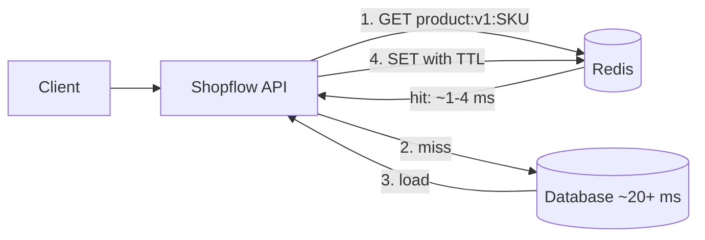
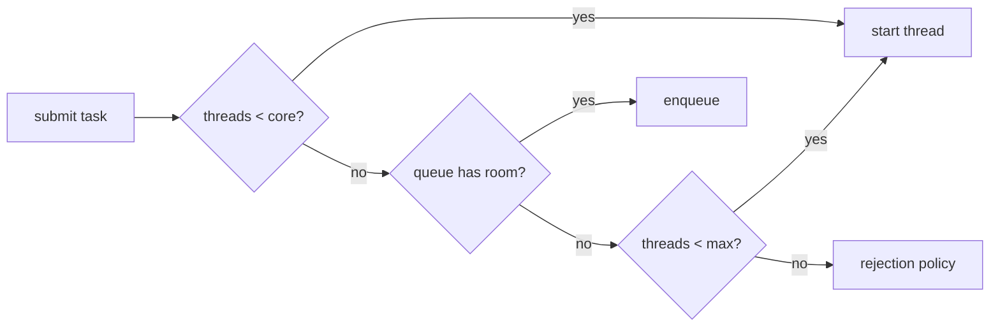
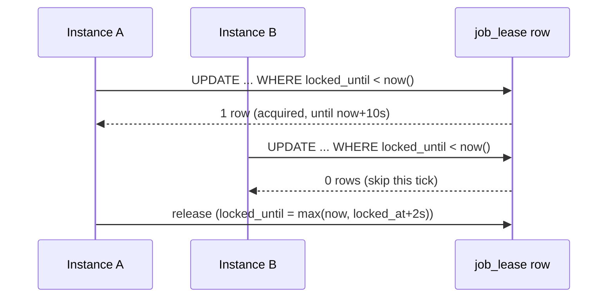
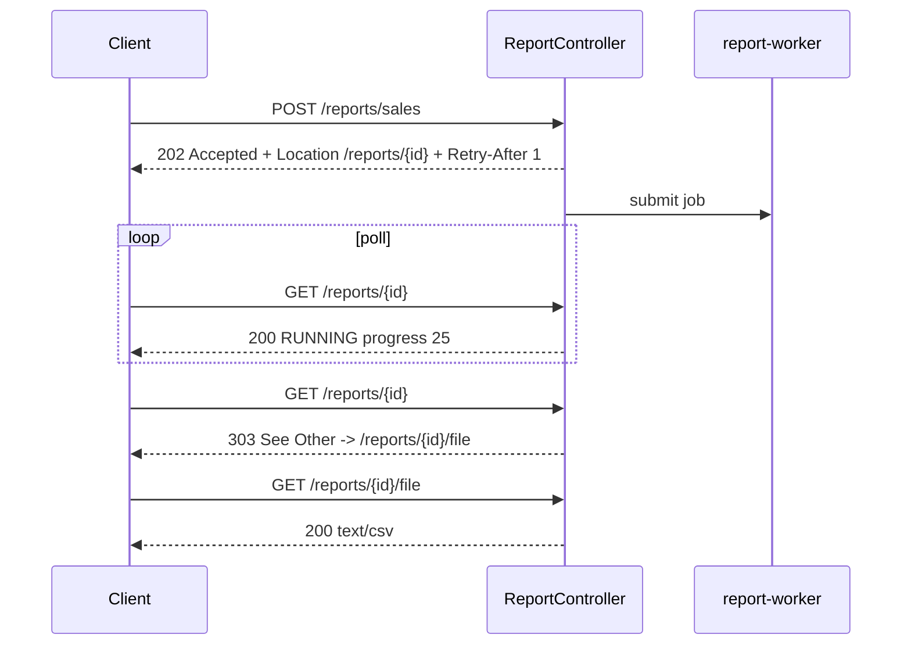

# Session 5 - Redis, caching, rate limiting, async, scheduling, webhooks and queues (from zero)

Goal: by the end you can put Redis in front of a slow read path *correctly* (cache-aside, TTLs, negative caching, invalidation, stampede/penetration defences), protect a public endpoint with a real rate limiter, move slow work off the request thread with `@Async` and a bounded executor, run `@Scheduled` jobs safely when you have 2+ instances, send and receive signed webhooks, consume a Redis Stream with at-least-once delivery without double-processing, and expose long-running work as `202 Accepted` + polling. Every bug in this article is shown first (broken -> real failure output -> fixed).

Real-world work this maps to: "the catalog endpoint is slow, add a cache" / "someone hammers our coupon API" / "send the confirmation e-mail after checkout without making checkout slow" / "the nightly job runs twice in prod" / "the payment provider retried the webhook and the order was marked paid twice" / "export the sales report without timing out the HTTP request". If you own a Spring Boot backend, every one of these lands on your desk.

Domain: `com.example.shopflow` (Products, Orders, Payments, Customers, loyalty points). Scenarios used, one per topic where it teaches best:

| Topic | Scenario |
|---|---|
| Cache, stampede, penetration | Product catalog reads (`GET /products/{sku}`) |
| Rate limiting | Public coupon-validation API (`POST /coupons/{code}/validate`, code guessing) |
| `@Async` | Order-confirmation e-mail/SMS after checkout |
| Buffered counters | Product-page view counter flushed in batches |
| `@Scheduled` + multi-instance | "Cancel unpaid orders after 30 minutes" job |
| Webhooks | Payment-provider `payment.succeeded` (receive) and merchant `order.paid` (send) |
| Queues | `order-events` Redis Stream -> loyalty points |
| Async request-reply | Sales report export (`202` + polling) |

## How to use this article

1. Create ONE Maven project (artifact `shopflow`, package `com.example.shopflow`) or add the packages to your running project. Sections add classes in sub-packages (`cache`, `ratelimit`, `async`, `jobs`, `webhook`, `stream`, `report`). Each code block starts with a `// file:` header = where to save it. Imports are mostly omitted - let the IDE add them; where a package name is new in Boot 4 it is called out.
2. Start infrastructure on RANDOM host ports (no clashes with anything on your machine):
   ```powershell
   docker run -d --name shop-redis -p 0:6379 redis:7
   docker run -d --name shop-pg -p 0:5432 -e POSTGRES_USER=shopflow -e POSTGRES_PASSWORD=shopflow -e POSTGRES_DB=shopflow postgres:16
   docker port shop-redis 6379     # e.g. 0.0.0.0:32773  <- use this port below
   docker port shop-pg 5432        # e.g. 0.0.0.0:32774
   ```
   Run the app with `--spring.data.redis.port=32773 --spring.datasource.url=jdbc:postgresql://localhost:32774/shopflow`. Cleanup at the end: `docker rm -f shop-redis shop-pg`.
3. Most demos are JUnit tests using Testcontainers (a Redis container shared by the whole test JVM, see `Infra` in section 1). Run one with `mvn test -Dtest=S6CacheProblemsTest`.
4. Every "EXPECTED OUTPUT" block is real output from Java 21.0.9, Spring Boot 4.0.8 (Spring Framework 7.0.9, Spring Data Redis 4.0.7, Lettuce 6.8.2, Tomcat 11.0.24), Redis 7, Postgres 16, on a loaded Windows laptop with Docker Desktop. Timings are noisy; counts (DB reads, 429s, rows) are what matter. Anything not run is marked `(not run)`.
5. Redis commands are shown as an interactive `redis-cli` session: `docker exec -it shop-redis redis-cli`.

## Topics

| # | Topic | You will be able to |
|---|---|---|
| 1 | Why cache + project setup | Measure DB-vs-Redis latency, set up the Boot 4 project and Postgres/Redis |
| 2 | Redis basics | Use strings/TTL/INCR/hashes/zsets/SET NX in redis-cli and map them to HLD C1-C3 |
| 3 | Spring Data Redis | Use `StringRedisTemplate`, avoid JDK-serialization junk keys, design key names |
| 4 | Manual cache-aside | Cache reads with TTL + jitter, negative caching, invalidate on write |
| 5 | Redis down | Show the failure, then degrade to the DB with try/catch and timeouts |
| 6 | Spring Cache abstraction | Use `@Cacheable/@CachePut/@CacheEvict`, per-cache TTL, JSON values, SpEL keys |
| 7 | Self-invocation + `sync` | Reproduce and fix the proxy gotcha; know what `sync=true` does and does not do |
| 8 | Stampede, penetration, stale | Demonstrate each with numbers and apply the right fix |
| 9 | Rate limiting | Implement fixed window, sliding window log, token bucket (Lua); return 429 + Retry-After; handle X-Forwarded-For |
| 10 | `@Async` | Configure a bounded executor, handle rejection and exceptions, fix self-invocation, MDC |
| 11 | Virtual threads | Switch them on, measure the effect, know the pinning caveat |
| 12 | Buffered counters | Count in Redis, flush to the DB in batches |
| 13 | `@Scheduled` | Pick fixedRate/fixedDelay/cron, understand the single-thread default |
| 14 | Multi-instance jobs | Show the double run, fix with a DB lease, survive a crash, know ShedLock |
| 15 | Webhooks | Sign (HMAC), send with timeouts + retry/backoff/jitter, verify, dedupe, reject tampering/replay |
| 16 | Redis Streams | Produce/consume with groups, ack, reclaim, and build an idempotent consumer |
| 17 | Async request-reply | Return 202 + Location, poll status, refuse when the queue is full |
| 18 | Complete slice + audit | Wire it together; audit your company's `@Scheduled/@Async/@Cacheable` |

---

## 1. Why cache, and the project setup

A cache is a *copy* of data kept somewhere faster, bought with a new problem: the copy can be wrong. So you only cache when reads dominate and slightly stale data is acceptable. Product catalog pages are the textbook case: millions of reads, a price change a few times a day.



Setup (Boot 4 starter names; Boot 3.x names are in the callout):

```xml
<!-- file: pom.xml (dependencies) -->
<parent>
  <groupId>org.springframework.boot</groupId>
  <artifactId>spring-boot-starter-parent</artifactId>
  <version>4.0.8</version>
</parent>
<properties><java.version>21</java.version></properties>
<dependencies>
  <dependency><groupId>org.springframework.boot</groupId><artifactId>spring-boot-starter-webmvc</artifactId></dependency>
  <dependency><groupId>org.springframework.boot</groupId><artifactId>spring-boot-starter-data-redis</artifactId></dependency>
  <dependency><groupId>org.springframework.boot</groupId><artifactId>spring-boot-starter-cache</artifactId></dependency>
  <dependency><groupId>org.springframework.boot</groupId><artifactId>spring-boot-starter-jdbc</artifactId></dependency>
  <dependency><groupId>org.postgresql</groupId><artifactId>postgresql</artifactId><scope>runtime</scope></dependency>

  <dependency><groupId>org.springframework.boot</groupId><artifactId>spring-boot-starter-webmvc-test</artifactId><scope>test</scope></dependency>
  <dependency><groupId>org.springframework.boot</groupId><artifactId>spring-boot-starter-data-redis-test</artifactId><scope>test</scope></dependency>
  <dependency><groupId>org.springframework.boot</groupId><artifactId>spring-boot-starter-jdbc-test</artifactId><scope>test</scope></dependency>
  <dependency><groupId>org.springframework.boot</groupId><artifactId>spring-boot-testcontainers</artifactId><scope>test</scope></dependency>
  <dependency><groupId>org.testcontainers</groupId><artifactId>testcontainers-junit-jupiter</artifactId><scope>test</scope></dependency>
  <dependency><groupId>org.testcontainers</groupId><artifactId>testcontainers-postgresql</artifactId><scope>test</scope></dependency>
</dependencies>
```

> If your company is on Spring Boot 3.x: the web starter is `spring-boot-starter-web` (4.x: `spring-boot-starter-webmvc`), the test starter is the single `spring-boot-starter-test` (4.x has per-technology `-test` starters), Testcontainers artifacts are `org.testcontainers:junit-jupiter` and `org.testcontainers:postgresql` (2.x names above: `testcontainers-junit-jupiter`, `testcontainers-postgresql`; the Postgres class moved to `org.testcontainers.postgresql.PostgreSQLContainer`). Redis and cache starters keep their names (`-data-redis`, `-cache`).

```properties
# file: src/main/resources/application.properties
spring.application.name=shopflow
spring.sql.init.mode=always
spring.data.redis.host=localhost
spring.data.redis.port=6379
spring.data.redis.timeout=500ms
spring.data.redis.connect-timeout=1s
spring.datasource.url=jdbc:postgresql://localhost:5432/shopflow
spring.datasource.username=shopflow
spring.datasource.password=shopflow
```

The two timeouts matter more than anything else here: Lettuce's default command timeout is **60 seconds**, so a hung Redis would hang your request threads for a minute (section 5 proves it matters).

The domain: a product record and a repository that *pretends* to be a slow DB (swap it for your JPA repository later; the counter lets us count DB reads in the demos).

```java
// file: src/main/java/com/example/shopflow/catalog/Product.java
public record Product(long id, String sku, String name, long priceCents, Instant updatedAt,
                      long views, Instant deletedAt) {
    public Product withPrice(long newPriceCents) {
        return new Product(id, sku, name, newPriceCents, Instant.now(), views, deletedAt);
    }
    public boolean deleted() { return deletedAt != null; }
}

// file: src/main/java/com/example/shopflow/catalog/ProductRepository.java
public interface ProductRepository {
    Optional<Product> findBySku(String sku);
    Product create(String sku, String name, long priceCents);
    Optional<Product> updatePrice(String sku, long newPriceCents);
    boolean softDelete(String sku);
    void addViews(String sku, long delta);
}

// file: src/main/java/com/example/shopflow/catalog/SlowProductRepository.java
@Repository
public class SlowProductRepository implements ProductRepository {
    private final Map<String, Product> table = new ConcurrentHashMap<>();
    private final AtomicLong ids = new AtomicLong();
    private final AtomicLong reads = new AtomicLong();
    private volatile long latencyMs;

    public SlowProductRepository(@Value("${shopflow.db-latency-ms:20}") long latencyMs) {
        this.latencyMs = latencyMs;
        create("SKU-1001", "Mechanical keyboard", 8999);
        create("SKU-1002", "USB-C hub", 3499);
    }
    @Override public Optional<Product> findBySku(String sku) {
        reads.incrementAndGet();
        sleep();                                   // the "network + disk + query" cost
        Product p = table.get(sku);
        return p == null || p.deleted() ? Optional.empty() : Optional.of(p);
    }
    @Override public Product create(String sku, String name, long priceCents) {
        Product p = new Product(ids.incrementAndGet(), sku, name, priceCents, Instant.now(), 0, null);
        table.put(sku, p);
        return p;
    }
    @Override public Optional<Product> updatePrice(String sku, long newPriceCents) {
        sleep();
        return Optional.ofNullable(table.computeIfPresent(sku, (s, p) -> p.withPrice(newPriceCents)));
    }
    @Override public boolean softDelete(String sku) {
        sleep();
        return table.computeIfPresent(sku, (s, p) -> new Product(p.id(), p.sku(), p.name(),
                p.priceCents(), Instant.now(), p.views(), Instant.now())) != null;
    }
    @Override public void addViews(String sku, long delta) {
        table.computeIfPresent(sku, (s, p) -> new Product(p.id(), p.sku(), p.name(), p.priceCents(),
                p.updatedAt(), p.views() + delta, p.deletedAt()));
    }
    public long reads() { return reads.get(); }
    public void resetReads() { reads.set(0); }
    public void setLatencyMs(long ms) { this.latencyMs = ms; }
    public Product raw(String sku) { return table.get(sku); }   // test helper: no latency, no counting
    private void sleep() { try { Thread.sleep(latencyMs); } catch (InterruptedException e) { Thread.currentThread().interrupt(); } }
}
```

Test infrastructure used by every demo test: one Redis (and lazily one Postgres) container for the whole JVM.

```java
// file: src/test/java/com/example/shopflow/Infra.java
public final class Infra {
    public static final GenericContainer<?> REDIS = new GenericContainer<>("redis:7").withExposedPorts(6379);
    private static PostgreSQLContainer postgres;
    static { REDIS.start(); }

    public static synchronized PostgreSQLContainer postgres() {
        if (postgres == null) { postgres = new PostgreSQLContainer("postgres:16"); postgres.start(); }
        return postgres;
    }
    public static void redisProps(DynamicPropertyRegistry r) {
        r.add("spring.data.redis.host", () -> "127.0.0.1");
        r.add("spring.data.redis.port", () -> REDIS.getMappedPort(6379));
    }
    public static void postgresProps(DynamicPropertyRegistry r) {
        r.add("spring.datasource.url", () -> postgres().getJdbcUrl());
        r.add("spring.datasource.username", () -> postgres().getUsername());
        r.add("spring.datasource.password", () -> postgres().getPassword());
    }
    public static void flushRedis() { cli("FLUSHALL"); }
    public static String cli(String... args) {         // run redis-cli inside the container, return stdout
        try {
            String[] cmd = new String[args.length + 1];
            cmd[0] = "redis-cli";
            System.arraycopy(args, 0, cmd, 1, args.length);
            return REDIS.execInContainer(cmd).getStdout().trim();
        } catch (Exception e) { throw new IllegalStateException(e); }
    }
    private static LettuceConnectionFactory factory;
    public static synchronized LettuceConnectionFactory connectionFactory() {
        if (factory == null) {
            factory = new LettuceConnectionFactory("127.0.0.1", REDIS.getMappedPort(6379));
            factory.afterPropertiesSet();
        }
        return factory;
    }
    public static StringRedisTemplate stringTemplate() {
        StringRedisTemplate t = new StringRedisTemplate(connectionFactory());
        t.afterPropertiesSet();
        return t;
    }
}
```

The benchmark: 200 reads from the "DB" (20 ms query) vs 200 Redis GETs.

```java
// file: src/test/java/com/example/shopflow/S1BenchmarkTest.java
@Test void dbVersusRedis() {
    SlowProductRepository repo = new SlowProductRepository(20);
    StringRedisTemplate redis = Infra.stringTemplate();
    redis.opsForValue().set("product:v1:SKU-1001", "{\"sku\":\"SKU-1001\"}");
    for (int i = 0; i < 200; i++) redis.opsForValue().get("product:v1:SKU-1001");   // warm-up
    List<Long> db = new ArrayList<>(), cache = new ArrayList<>();
    for (int i = 0; i < 200; i++) {
        long t0 = System.nanoTime(); repo.findBySku("SKU-1001"); db.add(System.nanoTime() - t0);
        t0 = System.nanoTime(); redis.opsForValue().get("product:v1:SKU-1001"); cache.add(System.nanoTime() - t0);
    }
    report("slow repo (20 ms query)", db);
    report("redis GET               ", cache);
}
```

EXPECTED OUTPUT (your numbers differ):

```text
slow repo (20 ms query)  p50=27.17 ms  p99=35.56 ms
redis GET                 p50=4.02 ms  p99=14.28 ms
```

Read it honestly: this is ~7x, not 1000x, because (a) the "DB" is a 20 ms `sleep`, a real hot query is often 2-5 ms, and (b) Redis here sits behind Docker Desktop's network on a busy laptop (a LAN Redis is typically ~0.2-1 ms). The *scaling* argument is what matters: Redis serves ~100k simple ops/second per node, your Postgres connection pool serves a few hundred queries/second. A 95% hit ratio cuts DB load 20x.

Try it: set `new SlowProductRepository(2)` and rerun. The gap shrinks - caching a 2 ms query by a 4 ms network hop would make things *slower*. Measure before you cache.

C++ equivalent: a `std::unordered_map` memo in front of an expensive function - except this memo lives in another process shared by all your instances, so it can also be invalidated by someone else. React equivalent: SWR/React Query cache - same stale-while-revalidate trade-offs, server side.

---

## 2. Redis basics (redis-cli)

Redis is a single-threaded, in-memory data-structure server. Each command is atomic; there is no row/table schema, only keys and typed values. Open a shell: `docker exec -it shop-redis redis-cli`.

```text
> SET product:v1:SKU-1001 '{"sku":"SKU-1001","priceCents":8999}'
OK
> GET product:v1:SKU-1001
"{\"sku\":\"SKU-1001\",\"priceCents\":8999}"
> EXPIRE product:v1:SKU-1001 600
(integer) 1
> TTL product:v1:SKU-1001
(integer) 600
> TTL nosuchkey
(integer) -2                      <- -2: key does not exist, -1: exists with no TTL
> PERSIST product:v1:SKU-1001
(integer) 1
> TTL product:v1:SKU-1001
(integer) -1

> SET lock:report:daily worker-1 NX EX 10      <- "set only if Not eXists", expire in 10 s
OK
> SET lock:report:daily worker-2 NX EX 10
(nil)                                          <- somebody else holds it
> GET lock:report:daily
"worker-1"

> INCR stock:SKU-1001                          <- atomic counter, creates the key at 0 first
(integer) 1
> INCRBY stock:SKU-1001 9
(integer) 10
> DECR stock:SKU-1001
(integer) 9

> HSET cart:7 SKU-1001 2 SKU-1002 1            <- hash = small map under one key
(integer) 2
> HINCRBY cart:7 SKU-1001 3
(integer) 5
> HGETALL cart:7
1) "SKU-1001"
2) "5"
3) "SKU-1002"
4) "1"

> ZADD bestsellers 120 SKU-1001 85 SKU-1002 300 SKU-2001      <- sorted set: member + score
(integer) 3
> ZINCRBY bestsellers 5 SKU-1002
"90"
> ZREVRANGE bestsellers 0 1 WITHSCORES                        <- top 2
1) "SKU-2001"
2) "300"
3) "SKU-1001"
4) "120"

> SADD views:dirty SKU-1001 SKU-1002 SKU-1001                 <- set: duplicates ignored
(integer) 2
> TYPE bestsellers
zset
> SCAN 0 MATCH product:* COUNT 100        <- iterate keys safely; NEVER use KEYS * in production
1) "0"
2) 1) "product:v1:SKU-1001"
> GETDEL lock:report:daily                <- read and delete atomically (Redis 6.2+)
"worker-1"
> CONFIG GET maxmemory-policy
1) "maxmemory-policy"
2) "noeviction"
```

What each structure is for in this article:

| Redis type | Used for | Section |
|---|---|---|
| String + TTL | cached product JSON, negative-cache marker, webhook "seen" marker, report CSV | 4, 15, 17 |
| String INCR | fixed-window rate limiter, view counters | 9, 12 |
| `SET NX EX` | single-flight lock, idempotency marker | 8, 15 |
| Hash | token bucket state, report job status | 9, 17 |
| Sorted set | sliding-window rate limiter | 9 |
| Set | "dirty" product list for the flush job | 12 |
| Stream | durable queue with consumer groups | 16 |

Two facts that bite later: `maxmemory-policy` is `noeviction` by default in the image (when memory is full, writes FAIL; real caches set `allkeys-lru` or `allkeys-lfu` plus `maxmemory`), and Redis persistence (RDB/AOF) is a durability *option* - never treat a cache-only Redis as the system of record.

**HLD notes to read alongside:** `C1-Cache-Patterns.md` (cache-aside vs write-through vs write-behind), `C2-Redis.md` (data structures, persistence, replication), `C3-Eviction-Failure-Modes.md` (LRU/LFU, stampede, penetration, avalanche).

---

## 3. Spring Data Redis: templates, serialization, key design

The starter brings Lettuce (async/netty Redis client; thread-safe, one shared connection by default - not a pool). Boot auto-configures two templates: `StringRedisTemplate` (String keys and values) and `RedisTemplate<Object,Object>`. The second one is a trap.

BROKEN: using the default `RedisTemplate`.

```java
// file: src/test/java/com/example/shopflow/S3SerializationTest.java
RedisTemplate<Object, Object> raw = new RedisTemplate<>();   // default: JDK serialization for keys AND values
raw.setConnectionFactory(Infra.connectionFactory());
raw.afterPropertiesSet();
raw.opsForValue().set("product:v1:SKU-1001", "Mechanical keyboard");
System.out.println("redis-cli --no-raw KEYS *  ->  " + Infra.cli("--no-raw", "KEYS", "*"));
System.out.println("redis-cli GET product:v1:SKU-1001  ->  [" + Infra.cli("GET", "product:v1:SKU-1001") + "]");
raw.opsForValue().set("product:v1:SKU-1001", product);   // a plain record, not Serializable
```

EXPECTED OUTPUT:

```text
redis-cli --no-raw KEYS *  ->  1) "\xac\xed\x00\x05t\x00\x13product:v1:SKU-1001"
redis-cli GET product:v1:SKU-1001  ->  []
SerializationException: Cannot serialize
```

The key you wrote is not the key stored: Java serialization prepends `\xac\xed\x00\x05t\x00\x13` (the Java stream magic). `redis-cli GET product:v1:SKU-1001` finds nothing, another service (Python, Node) can never read it, and any class change breaks deserialization. Values that are not `Serializable` fail outright.

FIXED: String keys and values you control.

```java
StringRedisTemplate s = Infra.stringTemplate();
s.opsForValue().set("product:v1:SKU-1001", "Mechanical keyboard");
// redis-cli KEYS *  ->  product:v1:SKU-1001            (readable)

RedisTemplate<String, Object> json = new RedisTemplate<>();
json.setConnectionFactory(Infra.connectionFactory());
json.setKeySerializer(StringRedisSerializer.UTF_8);
json.setValueSerializer(GenericJacksonJsonRedisSerializer.builder().build());   // Jackson 3
json.afterPropertiesSet();
json.opsForValue().set("product:v1:SKU-1002", product);
```

```text
StringRedisTemplate -> KEYS: product:v1:SKU-1001
JSON template stored: {"id":1,"sku":"SKU-1002","name":"USB-C hub","priceCents":3499,"updatedAt":"2026-01-01T10:00:00Z","views":0,"deletedAt":null}
```

> If your company is on Spring Boot 3.x: Jackson 2 is used (`com.fasterxml.jackson.databind.ObjectMapper`), and the serializers are `GenericJackson2JsonRedisSerializer` / `Jackson2JsonRedisSerializer<T>`. In Boot 4 / Spring Data Redis 4 they are `GenericJacksonJsonRedisSerializer` / `JacksonJsonRedisSerializer<T>` and use Jackson 3 (`tools.jackson.databind.json.JsonMapper`). Jackson 3 also writes `Instant` as ISO-8601 by default.

Rule of thumb in this article: store JSON as a **String** yourself with the injected `JsonMapper` (you see exactly what is in Redis, any language can read it, and you control versioning).

**Key design** (a naming convention is half of Redis operations):

| Rule | Example | Why |
|---|---|---|
| `domain:version:id` with colons | `product:v1:SKU-1001` | `v1` lets you change the JSON shape without reading old-format values; tools group by `:` |
| Namespace per app/env if the Redis is shared | `shopflow:prod:...` | avoids collisions between services |
| Include every dimension that changes the value | `product:v1:SKU-1001:locale=en` | otherwise users see each other's data |
| Never put unbounded user input in keys without validation | length-limit the sku | memory abuse |
| Every cache key gets a TTL | `EXPIRE` | a key with no TTL is a leak |
| Short, no spaces | | keys cost memory too |

---

## 4. Manual cache-aside: TTL, jitter, negative caching, invalidation

Cache-aside means *the application* talks to both: read cache -> on miss read DB -> write cache; on writes update DB then delete the cache entry. (Write-through/write-behind put the cache in the write path; see C1.)

```java
// file: src/main/java/com/example/shopflow/cache/ProductLookup.java  (core; the other methods follow)
@Service
public class ProductLookup {
    private static final Logger log = LoggerFactory.getLogger(ProductLookup.class);
    static final String KEY_PREFIX = "product:v1:";
    static final String NOT_FOUND_MARK = "__not_found__";

    private final ProductRepository repo;
    private final StringRedisTemplate redis;
    private final JsonMapper json;                // tools.jackson.databind.json.JsonMapper (Jackson 3)
    private final Duration ttl;
    private final Duration negativeTtl;

    public ProductLookup(ProductRepository repo, StringRedisTemplate redis, JsonMapper json,
                         @Value("${shopflow.cache.product-ttl:PT10M}") Duration ttl,
                         @Value("${shopflow.cache.negative-ttl:PT30S}") Duration negativeTtl) {
        this.repo = repo; this.redis = redis; this.json = json; this.ttl = ttl; this.negativeTtl = negativeTtl;
    }

    public Optional<Product> find(String sku) {
        String cached = redis.opsForValue().get(KEY_PREFIX + sku);        // 1. cache
        if (cached != null) {
            return NOT_FOUND_MARK.equals(cached) ? Optional.empty()
                                                 : Optional.of(json.readValue(cached, Product.class));
        }
        Optional<Product> loaded = repo.findBySku(sku);                   // 2. miss -> DB
        if (loaded.isPresent()) {                                         // 3. fill cache
            redis.opsForValue().set(KEY_PREFIX + sku, json.writeValueAsString(loaded.get()), withJitter(ttl));
        } else {
            redis.opsForValue().set(KEY_PREFIX + sku, NOT_FOUND_MARK, negativeTtl);   // negative caching
        }
        return loaded;
    }

    public void evict(String sku) { redis.delete(KEY_PREFIX + sku); }     // call after EVERY write

    static Duration withJitter(Duration base) {                           // +0..10% so keys do not expire together
        return base.plusMillis(ThreadLocalRandom.current().nextLong(base.toMillis() / 10 + 1));
    }
}
```

Three ideas to notice:

- **TTL is your staleness budget.** A 10-minute TTL means "a price change can take up to 10 minutes to appear unless we evict". Evicting on write makes this the *worst case* instead of the *normal case*.
- **Negative caching:** a lookup for an unknown SKU is stored as `__not_found__` for only 30 s. A scraper asking for the same missing SKU 1000 times hits the DB once. Short TTL because the product may be created any minute (and we also evict on create).
- **Jitter:** if 10,000 products are loaded at start-up with a flat 600 s TTL they all expire in the same second (an "avalanche"). Adding up to 10% random spreads them.

The controller (reads go through the cache; writes go to the DB and then evict):

```java
// file: src/main/java/com/example/shopflow/catalog/ProductController.java
@RestController @RequestMapping("/products")
public class ProductController {
    public record NewProduct(String sku, String name, long priceCents) {}
    public record PriceChange(long priceCents) {}
    private final ProductLookup lookup; private final ProductRepository repo;
    public ProductController(ProductLookup lookup, ProductRepository repo) { this.lookup = lookup; this.repo = repo; }

    @GetMapping("/{sku}")
    public Product get(@PathVariable String sku) {
        return lookup.find(sku).orElseThrow(() -> new ResponseStatusException(HttpStatus.NOT_FOUND, "Unknown product " + sku));
    }
    @PostMapping
    public ResponseEntity<Product> create(@RequestBody NewProduct in) {
        Product p = repo.create(in.sku(), in.name(), in.priceCents());
        lookup.evict(in.sku());                                  // kills a cached "not found"
        return ResponseEntity.status(HttpStatus.CREATED).body(p);
    }
    @PutMapping("/{sku}/price")
    public Product changePrice(@PathVariable String sku, @RequestBody PriceChange in) {
        Product p = repo.updatePrice(sku, in.priceCents()).orElseThrow(() -> new ResponseStatusException(HttpStatus.NOT_FOUND, "Unknown product " + sku));
        lookup.evict(sku);
        return p;
    }
    @DeleteMapping("/{sku}")
    public ResponseEntity<Void> delete(@PathVariable String sku) {
        if (!repo.softDelete(sku)) throw new ResponseStatusException(HttpStatus.NOT_FOUND, "Unknown product " + sku);
        lookup.evict(sku);
        return ResponseEntity.noContent().build();
    }
}
```

Run it and poke it (random port; `$P` = your port, `redis-cli` as before):

```text
$ curl -s -i localhost:$P/products/SKU-1001           -> HTTP/1.1 200   (JSON body, cache MISS then filled)
> TTL product:v1:SKU-1001                              -> (integer) 629     <- 600 s + jitter
$ curl -s -i localhost:$P/products/NOPE-1             -> HTTP/1.1 404
> GET product:v1:NOPE-1                                -> "__not_found__"   (TTL about 30)
$ curl -s -X POST localhost:$P/products -H "Content-Type: application/json" -d '{"sku":"NOPE-1","name":"Webcam","priceCents":4999}'
                                                       -> HTTP/1.1 201
$ curl -s -i localhost:$P/products/NOPE-1             -> HTTP/1.1 200   (evict on create removed the negative entry)
$ curl -s -X PUT localhost:$P/products/SKU-1001/price -H "Content-Type: application/json" -d '{"priceCents":7999}'
$ curl -s localhost:$P/products/SKU-1001              -> price 7999     (evict on write: no stale read)
$ curl -s -X DELETE localhost:$P/products/SKU-1001     -> HTTP/1.1 204
$ curl -s -i localhost:$P/products/SKU-1001           -> HTTP/1.1 404
```

(Outputs are abridged: status lines and the values that matter; I ran each of these against the real jar.) I deliberately do not quote request timings from curl on Windows - process start-up dominates them.

**Stale reads - the invariant that bites.** Evict-after-write is only as good as every writer. Reproduce the bug (a batch job updates the DB directly and forgets the cache):

```java
// file: src/test/java/com/example/shopflow/S6CacheProblemsTest.java
System.out.println("price in cache      : " + lookup.find("SKU-1001").get().priceCents());
repo.updatePrice("SKU-1001", 7999);                       // DB-only update, no evict
System.out.println("after DB-only update: " + lookup.find("SKU-1001").get().priceCents() + "   <- STALE");
lookup.evict("SKU-1001");
System.out.println("after evict         : " + lookup.find("SKU-1001").get().priceCents());
System.out.println("SKU-5555 before create: " + lookup.find("SKU-5555").isPresent());
repo.create("SKU-5555", "Webcam", 4999);                  // created, cache not told
System.out.println("after create, no evict: " + lookup.find("SKU-5555").isPresent() + "   <- negative entry still cached");
lookup.evict("SKU-5555");
System.out.println("after evict           : " + lookup.find("SKU-5555").isPresent());
```

```text
price in cache      : 8999
after DB-only update: 8999   <- STALE
after evict         : 7999
SKU-5555 before create: false
after create, no evict: false   <- negative entry still cached
after evict           : true
```

Mitigations: one write path per entity (a service, never ad-hoc SQL), a TTL as the safety net, evict (delete) rather than update the cache value (an update can race with a concurrent reader's older value; a delete just forces a reload), and for multi-service systems publish a change event that triggers eviction (section 16).

**Pitfall - cache-aside race:** reader A misses and loads price 8999; writer updates DB to 7999 and evicts; reader A *then* writes 8999 into the cache. Stale until TTL. Rare, bounded by the TTL, and the reason TTLs are mandatory.

---

## 5. When Redis is down: broken, then fixed

Preview of session 7 (resilience). A cache must never be a *single point of failure*. We simulate a Redis blackhole with `docker pause shop-redis` (the TCP connection stays open but nothing answers - the nastiest failure).

BROKEN (the `find` above, no error handling):

```text
$ docker pause shop-redis
$ curl -s -i localhost:$P/products/SKU-1002
HTTP/1.1 500
... RedisConnectionFailureException / RedisCommandTimeoutException: Command timed out after 500 millisecond(s)
$ docker unpause shop-redis
$ curl -s -i localhost:$P/products/SKU-1002        -> HTTP/1.1 200    (recovers by itself)
```

A cache outage became a site outage. Note `500 millisecond(s)`: that is *our* `spring.data.redis.timeout=500ms`. With Lettuce's default (60 s) every request would have hung for a minute and exhausted the Tomcat thread pool.

FIXED: treat every cache call as best-effort.

```java
// file: ProductLookup.java (final shape)
private String cacheGet(String sku) {
    try {
        return redis.opsForValue().get(KEY_PREFIX + sku);
    } catch (DataAccessException e) {
        log.warn("cache read failed for {}: {} -> falling back to the database", sku, e.getClass().getSimpleName());
        return null;                                   // behave like a miss
    }
}
private Optional<Product> loadAndCache(String sku) {
    Optional<Product> loaded = repo.findBySku(sku);
    try {
        if (loaded.isPresent()) redis.opsForValue().set(KEY_PREFIX + sku, json.writeValueAsString(loaded.get()), withJitter(ttl));
        else redis.opsForValue().set(KEY_PREFIX + sku, NOT_FOUND_MARK, negativeTtl);
    } catch (DataAccessException e) {
        log.warn("cache put failed for {}: {}", sku, e.getClass().getSimpleName());
    }
    return loaded;
}
public void evict(String sku) {
    try { redis.delete(KEY_PREFIX + sku); }
    catch (DataAccessException e) { log.warn("cache evict failed for {}: {} (entry may stay stale until TTL)", sku, e.getClass().getSimpleName()); }
}
```

(`find` now calls `cacheGet(sku)` / `loadAndCache(sku)`.) After `docker pause shop-redis` again:

```text
$ curl -s -i localhost:$P/products/SKU-1002        -> HTTP/1.1 200   (product JSON, served from the DB)
WARN ... ProductLookup : cache read failed for SKU-1002: QueryTimeoutException -> falling back to the database
WARN ... ProductLookup : cache put failed for SKU-1002: QueryTimeoutException
$ docker unpause shop-redis                         -> works normally again
```

Caveat you must understand: each failing Redis call still costs the full 500 ms timeout, so during an outage every request is 500 ms *slower* (twice: get + put) and your DB now takes 100% of the traffic it was being shielded from. The real fix is a **circuit breaker** that stops calling Redis for 30 s after N failures (Resilience4j, session 7), plus a DB that can survive the load or a load-shedding limit. Also: a failed `evict` leaves stale data - another reason for TTLs.

**HLD notes:** `I2-Timeouts-Retries-Backoff.md`, `I3-Circuit-Breaker-Bulkhead.md`.

---

## 6. Spring Cache abstraction

Writing get/put/evict by hand everywhere is repetitive, so Spring offers annotations over a `CacheManager`. Behind the annotation is an AOP proxy (section 7 explains why that matters).

```java
// file: src/main/java/com/example/shopflow/cache/CacheConfig.java
@Configuration
@EnableCaching
public class CacheConfig {
    @Bean
    RedisCacheManager cacheManager(RedisConnectionFactory connectionFactory) {
        RedisCacheConfiguration defaults = RedisCacheConfiguration.defaultCacheConfig()
                .prefixCacheNameWith("shopflow:")                       // keys: shopflow:products::SKU-1001
                .serializeValuesWith(SerializationPair.fromSerializer(new JacksonJsonRedisSerializer<>(Product.class)))
                .entryTtl(Duration.ofMinutes(5));                       // default TTL for any cache

        // per-cache TTL: real products 10 min, a cached "null" (not found) only 30 s
        RedisCacheConfiguration products = defaults.entryTtl(
                (key, value) -> value == null || value.getClass().getSimpleName().equals("NullValue")
                        ? Duration.ofSeconds(30) : Duration.ofMinutes(10));

        return RedisCacheManager.builder(connectionFactory)
                .cacheDefaults(defaults)
                .withCacheConfiguration("products", products)
                .build();
    }
}

// file: src/main/java/com/example/shopflow/cache/CachedProductService.java
@Service
public class CachedProductService {
    private final ProductRepository repo;
    public CachedProductService(ProductRepository repo) { this.repo = repo; }

    @Cacheable(cacheNames = "products", key = "#sku", condition = "#sku.length() <= 20")
    public Optional<Product> find(String sku) { return repo.findBySku(sku); }

    @CachePut(cacheNames = "products", key = "#result.sku()")      // always runs, always refreshes the entry
    public Product changePrice(String sku, long newPriceCents) {
        return repo.updatePrice(sku, newPriceCents).orElseThrow();
    }

    @CacheEvict(cacheNames = "products", key = "#sku")
    public void delete(String sku) { repo.softDelete(sku); }

    @CacheEvict(cacheNames = "products", allEntries = true)
    public void evictAll() {}
}
```

> If your company is on Spring Boot 3.x: identical annotations, but the value serializer is `new Jackson2JsonRedisSerializer<>(Product.class)` or `GenericJackson2JsonRedisSerializer` and `Optional`/record handling uses the Jackson 2 `ObjectMapper`. The `@EnableCaching` / `@Cacheable` annotations are unchanged.

| Annotation / attribute | Meaning | Gotcha |
|---|---|---|
| `@Cacheable` | check cache; on miss run method and store | method is skipped on a hit - do not put side effects in it |
| `@CachePut` | always run the method, store result | pairs with writes; `key` must equal the read key |
| `@CacheEvict` | delete the entry (`allEntries = true` clears the cache, `beforeInvocation = true` evicts even if the method throws) | default evicts AFTER success |
| `key` (SpEL) | `#sku`, `#p.id`, `#root.methodName`, `#result` (put/evict only) | default key uses all params - fine for 1 arg, surprising for 3 |
| `condition` | evaluated BEFORE the call; false -> bypass the cache entirely | cannot use `#result` |
| `unless` | evaluated AFTER the call; true -> do not store | can use `#result`; e.g. `unless = "#result == null"` |
| `sync = true` | one thread computes, others wait (section 7: read the fine print) | one cache only, no `unless` |

`Optional<Product>` return type works: Spring unwraps it and caches the value (an empty Optional becomes a cached null).

Test (3 calls, key/TTL/raw value, a `null` entry, a `condition` that is false):

```java
service.find("SKU-1001"); service.find("SKU-1001"); service.find("SKU-1001");
System.out.println("3 calls of find(SKU-1001) -> DB reads = " + repo.reads());
System.out.println("redis keys : " + Infra.cli("KEYS", "*"));
System.out.println("TTL        : " + Infra.cli("TTL", "shopflow:products::SKU-1001"));
System.out.println("raw value  : " + Infra.cli("GET", "shopflow:products::SKU-1001"));
repo.resetReads(); service.find("NOPE"); service.find("NOPE");
System.out.println("2 calls of find(NOPE) -> DB reads = " + repo.reads() + ", TTL of null entry = " + Infra.cli("TTL", "shopflow:products::NOPE") + "s");
repo.resetReads(); service.find("SKU-" + "X".repeat(30)); service.find("SKU-" + "X".repeat(30));
System.out.println("condition (key length <= 20) false -> 2 calls -> DB reads = " + repo.reads());
```

EXPECTED OUTPUT:

```text
CacheManager type: RedisCacheManager
3 calls of find(SKU-1001) -> DB reads = 1
redis keys : shopflow:products::SKU-1001
TTL        : 600
raw value  : {"id":1,"sku":"SKU-1001","name":"Mechanical keyboard","priceCents":8999,"updatedAt":"2026-10-19T04:39:51.341343700Z","views":0,"deletedAt":null}
2 calls of find(NOPE) -> DB reads = 1, TTL of null entry = 30s
condition (key length <= 20) false -> 2 calls -> DB reads = 2
after @CachePut: price=7999, DB reads = 0
after @CacheEvict + soft delete: present=false, DB reads = 1
```

`@CachePut` refreshed the entry so the next read cost 0 DB reads; `@CacheEvict` made the next read go to the DB (and find the product deleted). The `condition` (refuse to cache absurdly long keys - a defence against key-flooding) bypassed the cache both times.

Pitfalls: `@Cacheable` on a `private` or `final`/self-called method does nothing (next section); the default cache key for several parameters is a `SimpleKey` - write the SpEL explicitly; `Page<T>` / entity graphs with lazy relations are bad cache values - cache small DTO records; never cache `Optional` of a JPA entity, cache the DTO.

---

## 7. The self-invocation gotcha and what `sync=true` really does

`@Cacheable`, `@Async`, `@Transactional`, `@Retryable` are all implemented by a **proxy** wrapped around your bean. The proxy intercepts calls coming *from outside*. A call from one method to another method of the *same* object is plain Java (`this.find(..)`) and never touches the proxy.


BROKEN:

```java
// in CachedProductService
public long priceOfBroken(String sku) {
    return find(sku).map(Product::priceCents).orElse(-1L);   // this.find() - no proxy, no cache
}
```

FIXED: call the cached method through *another bean* (or split the class).

```java
// file: src/main/java/com/example/shopflow/cache/PriceQuoteService.java
@Service
public class PriceQuoteService {
    private final CachedProductService products;
    public PriceQuoteService(CachedProductService products) { this.products = products; }
    public long priceOf(String sku) { return products.find(sku).map(Product::priceCents).orElse(-1L); }
}
```

```text
BROKEN  priceOf x3 (this.find): DB reads = 3, keys in Redis = []
FIXED   priceOf x3 (other bean): DB reads = 1
```

No error, no warning - the annotation is silently ignored. That is why it is a favourite interview and production bug. Other fixes: inject the bean into itself (`@Lazy` self-reference), use `TransactionTemplate`/`CacheManager` programmatically, or AspectJ weaving (rare). Same rule for `@Async` (section 10) and `@Transactional`.

C++ equivalent: calling a member function directly versus through a decorator object - the decorator only sees calls routed through it.

**`sync=true` - the finding most tutorials get wrong.** `@Cacheable(sync = true)` says "only one thread should compute a missing value". We tested it against 100 threads missing at once (200 ms DB):

```text
@Cacheable        100 concurrent misses -> DB reads = 100
@Cacheable(sync)  100 concurrent misses (default non-locking writer) -> DB reads = 100
Cache.get(key, loader) with lockingRedisCacheWriter -> DB reads = 1
```

With `RedisCacheManager`'s *default* (non-locking) cache writer, `sync=true` did **not** stop the stampede in my test: all 100 loaders ran. Spring's `sync` hands the problem to the cache implementation, and the Redis cache only coordinates loaders across threads/instances when it is built on the *locking* writer:

```java
RedisCacheManager.builder(RedisCacheWriter.lockingRedisCacheWriter(connectionFactory))
        .cacheDefaults(...).build();
// then use cache.get(key, () -> repo.load(key)) or @Cacheable(sync = true)
```

and even then the lock is taken in Redis for *every* cache operation (slower), and `sync` supports a single cache name and no `unless`. For stampede protection I prefer the explicit single-flight below.

---

## 8. Cache problems you will meet: stampede, penetration, avalanche

All three are demonstrated in `S6CacheProblemsTest` (DB latency 200 ms for the stampede, 5 ms for the rest).

### 8.1 Stampede (thundering herd)

A hot key expires; 100 requests arrive in the same instant; all see a miss; all hit the DB.

```java
runConcurrently(100, i -> lookup.find("SKU-1001"));        // 100 threads released by one CountDownLatch
System.out.println("STAMPEDE  plain cache-aside : 100 concurrent misses -> DB reads = " + repo.reads());
```

Fix A - **single-flight with a Redis lock** (works across instances): only the holder of `SET lock:product:SKU NX EX 5` loads; the others poll the cache for up to 2 s.

```java
// in ProductLookup
private static final DefaultRedisScript<Long> UNLOCK = new DefaultRedisScript<>(
    "if redis.call('get', KEYS[1]) == ARGV[1] then return redis.call('del', KEYS[1]) else return 0 end", Long.class);

public Optional<Product> findSingleFlight(String sku) {
    String cached = cacheGet(sku);
    if (cached != null) return decode(cached);
    String lockKey = "lock:product:" + sku;
    String token = UUID.randomUUID().toString();                     // so we only release OUR lock
    if (Boolean.TRUE.equals(redis.opsForValue().setIfAbsent(lockKey, token, Duration.ofSeconds(5)))) {
        try { return loadAndCache(sku); }
        finally { redis.execute(UNLOCK, List.of(lockKey), token); }  // compare-and-delete, atomic in Lua
    }
    long deadline = System.nanoTime() + Duration.ofSeconds(2).toNanos();
    while (System.nanoTime() < deadline) {
        sleep(25);
        cached = cacheGet(sku);
        if (cached != null) return decode(cached);
    }
    return loadAndCache(sku);        // holder died or is too slow: do the work ourselves
}
```

```text
STAMPEDE  plain cache-aside : 100 concurrent misses -> DB reads = 100
STAMPEDE  Redis lock (SET NX): 100 concurrent misses -> DB reads = 1
```

The lock has an expiry (5 s) so a crashed holder cannot block forever, and the unlock compares the token so a slow holder does not delete somebody else's later lock. This is a *best-effort efficiency lock*, not a correctness lock (see `G2-Distributed-Locks-Reservations.md`). Fix B: `sync=true` with the locking writer (section 7). Fix C: **jittered TTLs** so keys do not all expire together (below). Fix D: refresh-ahead - a scheduled job reloads the 100 hottest keys *before* they expire, and logical expiry (serve stale while one thread refreshes).

### 8.2 Penetration (requests for data that does not exist)

Misses that are *never* cacheable: a scraper walks `SKU-9000..9049`, or attackers send random SKUs.

```text
PENETRATION without negative cache: DB reads = 1000
PENETRATION with negative cache   : DB reads = 50
PENETRATION 1000 distinct random SKUs, negative cache only: DB reads = 1000
PENETRATION 1000 distinct random SKUs behind a Bloom filter: passed filter = 27, DB reads = 27
Bloom filter: real SKU-42 -> true
```

1000 requests over 50 bogus SKUs: negative caching cuts the DB to 50 reads (one per distinct SKU). But 1000 *distinct* random SKUs defeat it: still 1000. A **Bloom filter** loaded with every real SKU answers "definitely not present" without touching Redis or the DB; only ~1-3% false positives (27 of 1000 here) leak through. In production use Guava's `BloomFilter` or RedisBloom (`(not run)`; my demo used a 30-line `BitSet` filter), rebuild it when products are added, and combine with a rate limit (section 9) and plain input validation (a SKU is 8 chars matching `SKU-\d{4}`; reject the rest with 400 before any cache lookup).

### 8.3 Avalanche and jitter

```text
TTLs of 5 products cached at the same moment (base 600s): [626s, 612s, 646s, 635s, 606s]
```

The same `withJitter` from section 4 at work. Avalanche also happens when *Redis itself* restarts empty: every key misses at once. Mitigate with warm-up, a Redis replica/persistence, and the single-flight/circuit-breaker/rate-limit trio.

### 8.4 The decision table

| Problem | Symptom | Cheapest fix | Extra |
|---|---|---|---|
| Stampede | DB spike when one hot key expires | single-flight lock | jitter, refresh-ahead |
| Penetration | DB load from keys that do not exist | negative cache (30 s) | Bloom filter, input validation, rate limit |
| Avalanche | many keys expire together | jittered TTL | warm-up, replicas |
| Stale data | users see old price | evict on write + TTL | change events |
| Hot key | one key saturates one Redis node | local in-process cache (Caffeine) in front | key replication |
| Big value | 5 MB JSON per key | cache DTOs / pages, compress | |

---

## 9. Rate limiting a public API

Scenario: `POST /coupons/{code}/validate` is public. Attackers script it to guess codes. We allow 5 requests per client per window and answer `429 Too Many Requests` with `Retry-After` beyond that. Three algorithms, all backed by Redis so the limit is shared by every instance.

```java
// file: src/main/java/com/example/shopflow/ratelimit/RateLimiter.java
public interface RateLimiter {
    Decision tryAcquire(String key);
    record Decision(boolean allowed, long remaining, long retryAfterMillis) {
        public long retryAfterSeconds() { return Math.max(1, (retryAfterMillis + 999) / 1000); }
    }
}
```

### 9.1 Fixed window: INCR + EXPIRE (simple, cheap, flawed)

```java
// file: .../ratelimit/FixedWindowLimiter.java
public class FixedWindowLimiter implements RateLimiter {
    private final StringRedisTemplate redis; private final int limit; private final Duration window;
    // constructor assigns the three fields
    @Override public Decision tryAcquire(String key) {
        String k = "rl:fw:" + key;
        Long count = redis.opsForValue().increment(k);
        if (count != null && count == 1) redis.expire(k, window);          // first hit starts the window
        Long ttlMs = redis.getExpire(k, TimeUnit.MILLISECONDS);
        if (ttlMs != null && ttlMs == -1) {                                // INCR ran but EXPIRE never did: repair, or the key blocks forever
            redis.expire(k, window); ttlMs = window.toMillis();
        }
        long used = count == null ? 0 : count;
        return used <= limit ? new Decision(true, limit - used, 0) : new Decision(false, 0, ttlMs == null ? window.toMillis() : ttlMs);
    }
}
```

The flaw: **boundary burst**. Window = 2 s, limit = 5. A client sends 5 requests at the very end of window 1 and 5 more at the very start of window 2 - 10 requests in a few hundred ms, while each window saw only 5. Demonstration (1 warm-up request at t=0, then 5 at t=1800 ms, 5 at t=2100 ms):

```text
FIXED WINDOW:   t=0 ALLOW | 1800: ALLOW x4, deny | 2100: ALLOW x5  -> allowed between 1800 and 2100 ms: 9  (limit says 5 per 2000 ms)
```

(Four at 1800 because the t=0 request used one of the five.) Also note the INCR and EXPIRE are two commands: a crash between them leaves a counter with no TTL - hence the repair line (or use a Lua script / `SET key 0 EX n NX` first).

### 9.2 Sliding window log: sorted set (exact, memory-heavier)

Every accepted request is a ZSET member scored by its time; old members are trimmed; count what is left. It must be ONE atomic step, so it is a Lua script (Redis runs a script without interleaving other commands). We use Redis's own clock (`TIME`) so app clock skew cannot matter.

```java
// file: .../ratelimit/SlidingWindowLimiter.java
public class SlidingWindowLimiter implements RateLimiter {
    private static final String LUA = """
            local t = redis.call('TIME')
            local now = t[1] * 1000 + math.floor(t[2] / 1000)
            local window = tonumber(ARGV[1])
            local limit = tonumber(ARGV[2])
            redis.call('ZREMRANGEBYSCORE', KEYS[1], 0, now - window)
            local count = redis.call('ZCARD', KEYS[1])
            if count < limit then
              redis.call('ZADD', KEYS[1], now, ARGV[3])
              redis.call('PEXPIRE', KEYS[1], window)
              return {1, limit - count - 1, 0}
            end
            local oldest = redis.call('ZRANGE', KEYS[1], 0, 0, 'WITHSCORES')
            return {0, 0, tonumber(oldest[2]) + window - now}
            """;
    @SuppressWarnings("rawtypes")
    private final DefaultRedisScript<List> script = new DefaultRedisScript<>(LUA, List.class);
    // fields redis, limit, window as before
    @Override @SuppressWarnings("unchecked")
    public Decision tryAcquire(String key) {
        List<Long> r = redis.execute(script, List.of("rl:sw:" + key),
                String.valueOf(window.toMillis()), String.valueOf(limit), UUID.randomUUID().toString());  // unique member per request
        return new Decision(r.get(0) == 1L, r.get(1), r.get(2));
    }
}
```

```text
SLIDING LOG:    t=0 ALLOW | 1800: ALLOW x4, deny | 2100: ALLOW, deny x4  -> allowed between 1800 and 2100 ms: 5
```

At 2100 ms the t=0 entry slid out (one slot free), but the four from 1800 ms still count: exactly 5 in any 2-second window. Cost: O(limit) memory per key. Denied requests are not stored (`ZCARD` stayed at 3 after 4 calls with limit 3), so hammering does not grow memory.

### 9.3 Token bucket: bursts allowed, sustained rate capped (what most APIs use)

A bucket holds up to `capacity` tokens and refills at `rate` tokens/s; each request takes one. Idle clients accumulate a burst allowance; abusers are held to the refill rate. State is a hash (`tokens`, `ts`); refill is computed lazily on each call, atomically in Lua.

```java
// file: .../ratelimit/TokenBucketLimiter.java
public class TokenBucketLimiter implements RateLimiter {
    private static final String LUA = """
            local t = redis.call('TIME')
            local now = t[1] * 1000 + math.floor(t[2] / 1000)
            local capacity = tonumber(ARGV[1])
            local rate = tonumber(ARGV[2])
            local data = redis.call('HMGET', KEYS[1], 'tokens', 'ts')
            local tokens = tonumber(data[1])
            local ts = tonumber(data[2])
            if tokens == nil then tokens = capacity; ts = now end
            tokens = math.min(capacity, tokens + (now - ts) / 1000 * rate)
            local allowed = 0
            local retry = 0
            if tokens >= 1 then tokens = tokens - 1; allowed = 1
            else retry = math.ceil((1 - tokens) / rate * 1000) end
            redis.call('HSET', KEYS[1], 'tokens', tostring(tokens), 'ts', now)
            redis.call('PEXPIRE', KEYS[1], math.ceil(capacity / rate * 1000) + 1000)
            return {allowed, math.floor(tokens), retry}
            """;
    // same script/field/constructor shape as above: (redis, capacity, refillPerSecond); key "rl:tb:" + key; args capacity, refillPerSecond
}
```

```text
TOKEN BUCKET (cap 5, 2.5 tokens/s): t=0 ALLOW | 1800: ALLOW x5 | 2100: deny x5   -> 5
```

Capacity 3, refill 1/s, five calls in a row:

```text
call 1 -> allowed remaining=2
call 2 -> allowed remaining=1
call 3 -> allowed remaining=0
call 4 -> DENIED  retryAfterMs=973
call 5 -> DENIED  retryAfterMs=967
> HGETALL rl:tb:demo
1) "tokens"  2) "0.033"  3) "ts"  4) "<epoch ms>"          (TTL 3)
```

| Algorithm | Accuracy | Memory/key | Allows bursts? | Use when |
|---|---|---|---|---|
| Fixed window | poor at edges (2x) | 1 counter | up to 2x | internal/cheap limits |
| Sliding window log | exact | O(limit) | no | small limits (login attempts) |
| Sliding window counter (2 counters, weighted) | ~exact | 2 counters | slight | big limits, cheap |
| Token bucket | exact rate + burst | 1 hash | yes (capacity) | public APIs |

Bucket4j (`https://github.com/bucket4j/bucket4j`) is a library implementing token buckets, with a Redis/JDBC backend and Spring integration; reading it after this section will be easy `(not run)`. Behind a gateway (NGINX, API Gateway, Envoy) prefer limiting there; app-level limiting is for business rules ("5 coupon tries per customer").

### 9.4 Wiring into Spring MVC: interceptor + 429 + ProblemDetail

```java
// file: .../ratelimit/RateLimitInterceptor.java
public class RateLimitInterceptor implements HandlerInterceptor {
    private static final Logger log = LoggerFactory.getLogger(RateLimitInterceptor.class);
    private final RateLimiter limiter; private final Function<HttpServletRequest, String> keyResolver;
    // constructor assigns both
    @Override
    public boolean preHandle(HttpServletRequest req, HttpServletResponse res, Object handler) {
        RateLimiter.Decision d;
        try { d = limiter.tryAcquire(keyResolver.apply(req)); }
        catch (DataAccessException e) {                       // fail OPEN: a Redis outage must not take the public API down
            log.warn("rate limiter unavailable ({}), allowing request", e.getClass().getSimpleName());
            return true;
        }
        res.setHeader("X-RateLimit-Remaining", String.valueOf(d.remaining()));
        if (!d.allowed()) throw new TooManyRequestsException(d.retryAfterSeconds());
        return true;
    }
}

// file: .../ratelimit/TooManyRequestsException.java
public class TooManyRequestsException extends RuntimeException {
    private final long retryAfterSeconds;
    public TooManyRequestsException(long s) { super("rate limited"); this.retryAfterSeconds = s; }
    public long getRetryAfterSeconds() { return retryAfterSeconds; }
}

// file: .../ratelimit/ApiExceptionHandler.java
@RestControllerAdvice
public class ApiExceptionHandler {
    @ExceptionHandler(TooManyRequestsException.class)
    ResponseEntity<ProblemDetail> tooMany(TooManyRequestsException e) {
        ProblemDetail pd = ProblemDetail.forStatusAndDetail(HttpStatus.TOO_MANY_REQUESTS, "Too many requests. Retry in " + e.getRetryAfterSeconds() + "s.");
        pd.setTitle("Rate limit exceeded");
        pd.setProperty("retryAfterSeconds", e.getRetryAfterSeconds());
        return ResponseEntity.status(HttpStatus.TOO_MANY_REQUESTS)
                .header(HttpHeaders.RETRY_AFTER, String.valueOf(e.getRetryAfterSeconds())).body(pd);
    }
}

// file: .../ratelimit/RateLimitConfig.java
@Configuration
public class RateLimitConfig implements WebMvcConfigurer {
    private final RateLimiter limiter; private final Function<HttpServletRequest, String> keyResolver;
    RateLimitConfig(StringRedisTemplate redis,
                    @Value("${shopflow.ratelimit.algorithm:fixed}") String algorithm,
                    @Value("${shopflow.ratelimit.limit:5}") int limit,
                    @Value("${shopflow.ratelimit.window:10s}") Duration window,
                    @Value("${shopflow.ratelimit.trusted-proxy-hops:0}") int hops,
                    @Value("${shopflow.ratelimit.insecure-trust-xff:false}") boolean insecure) {
        this.limiter = switch (algorithm) {
            case "sliding" -> new SlidingWindowLimiter(redis, limit, window);
            case "bucket"  -> new TokenBucketLimiter(redis, limit, limit / (double) window.toSeconds());
            default        -> new FixedWindowLimiter(redis, limit, window);
        };
        this.keyResolver = insecure ? ClientIp::naive : req -> ClientIp.resolve(req, hops);
    }
    @Override public void addInterceptors(InterceptorRegistry registry) {
        registry.addInterceptor(new RateLimitInterceptor(limiter, keyResolver)).addPathPatterns("/coupons/**");
    }
}

// file: .../ratelimit/CouponController.java
@RestController @RequestMapping("/coupons")
public class CouponController {
    private static final Map<String, Integer> COUPONS = Map.of("WELCOME10", 10, "SUMMER25", 25);
    @PostMapping("/{code}/validate")
    public Map<String, Object> validate(@PathVariable String code) {
        Integer pct = COUPONS.get(code.toUpperCase());
        return Map.of("code", code, "valid", pct != null, "discountPercent", pct == null ? 0 : pct);
    }
}
```

Exceptions thrown from an interceptor's `preHandle` reach `@RestControllerAdvice`, so the 429 body is the same RFC 9457 ProblemDetail as every other error. With `shopflow.ratelimit.algorithm=sliding`, `limit=3`, `window=30s` and MockMvc:

```java
for (int i = 1; i <= 5; i++) {
    MvcResult r = mvc.perform(post("/coupons/GUESS" + i + "/validate")).andReturn();
    System.out.println("request " + i + " -> HTTP " + r.getResponse().getStatus() + "  Retry-After=" + r.getResponse().getHeader("Retry-After")
        + "  X-RateLimit-Remaining=" + r.getResponse().getHeader("X-RateLimit-Remaining") + "  body=" + r.getResponse().getContentAsString());
}
```

EXPECTED OUTPUT (requests 1-3 allowed with Remaining 2, 1, 0; the 4th and 5th are refused):

```text
request 4 -> HTTP 429  Retry-After=30  X-RateLimit-Remaining=0  body={"detail":"Too many requests. Retry in 30s.","instance":"/coupons/GUESS4/validate","status":429,"title":"Rate limit exceeded","retryAfterSeconds":30}
```

> If your company is on Spring Boot 3.x: `@AutoConfigureMockMvc` lives in `org.springframework.boot.test.autoconfigure.web.servlet`; in Boot 4 it is `org.springframework.boot.webmvc.test.autoconfigure.AutoConfigureMockMvc` (module `spring-boot-starter-webmvc-test`). `ProblemDetail` is Spring Framework 6+ in both.

### 9.5 Who is "the client"? The X-Forwarded-For trap

Behind a load balancer `request.getRemoteAddr()` is the *balancer's* IP, so the real client IP arrives in `X-Forwarded-For` (XFF). Each proxy **appends** the address it saw: `X-Forwarded-For: <whatever the client sent>, <client ip seen by proxy 1>, ...`. The left-most value is attacker-controlled.

BROKEN: key by the first XFF value. An attacker rotates the header and never hits the limit:

```text
statuses (8 requests, header X-Forwarded-For: 10.9.9.i):  200 200 200 200 200 200 200 200
redis keys: rl:sw:10.9.9.1 ... rl:sw:10.9.9.8              <- eight "clients"; memory grows too
```

FIXED: count trusted proxies from the RIGHT. With N trusted hops the entry N positions from the end is the one *your* infrastructure wrote.

```java
// file: .../ratelimit/ClientIp.java
public static String resolve(HttpServletRequest req, int trustedProxyHops) {
    String xff = req.getHeader("X-Forwarded-For");
    if (trustedProxyHops <= 0 || xff == null || xff.isBlank()) return req.getRemoteAddr();   // 0 hops: ignore XFF completely
    String[] parts = xff.split(",");
    int idx = parts.length - trustedProxyHops;
    return idx >= 0 ? parts[idx].trim() : req.getRemoteAddr();
}
```

```text
trusted-proxy-hops=1, header "10.9.9.i, 203.0.113.9" (the 2nd value was appended by our load balancer):
statuses: 200 200 200 429 429 429 429 429      redis key: rl:sw:203.0.113.9   (one client, limited)
```

Spring Boot can also do this for you: `server.forward-headers-strategy=native` (Tomcat's RemoteIpValve, with `server.tomcat.remoteip.internal-proxies`) rewrites `getRemoteAddr()` safely for trusted proxies only. For authenticated APIs key by user/API key, not IP (shared NATs).

**HLD notes:** `C1-Cache-Patterns.md` for Redis-as-shared-state; the rate-limiter chapter of your HLD notes if present.

---

## 10. `@Async` and thread pools

Scenario: after checkout, send the order-confirmation e-mail/SMS (300 ms-3 s). Doing it inline makes checkout slow and ties it to the e-mail provider's availability. `@Async` runs the method on another thread.

```java
// file: .../async/AsyncConfig.java
@Configuration
@EnableAsync
public class AsyncConfig implements AsyncConfigurer {
    private static final Logger log = LoggerFactory.getLogger(AsyncConfig.class);
    public static final ConcurrentLinkedQueue<String> FAILURES = new ConcurrentLinkedQueue<>();
    /** Only for void @Async methods: nobody holds a Future, so without this the error is easy to miss. */
    @Override public AsyncUncaughtExceptionHandler getAsyncUncaughtExceptionHandler() {
        return (Throwable ex, Method method, Object... params) -> {
            FAILURES.add(method.getName() + " -> " + ex.getMessage());
            log.error("ASYNC FAILURE in {}({}): {}", method.getName(), params.length > 0 ? params[0] : "", ex.toString());
        };
    }
}

// file: .../async/NotificationService.java
@Service
public class NotificationService {
    private final long sendMillis;
    private final ConcurrentLinkedQueue<String> threadsSeen = new ConcurrentLinkedQueue<>();
    private final AtomicInteger completed = new AtomicInteger();
    public NotificationService(@Value("${shopflow.notify.send-millis:200}") long sendMillis) { this.sendMillis = sendMillis; }

    @Async public void sendOrderConfirmation(long orderId) {
        sleep(sendMillis);                                    // stands in for the SMTP/SMS call
        threadsSeen.add(Thread.currentThread().getName());
        completed.incrementAndGet();
    }
    @Async public CompletableFuture<String> sendEmail(long orderId) { sleep(sendMillis); return CompletableFuture.completedFuture("email-sent:" + orderId); }
    @Async public CompletableFuture<String> sendSmsThatFails(long orderId) { throw new IllegalStateException("sms gateway down for order " + orderId); }
    @Async public void failingVoid(long orderId) { throw new IllegalStateException("smtp down for order " + orderId); }
    @Async public void probeMdc() { mdcSeen.set(String.valueOf(MDC.get("orderId"))); }     // mdcSeen: AtomicReference<String>

    /** BROKEN: this.method() bypasses the proxy, @Async silently ignored. */
    public void placeBroken(long orderId) { this.sendOrderConfirmation(orderId); }

    // read state through methods: a public FIELD read on the CGLIB proxy returns the proxy's own (null) field
    public List<String> threads() { return new ArrayList<>(threadsSeen); }
    public int completedCount() { return completed.get(); }
    public void reset() { threadsSeen.clear(); completed.set(0); }
    private static void sleep(long ms) { try { Thread.sleep(ms); } catch (InterruptedException e) { Thread.currentThread().interrupt(); } }
}
```

### 10.1 The default executor and why you must configure your own

Boot auto-configures `applicationTaskExecutor` (a `ThreadPoolTaskExecutor`). Look at it:

```text
Executor beans: [applicationTaskExecutor]
core=8  max=2147483647  queueRemainingCapacity=2147483647  prefix=task-
```

Core 8, **unbounded queue**, max effectively infinite (but a `ThreadPoolExecutor` only grows beyond core when the queue is *full*, and an unbounded queue is never full, so it stays at 8 threads). Fire 200 `@Async` calls of 200 ms:

```text
200 @Async calls returned to the caller in 14 ms
right after submit: poolSize=8 active=8 queued=192
all 200 done after 5393 ms, by 8 threads: task-1 .. task-8
```

Fine for a demo, dangerous in prod: under load the queue grows without limit (memory, and each queued confirmation is delayed by minutes) and the caller is never told. `ThreadPoolExecutor` rules: threads <= core -> new thread; else enqueue; queue full -> grow to max; at max and queue full -> *rejection policy*.



### 10.2 A bounded executor + rejection policy

```java
// file: .../async/ExecutorConfig.java
@Configuration
public class ExecutorConfig {
    /** Defining ANY Executor bean makes Boot's default applicationTaskExecutor back off. */
    @Bean(name = "notificationExecutor")
    ThreadPoolTaskExecutor notificationExecutor(ObjectProvider<TaskDecorator> decorator,
                                                @Value("${shopflow.async.rejection:abort}") String rejection) {
        ThreadPoolTaskExecutor ex = new ThreadPoolTaskExecutor();
        ex.setCorePoolSize(2);
        ex.setMaxPoolSize(4);
        ex.setQueueCapacity(10);
        ex.setThreadNamePrefix("notif-");
        ex.setRejectedExecutionHandler("caller-runs".equals(rejection)
                ? new ThreadPoolExecutor.CallerRunsPolicy() : new ThreadPoolExecutor.AbortPolicy());
        ex.setWaitForTasksToCompleteOnShutdown(true);     // finish queued e-mails on deploy ...
        ex.setAwaitTerminationSeconds(20);                // ... but not forever
        decorator.ifAvailable(ex::setTaskDecorator);
        return ex;
    }
}
```

Core 2, max 4, queue 10: capacity for 4 running + 10 waiting = 14. Submit 30 tasks of 500 ms from a loop:

```text
AbortPolicy:       accepted=14 rejected=16     pool: poolSize=4 queued=10, threads notif-1..4
  error: TaskRejectedException: ExecutorService in active state did not accept task: ...AsyncExecutionInterceptor$$Lambda...
CallerRunsPolicy:  30 calls, none rejected; submit loop took 2061 ms (the CALLER blocked); 4 of 30 ran on thread "main"
```

| Policy | Behaviour | Use when |
|---|---|---|
| `AbortPolicy` (default) | throws `TaskRejectedException` to the caller | you can degrade/queue elsewhere (return 503, store in outbox) |
| `CallerRunsPolicy` | the submitting thread runs the task itself | natural back-pressure: producers slow down; fine for non-critical work, bad if the caller is a Tomcat thread under load |
| `DiscardPolicy` / `DiscardOldestPolicy` | silently drop | only for truly disposable work - rare, dangerous |

Sizing: CPU-bound work -> threads ~ cores; blocking I/O (e-mail) -> more threads, but bounded; queue size = how many tasks you can afford to delay and lose on a restart (the queue is *in memory*: a crash loses it - for must-not-lose work use an outbox table or a real queue, section 16). Give each kind of slow dependency its own pool (bulkhead - `I3-Circuit-Breaker-Bulkhead.md`) so a dead SMS gateway cannot starve e-mail. Select it with `@Async("notificationExecutor")`; with exactly one `Executor` bean plain `@Async` finds it too.

### 10.3 Exceptions

A `void` `@Async` method's exception has nowhere to go - without a handler it is logged by a default handler and easy to miss. We installed an `AsyncUncaughtExceptionHandler` (above):

```text
ASYNC FAILURE in failingVoid(9): java.lang.IllegalStateException: smtp down for order 9
handler recorded: [failingVoid -> smtp down for order 9]
```

A method returning `Future`/`CompletableFuture` hands the exception to the caller instead:

```java
try { notifications.sendSmsThatFails(9).get(); } catch (ExecutionException e) { System.out.println(e.getClass().getSimpleName() + " -> " + e.getCause()); }
```

```text
ExecutionException -> java.lang.IllegalStateException: sms gateway down for order 9
```

### 10.4 Self-invocation (again) and the fix

```java
public void placeBroken(long orderId) { this.sendOrderConfirmation(orderId); }
// file: .../async/CheckoutService.java  (FIX: go through another bean)
@Service public class CheckoutService {
    private final NotificationService notifications;
    public CheckoutService(NotificationService notifications) { this.notifications = notifications; }
    public void placeOrder(long orderId) { notifications.sendOrderConfirmation(orderId); }
}
```

```text
BROKEN (placeBroken):  ran on thread "main", completed before the call returned
FIXED  (CheckoutService.placeOrder): ran on thread "task-1"
```

### 10.5 Losing MDC and SecurityContext across threads

MDC (logging context: `orderId`, `traceId`) and `SecurityContextHolder` are `ThreadLocal`s - a new thread starts empty. A `TaskDecorator` copies them when the task is *submitted*:

```java
@Bean
TaskDecorator mdcTaskDecorator() {
    return runnable -> {
        Map<String, String> callerContext = MDC.getCopyOfContextMap();          // captured on the CALLER thread
        return () -> {
            Map<String, String> previous = MDC.getCopyOfContextMap();           // restore after: pool threads are reused
            try {
                if (callerContext != null) MDC.setContextMap(callerContext); else MDC.clear();
                runnable.run();
            } finally {
                if (previous != null) MDC.setContextMap(previous); else MDC.clear();
            }
        };
    };
}
```

```text
MDC orderId in the caller: ORD-77
inside @Async, no decorator:   null
inside @Async, with decorator: ORD-77
```

Boot applies a `TaskDecorator` bean to *its* auto-configured executor automatically; a custom executor needs `setTaskDecorator` (as above). For Spring Security use `DelegatingSecurityContextAsyncTaskExecutor` / `DelegatingSecurityContext(Runnable)` the same way (not run). Micrometer's context-propagation library does the general case.

### 10.6 `CompletableFuture` with Spring

```java
var a = notifications.sendEmail(1);  var b = notifications.sendEmail(2);       // two 500 ms sends, in parallel
CompletableFuture.allOf(a, b).join();                                           // finished in 516-620 ms, not 1000
notifications.sendEmail(3).orTimeout(100, TimeUnit.MILLISECONDS).get();         // ExecutionException, cause = TimeoutException
notifications.sendSmsThatFails(4).exceptionally(t -> "fallback:" + t).join();   // "fallback:java.lang.IllegalStateException: sms gateway down for order 4"
```

Always put a timeout on anything you wait for, and never `.get()` without one on a request thread.

C++ equivalent: `std::async` / a thread pool with a bounded queue; `AbortPolicy` = `try_push` that fails. React equivalent: fire-and-forget `fetch` without awaiting - and just as easy to forget the error handling.

> Spring Framework 7 additionally ships `@Retryable`/`RetryTemplate` and `@ConcurrencyLimit` in core (enable with `@EnableResilientMethods`); older apps use spring-retry or Resilience4j (`(not run)`, pointer for session 7).

**HLD notes:** `D1-Queues.md`, `I3-Circuit-Breaker-Bulkhead.md`.

---

## 11. Virtual threads (Java 21)

A *virtual thread* is a JVM-scheduled lightweight thread; when it blocks on I/O the JVM unmounts it and the carrier (platform) thread serves another. Blocking code scales again. In Spring Boot 3.2+/4: `spring.threads.virtual.enabled=true`. Observe what it changes, using a request handler that blocks 500 ms like a payment-gateway call:

```java
// file: .../async/ThreadDiagController.java
@RestController
public class ThreadDiagController {
    private final ApplicationContext ctx;
    public ThreadDiagController(ApplicationContext ctx) { this.ctx = ctx; }
    @GetMapping("/slow")
    public String slow() throws InterruptedException {
        Thread.sleep(500);
        return Thread.currentThread().isVirtual() ? "virtual" : "platform:" + Thread.currentThread().getName();
    }
    @GetMapping("/diag/executors")
    public Map<String, String> executors() {
        Map<String, String> m = new LinkedHashMap<>();
        ctx.getBeansOfType(Executor.class).forEach((k, v) -> m.put(k, v.getClass().getSimpleName()));
        ctx.getBeansOfType(TaskScheduler.class).forEach((k, v) -> m.put(k, v.getClass().getSimpleName()));
        return m;
    }
}
```

Load generator (single-file Java, `java Load.java <port> <concurrent>`): warm-up request, then N concurrent `/slow` calls.

```java
// file: Load.java
public class Load {
    public static void main(String[] a) throws Exception {
        int port = Integer.parseInt(a[0]), n = Integer.parseInt(a[1]);
        HttpClient c = HttpClient.newBuilder().version(HttpClient.Version.HTTP_1_1).build();
        HttpRequest req = HttpRequest.newBuilder(URI.create("http://127.0.0.1:" + port + "/slow")).build();
        c.send(req, HttpResponse.BodyHandlers.ofString());                               // warm-up
        long t0 = System.nanoTime();
        List<CompletableFuture<String>> fs = new ArrayList<>();
        for (int i = 0; i < n; i++) {
            fs.add(c.sendAsync(req, HttpResponse.BodyHandlers.ofString()).thenApply(HttpResponse::body));
            if (i % 25 == 24) Thread.sleep(20);                                           // ramp: a 400-connection burst got refused by the OS
        }
        Map<String, Integer> kinds = new TreeMap<>();
        for (var f : fs) { String b = f.get(); kinds.merge(b.startsWith("platform") ? "platform-threads" : b, 1, Integer::sum); }
        System.out.println(n + " concurrent requests (each blocks 500 ms) finished in " + (System.nanoTime() - t0) / 1_000_000 + " ms; handled by: " + kinds);
    }
}
```

Run the same jar twice with Tomcat limited to 20 threads (`--server.tomcat.threads.max=20`):

```text
# without:   curl localhost:18520/diag/executors
{"applicationTaskExecutor":"ThreadPoolTaskExecutor","taskScheduler":"ThreadPoolTaskScheduler"}
400 concurrent requests (each blocks 500 ms) finished in 10531 ms; handled by: {platform-threads=400}
400 concurrent requests (each blocks 500 ms) finished in 10392 ms; handled by: {platform-threads=400}

# with --spring.threads.virtual.enabled=true:
{"applicationTaskExecutor":"SimpleAsyncTaskExecutor","taskScheduler":"SimpleAsyncTaskScheduler"}
400 concurrent requests (each blocks 500 ms) finished in 1022 ms; handled by: {virtual=400}
400 concurrent requests (each blocks 500 ms) finished in 1130 ms; handled by: {virtual=400}
```

(The platform-thread numbers came from the same client before I added the 20 ms ramp; 400 requests / 20 threads x 0.5 s = 10 s either way.) What the flag changed: Tomcat handles each request on a virtual thread (no 20-thread ceiling), `applicationTaskExecutor` became a `SimpleAsyncTaskExecutor` (a new virtual thread per `@Async` task - **no queue, no pool bound, no rejection**), and the scheduler became `SimpleAsyncTaskScheduler`.

Consequences to think through:

- Throughput for I/O-bound requests jumps with no code change, but the *downstream* limits remain: 400 simultaneous requests now hit the DB pool (default 10 connections) and the payment gateway at once. You moved the queue; you did not remove it. Bound it deliberately with a connection pool, `Semaphore` or `@ConcurrencyLimit`.
- The bounded-executor safety from section 10.2 is gone for `@Async` - keep a custom bounded `Executor` bean if you rely on back-pressure.
- **Pinning (Java 21):** a virtual thread that blocks while inside a `synchronized` block (or a native call) pins its carrier thread and cannot unmount, so lots of blocking-inside-`synchronized` (old JDBC drivers, some libraries) degrades back to platform-thread behaviour. Java 24 removed most `synchronized` pinning; on 21 prefer `ReentrantLock` in your code and upgrade drivers. Diagnose with `-Djdk.tracePinnedThreads=full`. (Mentioned, not reproduced here.)
- ThreadLocals still work but each virtual thread has its own - millions of them with large ThreadLocal caches cost memory. CPU-bound work gains nothing.

---

## 12. Async click/view analytics: buffer in Redis, flush in batches

Scenario: every product-page view should increment `products.views`. 10,000 `UPDATE products SET views = views + 1` per minute on hot rows is a self-inflicted lock storm. Instead count in Redis and flush a batch every few seconds.

```java
// file: .../jobs/ViewCounter.java
@Service
public class ViewCounter {
    private static final String DIRTY = "views:dirty";
    private final StringRedisTemplate redis; private final ProductRepository products;
    public ViewCounter(StringRedisTemplate redis, ProductRepository products) { this.redis = redis; this.products = products; }

    public void record(String sku) {                                  // hot path: two O(1) Redis ops, no DB
        redis.opsForValue().increment("views:pending:" + sku);
        redis.opsForSet().add(DIRTY, sku);                           // remember which products changed
    }
    /** SPOP + GETDEL are atomic, so two instances flushing at once never apply the same delta twice. */
    public int flush() {
        int dbWrites = 0; String sku;
        while ((sku = redis.opsForSet().pop(DIRTY)) != null) {
            String delta = redis.opsForValue().getAndDelete("views:pending:" + sku);
            if (delta != null) { products.addViews(sku, Long.parseLong(delta)); dbWrites++; }
        }
        return dbWrites;
    }
    @Service @ConditionalOnProperty(name = "shopflow.views.flush-enabled", havingValue = "true")
    static class FlushJob {
        private static final Logger log = LoggerFactory.getLogger(FlushJob.class);
        private final ViewCounter counter;
        FlushJob(ViewCounter counter) { this.counter = counter; }
        @Scheduled(fixedDelayString = "${shopflow.views.flush-ms:5000}")
        void run() { int w = counter.flush(); if (w > 0) log.info("flushed view counters: {} DB writes", w); }
    }
}
```

Demo: 10,000 views (2/3 for SKU-1001, 1/3 for SKU-1002) from 50 threads, then a flush, then a second flush:

```text
recorded 10000 views in 5846 ms (50 threads; about 2 round trips each through Docker NAT)
redis: views:pending:SKU-1001 = 6667   views:pending:SKU-1002 = 3333   views:dirty = {SKU-1002, SKU-1001}
flush() -> 2 DB writes ; SKU-1001 views = 6667
flush() again -> 0 DB writes ; no leftover keys
```

10,000 events became **2 DB writes**. Trade-off (say it in interviews): if Redis loses data between flushes (crash without persistence) you lose up to one interval of counts - acceptable for page views, *not* for payments or stock. Flush atomically (as here: GETDEL) so a crash mid-flush loses at most the delta in hand; if you cannot lose counts, use a Stream (section 16) or `RENAME` the key and process the renamed copy. Per-event analytics (who viewed what) belongs in a queue/Kafka, not a counter.

---

## 13. `@Scheduled`: fixedRate, fixedDelay, cron, and the single-thread default

```java
// file: .../jobs/SchedulingConfig.java
@Configuration @EnableScheduling
public class SchedulingConfig {}
```

| Attribute | Meaning | Overlap? |
|---|---|---|
| `fixedRate = 1000` | start every 1000 ms measured from the previous START | can pile up/overlap on a multi-thread scheduler; on 1 thread it catches up late |
| `fixedDelay = 1000` | wait 1000 ms after the previous run FINISHES | never overlaps |
| `cron = "0 0 * * * *"` | 6 fields: sec min hour day month weekday (server zone unless `zone=`) | like fixedRate, anchored to the wall clock |
| `initialDelay = 3000` | delay before the first run (also works with fixedRate/Delay) | |

Lab: each job sleeps 1500 ms of "work" (scheduler pool = 4 threads so jobs do not block each other):

```java
@Scheduled(fixedRate = 1000)                      void fixedRate()    { run("fixedRate=1000        work=1500", 1500); }
@Scheduled(fixedDelay = 1000)                     void fixedDelay()   { run("fixedDelay=1000       work=1500", 1500); }
@Scheduled(fixedDelay = 1000, initialDelay = 3000) void initialDelay() { run("fixedDelay=1000 initialDelay=3000 work=100", 100); }
@Scheduled(cron = "*/2 * * * * *")                void cron()         { cronWallClock.add(LocalTime.now().format(...)); }
```

EXPECTED OUTPUT (start offsets in ms since the app started):

```text
fixedRate=1000  work=1500          [358, 1862, 3372, 4885, 6400, 7900, 9414]   every ~1.5 s: same job never overlaps itself (Spring does not run a second copy of one @Scheduled method concurrently)
fixedDelay=1000 work=1500          [358, 2873, 5396, 7900]                      every ~2.5 s = work 1.5 + delay 1.0
fixedDelay=1000 initialDelay=3000  first at 3372, then about every 1.1 s
cron */2 * * * * *                 04:17:34.012, 04:17:36.006, 04:17:38.015, 04:17:40.013, 04:17:42.003
```

So `fixedRate=1000` with 1.5 s of work does *not* run at 1 Hz - one invocation of a method never runs concurrently with itself; it just starts again immediately when it finishes (and lags behind, see next).

**The single-thread default.** `spring.task.scheduling.pool.size` defaults to **1**: all `@Scheduled` methods in the app share one thread. A slow job blocks every other job. Lab: a 3 s report every 6 s and a 1-second heartbeat:

```java
@Scheduled(fixedRate = 6000) void slowReport() throws InterruptedException { Thread.sleep(3000); }
@Scheduled(fixedRate = 1000) void heartbeat() { heartbeatStarts.add(System.currentTimeMillis() - t0); heartbeatThreads.add(Thread.currentThread().getName()); }
```

```text
BROKEN (default pool size 1): gaps between heartbeats (ms) = [0, 1, 0, 975, 996, 4001, 0, 0, 0, 997, 994]   thread: scheduling-1
```

A **4001 ms** hole where the heartbeat is silent (monitoring thinks the app died), then a burst of zero-gap catch-up runs (the missed fixedRate ticks fire back to back). FIX: `spring.task.scheduling.pool.size=3` (or a `TaskScheduler` bean):

```text
FIXED (pool size 3): gaps ~ 1000 ms each, threads scheduling-1 .. scheduling-3
```

```properties
spring.task.scheduling.pool.size=3
spring.task.scheduling.thread-name-prefix=sched-
spring.task.scheduling.shutdown.await-termination=true
spring.task.scheduling.shutdown.await-termination-period=30s
```

Pitfalls: exceptions in a `@Scheduled` method are logged and the schedule *continues* (unlike `ScheduledExecutorService.scheduleAtFixedRate`, which silently stops - a classic C++/Java trap); a job must not assume it runs exactly once per tick across instances (next section); long jobs should be idempotent and resumable (batch + cursor), because a deploy kills them mid-way; cron uses the server time zone - set `zone = "UTC"` explicitly.

---

## 14. Multi-instance scheduling: the job that runs twice

Scenario: `OrderExpiryJob` cancels orders stuck in `PENDING_PAYMENT` for 30 minutes (releasing reserved stock). In production you run 2+ instances. `@Scheduled` is *per JVM*: every instance runs it.

```sql
-- file: src/main/resources/schema.sql   (relevant tables)
CREATE TABLE IF NOT EXISTS job_lease (name text PRIMARY KEY, locked_by text, locked_at timestamptz, locked_until timestamptz NOT NULL DEFAULT 'epoch');
INSERT INTO job_lease (name) VALUES ('order-expiry') ON CONFLICT DO NOTHING;
CREATE TABLE IF NOT EXISTS job_run_log (id bigserial PRIMARY KEY, job text, instance text, detail text, ran_at timestamptz DEFAULT clock_timestamp());
CREATE TABLE IF NOT EXISTS orders (id bigserial PRIMARY KEY, customer_id bigint, status text, total_cents bigint, created_at timestamptz DEFAULT now());
```

```java
// file: .../jobs/OrderExpiryJob.java
@Component
@ConditionalOnProperty(name = "shopflow.expiry.enabled", havingValue = "true")
public class OrderExpiryJob {
    private static final Logger log = LoggerFactory.getLogger(OrderExpiryJob.class);
    private final JdbcClient jdbc; private final JobLease lease; private final String instance;
    private final boolean useLock; private final long workMs;
    // constructor: instance = "server.port" value, useLock = shopflow.expiry.lock, workMs = shopflow.expiry.work-ms

    @Scheduled(fixedDelayString = "${shopflow.expiry.delay-ms:3000}")
    void run() throws InterruptedException {
        if (useLock && !lease.tryAcquire("order-expiry", instance, Duration.ofSeconds(10))) {
            log.info("[{}] skipped: lease held by {}", instance, lease.holder("order-expiry"));
            return;
        }
        try {
            log.info("[{}] job START", instance);
            List<Long> ids = jdbc.sql("""
                UPDATE orders SET status='CANCELLED'
                WHERE status='PENDING_PAYMENT' AND created_at < now() - interval '30 minutes'
                RETURNING id""").query(Long.class).list();
            Thread.sleep(workMs);                               // stands in for releasing stock, e-mailing customers
            jdbc.sql("INSERT INTO job_run_log(job, instance, detail) VALUES ('order-expiry', :i, :d)")
                .param("i", instance).param("d", "cancelled " + ids.size()).update();
            log.info("[{}] job END (cancelled {} orders)", instance, ids.size());
        } finally {
            if (useLock) lease.release("order-expiry", instance, Duration.ofSeconds(2));
        }
    }
}
```

BROKEN: start two instances (`java -jar app.jar --server.port=18510 --shopflow.expiry.enabled=true --shopflow.expiry.lock=false ...` and port 18511, same Postgres). Result: both ran every tick, interleaved, and `job_run_log` showed rows from both instances (about 10 rows in 20 s for a job meant to run ~once per tick). With a non-idempotent job (send an e-mail per expired order, charge a subscription) that is a double e-mail or double charge. The SQL above happens to be safe (`UPDATE ... RETURNING` gives each order to exactly one instance) - the surrounding side effects are not.

### 14.1 The fix: a DB lease via one atomic UPDATE

The trick: let the database arbitrate with a single conditional `UPDATE`. Exactly one concurrent caller sees `rowcount = 1`.

```java
// file: .../jobs/JobLease.java
@Component
public class JobLease {
    private final JdbcClient jdbc;
    public JobLease(JdbcClient jdbc) { this.jdbc = jdbc; }

    public boolean tryAcquire(String name, String owner, Duration atMost) {
        return jdbc.sql("""
                UPDATE job_lease
                   SET locked_by = :owner, locked_at = now(), locked_until = now() + make_interval(secs => :secs)
                 WHERE name = :name AND locked_until < now()""")
                .param("owner", owner).param("name", name).param("secs", atMost.toSeconds()).update() == 1;
    }
    /** Release, but keep the lease for at least `atLeast` after it was taken, so a fast job is not re-run by a node with a skewed clock. */
    public void release(String name, String owner, Duration atLeast) {
        jdbc.sql("""
                UPDATE job_lease SET locked_until = GREATEST(now(), locked_at + make_interval(secs => :secs))
                 WHERE name = :name AND locked_by = :owner""")
                .param("secs", atLeast.toSeconds()).param("name", name).param("owner", owner).update();
    }
    public String holder(String name) {
        return jdbc.sql("SELECT locked_by FROM job_lease WHERE name = :n AND locked_until > now()").param("n", name).query(String.class).optional().orElse("none");
    }
}
```

Why it works: Postgres row-locks the single row during `UPDATE`; a concurrent updater re-evaluates `locked_until < now()` after the first commits, sees the lease taken and matches 0 rows. All time comparisons use the **database's** `now()`, so app-server clock skew does not matter. No explicit transaction needed (single statement, autocommit).



Unit test - 8 threads race for the lease:

```text
8 threads racing for the lease -> winners = 1
after release(atLeast=0): holder = none, acquire again = true
lease TTL 1s, owner node-x "crashes" (never releases); after 1.2 s node-y acquires = true
```

Two real instances with `lock=true`, job work 6 s (lease 10 s):

```text
09:53:39.346|[18510] job START
09:53:39.479|[18511] skipped: lease held by 18510
09:53:42.533|[18511] skipped: lease held by 18510
09:53:45.407|[18510] job END (cancelled 0 orders)
09:53:45.552|[18511] job START
```

Exactly one runs at a time. **Crash recovery:** I killed instance 18510 (by PID) 100 ms into a run (09:57:26.457). Instance 18511 logged `skipped: lease held by 18510` until 09:57:35.934 and took over at 09:57:38.973 - when the 10 s lease expired - finishing at 09:57:45. The `atMost` value is your trade-off: shorter = faster failover, but if the job legitimately takes longer than `atMost` a second node starts while the first is still working (set it comfortably above the worst-case runtime, and make the job idempotent anyway). A long job can extend its lease (`UPDATE ... SET locked_until = ... WHERE locked_by = :me`) as a heartbeat.

Caveat: a lease gives "at most one at a time" only approximately (GC pauses, paused VMs). For strict mutual exclusion on a resource use fencing tokens - see `G2-Distributed-Locks-Reservations.md`. Alternatives: Postgres `pg_try_advisory_lock` (auto-released when the connection drops, but awkward with connection pools), Redis `SET lock owner NX PX 10000` (section 8), leader election (`I1-Leader-Election.md`), a Kubernetes `CronJob` (one pod per run, no app-level lock at all - often the best answer), or ShedLock:

### 14.2 ShedLock (library version of the same idea) `(not run)`

```xml
<!-- file: pom.xml (additional) -->
<dependency><groupId>net.javacrumbs.shedlock</groupId><artifactId>shedlock-spring</artifactId><version>(latest 6.x from the ShedLock README)</version></dependency>
<dependency><groupId>net.javacrumbs.shedlock</groupId><artifactId>shedlock-provider-jdbc-template</artifactId><version>(same)</version></dependency>
```

```java
@Configuration @EnableScheduling @EnableSchedulerLock(defaultLockAtMostFor = "PT10M")
class SchedulingLockConfig {
    @Bean LockProvider lockProvider(DataSource ds) { return new JdbcTemplateLockProvider(JdbcTemplateLockProvider.Configuration.builder()
            .withJdbcTemplate(new JdbcTemplate(ds)).usingDbTime().build()); }   // table "shedlock(name, lock_until, locked_at, locked_by)"
}
@Scheduled(cron = "0 */5 * * * *")
@SchedulerLock(name = "orderExpiry", lockAtMostFor = "PT4M", lockAtLeastFor = "PT30S")
void expireOrders() { ... }
```

`lockAtMostFor` = our `atMost`, `lockAtLeastFor` = our `atLeast`. Details and the exact artifact versions: `https://github.com/lukas-krecan/ShedLock`.

### 14.3 Expiry cleanup jobs - design rules

Ticket/seat holds, unpaid orders, expired coupons, soft-deleted rows: (1) the WHERE clause is the source of truth (`status='PENDING_PAYMENT' AND created_at < now() - 30m`), so running twice or late is harmless; (2) work in batches (`LIMIT 500` in a subselect, loop) to avoid long locks; (3) log how many rows were affected - a job that has cancelled 0 orders for a month is also a signal; (4) reads must also respect expiry (a hold that has expired but the job has not yet run must not block a new customer - check `expires_at > now()` in the query too).

React equivalent: none (browser has no cron). C++ equivalent: a cron daemon vs. a thread in each process.

**HLD notes:** `I1-Leader-Election.md`, `G2-Distributed-Locks-Reservations.md`.

---

## 15. Webhooks: sending and receiving safely

Scenario: the payment provider calls `POST /webhooks/payments` when a payment settles; Shopflow in turn notifies merchants of `order.paid`. Webhooks are HTTP callbacks - the internet can forge, replay, duplicate and reorder them.

Threats and defences:

| Threat | Defence |
|---|---|
| Forged request | HMAC-SHA256 signature with a shared secret |
| Body tampered in transit | the signature covers the exact raw bytes |
| Replay of a captured valid request | signed timestamp + tolerance window (5 min) |
| Provider retries -> duplicates | idempotency by event id |
| Timing attack on comparison | constant-time compare |
| Slow/dead receiver | sender: timeouts + capped retry with backoff and jitter |

Signature format (same idea as Stripe): `Shopflow-Signature: t=<epoch seconds>,v1=<hex HMAC-SHA256 of "t.rawBody">`.

```java
// file: .../webhook/WebhookSigner.java
public final class WebhookSigner {
    public enum Result { OK, MALFORMED, TOO_OLD, BAD_SIGNATURE }
    private WebhookSigner() {}

    public static String hmacHex(String secret, String payload) {
        try {
            Mac mac = Mac.getInstance("HmacSHA256");
            mac.init(new SecretKeySpec(secret.getBytes(StandardCharsets.UTF_8), "HmacSHA256"));
            return HexFormat.of().formatHex(mac.doFinal(payload.getBytes(StandardCharsets.UTF_8)));
        } catch (GeneralSecurityException e) { throw new IllegalStateException(e); }
    }
    public static String header(String secret, long epochSeconds, String rawBody) {
        return "t=" + epochSeconds + ",v1=" + hmacHex(secret, epochSeconds + "." + rawBody);
    }
    public static Result verify(String secret, String header, String rawBody, long nowEpoch, long toleranceSeconds) {
        if (header == null) return Result.MALFORMED;
        String t = null, v1 = null;
        for (String part : header.split(",")) {
            if (part.startsWith("t=")) t = part.substring(2);
            else if (part.startsWith("v1=")) v1 = part.substring(3);
        }
        if (t == null || v1 == null) return Result.MALFORMED;
        long ts;
        try { ts = Long.parseLong(t); } catch (NumberFormatException e) { return Result.MALFORMED; }
        if (Math.abs(nowEpoch - ts) > toleranceSeconds) return Result.TOO_OLD;
        byte[] expected = hmacHex(secret, ts + "." + rawBody).getBytes(StandardCharsets.UTF_8);
        byte[] actual = v1.getBytes(StandardCharsets.UTF_8);
        return MessageDigest.isEqual(expected, actual) ? Result.OK : Result.BAD_SIGNATURE;   // constant time, NOT String.equals
    }
}
```

`String.equals` returns at the first differing byte, so response time leaks how many leading bytes of a guess were right; `MessageDigest.isEqual` takes the same time regardless.

```java
// file: .../webhook/PaymentWebhookController.java
@RestController
public class PaymentWebhookController {
    private final StringRedisTemplate redis; private final String secret;
    private final AtomicInteger processed = new AtomicInteger();
    public PaymentWebhookController(StringRedisTemplate redis, @Value("${shopflow.webhook.secret}") String secret) { this.redis = redis; this.secret = secret; }

    @PostMapping("/webhooks/payments")
    public ResponseEntity<String> receive(@RequestBody String rawBody,                       // RAW string: re-serialising parsed JSON would change the bytes
                                          @RequestHeader(value = "Shopflow-Signature", required = false) String sig,
                                          @RequestHeader("Shopflow-Event-Id") String eventId) {
        WebhookSigner.Result r = WebhookSigner.verify(secret, sig, rawBody, Instant.now().getEpochSecond(), 300);
        if (r != WebhookSigner.Result.OK) return ResponseEntity.status(401).body("rejected: " + r);
        Boolean first = redis.opsForValue().setIfAbsent("webhook:seen:" + eventId, "1", Duration.ofDays(2));   // SET NX EX
        if (!Boolean.TRUE.equals(first)) return ResponseEntity.ok("duplicate ignored");
        processed.incrementAndGet();                                                          // real code: mark the Payment as SETTLED
        return ResponseEntity.ok("processed");
    }
    public int processedCount() { return processed.get(); }
}
```

Test (MockMvc) sending a signed `payment.settled` event for order 5001, amount 4999:

```text
1) valid signature -> HTTP 200 processed
2) same event again -> HTTP 200 duplicate ignored
3) tampered body (amount 4999 -> 1) -> HTTP 401 rejected: BAD_SIGNATURE
4) replay, timestamp 1h old -> HTTP 401 rejected: TOO_OLD
5) wrong secret -> HTTP 401 rejected: BAD_SIGNATURE
6) no signature header -> HTTP 401 rejected: MALFORMED
events actually processed = 1
redis keys: webhook:seen:evt_1   TTL = 172800
header example: t=1718000000,v1=45a56b863cb2378748a31942beaffb313a2e496491cf317e584e1f9547541f56
```

Notes: return 200 quickly and process asynchronously if the work is slow (providers retry on timeout, which creates the duplicates you just defended against); a duplicate is answered 200 (not an error) so the provider stops retrying; dedupe on the provider's event id, not on the payload; for must-not-lose events persist the raw event first (inbox table) and process afterwards. The 2-day TTL must exceed the provider's maximum retry window. (A Redis `SET NX` is fast but if Redis is flushed you may reprocess - the strongest dedupe is a unique constraint in the same DB transaction as the business change, see 16.2.)

### 15.1 Sending: RestClient with timeouts, retries, backoff and jitter

```java
// file: .../webhook/WebhookSender.java
public class WebhookSender {
    private static final Logger log = LoggerFactory.getLogger(WebhookSender.class);
    private final RestClient client; private final String secret; private final int maxAttempts; private final long baseMs;

    public WebhookSender(String baseUrl, String secret, int maxAttempts, long baseMs, Duration connectTimeout, Duration readTimeout) {
        HttpClient http = HttpClient.newBuilder().connectTimeout(connectTimeout).build();
        JdkClientHttpRequestFactory factory = new JdkClientHttpRequestFactory(http);
        factory.setReadTimeout(readTimeout);                         // without these two, a hung receiver hangs YOUR thread forever
        this.client = RestClient.builder().baseUrl(baseUrl).requestFactory(factory).build();
        this.secret = secret; this.maxAttempts = maxAttempts; this.baseMs = baseMs;
    }

    /** Returns attempts used, or -1 if given up. */
    public int send(String eventId, String body) {
        for (int attempt = 1; attempt <= maxAttempts; attempt++) {
            try {
                client.post().uri("/webhooks/payments")
                      .header("Shopflow-Event-Id", eventId)                                   // SAME id on every retry: receiver dedupes
                      .header("Shopflow-Signature", WebhookSigner.header(secret, Instant.now().getEpochSecond(), body))  // FRESH timestamp per attempt
                      .contentType(MediaType.APPLICATION_JSON).body(body).retrieve().toBodilessEntity();
                log.info("attempt {}/{} -> delivered", attempt, maxAttempts);
                return attempt;
            } catch (HttpClientErrorException e) {
                log.warn("attempt {}/{} -> {} (not retrying)", attempt, maxAttempts, e.getStatusCode());   // 4xx: our request is wrong; retrying will not help
                return -1;
            } catch (RestClientException e) {                                                // 5xx, timeouts, connection errors: transient, retry
                if (attempt == maxAttempts) { log.warn("giving up after {} attempts", attempt); return -1; }
                long cap = baseMs * (1L << (attempt - 1));                                    // exponential: base, 2x, 4x ...
                long sleep = ThreadLocalRandom.current().nextLong(cap / 2, cap + 1);          // jitter: spread retries so clients do not thunder together
                log.warn("attempt {}/{} -> {} ... sleeping {} ms", attempt, maxAttempts, e.getClass().getSimpleName(), sleep);
                try { Thread.sleep(sleep); } catch (InterruptedException ie) { Thread.currentThread().interrupt(); return -1; }
            }
        }
        return -1;
    }
}
```

Three scenarios against a stub receiver:

```text
A) receiver answers 503, 503, then 200:
   attempt 1/5 -> ServiceUnavailable ... sleeping 117 ms
   attempt 2/5 -> ServiceUnavailable ... sleeping 269 ms
   attempt 3/5 -> delivered          attempts used = 3, server saw 3 requests
B) receiver hangs 3 s, read timeout 500 ms, 2 attempts:
   attempt 1/2 -> ResourceAccessException: I/O error on POST request ...: Request cancelled ... sleeping ...
   giving up after 2 attempts        result = -1 after 1104 ms          (not 6 s: the timeout saved us)
C) receiver answers 400:
   attempt 1/5 -> 400 BAD_REQUEST (not retrying)    result = -1
```

Production additions: persist undelivered events in an outbox table and retry from a scheduled job (survives restarts), cap total retry time (hours/days), disable endpoints that fail for days, and run sending on a bounded executor (section 10) - never on the checkout request thread. Spring Framework 7's `@Retryable` can replace the hand-written loop `(not run)`; Resilience4j adds circuit breakers (session 7).

> If your company is on Spring Boot 3.x: `RestClient` exists from Spring 6.1 (Boot 3.2); `JdkClientHttpRequestFactory` is in Spring 6.1+. `TestRestTemplate` is in `spring-boot-starter-test` on 3.x; in Boot 4 it moved to the `spring-boot-resttestclient` module. `@MockBean` is `@MockitoBean` in Boot 4 (3.x deprecated `@MockBean` in 3.4).

**HLD notes:** `D3-Delivery-Semantics-Idempotency.md`, `I2-Timeouts-Retries-Backoff.md`.

---

## 16. Queues: Redis Streams with consumer groups

Scenario: when an `order.paid` event happens, a separate consumer awards loyalty points. Pub/sub loses messages if nobody is listening; a **stream** is an append-only log with consumer groups, acknowledgements and a pending list - at-least-once delivery.

### 16.1 Streams in redis-cli

```text
> XGROUP CREATE order-events loyalty $ MKSTREAM
OK
> XADD order-events * type order.paid orderId 42 customerId 7 amount 4999
"1792384514915-0"
> XADD order-events * type order.paid orderId 43 customerId 8 amount 1500
"1792384515102-0"
> XLEN order-events
(integer) 2
> XREADGROUP GROUP loyalty worker-1 COUNT 1 STREAMS order-events >
1) 1) "order-events"
   2) 1) 1) "1792384514915-0"
         2) 1) "type" 2) "order.paid" 3) "orderId" 4) "42" 5) "customerId" 6) "7" 7) "amount" 8) "4999"
> XPENDING order-events loyalty
1) (integer) 1                      <- delivered to worker-1, not yet acknowledged
2) "1792384514915-0"  3) "1792384514915-0"   4) 1) 1) "worker-1" 2) "1"
> XREADGROUP GROUP loyalty worker-2 COUNT 1 STREAMS order-events >     (gets the SECOND message)
> XPENDING order-events loyalty - + 10
1) 1) "1792384514915-0" 2) "worker-1" 3) (integer) 505 4) (integer) 1      <- id, consumer, idle ms, delivery count
2) 1) "1792384515102-0" 2) "worker-2" 3) (integer) 170 4) (integer) 1
> XAUTOCLAIM order-events loyalty worker-3 1000 0 COUNT 10                 (after 2 s: take over messages idle > 1000 ms)
   ... both messages now owned by worker-3 ...
> XACK order-events loyalty 1792384514915-0 1792384515102-0
(integer) 2
> XPENDING order-events loyalty
1) (integer) 0
> XINFO GROUPS order-events          -> consumers 3, pending 0, entries-read 2, lag 0
```

| Command | Meaning |
|---|---|
| `XADD key * f v ...` | append; `*` = auto id `<ms>-<seq>`; add `MAXLEN ~ 100000` to cap the log |
| `XGROUP CREATE key group $ MKSTREAM` | group that starts from new messages (`0` = from the beginning) |
| `XREADGROUP GROUP g c COUNT n BLOCK ms STREAMS key >` | give me messages never delivered to this group; they go to the pending list |
| `XACK key g id` | done - remove from pending |
| `XPENDING` / `XAUTOCLAIM` / `XCLAIM` | inspect un-acked messages / take over dead consumers' messages |

Delivery count in `XPENDING` is your poison-message detector: after N deliveries move the message to a dead-letter stream and ack it.

### 16.2 Spring consumer: naive (double-processes) vs idempotent

```java
// file: .../stream/LoyaltyConsumer.java   (the Redis plumbing)
@Component
public class LoyaltyConsumer {
    static final String STREAM = "order-events", GROUP = "loyalty";
    private final StringRedisTemplate redis; private final JdbcClient jdbc; private final TransactionTemplate tx;
    // constructor assigns the three

    public RecordId publishOrderPaid(long orderId, long customerId, long amountCents) {
        return redis.opsForStream().add(StreamRecords.string(Map.of("type", "order.paid", "orderId", "" + orderId,
                "customerId", "" + customerId, "amount", "" + amountCents)).withStreamKey(STREAM));
    }
    public void ensureGroup() {
        try { redis.opsForStream().createGroup(STREAM, ReadOffset.from("0"), GROUP); }
        catch (RedisSystemException e) { /* BUSYGROUP: group already exists */ }
    }
    public List<MapRecord<String, Object, Object>> readNew(String consumer, int n) {
        return redis.opsForStream().read(Consumer.from(GROUP, consumer),
                StreamReadOptions.empty().count(n).block(Duration.ofMillis(200)), StreamOffset.create(STREAM, ReadOffset.lastConsumed()));
    }
    /** Take over messages that someone else read but never acked for longer than minIdle. */
    public List<MapRecord<String, Object, Object>> reclaim(String consumer, Duration minIdle) {
        PendingMessages pending = redis.opsForStream().pending(STREAM, GROUP, Range.unbounded(), 100);
        RecordId[] ids = pending.stream().filter(m -> m.getElapsedTimeSinceLastDelivery().compareTo(minIdle) >= 0)
                .map(PendingMessage::getId).toArray(RecordId[]::new);
        return ids.length == 0 ? List.of() : redis.opsForStream().claim(STREAM, GROUP, consumer, minIdle, ids);
    }
    public void ack(RecordId id) { redis.opsForStream().acknowledge(STREAM, GROUP, id); }
    public long pendingCount() { var p = redis.opsForStream().pending(STREAM, GROUP); return p == null ? 0 : p.getTotalPendingMessages(); }

    /** NAIVE: applies the effect every time the message is delivered. */
    public void processNaive(MapRecord<String, Object, Object> m) {
        long points = Long.parseLong((String) m.getValue().get("amount")) / 100;
        jdbc.sql("INSERT INTO loyalty_points(customer_id, points) VALUES (:c, :p) ON CONFLICT (customer_id) DO UPDATE SET points = loyalty_points.points + :p")
            .param("c", Long.parseLong((String) m.getValue().get("customerId"))).param("p", points).update();
    }
    /** IDEMPOTENT: dedupe row and business effect in ONE transaction. */
    public boolean processIdempotent(MapRecord<String, Object, Object> m) {
        return Boolean.TRUE.equals(tx.execute(status -> {
            int inserted = jdbc.sql("INSERT INTO processed_events(event_id, consumer) VALUES (:id, 'loyalty') ON CONFLICT DO NOTHING")
                    .param("id", m.getId().getValue()).update();
            if (inserted == 0) return false;                                  // already processed: skip
            processNaive(m);
            return true;
        }));
    }
}
```

Test: worker-1 reads the message, processes it, then "crashes" before `ack`; worker-2 finds nothing new, reclaims the idle pending message, processes it again, acks.

```text
=== NAIVE consumer ===
published order 42 (amount 4999) as 1792384579760-0
worker-1 read 1 message(s), pending=1
worker-1 processed it, then CRASHED before XACK. points(7)=49 pending=1
worker-2 asks for NEW messages: 0
worker-2 reclaimed 1 idle pending message(s)
  redelivered 1792384579760-0 -> processed
after ack: pending=0  points(7)=98  (expected 49)          <- customer got double points
=== IDEMPOTENT consumer ===
  ... redelivered 1792384580617-0 -> skipped as duplicate
after ack: pending=0  points(7)=49  (expected 49)
```

This is the whole story of at-least-once delivery: **you cannot avoid duplicates, so make consumers idempotent.** The ack goes *after* the effect (crash between -> redelivery, safe); ack-before-effect would be at-most-once (crash -> lost). The dedupe row and the business effect share one DB transaction, so they commit or roll back together - stronger than a Redis `SET NX` (which can be lost). Real consumer loop: a `@Scheduled`/`SmartLifecycle` thread calling `readNew`, plus a periodic `reclaim` with `minIdle` = longer than a normal processing time, plus a DLQ after N deliveries. Trim the stream with `XADD ... MAXLEN ~ N` or `XTRIM`.

### 16.3 Which queue for what

| | Redis Streams | RabbitMQ | Kafka | AWS SQS |
|---|---|---|---|---|
| Model | log + consumer groups | broker queues/exchanges | partitioned replicated log | managed queue |
| Ordering | per stream | per queue | per partition (key) | FIFO queues only |
| Replay old events | yes (until trimmed) | no (consumed = gone) | yes (retention) | no |
| Durability | RAM (+AOF/RDB; can lose last ms) | disk, mirrored | disk, replicated | managed, durable |
| Routing/priorities/TTL/DLQ | DIY | rich built in | DIY-ish | DLQ built in |
| Throughput | high | medium | very high | high |
| Ops cost | you already run Redis | a broker | a cluster | none |
| Pick it when | small/medium, already on Redis, loss of a few events tolerable | task queues with routing, retries | event backbone, analytics, many consumers, replay | AWS-native, minimal ops |

Order-critical financial events: write to the DB first with an outbox table and publish from it (`D1-Queues.md`, `D3-Delivery-Semantics-Idempotency.md`) - never "update DB then publish" without one, because the process can die in between.

---

## 17. Async request-reply: `202 Accepted` + polling

Scenario: `POST /reports/sales` builds a CSV over millions of orders (takes minutes). Holding the HTTP request open ties up a thread and hits gateway timeouts. Instead: accept, return a status URL, let the client poll, redirect to the result when done (HLD `D5-Async-Request-Reply.md`).



```java
// file: .../report/ReportService.java   (state in Redis so any instance can answer a poll)
@Service
public class ReportService {
    private final StringRedisTemplate redis; private final JdbcClient jdbc;
    // bounded on purpose: 2 workers + 3 queued = 5 accepted jobs, the rest are refused
    private final ThreadPoolExecutor pool = new ThreadPoolExecutor(2, 2, 0, TimeUnit.SECONDS, new ArrayBlockingQueue<>(3),
            r -> new Thread(r, "report-worker"));
    // constructor assigns redis and jdbc

    public String submit() {
        String id = UUID.randomUUID().toString().substring(0, 8);
        redis.opsForHash().putAll("report:" + id, Map.of("status", "QUEUED", "progress", "0"));
        redis.expire("report:" + id, Duration.ofHours(1));
        pool.execute(() -> build(id));                                 // throws RejectedExecutionException when full
        return id;
    }
    private void build(String id) {
        try {
            set(id, "RUNNING", "0");
            for (int step = 1; step <= 4; step++) { Thread.sleep(600); redis.opsForHash().put("report:" + id, "progress", String.valueOf(step * 25)); }   // stands in for a slow export page
            var rows = jdbc.sql("SELECT status, count(*) c, sum(total_cents) s FROM orders GROUP BY status ORDER BY status").query().listOfRows();
            StringBuilder csv = new StringBuilder("status,orders,revenue_cents\n");
            rows.forEach(r -> csv.append(r.get("status")).append(',').append(r.get("c")).append(',').append(r.get("s")).append('\n'));
            redis.opsForValue().set("report:" + id + ":csv", csv.toString(), Duration.ofHours(1));
            set(id, "DONE", "100");
        } catch (Exception e) { set(id, "FAILED", "0"); }
    }
    private void set(String id, String status, String progress) { redis.opsForHash().putAll("report:" + id, Map.of("status", status, "progress", progress)); }
    public Map<Object, Object> status(String id) { return redis.opsForHash().entries("report:" + id); }
    public String csv(String id) { return redis.opsForValue().get("report:" + id + ":csv"); }
    @PreDestroy void stop() { pool.shutdownNow(); }
}

// file: .../report/ReportController.java
@RestController @RequestMapping("/reports")
public class ReportController {
    private final ReportService service;
    public ReportController(ReportService service) { this.service = service; }

    @PostMapping("/sales")
    ResponseEntity<?> create() {
        try {
            String id = service.submit();
            return ResponseEntity.accepted().location(URI.create("/reports/" + id)).header("Retry-After", "1").body(Map.of("id", id, "status", "QUEUED"));
        } catch (RejectedExecutionException e) {
            return ResponseEntity.status(503).header("Retry-After", "5").body(Map.of("error", "report queue is full, try again later"));
        }
    }
    @GetMapping("/{id}")
    ResponseEntity<?> status(@PathVariable String id) {
        Map<Object, Object> s = service.status(id);
        if (s.isEmpty()) return ResponseEntity.notFound().build();
        if ("DONE".equals(s.get("status"))) return ResponseEntity.status(303).location(URI.create("/reports/" + id + "/file")).build();
        return ResponseEntity.ok().header("Retry-After", "1").body(s);
    }
    @GetMapping(value = "/{id}/file", produces = "text/csv")
    ResponseEntity<String> file(@PathVariable String id) {
        String csv = service.csv(id);
        return csv == null ? ResponseEntity.notFound().build() : ResponseEntity.ok(csv);
    }
}
```

Run (jar on a random port; orders seeded: PAID 4999, PAID 1500, PENDING_PAYMENT 2500, CANCELLED 999):

```text
$ curl -i -X POST localhost:18530/reports/sales
HTTP/1.1 202
Location: /reports/28bb273c
Retry-After: 1
{"id":"28bb273c","status":"QUEUED"}

$ curl -i localhost:18530/reports/28bb273c
HTTP/1.1 200   Retry-After: 1   {"progress":"0","status":"RUNNING"}
 ... later: {"progress":"25","status":"RUNNING"} ... {"progress":"75","status":"RUNNING"}
 ... then:
HTTP/1.1 303   Location: /reports/28bb273c/file

$ curl -iL localhost:18530/reports/28bb273c        (-L follows the 303)
HTTP/1.1 200   Content-Type: text/csv
status,orders,revenue_cents
CANCELLED,1,999
PAID,2,6499
PENDING_PAYMENT,1,2500
```

Try it: queue-full behaviour. Fire 7 `POST`s quickly: the first five are `202` (2 running + 3 queued); the 6th and 7th are refused, and once the pool drains a new POST is accepted again:

```text
POST 1..5 -> 202
POST 6, 7 -> 503 Retry-After: 5 {"error":"report queue is full, try again later"}
(after the pool drained) POST -> 202
```

Design points: `202` means "accepted, not done" and carries a status URL; `Retry-After` tells well-behaved clients how often to poll; `303 See Other` to the result keeps the status resource and the result resource separate; status lives in Redis (or a table) so any instance can answer, and a TTL stops garbage building up; persist the job request too if it must survive a restart (here a crash loses queued jobs - section 10.2). In a real project this is a named `ThreadPoolTaskExecutor` bean, not a private pool. Alternatives: WebSocket/SSE push, or a webhook when done (section 15).

---

## 18. The complete slice, and the work task

```text
src/main/java/com/example/shopflow/
  cache/      Product, ProductRepository, SlowProductRepository, ProductLookup (manual cache-aside), CacheConfig, CachedProductService
  ratelimit/  RateLimiter, FixedWindow/SlidingWindow/TokenBucketLimiter, ClientIp, RateLimitInterceptor, RateLimitConfig, ApiExceptionHandler, CouponController
  async/      AsyncConfig, ExecutorConfig, NotificationService, CheckoutService, ThreadDiagController
  jobs/       SchedulingConfig, ViewCounter (+FlushJob), JobLease, OrderExpiryJob
  webhook/    WebhookSigner, PaymentWebhookController, WebhookSender
  stream/     LoyaltyConsumer
  report/     ReportService, ReportController
src/main/resources/ application.properties, schema.sql
```

Which pattern solved which scenario:

| Scenario | Technique | Section |
|---|---|---|
| Product catalog reads | cache-aside + TTL + negative cache; Spring Cache; stampede protection | 4-8 |
| Public coupon API | token bucket / sliding window in Redis, 429 + Retry-After | 9 |
| Order confirmation e-mail | bounded `@Async` executor, TaskDecorator | 10 |
| Product view counter | Redis buffer + scheduled batch flush | 12 |
| Unpaid-order expiry | `@Scheduled` + DB lease | 13-14 |
| Payment-provider webhook | HMAC + timestamp + event-id idempotency | 15 |
| Loyalty points on `order.paid` | Redis Stream consumer group + idempotent consumer | 16 |
| Sales report export | `202` + status URL + polling | 17 |

### The work task: audit your company's `@Scheduled` / `@Async` / `@Cacheable`

Open the Java service you now own and answer in a short written doc (this is real ownership work and gets you quick, concrete wins):

1. `grep -rn "@Scheduled" src` - list every job. For each: how often? how long does it take? Does it run on N instances (look at the deployment replica count)? Is there a lock (ShedLock, DB, K8s CronJob)? Is it idempotent? What happens if it overlaps or dies mid-way? Is `spring.task.scheduling.pool.size` > 1 and are there slow jobs?
2. `grep -rn "@Async" src` - list every one. Which executor does it use (default or named)? Core/max/queue/rejection policy? Is the method `void` (where do errors go)? Is it called from the same class (self-invocation)? Does it need MDC/SecurityContext/transaction context? Is losing the task on restart acceptable?
3. `grep -rn "@Cacheable\|@CacheEvict\|@CachePut" src` - for each cache: what is the key, the TTL, the serializer (JDK serialization?), what evicts it, what happens on a stampede, what if Redis is down (does the endpoint fail or fall back)? Any self-invocation? Any caching of `null`/errors?
4. Check `spring.data.redis.timeout` (Lettuce default 60 s!), Tomcat/virtual-thread settings, and whether `RestClient`/`RestTemplate` calls all have connect+read timeouts.
5. Write down the top 3 risks and one fix each, with a rough size (hours). Bring it to your next 1:1.

---

## HLD notes to read alongside

In `C:\Users\neerajj\personal\SystemDesign\Notes\HLD\`: `C-Caching\C1-Cache-Patterns.md`, `C-Caching\C2-Redis.md`, `C-Caching\C3-Eviction-Failure-Modes.md` (sections 1-8: patterns, Redis data types, stampede/penetration/avalanche), `D-Async\D1-Queues.md`, `D-Async\D3-Delivery-Semantics-Idempotency.md`, `D-Async\D5-Async-Request-Reply.md` (sections 10, 16, 17), `I-Reliability\I1-Leader-Election.md`, `I-Reliability\I2-Timeouts-Retries-Backoff.md`, `I-Reliability\I3-Circuit-Breaker-Bulkhead.md` (sections 10, 14, 15), `G-Contention\G2-Distributed-Locks-Reservations.md` (section 14).

---

## Practice tasks

1. Reproduce the benchmark: a 200 ms `SlowProductRepository` vs the Redis cache-aside path; record p50/p95 for 1,000 calls and explain the difference.
2. Switch `StringRedisTemplate` for a `RedisTemplate<String,Object>` with default JDK serialization, `SET` a `Product`, and look at the key in `redis-cli` (`KEYS *`). Then fix it with a JSON serializer and a namespaced key `shopflow:v1:product:{sku}`.
3. Add negative caching with a 30 s TTL for unknown SKUs; prove with a counter that 1,000 requests for a random missing SKU hit the DB once per SKU, and show the invalidation when the product is later created.
4. Write a failing test for `@Cacheable` self-invocation, then fix it by moving the method to another bean; also demonstrate `unless = "#result == null"`.
5. Reproduce the stampede (100 threads, cold key -> 100 loader calls) and fix it three ways: locking `RedisCacheWriter` + `sync=true`, a Redis `SET NX PX` lock with re-check, and jittered TTLs. Compare the loader-call counts.
6. Demonstrate the fixed-window boundary burst, then show the sliding window and token bucket handle it. Add a `Retry-After` and a ProblemDetail 429 and test with MockMvc.
7. Break the X-Forwarded-For handling (rotate the header), then fix it with a trusted-hop count; write the test.
8. Configure a bounded `ThreadPoolTaskExecutor` for notifications, submit 30 tasks and observe `TaskRejectedException`; switch to `CallerRunsPolicy` and measure the effect on the submit loop. Add an `AsyncUncaughtExceptionHandler`.
9. Run two instances of the expiry job, show the double run, then add the lease; kill one instance mid-job and watch failover. Extension: add lease renewal for a job longer than `atMost`.
10. Build the webhook receiver and sender; add tests for tampered body, replayed timestamp, duplicate event id and a 503-then-200 receiver.
11. Implement the Stream consumer with a dead-letter stream after 3 deliveries; add a test where the handler throws twice, then succeeds.
12. Stop the Redis container (`docker pause`) and make `GET /products/{sku}` fall back to the database with a 500 ms Redis timeout; then think what session 7 (circuit breaker) adds.

## Interview questions

1. **Cache-aside vs write-through, and what is a cache stampede?** Cache-aside: the app checks the cache, on a miss loads from the DB and populates (lazy, tolerates cache loss, may serve stale data until TTL/eviction). Write-through: writes go through the cache to the DB (fresher, more write latency, caches data that may never be read). Stampede: a hot key expires and many requests miss at once and all hit the DB; fix with single-flight/locking, jittered TTLs, or refresh-ahead.
2. **Why does `@Cacheable` not work when I call the method from the same class?** Caching is applied by a proxy around the bean; `this.method()` skips the proxy, so no interceptor runs. Fix by calling through another bean (or self-injection, or AspectJ weaving). Same for `@Async`, `@Transactional`, `@Retryable`.
3. **How do you run a scheduled job on only one of N instances?** `@Scheduled` is per JVM. Use a distributed lease (ShedLock / DB `UPDATE ... WHERE locked_until < now()`), leader election, or move it to a K8s CronJob/external scheduler. Set `lockAtMostFor` above runtime and make the job idempotent anyway because leases are not perfect (GC pauses).
4. **Design a rate limiter.** Choose the key (user/API key, else trusted client IP), the algorithm (token bucket for bursts + sustained rate; sliding window for exactness), store state in Redis with an atomic Lua script, return 429 with `Retry-After`, decide fail-open vs fail-closed when Redis is down, and put coarse limits at the gateway.
5. **What does at-least-once delivery mean for consumers?** Messages may arrive more than once (crash before ack, retries), never silently lost. So consumers must be idempotent: dedupe by event id in the same transaction as the effect (unique constraint), ack after the effect.
6. **How do you configure `@Async` safely?** A named bounded `ThreadPoolTaskExecutor` (core/max/queue sized for the work), an explicit rejection policy (abort + handle, or caller-runs for back-pressure), a `TaskDecorator` for MDC/security context, an `AsyncUncaughtExceptionHandler` for void methods, graceful shutdown settings, and one pool per slow dependency.
7. **Why is the default executor risky?** Core 8 with an unbounded queue: it never grows past 8 threads, the queue grows without limit, tasks wait indefinitely, memory climbs and nobody is told. Also lost on restart.
8. **How do you verify a webhook?** Recompute HMAC-SHA256 over the raw body plus signed timestamp with the shared secret, compare in constant time, reject old timestamps (replay), dedupe by event id, respond 2xx fast and process asynchronously.
9. **What do virtual threads change in Spring Boot?** With `spring.threads.virtual.enabled=true` Tomcat and the default task executor use virtual threads, so blocking I/O no longer limits concurrency (400 x 500 ms requests: 10 s -> 1 s on 20 Tomcat threads). Downstream pools still bound throughput, `@Async` loses its queue back-pressure, and `synchronized` + blocking pins carriers on Java 21.
10. **Why return 202 and a Location for long operations?** The request thread is freed, gateways do not time out, the client polls a status resource with `Retry-After`, and gets a 303 to the result; the job state must live outside the request (Redis/DB) and the queue must be bounded.
11. **What happens to a cached product read when Redis is down?** With Lettuce defaults it can hang 60 s per call. Set short timeouts, catch `DataAccessException` and fall back to the DB (accepting the load), then add circuit breakers so you stop trying (session 7).

## Done when

- [ ] I can explain why a cache helps (with latency numbers I measured) and name the three cache problems and one fix for each.
- [ ] I used `redis-cli` for strings, TTL, INCR, hashes, sorted sets, `SET NX EX`, and Streams.
- [ ] I saw JDK-serialization junk keys and fixed them with String/JSON serializers and namespaced keys.
- [ ] I implemented cache-aside with negative caching and invalidation, and the Spring Cache version with per-cache TTLs.
- [ ] I reproduced the `@Cacheable` self-invocation bug and fixed it; I know why `sync=true` needs the locking writer on Redis.
- [ ] I demonstrated the stampede (100 loads) and reduced it to 1.
- [ ] I demonstrated the fixed-window boundary burst and implemented sliding window and token bucket with Lua.
- [ ] My 429 response has `Retry-After` and a ProblemDetail body, and the client IP logic is not spoofable.
- [ ] I configured a bounded `@Async` executor, saw rejection and CallerRuns, handled void exceptions, and propagated MDC.
- [ ] I ran with and without virtual threads and can state the trade-offs.
- [ ] I ran two instances, saw the double-run, fixed it with a lease, and watched crash recovery.
- [ ] I signed and verified a webhook (tamper, replay, duplicate rejected) and wrote a sender with timeouts, backoff and jitter.
- [ ] I demonstrated at-least-once redelivery from a Redis Stream and made the consumer idempotent.
- [ ] I built a 202 + polling endpoint with a bounded queue.
- [ ] I finished the audit of my company's `@Scheduled` / `@Async` / `@Cacheable` and listed the top 3 risks.

## Reading

- Spring Boot caching: https://docs.spring.io/spring-boot/io/caching.html
- Task execution and scheduling: https://docs.spring.io/spring-boot/features/task-execution-and-scheduling.html
- Spring Framework scheduling and async: https://docs.spring.io/spring-framework/reference/integration/scheduling.html
- Async requests in Spring MVC: https://docs.spring.io/spring-framework/reference/web/webmvc/mvc-ann-async.html
- Error responses / ProblemDetail: https://docs.spring.io/spring-framework/reference/web/webmvc/mvc-ann-rest-exceptions.html
- Graceful shutdown: https://docs.spring.io/spring-boot/web/graceful-shutdown.html
- Testcontainers in Spring Boot: https://docs.spring.io/spring-boot/testing/testcontainers.html and https://java.testcontainers.org
- ShedLock: https://github.com/lukas-krecan/ShedLock
- Bucket4j: https://github.com/bucket4j/bucket4j
- Resilience4j (preview for session 7): https://resilience4j.readme.io/docs/getting-started

