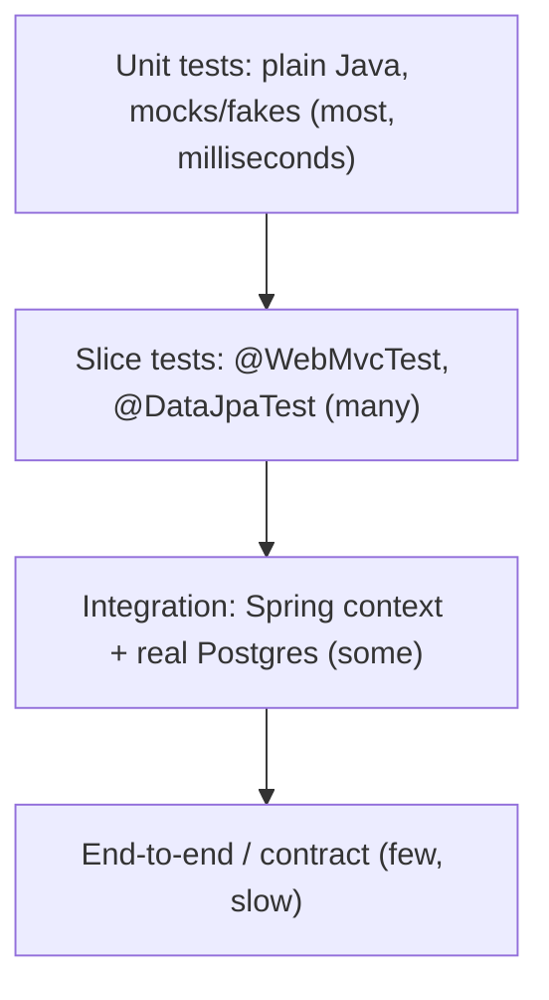

# Session 6 - Testing a Spring Boot backend (from zero)

Goal: by the end you can put a safety net under a real Java/Spring Boot backend. You will write fast unit tests (JUnit 5, AssertJ, Mockito), web-layer slice tests (`@WebMvcTest`), real-database tests (Testcontainers + Postgres), concurrency tests (50 threads fighting for 20 items), time-dependent tests (a `Clock` you control), outbound-HTTP tests (500s and timeouts), and you will know how to add a test to somebody else's repo without breaking CI. The running example is `com.example.shopflow`, an e-commerce backend (Products, StockLevel, Customers, Orders + OrderItems, a fake payment gateway). Every code block here was built and run on Java 21, Maven 3.9.11, Spring Boot 4.0.8; the outputs are real (shortened).

**Real-world work this maps to:** "add tests to the order/stock service before I refactor it", "reproduce this production bug in a test first", "why is CI red only on the build server", "how do I test the payment-provider timeout path".

Who this is for: you know JS testing (Jest + supertest) and C++ (gtest). Java has the same ideas with more ceremony. Equivalents are noted along the way.

## How to use this article

1. Generate a project: https://start.spring.io -> Maven, Java 21, Spring Boot 4.0.8, package `com.example.shopflow`, dependencies: Spring Web, Spring Data JPA, Validation, Spring Security, Flyway Migration, PostgreSQL Driver, Testcontainers. (Or copy the `pom.xml` in section 2.)
2. Put the "code under test" from **Appendix A** into `src/main/java/com/example/shopflow/` (it is about 20 small files; the tests only make sense against real code). Docker must be running for sections 7-10.
3. Work through the sections in order. For each: type the test, run it, break it on purpose, read the failure.
4. Run one test class: `mvn test -Dtest=PricingPolicyTest`. Run everything: `mvn verify`.
5. In your real (company) repo: do the same, one section at a time, on a scratch branch.

> Corporate network note: if Maven fails with `PKIX path building failed` against your company mirror, that is a certificate problem on your machine, not a Spring problem. Ask for the CA bundle or use a settings file pointing at Maven Central.

## Topics

| # | Topic | You will be able to |
|---|-------|---------------------|
| 1 | Why test, what to test, what to mock | Pick the right kind of test for a given risk |
| 2 | Project setup and Spring Boot 4 vs 3 names | Add the right test starters; translate 3.x names |
| 3 | JUnit 5 and AssertJ | Use lifecycle, `@Nested`, parameterized tests; read failures |
| 4 | Mockito | Mock, verify, capture; know when a hand-written fake is better |
| 5 | Time and retry logic | Make time-dependent code testable with `Clock` |
| 6 | Web slice tests | Test controllers, validation, error JSON and security with `@WebMvcTest` |
| 7 | Real database tests | Run Postgres + Flyway in Testcontainers; see why H2 lies |
| 8 | Full-stack tests | Use `@SpringBootTest`, `RestTestClient`, context caching, DB cleanup |
| 9 | Concurrency, idempotency, async, schedulers | Prove no overselling; test `@Async` and `@Scheduled` without sleeping |
| 10 | Outbound HTTP | Test a payment provider returning 500 or hanging |
| 11 | Flaky tests and test data | Remove the usual causes; write builders |
| 12 | Maven: surefire, failsafe, JaCoCo, PIT, ArchUnit | Split fast/slow tests; read coverage honestly |
| 13 | Adding tests to a company repo | Do the red -> green bug-reproduction workflow |

---

## 1. Why test, what to test, what to mock

A test is a program that runs your program and fails loudly when behaviour changes. You write them so you can change code without fear (refactoring, upgrades, taking over someone else's service).



| Layer | Example in shopflow | Runs in | Uses |
|-------|---------------------|---------|------|
| Unit | `PricingPolicy` coupon math, `OrderNumberAllocator` retry | ms | no Spring, Mockito/fakes |
| Web slice | `POST /api/orders` returns 409 problem JSON when out of stock | ~1-2 s | `@WebMvcTest`, mock service |
| DB slice | `lower(email)` unique index, atomic stock `UPDATE` | seconds | real Postgres in Docker |
| Integration | place -> pay -> notification over real HTTP | seconds | full app, real Postgres |
| Concurrency | 50 buyers, 20 units | seconds | full app, threads |

**What to mock:** things that are slow, non-deterministic or outside your control: the payment provider, the system clock, random numbers, e-mail. **What not to mock:** the database when the bug could live in SQL/constraints/transactions (it nearly always does), and your own simple value classes. Rule of thumb: mock at the edge of your system, not in the middle of it.

**Over-mocking** (see section 4) means the test re-states the implementation line by line; it passes while the real system is broken, and it fails when you refactor harmlessly.

> C++ equivalent: unit = gtest with a fake/mock interface (gmock); integration = a test binary linking the real library. React equivalent: unit = Jest on a function; slice = React Testing Library on one component; integration = Cypress against the dev server.

---

## 2. Project setup and Spring Boot 4 vs 3

```xml
<!-- file: pom.xml (dependencies part) -->
<parent>
  <groupId>org.springframework.boot</groupId>
  <artifactId>spring-boot-starter-parent</artifactId>
  <version>4.0.8</version>
</parent>
<properties><java.version>21</java.version></properties>

<dependencies>
  <!-- main -->
  <dependency><groupId>org.springframework.boot</groupId><artifactId>spring-boot-starter-webmvc</artifactId></dependency>
  <dependency><groupId>org.springframework.boot</groupId><artifactId>spring-boot-starter-data-jpa</artifactId></dependency>
  <dependency><groupId>org.springframework.boot</groupId><artifactId>spring-boot-starter-validation</artifactId></dependency>
  <dependency><groupId>org.springframework.boot</groupId><artifactId>spring-boot-starter-security</artifactId></dependency>
  <dependency><groupId>org.springframework.boot</groupId><artifactId>spring-boot-starter-flyway</artifactId></dependency>
  <dependency><groupId>org.flywaydb</groupId><artifactId>flyway-database-postgresql</artifactId></dependency>
  <dependency><groupId>org.postgresql</groupId><artifactId>postgresql</artifactId><scope>runtime</scope></dependency>

  <!-- test: Boot 4 has one small test starter PER technology -->
  <dependency><groupId>org.springframework.boot</groupId><artifactId>spring-boot-starter-webmvc-test</artifactId><scope>test</scope></dependency>
  <dependency><groupId>org.springframework.boot</groupId><artifactId>spring-boot-starter-data-jpa-test</artifactId><scope>test</scope></dependency>
  <dependency><groupId>org.springframework.boot</groupId><artifactId>spring-boot-starter-security-test</artifactId><scope>test</scope></dependency>
  <dependency><groupId>org.springframework.boot</groupId><artifactId>spring-boot-starter-validation-test</artifactId><scope>test</scope></dependency>
  <dependency><groupId>org.springframework.boot</groupId><artifactId>spring-boot-starter-flyway-test</artifactId><scope>test</scope></dependency>
  <dependency><groupId>org.springframework.boot</groupId><artifactId>spring-boot-starter-restclient</artifactId><scope>test</scope></dependency>
  <dependency><groupId>org.springframework.boot</groupId><artifactId>spring-boot-testcontainers</artifactId><scope>test</scope></dependency>
  <dependency><groupId>org.testcontainers</groupId><artifactId>testcontainers-junit-jupiter</artifactId><scope>test</scope></dependency>
  <dependency><groupId>org.testcontainers</groupId><artifactId>testcontainers-postgresql</artifactId><scope>test</scope></dependency>
  <dependency><groupId>org.awaitility</groupId><artifactId>awaitility</artifactId><scope>test</scope></dependency>
  <dependency><groupId>org.wiremock</groupId><artifactId>wiremock-standalone</artifactId><version>3.13.2</version><scope>test</scope></dependency>
  <dependency><groupId>com.tngtech.archunit</groupId><artifactId>archunit-junit5</artifactId><version>1.5.1</version><scope>test</scope></dependency>
</dependencies>
```

JUnit 5, AssertJ, Mockito, Hamcrest and JSONassert come transitively from the test starters.

Names that changed in Boot 4 (every one was verified by compiling):

| Thing | Spring Boot 4.0.x | Spring Boot 3.x |
|-------|-------------------|-----------------|
| Web starter | `spring-boot-starter-webmvc` | `spring-boot-starter-web` |
| Test starters | `spring-boot-starter-webmvc-test`, `-data-jpa-test`, `-security-test`, ... | one `spring-boot-starter-test` |
| `@WebMvcTest` | `org.springframework.boot.webmvc.test.autoconfigure.WebMvcTest` | `org.springframework.boot.test.autoconfigure.web.servlet.WebMvcTest` |
| `@DataJpaTest` | `org.springframework.boot.data.jpa.test.autoconfigure.DataJpaTest` | `org.springframework.boot.test.autoconfigure.orm.jpa.DataJpaTest` |
| `@AutoConfigureTestDatabase` | `org.springframework.boot.jdbc.test.autoconfigure.AutoConfigureTestDatabase` | `org.springframework.boot.test.autoconfigure.jdbc.AutoConfigureTestDatabase` |
| Mock a bean | `@MockitoBean` (`org.springframework.test.context.bean.override.mockito`) | `@MockBean` (`org.springframework.boot.test.mock.mockito`); `@MockitoBean` exists from 3.4 |
| `TestRestTemplate` | `org.springframework.boot.resttestclient.TestRestTemplate` + `@AutoConfigureTestRestTemplate` | `org.springframework.boot.test.web.client.TestRestTemplate` |
| Jackson | `tools.jackson.*` (Jackson 3) | `com.fasterxml.jackson.*` |
| Testcontainers | 2.x: `org.testcontainers.postgresql.PostgreSQLContainer`, artifact `testcontainers-postgresql` | 1.x: `org.testcontainers.containers.PostgreSQLContainer`, artifact `postgresql` |
| `RestTestClient` | `org.springframework.test.web.servlet.client.RestTestClient` (Framework 7) | not available |
| `MockMvcTester` | available | available from Spring 6.2 (Boot 3.4+) |

> If your company is on Spring Boot 3.x: keep `spring-boot-starter-test`, import `@WebMvcTest` etc. from `org.springframework.boot.test.autoconfigure...`, use `@MockBean` (or `@MockitoBean` on 3.4+), `WebTestClient`/`TestRestTemplate` for HTTP tests, and Testcontainers 1.x names. Everything else in this article (JUnit, AssertJ, Mockito, `@ServiceConnection` from 3.1) works the same.

Surprise worth knowing: in Boot 4, `TestRestTemplate` auto-configuration fails with `NoClassDefFoundError: org/springframework/boot/restclient/RestTemplateBuilder` unless `spring-boot-starter-restclient` is on the test classpath (it is in the pom above).

---

## 3. JUnit 5 and AssertJ

### 3.1 Lifecycle, `@Nested`, `@Timeout`, `@Disabled`, tags

```java
// file: src/test/java/com/example/shopflow/demo/LifecycleDemoTest.java
class LifecycleDemoTest {
    @BeforeAll static void beforeAll() { System.out.println("[beforeAll] once per class (must be static)"); }
    @AfterAll  static void afterAll()  { System.out.println("[afterAll]"); }
    @BeforeEach void beforeEach() { System.out.println("  [beforeEach] new test instance: " + System.identityHashCode(this)); }
    @AfterEach  void afterEach()  { System.out.println("  [afterEach]"); }

    @Test @DisplayName("first test") void first()  { System.out.println("    test: first"); }
    @Test void second() { System.out.println("    test: second"); }

    @Test @Tag("slow") @Timeout(value = 200, unit = TimeUnit.MILLISECONDS)
    void fails_when_it_takes_longer_than_the_timeout() throws Exception { Thread.sleep(Duration.ofMillis(500)); }

    @Test @Disabled("kept as documentation: re-enable when the payment sandbox is back")
    void disabled() { }

    @Nested @DisplayName("nested group")
    class Group {
        @BeforeEach void inner() { System.out.println("    [nested beforeEach] runs AFTER the outer beforeEach"); }
        @Test void inside() { System.out.println("      test: nested"); }
    }
}
```

Expected output (`mvn test -Dtest=LifecycleDemoTest`):

```text
[beforeAll] once per class (must be static)
  [beforeEach] new test instance: 1967434886
    test: second
  [afterEach]
  [beforeEach] new test instance: 220689785
  [afterEach]
  [beforeEach] new test instance: 1596708569
    test: first
  [afterEach]
[INFO] Running nested group
  [beforeEach] new test instance: 1287875609
    [nested beforeEach] runs AFTER the outer beforeEach
      test: nested
  [afterEach]
[ERROR]   LifecycleDemoTest.fails_when_it_takes_longer_than_the_timeout - Timeout ... timed out after 200 milliseconds
[afterAll]
Tests run: 5, Failures: 0, Errors: 1, Skipped: 1
```

What to see: a **new instance per test** (different identity numbers, so instance fields never leak between tests); `second` ran before `first` (order is deliberately unspecified - tests must not depend on order); the nested `@BeforeEach` runs after the outer one; `@Disabled` shows as Skipped; `@Timeout` turns a hang into a failure. Run only fast tests with `mvn test -Dgroups='!slow'` (tags).

> C++/gtest: `SetUp/TearDown` = `@BeforeEach/@AfterEach`; fixtures are re-created per test there too. Jest: `beforeEach`, `describe` = `@Nested`, `test.skip` = `@Disabled`.

### 3.2 Parameterized tests: one test, many cases

```java
// file: src/test/java/com/example/shopflow/PricingPolicyTest.java
@DisplayName("PricingPolicy")
class PricingPolicyTest {
    @Nested @DisplayName("discount")
    class Discount {
        @ParameterizedTest(name = "subtotal={0} coupon={1} -> discount {2}")
        @CsvSource({
                "10000, SAVE10,  1000",
                "5000,  SAVE10,  500",
                "4999,  SAVE10,  0",      // boundary: just under the minimum
                "2000,  FLAT500, 500",
                "1999,  FLAT500, 0",
                "10000, save10,  1000",   // case-insensitive
                "10000, ,        0"})     // blank coupon
        void by_coupon(long subtotal, String coupon, long expected) {
            assertThat(PricingPolicy.discountCents(subtotal, coupon)).isEqualTo(expected);
        }

        @ParameterizedTest
        @NullAndEmptySource @ValueSource(strings = {"   "})
        void blank_coupon_means_no_discount(String coupon) {
            assertThat(PricingPolicy.discountCents(99_999, coupon)).isZero();
        }

        @Test
        void unknown_coupon_is_rejected_with_a_helpful_message() {
            assertThatThrownBy(() -> PricingPolicy.discountCents(1_000, "HACK99"))
                    .isInstanceOf(ShopExceptions.InvalidOrder.class)
                    .hasMessage("unknown coupon HACK99");
        }
    }

    @Nested @DisplayName("total")
    class Total {
        static Stream<Arguments> cases() {
            return Stream.of(Arguments.of("no coupon", 7_000L, null, 7_000L),
                             Arguments.of("10 percent", 7_000L, "SAVE10", 6_300L),
                             Arguments.of("flat 500", 2_500L, "FLAT500", 2_000L));
        }
        @ParameterizedTest(name = "{0}") @MethodSource("cases")
        void subtracts_the_discount(String label, long subtotal, String coupon, long expected) {
            assertThat(PricingPolicy.total(subtotal, coupon)).isEqualTo(expected);
        }
    }

    @Test
    void assertThrows_returns_the_exception_for_further_checks() {
        var ex = assertThrows(ShopExceptions.InvalidOrder.class, () -> PricingPolicy.total(100, "NOPE"));
        assertThat(ex).hasMessageContaining("NOPE");
    }
}
```

Expected output:

```text
[INFO] Tests run: 12, Failures: 0, Errors: 0, Skipped: 0 -- in discount
[INFO] Tests run: 3,  Failures: 0, Errors: 0, Skipped: 0 -- in total
```

Notes: `@CsvSource` for simple primitives; `@MethodSource` for objects; `@NullAndEmptySource` adds the two cases people forget. The `name = ...` pattern makes failures readable ("subtotal=4999 coupon=SAVE10 -> discount 0"). Boundaries (4999 vs 5000) are where bugs live - always test the edge on both sides.

### 3.3 AssertJ vs JUnit asserts vs Hamcrest: read the failures

AssertJ is the default choice: fluent, great IDE completion (`assertThat(x).` then Ctrl+Space), and the best failure messages. These five tests fail on purpose:

```java
// file: src/test/java/com/example/shopflow/demo/FailingAssertionsDemoTest.java  (actual = a PENDING_PAYMENT order, total 2500, 1 line)
@Test void junit_plain()      { assertEquals("PAID", actual().status()); }
@Test void assertj_fluent()   { assertThat(actual().status()).as("order status").isEqualTo("PAID"); }
@Test void assertj_recursive_comparison() {          // expected has totalCents 3000
    assertThat(actual()).usingRecursiveComparison().isEqualTo(expected); }
@Test void assertj_soft_assertions_report_everything() {
    SoftAssertions softly = new SoftAssertions();
    softly.assertThat(actual().status()).isEqualTo("PAID");
    softly.assertThat(actual().totalCents()).isEqualTo(3_000);
    softly.assertThat(actual().items()).hasSize(2);
    softly.assertAll(); }
@Test void hamcrest() { org.hamcrest.MatcherAssert.assertThat(actual().items(), hasSize(2)); }
```

Real output, trimmed:

```text
junit_plain:                  expected: <PAID> but was: <PENDING_PAYMENT>
assertj_fluent:               [order status]
                              expected: "PAID"
                               but was: "PENDING_PAYMENT"
assertj_recursive_comparison: when recursively comparing field by field, but found the following difference:
                              field/property 'totalCents' differ:
                              - actual value  : 2500L
                              - expected value: 3000L
assertj_soft_assertions:      Multiple Failures (3 failures)
                              -- failure 1 -- expected: "PAID" but was: "PENDING_PAYMENT"
                              -- failure 2 -- expected: 3000L but was: 2500L
                              -- failure 3 -- Expected size: 2 but was: 1 in: [Line[productId=7, ...]]
hamcrest:                     Expected: a collection with size <2>
                                   but: collection size was <1>
```

How to read a failure: first line = what was expected vs actual; the `at ...Test.java:NN` line is YOUR test line (ignore framework frames); `as("order status")` gives context. Soft assertions report all failures in one run instead of the first only. `usingRecursiveComparison()` compares field by field without needing `equals()` - perfect for comparing a DTO with an expected DTO and it names the differing field.

```java
// everyday AssertJ
assertThat(orders).hasSize(2).extracting(Order::getStatus).containsExactly(PAID, PENDING_PAYMENT);
assertThat(order.getItems()).singleElement().satisfies(i -> assertThat(i.getQuantity()).isEqualTo(2));
assertThat(Optional.of(x)).isPresent();
assertThatThrownBy(() -> service.pay(5L)).isInstanceOf(OrderExpired.class).hasMessageContaining("deadline");
```

| | JUnit `assertEquals` | AssertJ | Hamcrest |
|-|----------------------|---------|----------|
| Style | static methods | fluent chain | matcher objects |
| Argument order | (expected, actual) - easy to swap | (actual) then expected | (actual, matcher) |
| Failure message | basic | rich | good |
| Use | quick one-liners | default | inside `jsonPath(...)`/MockMvc, older code |

Pitfall: argument order in `assertEquals(expected, actual)` - swapped arguments give a misleading failure message. AssertJ avoids the problem.

---

## 4. Mockito

A mock is a fake object you can program (`when(...).thenReturn`) and interrogate (`verify`). Add `@ExtendWith(MockitoExtension.class)` and use `@Mock` / `@InjectMocks`.

We test the **order-number collision retry** (an 8-char random code can collide with an existing order; the allocator must retry, and give up after 5 attempts):

```java
// file: src/test/java/com/example/shopflow/OrderNumberAllocatorTest.java
@ExtendWith(MockitoExtension.class)
@DisplayName("OrderNumberAllocator (collision retry)")
class OrderNumberAllocatorTest {
    @Mock OrderNumberGenerator generator;
    @Mock OrderRepository orders;
    @InjectMocks OrderNumberAllocator allocator;       // constructor injection with the two mocks

    @Test
    void returns_the_first_free_number() {
        when(generator.next()).thenReturn("ORD-AAAA1111");
        when(orders.existsByOrderNumber("ORD-AAAA1111")).thenReturn(false);

        assertThat(allocator.allocate()).isEqualTo("ORD-AAAA1111");
        verify(generator, times(1)).next();
    }

    @Test
    void retries_after_a_collision() {
        when(generator.next()).thenReturn("ORD-TAKEN001", "ORD-FREE0002");   // 1st call, then 2nd call
        when(orders.existsByOrderNumber("ORD-TAKEN001")).thenReturn(true);
        when(orders.existsByOrderNumber("ORD-FREE0002")).thenReturn(false);

        assertThat(allocator.allocate()).isEqualTo("ORD-FREE0002");
        verify(generator, times(2)).next();
        verifyNoMoreInteractions(orders);
    }

    @Test
    void gives_up_after_max_attempts() {
        when(generator.next()).thenReturn("ORD-TAKEN001");
        when(orders.existsByOrderNumber(anyString())).thenReturn(true);      // everything collides

        assertThatThrownBy(() -> allocator.allocate())
                .isInstanceOf(ShopExceptions.OrderNumberExhausted.class)
                .hasMessage("No free order number after 5 attempts");
        verify(generator, times(OrderNumberAllocator.MAX_ATTEMPTS)).next();
    }

    @Test @DisplayName("same retry test, BDDMockito given/then style")
    void retries_bdd_style() {
        given(generator.next()).willReturn("ORD-TAKEN001", "ORD-FREE0002");
        given(orders.existsByOrderNumber("ORD-TAKEN001")).willReturn(true);
        given(orders.existsByOrderNumber("ORD-FREE0002")).willReturn(false);

        assertThat(allocator.allocate()).isEqualTo("ORD-FREE0002");
        then(orders).should(never()).existsByOrderNumber("ORD-NEVER");
    }

    @Test @DisplayName("hand-written fake instead of a generator mock")
    void with_a_fake_generator() {
        var fakeAllocator = new OrderNumberAllocator(new SequenceOrderNumbers("ORD-TAKEN001", "ORD-FREE0002"), orders);
        when(orders.existsByOrderNumber("ORD-TAKEN001")).thenReturn(true);
        when(orders.existsByOrderNumber("ORD-FREE0002")).thenReturn(false);
        assertThat(fakeAllocator.allocate()).isEqualTo("ORD-FREE0002");
    }
}
```

```java
// file: src/test/java/com/example/shopflow/support/SequenceOrderNumbers.java  - the fake
public class SequenceOrderNumbers implements OrderNumberGenerator {
    private final Deque<String> numbers;
    public SequenceOrderNumbers(String... numbers) { this.numbers = new ArrayDeque<>(Arrays.asList(numbers)); }
    @Override public String next() {
        if (numbers.isEmpty()) throw new IllegalStateException("test asked for more order numbers than it prepared");
        return numbers.removeFirst();
    }
}
```

```text
[INFO] Tests run: 5, Failures: 0, Errors: 0, Skipped: 0, Time elapsed: 6.784 s -- in OrderNumberAllocator (collision retry)
```

### 4.1 ArgumentCaptor: check what was passed to a collaborator

`OrderPlacement.place(...)` builds an `Order` and hands it to `orders.saveAndFlush(...)`. The test captures the argument and asserts on the built object (prices, total with coupon, 15-minute hold):

```java
// file: src/test/java/com/example/shopflow/OrderPlacementTest.java (excerpt)
@Test
void builds_the_order_with_prices_total_and_a_15_minute_hold() {
    Product mug = productWithId(7L, "MUG-BLUE", 1_500);
    when(numbers.allocate()).thenReturn("ORD-TEST0001");
    when(products.findById(7L)).thenReturn(Optional.of(mug));
    when(stock.reserve(7L, 2)).thenReturn(1);
    when(orders.saveAndFlush(any(Order.class))).thenAnswer(inv -> inv.getArgument(0));   // return what was saved

    placement().place(42L, List.of(new ItemRequest(7L, 2)), "FLAT500", "key-1");

    ArgumentCaptor<Order> saved = ArgumentCaptor.forClass(Order.class);
    verify(orders).saveAndFlush(saved.capture());
    Order order = saved.getValue();
    assertThat(order.getTotalCents()).isEqualTo(2_500);              // 2 x 1500 = 3000, minus FLAT500
    assertThat(order.getExpiresAt()).isEqualTo(MutableClock.DEFAULT_START.plus(Duration.ofMinutes(15)));
    assertThat(order.getItems()).singleElement().satisfies(i -> {
        assertThat(i.getProductId()).isEqualTo(7L);
        assertThat(i.getUnitPriceCents()).isEqualTo(1_500);
    });
}
```

### 4.2 Strict stubs: Mockito catches dead test code

`MockitoExtension` is strict by default: a stub that the code never used fails the test. This is a feature - it exposes tests that no longer match the code.

```java
// file: src/test/java/com/example/shopflow/demo/StrictStubsDemoTest.java
@Test
void stubs_something_the_code_never_calls() {
    when(generator.next()).thenReturn("ORD-AAAA1111");
    when(orders.existsByOrderNumber("ORD-ZZZZ9999")).thenReturn(true);     // never used
    generator.next();
}
```

```text
org.mockito.exceptions.misusing.UnnecessaryStubbingException:
Unnecessary stubbings detected.
Following stubbings are unnecessary (click to navigate to relevant line of code):
  1. -> at ...StrictStubsDemoTest.stubs_something_the_code_never_calls(StrictStubsDemoTest.java:21)
Please remove unnecessary stubbings or use 'lenient' strictness.
```

Fix: delete the stub (do not reach for `lenient()` unless a shared `@BeforeEach` stub is legitimately unused by some tests).

### 4.3 Other tools

- `thenThrow(new ShopExceptions.PaymentUnavailable("ORD-1"))` / `willThrow` for exception paths (used in the web tests).
- `spy(realObject)`: a real object where you override one method. Use sparingly; needing a spy usually means the class does too much.
- `verifyNoInteractions(mock)`: proves a code path did NOT call something (`OrderServiceTest` uses it to show an empty order never reaches `OrderPlacement`).

### 4.4 Over-mocking, and mocks vs fakes

Anti-example (do not write this):

```java
// BAD: restates the implementation. Rename one repository method and it breaks although behaviour is unchanged,
// and it passes even if the SQL behind it is wrong.
when(products.findById(7L)).thenReturn(Optional.of(mug));
when(stock.reserve(7L, 2)).thenReturn(1);
when(orders.saveAndFlush(any())).thenReturn(order);
service.place(...);
verify(products).findById(7L);
verify(stock).reserve(7L, 2);
verify(orders).saveAndFlush(order);
verifyNoMoreInteractions(products, stock, orders);
```

Rules: assert on **outcomes** (returned value, exception, saved state) before interactions; verify an interaction only when the call itself IS the behaviour ("the payment gateway was charged exactly once"). And ask: would a real database test cover this better? For `OrderPlacement` the real risk is the SQL (`reserve`) - that is why section 7 tests it against Postgres, and the mock-based unit test only checks assembly logic.

| | Mockito mock | Hand-written fake |
|-|--------------|-------------------|
| Setup cost | one line per call | write a class once |
| Reads like | a script of calls | a tiny working implementation |
| Good for | verifying a call, forcing one error | reuse across many tests, stateful behaviour (in-memory repo, `SequenceOrderNumbers`) |
| Risk | brittle, over-specified | fake drifts from the real thing |

> C++ equivalent: Mockito = gmock `EXPECT_CALL`; fake = a hand-written test double class implementing the interface.

---

## 5. Time and retry logic: inject a `Clock`

**Real-world work:** payment holds, reservation expiry (ticket/seat holds, unpaid orders), token expiry, "orders older than 30 days". Anything that reads "now".

### 5.1 The bug first: code that calls `Instant.now()` itself

```java
// file: src/test/java/com/example/shopflow/demo/BrokenClockDemoTest.java
static class PaymentHold {
    Instant expiresAt()                { return Instant.now().plus(Duration.ofMinutes(15)); }
    boolean isPastDue(Instant expiresAt) { return !Instant.now().isBefore(expiresAt); }
}
@Test void hold_lasts_15_minutes_from_creation() {
    Instant expected = Instant.parse("2030-01-01T00:15:00Z");
    assertEquals(expected, new PaymentHold().expiresAt());           // can never pass
}
@Test void hold_is_past_due_after_the_deadline_the_slow_way() throws Exception {
    PaymentHold hold = new PaymentHold();
    Instant expiresAt = Instant.now().plusSeconds(1);                // only trick available: a 1 s hold
    assertFalse(hold.isPastDue(expiresAt));
    Thread.sleep(1_100);                                             // slow, and flaky on a loaded CI box
    assertTrue(hold.isPastDue(expiresAt));
}
```

```text
[ERROR] BrokenClockDemoTest.hold_lasts_15_minutes_from_creation:27
        expected: <2030-01-01T00:15:00Z> but was: <2026-10-19T03:56:49.293659100Z>
```

You cannot assert an exact deadline, and the only way to test "after the deadline" is to wait. Tests with `Thread.sleep` are slow and flaky.

### 5.2 The fix: inject `java.time.Clock`

Production code asks an injected `Clock` for the time (see `OrderPlacement`, `OrderService`, `OrderExpiry` in Appendix A; the real bean is `Clock.systemUTC()`). Tests supply a clock they can move:

```java
// file: src/test/java/com/example/shopflow/support/MutableClock.java
public class MutableClock extends Clock {
    public static final Instant DEFAULT_START = Instant.parse("2030-01-01T00:00:00Z");
    private volatile Instant now;
    public MutableClock() { this(DEFAULT_START); }
    public MutableClock(Instant start) { this.now = start; }
    public void advance(Duration d) { now = now.plus(d); }
    public void set(Instant instant) { now = instant; }
    @Override public ZoneId getZone() { return ZoneOffset.UTC; }
    @Override public Clock withZone(ZoneId zone) { return this; }
    @Override public Instant instant() { return now; }
}
```

(`Clock.fixed(instant, zone)` also works when time never has to move.) Now the boundary tests are instant and exact:

```java
// file: src/test/java/com/example/shopflow/OrderServiceTest.java (excerpt, @Nested class Pay)
@Test
void the_deadline_is_inclusive_at_exactly_15_minutes() {
    when(orders.findWithItemsById(5L)).thenReturn(Optional.of(anOrder().build()));  // expires at start+15m
    clock.advance(Duration.ofMinutes(15).minusNanos(1));
    when(gateway.charge(any(), any(Long.class))).thenReturn(PaymentGateway.Outcome.UNAVAILABLE);
    assertThatThrownBy(() -> service().pay(5L)).isInstanceOf(ShopExceptions.PaymentUnavailable.class);  // got past the deadline check
    clock.advance(Duration.ofNanos(1));                                      // now exactly at expiresAt
    assertThatThrownBy(() -> service().pay(5L)).isInstanceOf(ShopExceptions.OrderExpired.class);
}
```

```text
[INFO] Tests run: 4, Failures: 0, Errors: 0, Skipped: 0 -- in pay
[INFO] Tests run: 3, Failures: 0, Errors: 0, Skipped: 0 -- in com.example.shopflow.OrderPlacementTest
```

Design rule enforced automatically (ArchUnit, section 12): nobody except `*Config` classes may call `Instant.now()`.

> If your company is on Spring Boot 3.x: identical. In an existing codebase that calls `Instant.now()`/`LocalDateTime.now()` everywhere, add a `Clock` bean and migrate the code you touch (`Instant.now(clock)`) - do it class by class, only when you need a test.

---

## 6. Web slice tests: `@WebMvcTest`, MockMvc, ProblemDetail, security

`@WebMvcTest(OrderController.class)` starts only the web layer (controllers, JSON, validation, `@RestControllerAdvice`, security filters) - no database, one to two seconds. Collaborators are replaced with `@MockitoBean`. You are testing the **HTTP contract**: status codes, headers, JSON shape, error bodies, auth.

```java
// file: src/test/java/com/example/shopflow/web/OrderControllerWebTest.java
import org.springframework.boot.webmvc.test.autoconfigure.WebMvcTest;                 // Boot 4 package
import org.springframework.test.context.bean.override.mockito.MockitoBean;
import org.springframework.test.web.servlet.assertj.MockMvcTester;

@WebMvcTest(value = OrderController.class, properties = "shopflow.csrf.enabled=true")
@Import({SecurityConfig.class, ApiExceptionHandler.class})     // slices do not component-scan @Configuration classes
class OrderControllerWebTest {
    @Autowired MockMvc mvc;
    @Autowired MockMvcTester tester;
    @MockitoBean OrderService orders;                           // Boot 3.x: @MockBean

    static OrderView pending() {
        return new OrderView(11L, "ORD-AAAA1111", 42L, "PENDING_PAYMENT", 2_500,
                Instant.parse("2030-01-01T00:00:00Z"), Instant.parse("2030-01-01T00:15:00Z"),
                List.of(new OrderView.Line(7L, 2, 1_250)));
    }
    static final String BODY = """
            {"customerId": 42, "items": [{"productId": 7, "quantity": 2}], "couponCode": null}
            """;

    @Nested @DisplayName("security")
    class Security {
        @Test void anonymous_gets_401() throws Exception {
            mvc.perform(get("/api/orders/11")).andExpect(status().isUnauthorized());
        }
        @Test @WithMockUser(roles = "USER")
        void post_without_csrf_token_is_403() throws Exception {
            mvc.perform(post("/api/orders").contentType(MediaType.APPLICATION_JSON).content(BODY))
                    .andExpect(status().isForbidden());
        }
        @Test @WithMockUser(roles = "USER")
        void user_cannot_use_admin_api_403() throws Exception {
            mvc.perform(post("/api/admin/products").with(csrf()).contentType(MediaType.APPLICATION_JSON).content("{}"))
                    .andExpect(status().isForbidden());
        }
    }

    @Nested @DisplayName("POST /api/orders")
    class Create {
        @Test @WithMockUser
        void created_returns_201_location_and_json() throws Exception {
            given(orders.place(eq(42L), any(), any(), eq("key-1"))).willReturn(pending());
            mvc.perform(post("/api/orders").with(csrf()).header("Idempotency-Key", "key-1")
                            .contentType(MediaType.APPLICATION_JSON).content(BODY))
                    .andExpect(status().isCreated())
                    .andExpect(header().string("Location", "/api/orders/11"))
                    .andExpect(jsonPath("$.orderNumber").value("ORD-AAAA1111"))
                    .andExpect(jsonPath("$.items", hasSize(1)))
                    .andExpect(jsonPath("$.items[0].quantity").value(2));
        }
        @Test @WithMockUser
        void validation_error_is_a_problem_detail_with_field_errors() throws Exception {
            mvc.perform(post("/api/orders").with(csrf()).contentType(MediaType.APPLICATION_JSON)
                            .content("""
                                    {"customerId": null, "items": [{"productId": 7, "quantity": 0}]}
                                    """))
                    .andExpect(status().isBadRequest())
                    .andExpect(header().string("Content-Type", "application/problem+json"))
                    .andExpect(jsonPath("$.title").value("Validation failed"))
                    .andExpect(jsonPath("$.type").value("urn:problem:validation"))
                    .andExpect(jsonPath("$.errors[?(@.field == 'customerId')].message").value("must not be null"))
                    .andExpect(jsonPath("$.errors[?(@.field == 'items[0].quantity')]").exists());
        }
        @Test @WithMockUser
        void out_of_stock_maps_to_409_problem() throws Exception {
            given(orders.place(any(), any(), any(), any())).willThrow(new ShopExceptions.OutOfStock("SKU-1"));
            mvc.perform(post("/api/orders").with(csrf()).contentType(MediaType.APPLICATION_JSON).content(BODY))
                    .andExpect(status().isConflict())
                    .andExpect(jsonPath("$.type").value("urn:problem:out-of-stock"))
                    .andExpect(jsonPath("$.detail").value(containsString("SKU-1")));
        }
        @Test @WithMockUser
        void same_contract_checked_with_mockmvctester() {                     // AssertJ style, Spring 6.2+
            given(orders.place(any(), any(), any(), any())).willThrow(new ShopExceptions.OutOfStock("SKU-1"));
            assertThat(tester.post().uri("/api/orders").with(csrf())
                    .contentType(MediaType.APPLICATION_JSON).content(BODY))
                    .hasStatus(409)
                    .bodyJson().extractingPath("$.type").isEqualTo("urn:problem:out-of-stock");
        }
    }

    @Nested @DisplayName("GET /api/orders/{id}")
    class Read {
        @Test @WithMockUser
        void unknown_order_is_404() throws Exception {
            given(orders.get(99L)).willThrow(new ShopExceptions.OrderNotFound(99L));
            mvc.perform(get("/api/orders/99")).andExpect(status().isNotFound())
                    .andExpect(jsonPath("$.type").value("urn:problem:order-not-found"));
        }
    }
}
```

```text
[INFO] Tests run: 3, Failures: 0, Errors: 0, Skipped: 0 -- in security
[INFO] Tests run: 1, Failures: 0, Errors: 0, Skipped: 0 -- in GET /api/orders/{id}
[INFO] Tests run: 4, Failures: 0, Errors: 0, Skipped: 0 -- in POST /api/orders
```

### 6.1 A failing contract test, read carefully

My first version of the validation test asserted `$.title` equals `"Bad Request"`. It failed and showed the REAL body, which is exactly how you learn the contract:

```text
Body = {"detail":"Invalid request content.","status":400,"title":"Validation failed","type":"urn:problem:validation",
        "errors":[{"message":"must not be null","field":"customerId"}, ...]}
java.lang.AssertionError: JSON path "$.title" expected:<Bad Request> but was:<Validation failed>
```

Fix the expectation (the handler deliberately sets the title), keep the test: clients depend on `type` and `errors[].field`, so this is a **contract test** - if someone renames a field, the build goes red instead of the mobile app.

### 6.2 What each trick does

| Need | Tool |
|------|------|
| Logged-in user without real auth | `@WithMockUser(roles = "USER")` |
| Anonymous request | no annotation -> 401 |
| POST/PUT/DELETE when CSRF is on | `.with(csrf())`; without it -> 403 |
| JWT resource server | `.with(jwt().authorities(new SimpleGrantedAuthority("SCOPE_orders")))` (`SecurityMockMvcRequestPostProcessors.jwt`) - needs `spring-boot-starter-oauth2-resource-server`; `(not run: this project uses Basic auth)` |
| Replace a bean with a mock | `@MockitoBean` (3.x: `@MockBean`); `@MockitoSpyBean` replaces `@SpyBean` |
| JSON assertions | `jsonPath("$.a.b")`, or `MockMvcTester ... bodyJson()` |

Pitfalls: (1) a slice does not scan your `@Configuration` classes, so import your `SecurityConfig` or you test the framework's default security instead of yours (`(not run)` without the import: you would see Boot's default login/401 rules, not yours); (2) the app disables CSRF for the stateless Basic-auth API, and the test flips it on via `properties = "shopflow.csrf.enabled=true"` to prove the 403 behaviour is wired.

`RestTestClient` (new in Spring Framework 7) gives the same fluent style over a real server; it is used in section 8.

> React equivalent: `@WebMvcTest` is like testing a component with the data layer mocked (MSW). `supertest(app)` in Express is the closest sibling of MockMvc.

---

## 7. Real database tests with Testcontainers

**Real-world work:** every "this query works on my machine" bug: unique indexes, check constraints, `ON CONFLICT`, locking, transactions.

### 7.1 Why H2 lies (shown, not claimed)

Many tutorials run `@DataJpaTest` on the default embedded H2. Our schema is written for Postgres (case-insensitive unique index, partial unique index, `timestamptz`). With H2 on the classpath the default `@DataJpaTest` swaps in H2 and runs the Flyway migration there:

```text
ERROR o.f.core.internal.command.DbMigrate : Migration of schema "PUBLIC" to version "1 - init schema" failed!
SQL State  : 42001
Message    : Syntax error in SQL statement "... CREATE UNIQUE INDEX ux_customers_email_lower ON customers (lower[*](email))"
Location   : db/migration/V1__init_schema.sql
```

H2 cannot even create the index that production needs (and it has no partial unique indexes with `WHERE`; `ON CONFLICT` and `jsonb` also differ). The opposite failure is worse: tests PASS on H2 while production fails - for example H2 happily accepts a query that relies on case-insensitive matching. Test on the database you ship: Postgres in Docker.

### 7.2 `@ServiceConnection`: Spring wires the datasource for you

```java
// file: src/test/java/com/example/shopflow/support/PostgresTestConfig.java
import org.springframework.boot.testcontainers.service.connection.ServiceConnection;
import org.testcontainers.postgresql.PostgreSQLContainer;          // Testcontainers 2.x; 1.x: org.testcontainers.containers.PostgreSQLContainer

@TestConfiguration(proxyBeanMethods = false)
public class PostgresTestConfig {
    // static = one container for the whole test JVM (singleton pattern, see 7.4)
    private static final PostgreSQLContainer POSTGRES = new PostgreSQLContainer("postgres:17-alpine");

    @Bean
    @ServiceConnection                       // replaces spring.datasource.url/username/password automatically
    PostgreSQLContainer postgres() { return POSTGRES; }
}
```

```java
// file: src/test/java/com/example/shopflow/db/SchemaConstraintsIT.java
@DataJpaTest
@AutoConfigureTestDatabase(replace = AutoConfigureTestDatabase.Replace.NONE)    // do NOT swap in H2
@Import(PostgresTestConfig.class)
class SchemaConstraintsIT {
    @Autowired CustomerRepository customers;
    @Autowired OrderRepository orders;
    @Autowired ProductRepository products;
    @Autowired StockRepository stock;

    private long aProduct(String sku) { return products.saveAndFlush(new Product(sku, "Tee", 1_999)).getId(); }

    @Test @DisplayName("e-mail uniqueness is case-insensitive (lower(email) index)")
    void duplicate_email_in_other_case_is_rejected() {
        customers.saveAndFlush(new Customer("Ada@Example.com"));
        assertThatThrownBy(() -> customers.saveAndFlush(new Customer("ada@example.com")))
                .isInstanceOf(DataIntegrityViolationException.class);
    }

    @Test @DisplayName("partial unique index: many orders without a key, but a key can be used once")
    void idempotency_key_is_unique_only_when_present() {
        long pid = aProduct("TEE-GRN-S");
        orders.saveAndFlush(anOrder().withNumber("ORD-AAAA0001").withItem(pid, 1, 100).build());
        orders.saveAndFlush(anOrder().withNumber("ORD-AAAA0002").withItem(pid, 1, 100).build());   // two NULL keys: fine
        orders.saveAndFlush(anOrder().withNumber("ORD-AAAA0003").withItem(pid, 1, 100).withKey("k-1").build());
        assertThatThrownBy(() -> orders.saveAndFlush(
                anOrder().withNumber("ORD-AAAA0004").withItem(pid, 1, 100).withKey("k-1").build()))
                .isInstanceOf(DataIntegrityViolationException.class)
                .hasMessageContaining("idempotency");
    }

    @Test
    void order_with_items_is_found_by_key_without_lazy_loading_errors() {       // N+1 / LazyInitialization guard via @EntityGraph
        long pid = aProduct("TEE-GRN-M");
        orders.saveAndFlush(anOrder().withNumber("ORD-AAAA0009").withKey("k-9").withItem(pid, 3, 700).build());
        var found = orders.findByIdempotencyKey("k-9");
        assertThat(found).isPresent();
        assertThat(found.get().getItems()).extracting("productId", "quantity").containsExactly(tuple(pid, 3));
    }

    @Test @DisplayName("reserve() is an atomic conditional UPDATE: 1 row when enough stock, 0 otherwise")
    void reserve_updates_only_when_enough_stock() {
        Product p = products.saveAndFlush(new Product("TEE-RED-M", "Red tee", 1_999));
        stock.saveAndFlush(new StockLevel(p.getId(), 3));
        assertThat(stock.reserve(p.getId(), 2)).isEqualTo(1);
        assertThat(stock.reserve(p.getId(), 2)).isZero();            // only 1 left
        assertThat(stock.reserve(p.getId(), 1)).isEqualTo(1);
    }

    @Test
    void check_constraint_stops_negative_stock() {
        Product p = products.saveAndFlush(new Product("TEE-BLU-L", "Blue tee", 1_999));
        assertThatThrownBy(() -> stock.saveAndFlush(new StockLevel(p.getId(), -1)))
                .isInstanceOf(DataIntegrityViolationException.class);
    }
}
```

Log lines proving it is the real thing (shortened):

```text
Container postgres:17-alpine started in PT3.3S
Migrating schema "public" to version "1 - init schema"
Migrating schema "public" to version "2 - job lease"
Successfully applied 2 migrations to schema "public" ... now at version v2
[INFO] Tests run: 5, Failures: 0, Errors: 0, Skipped: 0 -- in com.example.shopflow.db.SchemaConstraintsIT
```

`@DataJpaTest` wraps each test in a transaction and rolls it back, so these tests do not leave rows behind. The Flyway migrations ran against a real Postgres: **migrations are now tested on every build**.

> If your company is on Spring Boot 3.x: same code with `org.testcontainers.containers.PostgreSQLContainer`, `org.testcontainers:postgresql` + `junit-jupiter` artifacts, and the old `@DataJpaTest`/`@AutoConfigureTestDatabase` packages from section 2.

### 7.3 The two other ways to wire a container

```java
// file: src/test/java/com/example/shopflow/demo/DynamicPropertyStyleDemoIT.java  - works on any Spring Boot version
@SpringBootTest @ActiveProfiles("test") @Testcontainers
class DynamicPropertyStyleDemoIT {
    @Container
    static PostgreSQLContainer postgres = new PostgreSQLContainer("postgres:17-alpine");   // JUnit starts/stops it

    @DynamicPropertySource
    static void datasource(DynamicPropertyRegistry registry) {
        registry.add("spring.datasource.url", postgres::getJdbcUrl);
        registry.add("spring.datasource.username", postgres::getUsername);
        registry.add("spring.datasource.password", postgres::getPassword);
    }
    @Autowired ProductService products;
    @Test void flyway_ran_against_the_container() {
        products.create("DYN-1", "Dynamic", 100, 1);
        assertThat(products.get("DYN-1").available()).isEqualTo(1);
    }
}
```

```text
[INFO] Tests run: 1, Failures: 0, Errors: 0, Skipped: 0, Time elapsed: 44.90 s -- in DynamicPropertyStyleDemoIT
```

| Style | Use when |
|-------|----------|
| `@Bean @ServiceConnection` in a `@TestConfiguration` | Default. Typed, no property names to remember (Postgres, Redis, Kafka, ...) |
| `@Testcontainers` + `@Container` + `@DynamicPropertySource` | Older Boot, or a service with no connection-details support (set any property by hand) |
| `docker run` + fixed port | Never in tests: port clashes between developers and CI agents |

The port is random every run (the container maps 5432 to a free port); never hard-code it.

### 7.4 Speed: the singleton container

A container per test class costs several seconds each. The `static final POSTGRES` in `PostgresTestConfig` means every test class and every cached Spring context in the JVM shares ONE Postgres. Measured: running `CacheAIT` then `CacheCIT` (two different Spring contexts) - with one container per context the second context re-ran both Flyway migrations on a fresh database; with the singleton it found the schema already at version 2 and only the first context printed "Migrating schema" (log count of `Successfully applied 2 migrations`: 2 before, 1 after). Cost of sharing: data from one test class is visible to the next, so you MUST clean between tests (section 8.4).

**Reuse caveat:** Testcontainers has an experimental `withReuse(true)` that keeps the container alive across JVM runs (needs `testcontainers.reuse.enable=true` in `~/.testcontainers.properties`). It is fast for local dev but leaves state behind and does nothing on CI - do not rely on it, and never use it as the only cleanup strategy. A `Ryuk` helper container removes containers when the JVM exits (you will see `testcontainers/ryuk` in `docker ps`).

---

## 8. Full-stack tests: `@SpringBootTest`

### 8.1 MOCK vs RANDOM_PORT

| `webEnvironment` | What runs | HTTP client | Test thread = server thread? |
|------------------|-----------|-------------|------------------------------|
| `MOCK` (default) | full context, mock servlet (no socket) | `MockMvc`/`MockMvcTester` | **yes** |
| `RANDOM_PORT` | real embedded Tomcat on a free port | `RestTestClient`, `TestRestTemplate`, `RestClient`, `WebTestClient` | **no** |

`RANDOM_PORT` exercises the whole stack including the servlet container and real JSON over HTTP: use it for a few end-to-end flows.

### 8.2 One composed annotation for all integration tests

```java
// file: src/test/java/com/example/shopflow/support/IntegrationTest.java
@Target(ElementType.TYPE) @Retention(RetentionPolicy.RUNTIME)
@SpringBootTest(webEnvironment = SpringBootTest.WebEnvironment.RANDOM_PORT)
@Import({PostgresTestConfig.class, ClockTestConfig.class})
@ActiveProfiles("test")
@AutoConfigureRestTestClient          // org.springframework.boot.resttestclient.autoconfigure (Boot 4)
@AutoConfigureTestRestTemplate        // only if you use TestRestTemplate
@Sql(scripts = "/sql/clean.sql", executionPhase = Sql.ExecutionPhase.BEFORE_TEST_METHOD,
        config = @SqlConfig(transactionMode = SqlConfig.TransactionMode.ISOLATED))
public @interface IntegrationTest { }
```

```java
// file: src/test/java/com/example/shopflow/support/ClockTestConfig.java
@TestConfiguration(proxyBeanMethods = false)
public class ClockTestConfig {
    @Bean @Primary
    MutableClock testClock() { return new MutableClock(); }       // replaces Clock.systemUTC() everywhere in the app
}
```

```yaml
# file: src/test/resources/application-test.yml   (activated by @ActiveProfiles("test"))
spring:
  jpa:
    show-sql: false
shopflow:
  scheduling:
    enabled: false          # tests call the scheduled job themselves
logging:
  level:
    org.testcontainers: WARN
    com.github.dockerjava: WARN
```

```sql
-- file: src/test/resources/sql/clean.sql
TRUNCATE TABLE order_items, orders, stock_levels, products, customers, job_lease RESTART IDENTITY CASCADE;
```

`@TestConfiguration` adds/overrides beans for tests only (fixed clock, containers, fakes). `@ActiveProfiles("test")` loads `application-test.yml` on top of `application.yml`; disabling the scheduler there stops background jobs from racing with the test.

### 8.3 An end-to-end test with `RestTestClient`

```java
// file: src/test/java/com/example/shopflow/it/OrderFlowIT.java
@IntegrationTest
class OrderFlowIT {
    @Autowired RestTestClient client;
    @Autowired ProductService products;
    @Autowired CustomerRepository customers;
    @Autowired OrderRepository orders;
    @Autowired OrderNotifier notifier;
    long customerId, productId;

    @BeforeEach void data() {
        customerId = customers.save(new Customer("buyer@example.com")).getId();
        productId = products.create("MUG-WHITE", "White mug", 1_200, 10).getId();
    }
    private Map<String, Object> body(int qty) {
        return Map.of("customerId", customerId, "items", List.of(Map.of("productId", productId, "quantity", qty)));
    }

    @Test void anonymous_cannot_order_but_can_read_the_catalog() {
        client.post().uri("/api/orders").contentType(MediaType.APPLICATION_JSON).body(body(1))
                .exchange().expectStatus().isUnauthorized();
        client.get().uri("/api/products/MUG-WHITE").exchange()
                .expectStatus().isOk().expectBody().jsonPath("$.available").isEqualTo(10);
    }

    @Test void place_then_pay_then_notification_arrives_asynchronously() {
        OrderView placed = client.post().uri("/api/orders")
                .headers(h -> h.setBasicAuth("alice", "alice-pw"))
                .contentType(MediaType.APPLICATION_JSON).body(body(2))
                .exchange().expectStatus().isCreated().expectHeader().exists("Location")
                .expectBody(OrderView.class).returnResult().getResponseBody();
        assertThat(placed.status()).isEqualTo("PENDING_PAYMENT");
        assertThat(placed.totalCents()).isEqualTo(2_400);

        OrderView paid = client.post().uri("/api/orders/{id}/pay", placed.id())
                .headers(h -> h.setBasicAuth("alice", "alice-pw"))
                .exchange().expectStatus().isOk().expectBody(OrderView.class).returnResult().getResponseBody();
        assertThat(paid.status()).isEqualTo("PAID");
        assertThat(notifier.sent()).doesNotContain(placed.orderNumber());   // @Async is still sleeping on its own thread
        await().atMost(Duration.ofSeconds(3)).untilAsserted(               // polls; no Thread.sleep
                () -> assertThat(notifier.sent()).contains(placed.orderNumber()));
    }

    @Test void same_idempotency_key_twice_returns_the_same_order_and_stores_one_row() {
        OrderView first = postWithKey("key-abc");
        OrderView second = postWithKey("key-abc");
        assertThat(second.id()).isEqualTo(first.id());
        assertThat(orders.count()).isEqualTo(1);
        client.get().uri("/api/products/MUG-WHITE").exchange().expectBody().jsonPath("$.available").isEqualTo(9);
    }
    private OrderView postWithKey(String key) {
        return client.post().uri("/api/orders")
                .headers(h -> { h.setBasicAuth("alice", "alice-pw"); h.set("Idempotency-Key", key); })
                .contentType(MediaType.APPLICATION_JSON).body(body(1))
                .exchange().expectStatus().is2xxSuccessful().expectBody(OrderView.class).returnResult().getResponseBody();
    }
}
```

```text
[INFO] Tests run: 3, Failures: 0, Errors: 0, Skipped: 0, Time elapsed: 2.683 s -- in com.example.shopflow.it.OrderFlowIT
```

`RestTestClient` (Spring Framework 7) worked here with `@AutoConfigureRestTestClient`. The order was placed, stock dropped from 10 to 9 exactly once for two identical POSTs, and the notifier test proves async behaviour with Awaitility instead of `Thread.sleep(500)` guesses.

> If your company is on Spring Boot 3.x: use `WebTestClient` (add `spring-boot-starter-webflux` test-scope) or `TestRestTemplate` with `@SpringBootTest(webEnvironment = RANDOM_PORT)`; `RestTestClient` does not exist before Framework 7.

### 8.4 Cleaning the database between tests (and the traps)

| Strategy | How | Good | Bad |
|----------|-----|------|-----|
| Rollback | `@Transactional` on the test (`@DataJpaTest` does it by default) | free, fast | **hides commit-time bugs**; server thread cannot see the data (below) |
| Truncate | `@Sql("clean.sql")` before each test | real commits, works with RANDOM_PORT and threads | a few ms per test |
| Recreate container | new container per class | perfect isolation | slow |

**Trap 1: `@Transactional` + RANDOM_PORT.** The test thread has an open transaction that is never committed; the HTTP request runs on a *server* thread with its own connection and its own transaction, so it cannot see your rows:

```java
// file: src/test/java/com/example/shopflow/demo/TransactionalTrapDemoIT.java
@IntegrationTest
class TransactionalTrapDemoIT {
    @Autowired ProductService products;
    @Autowired RestTestClient client;

    @Test @Transactional
    void test_transaction_data_is_invisible_to_the_server() {
        products.create("MUG-BLUE", "Blue mug", 1_200, 5);                        // joins the test tx, never committed
        assertThat(products.get("MUG-BLUE").available()).isEqualTo(5);            // same thread: visible
        client.get().uri("/api/products/MUG-BLUE").exchange().expectStatus().isOk();   // server thread: different connection
    }
}
```

```text
java.lang.AssertionError: Status expected:<200 OK> but was:<404 NOT_FOUND>
Body = {"detail":"No product with sku MUG-BLUE","status":404,"title":"Product not found","type":"urn:problem:product-not-found"}
```

The product exists in the test's transaction, yet the server says 404. Fix: do not use `@Transactional` on RANDOM_PORT tests; clean with TRUNCATE instead.

**Trap 2: `@Transactional` hides commit-time behaviour.** `flush()` constraint errors, `@TransactionalEventListener(phase = AFTER_COMMIT)` handlers, `@Async` code that reads your data, optimistic-lock version checks - none of them really happen when the transaction is rolled back at the end of the test. `(not run: described, not demonstrated)`. If the bug involves commit, the test must commit.

**Trap 3: TRUNCATE inside the test transaction hangs.** This one cost me a hung build. If a test is `@Transactional` AND `@Sql` runs TRUNCATE, the TRUNCATE joins the test transaction and holds an ACCESS EXCLUSIVE lock on the tables until the test ends; the HTTP server thread then waits for that lock forever. I observed an 8-minute hang. Fix, already in `@IntegrationTest`: `@SqlConfig(transactionMode = ISOLATED)` so the clean-up commits in its own transaction before the test starts.

### 8.5 Context caching: why your suite is slow or fast

Starting a Spring context (with Flyway and JPA) takes seconds. Spring caches contexts by their configuration "key" (classes, profiles, properties, `@MockitoBean` set, `@Import`s...). Same key = reuse; different key = a new context. Real log from `CacheAIT`, `CacheBIT`, `CacheCIT`, `CacheDIT` (enable with `logging.level.org.springframework.test.context.cache=DEBUG`):

```java
@IntegrationTest class CacheAIT { @Test void a() { } }
@IntegrationTest class CacheBIT { @Test void b() { } }
@IntegrationTest class CacheCIT { @MockitoBean OrderNotifier notifier; @Test void c() { } }   // different bean overrides
@IntegrationTest @DirtiesContext class CacheDIT { @Test void d() { } }                        // context closed afterwards
```

```text
Started CacheAIT in 56.44 seconds               <- first context: cold JVM, Docker, Flyway
(CacheBIT: no "Starting ..." line at all; ran in 0.268 s) <- cache hit: same key
Started CacheCIT in 12.959 seconds              <- extra @MockitoBean => new key => new context
Spring test ApplicationContext cache statistics: [... size = 2, maxSize = 32, ... missCount = 2]
```

(The first-start times are inflated because the machine was running several builds at once; the point is the ratio.) Lessons: reuse one composed annotation (`@IntegrationTest`) so every class shares one context; every different `@MockitoBean`, `@TestPropertySource`, `@ActiveProfiles` or `@DirtiesContext` costs a new context. In a big suite, count `Started ...Test in` lines in the log - each is a startup you paid for. `@DirtiesContext` is a last resort (it throws the context away); prefer cleaning state explicitly.

---

## 9. Concurrency, idempotency, async and schedulers

### 9.1 Flash sale: prove no overselling (broken -> fixed)

**Real-world work:** flash-sale overselling, last-seat booking, wallet debit. The classic bug is read-check-write in Java (a lost update).

Broken version, run on purpose (`NaiveOversellDemoIT`):

```java
boolean naiveReserve(long productId, int qty) {
    return new TransactionTemplate(tm).execute(status -> {
        StockLevel level = stock.findById(productId).orElseThrow();   // 1. read
        if (level.getAvailable() < qty) return false;                  // 2. check
        Thread.sleep(5);                                               // widen the window a real request has anyway
        level.setAvailable(level.getAvailable() - qty);                // 3. write back a stale value
        return true;
    });
}
// 50 threads released together by a CountDownLatch, stock = 20
```

```text
NAIVE RESULT: sold=50 left=14 (sold + left should be 20)
org.opentest4j.AssertionFailedError: expected: 20 but was: 50
```

50 buyers got "success" for 20 items, and the final stock (14) does not even agree with the sales count - the textbook lost update. (Run it a few times: the numbers vary, which is what makes concurrency bugs hard.)

Fixed version in production code is ONE atomic statement (`StockRepository.reserve`: `UPDATE stock_levels SET available = available - :qty WHERE product_id = :id AND available >= :qty`, returns 1 row or 0). The test hits the real service from 50 threads:

```java
// file: src/test/java/com/example/shopflow/it/FlashSaleConcurrencyIT.java
@IntegrationTest
class FlashSaleConcurrencyIT {
    // ...autowired orderService, products, customers, orders, stock; @BeforeEach creates SNEAKER-X with 20 units...

    /** Runs the task on n threads released by a single starting gun; returns each thread's result or exception. */
    static <T> List<Object> runConcurrently(int n, Callable<T> task) throws Exception {
        ExecutorService pool = Executors.newFixedThreadPool(n);
        CountDownLatch ready = new CountDownLatch(n);
        CountDownLatch go = new CountDownLatch(1);
        List<Future<Object>> futures = new ArrayList<>();
        for (int i = 0; i < n; i++) {
            futures.add(pool.submit(() -> {
                ready.countDown();
                go.await();
                try { return task.call(); } catch (Exception e) { return e; }
            }));
        }
        ready.await();
        go.countDown();                                   // everyone starts now
        List<Object> results = new ArrayList<>();
        for (Future<Object> f : futures) results.add(f.get());
        pool.shutdown();
        return results;
    }

    @Test
    void fifty_buyers_for_twenty_units_sell_exactly_twenty() throws Exception {
        List<Object> results = runConcurrently(50,
                () -> orderService.place(customerId, List.of(new ItemRequest(productId, 1)), null, null));
        long sold = results.stream().filter(r -> r instanceof OrderView).count();
        long rejected = results.stream().filter(r -> r instanceof ShopExceptions.OutOfStock).count();
        assertThat(sold).isEqualTo(20);
        assertThat(rejected).isEqualTo(30);
        assertThat(stock.findById(productId).orElseThrow().getAvailable()).isZero();
        assertThat(orders.count()).isEqualTo(20);
    }

    @Test
    void ten_concurrent_requests_with_the_same_idempotency_key_create_one_order() throws Exception {
        List<Object> results = runConcurrently(10,
                () -> orderService.place(customerId, List.of(new ItemRequest(productId, 1)), null, "same-key"));
        assertThat(results).allSatisfy(r -> assertThat(r).isInstanceOf(OrderView.class));
        assertThat(results.stream().map(r -> ((OrderView) r).id()).distinct()).hasSize(1);
        assertThat(orders.count()).isEqualTo(1);
        assertThat(stock.findById(productId).orElseThrow().getAvailable()).isEqualTo(19);   // reserved once
    }
}
```

```text
[INFO] Tests run: 2, Failures: 0, Errors: 0, Skipped: 0, Time elapsed: 1.045 s -- in com.example.shopflow.it.FlashSaleConcurrencyIT
```

The `CountDownLatch` "starting gun" is the trick: without it threads start one by one and never really overlap. The second test is the **idempotency race**: 10 identical requests arrive at once; the partial unique index lets exactly one insert win, losers catch `DataIntegrityViolationException`, re-read the winner and return the same order. Both properties - "exactly 20 sold" and "one order per key" - are *database-guaranteed*, which is why a test with real Postgres is the only honest proof.

Pitfall: a concurrency test that passes once proves little. Run it in a loop locally (`for ($i=0;$i -lt 20;$i++){ mvn -q test -Dtest=FlashSaleConcurrencyIT }`) when you change locking code.

> C++ equivalent: the starting-gun latch is `std::latch`/`std::barrier`; the lost update is a non-atomic read-modify-write that needs `std::atomic::fetch_sub` or a lock - here the "atomic" is the database UPDATE.

### 9.2 Idempotent POST (HTTP level)

Covered by `same_idempotency_key_twice_returns_the_same_order_and_stores_one_row` in 8.3: same key twice -> same order id, `orders.count() == 1`, stock reduced once.

### 9.3 Async behaviour: Awaitility, never `Thread.sleep`

`OrderNotifier.orderPaid` is `@Async` (sends the "paid" e-mail on another thread, 300 ms). Asserting immediately fails; sleeping a fixed time is slow and flaky. Awaitility polls until the condition holds or a timeout expires, and prints what it saw if it never does:

```java
await().atMost(Duration.ofSeconds(3)).untilAsserted(
        () -> assertThat(notifier.sent()).contains(placed.orderNumber()));
```

If you break the notifier (comment out `sent.add`), the failure reads like `Condition ... was not fulfilled within 3 seconds` - with the assertion message of the last attempt. Prefer a short `pollInterval` (default 100 ms) and a generous `atMost` (on CI machines it only matters when it fails).

### 9.4 `@Scheduled` logic and leases with a fixed clock

**Real-world work:** "cancel unpaid orders after 15 minutes", "release held seats", nightly reports. Do not wait for the scheduler: the job is an ordinary method; `application-test.yml` disables scheduling, and the test calls it and moves the clock.

```java
// file: src/test/java/com/example/shopflow/it/ExpiryAndLeaseIT.java
@IntegrationTest
class ExpiryAndLeaseIT {
    @Autowired MutableClock clock;  /* + orderService, products, customers, job (ExpiredOrderJob), lease (JobLease) */
    long customerId, productId;

    @BeforeEach void data() {
        clock.set(MutableClock.DEFAULT_START);
        customerId = customers.save(new Customer("hold@example.com")).getId();
        productId = products.create("CONCERT-A12", "Seat A12", 5_000, 1).getId();
    }

    @Test void unpaid_order_is_cancelled_and_stock_released_after_the_hold() {
        OrderView order = orderService.place(customerId, List.of(new ItemRequest(productId, 1)), null, null);
        assertThat(products.get("CONCERT-A12").available()).isZero();            // seat is held

        clock.advance(Duration.ofMinutes(14));
        job.run();
        assertThat(orderService.get(order.id()).status()).isEqualTo("PENDING_PAYMENT");   // still inside the hold

        clock.advance(Duration.ofMinutes(1));                                    // exactly at expiresAt
        job.run();
        assertThat(orderService.get(order.id()).status()).isEqualTo("CANCELLED");
        assertThat(products.get("CONCERT-A12").available()).isEqualTo(1);        // seat is free again
        assertThatThrownBy(() -> orderService.pay(order.id())).isInstanceOf(ShopExceptions.OrderNotPayable.class);
    }

    @Test void lease_is_exclusive_until_it_expires_and_renewable_by_its_owner() {
        Duration ttl = Duration.ofSeconds(50);
        assertThat(lease.tryAcquire("expire-pending-orders", "node-A", ttl)).isTrue();
        assertThat(lease.tryAcquire("expire-pending-orders", "node-B", ttl)).isFalse();
        assertThat(lease.tryAcquire("expire-pending-orders", "node-A", ttl)).isTrue();    // owner renews
        clock.advance(Duration.ofSeconds(51));
        assertThat(lease.tryAcquire("expire-pending-orders", "node-B", ttl)).isTrue();    // A's lease ran out
        assertThat(lease.tryAcquire("expire-pending-orders", "node-A", ttl)).isFalse();
    }
}
```

```text
[INFO] Tests run: 2, Failures: 0, Errors: 0, Skipped: 0, Time elapsed: 8.696 s -- in com.example.shopflow.it.ExpiryAndLeaseIT
```

`JobLease` is a tiny `INSERT ... ON CONFLICT DO UPDATE ... WHERE lease_until <= :now OR owner = ...` (Appendix A) so that with 3 app instances only one runs the job; the test shows the multi-instance behaviour with two fake "nodes" and no sleeping. (In real projects, ShedLock does this: https://github.com/lukas-krecan/ShedLock.)

---

## 10. Testing outbound HTTP (payment provider)

**Real-world work:** payment gateways, shipping rates, webhooks you call. The risky paths are the failures: 500, slow response, connection reset. `HttpPaymentGateway` maps every failure to `UNAVAILABLE` (a 503 to our caller), a decline to `DECLINED`, success to `APPROVED`.

### 10.1 `MockRestServiceServer`: fast, no network

```java
// file: src/test/java/com/example/shopflow/HttpPaymentGatewayMockServerTest.java
class HttpPaymentGatewayMockServerTest {
    MockRestServiceServer server;
    HttpPaymentGateway gateway;

    @BeforeEach void setUp() {
        RestClient.Builder builder = RestClient.builder().baseUrl("http://payments.test");
        server = MockRestServiceServer.bindTo(builder).build();          // swaps in a fake request factory
        gateway = new HttpPaymentGateway(builder.build());
    }
    @Test void sends_the_charge_and_maps_approved() {
        server.expect(requestTo("http://payments.test/charges"))
                .andExpect(method(HttpMethod.POST))
                .andExpect(content().json("{\"orderNumber\":\"ORD-AAAA1111\",\"amountCents\":2500}"))
                .andRespond(withSuccess("{\"approved\":true}", MediaType.APPLICATION_JSON));
        assertThat(gateway.charge("ORD-AAAA1111", 2_500)).isEqualTo(Outcome.APPROVED);
        server.verify();
    }
    @Test void declined_is_not_an_error() {
        server.expect(requestTo("http://payments.test/charges"))
                .andRespond(withSuccess("{\"approved\":false}", MediaType.APPLICATION_JSON));
        assertThat(gateway.charge("ORD-AAAA1111", 2_500)).isEqualTo(Outcome.DECLINED);
    }
    @Test void provider_500_becomes_unavailable() {
        server.expect(requestTo("http://payments.test/charges")).andRespond(withServerError());
        assertThat(gateway.charge("ORD-AAAA1111", 2_500)).isEqualTo(Outcome.UNAVAILABLE);
    }
    @Test void io_failure_becomes_unavailable() {
        server.expect(requestTo("http://payments.test/charges"))
                .andRespond(request -> { throw new SocketTimeoutException("Read timed out"); });
        assertThat(gateway.charge("ORD-AAAA1111", 2_500)).isEqualTo(Outcome.UNAVAILABLE);
    }
}
```

```text
[INFO] Tests run: 4, Failures: 0, Errors: 0, Skipped: 0, Time elapsed: 3.587 s -- in HttpPaymentGatewayMockServerTest
```

This checks request shape and error mapping but it CANNOT prove a real timeout fires (nothing is slow here; we simulated the exception).

### 10.2 WireMock: a real socket, real delays

```java
// file: src/test/java/com/example/shopflow/HttpPaymentGatewayWireMockTest.java
class HttpPaymentGatewayWireMockTest {
    @RegisterExtension
    static WireMockExtension wm = WireMockExtension.newInstance()
            .options(WireMockConfiguration.options().dynamicPort()).build();

    HttpPaymentGateway gatewayWithReadTimeout(Duration readTimeout) {
        JdkClientHttpRequestFactory factory = new JdkClientHttpRequestFactory(
                HttpClient.newBuilder().version(HttpClient.Version.HTTP_1_1)      // see gotcha below
                        .connectTimeout(Duration.ofMillis(500)).build());
        factory.setReadTimeout(readTimeout);
        return new HttpPaymentGateway(RestClient.builder().baseUrl(wm.baseUrl()).requestFactory(factory).build());
    }

    @Test void slow_provider_trips_the_read_timeout_instead_of_hanging() {
        wm.stubFor(post(urlEqualTo("/charges")).willReturn(aResponse().withStatus(200)
                .withHeader("Content-Type", "application/json").withBody("{\"approved\":true}")
                .withFixedDelay(2_000)));                                          // provider takes 2 s
        Outcome outcome = assertTimeoutPreemptively(Duration.ofMillis(1_500),     // test itself must not hang
                () -> gatewayWithReadTimeout(Duration.ofMillis(300)).charge("ORD-1", 100));
        assertThat(outcome).isEqualTo(Outcome.UNAVAILABLE);
    }
    @Test void connection_reset_is_unavailable() {
        wm.stubFor(post(urlEqualTo("/charges")).willReturn(aResponse().withFault(Fault.CONNECTION_RESET_BY_PEER)));
        assertThat(gatewayWithReadTimeout(Duration.ofSeconds(1)).charge("ORD-1", 100)).isEqualTo(Outcome.UNAVAILABLE);
    }
    // plus approved_over_a_real_socket()
}
```

```text
[INFO] Tests run: 3, Failures: 0, Errors: 0, Skipped: 0, Time elapsed: 5.685 s -- in HttpPaymentGatewayWireMockTest
```

Gotcha I hit: the JDK `HttpClient` tries an HTTP/2 upgrade by default and the very first request to WireMock failed with `Received RST_STREAM: Stream cancelled`; pinning `HttpClient.Version.HTTP_1_1` in the test fixed it. A timeout test that "passes" because of an unrelated error is worthless: assert on the specific outcome and keep the `assertTimeoutPreemptively` guard.

| | MockRestServiceServer | WireMock |
|-|-----------------------|----------|
| Network | none | real socket, random port |
| Speed | ms | tens of ms |
| Can test real timeouts, resets, slow bodies | no | yes |
| Pick when | request shape, status mapping | timeout/retry/circuit-breaker behaviour |

Rule: **a call without a timeout is a production incident waiting.** The configured gateway (Appendix A, `AppConfig`) sets 500 ms connect and 1 s read timeouts and this test is what keeps them honest.

---

## 11. Fast, non-flaky tests, and test data

A flaky test passes and fails with no code change. It destroys trust: people re-run CI until green and then miss real failures.

| Cause | Symptom | Fix |
|-------|---------|-----|
| Shared state (static fields, shared DB rows) | passes alone, fails in suite | clean DB per test (`@Sql` TRUNCATE), no mutable statics |
| Test order dependence | fails after a reorder | each test builds its own data (`@BeforeEach`) |
| Real time (`now()`, `sleep`) | fails near midnight / on slow CI | inject `Clock`; Awaitility for async |
| Fixed ports | "Address already in use" | random ports (Testcontainers, `RANDOM_PORT`) |
| Random data with no seed | fails 1 run in 50 | seed `new Random(42)` or log the seed |
| Real external services | fails when the provider is down | WireMock / `MockRestServiceServer` |
| Unclosed resources/threads | next test sees leftovers | `@AfterEach`, executor `shutdown` |
| Concurrency races in the test itself | fails 1 in 20 | latch/barrier + assert on invariants, not timing |

Speed budget: unit tests in ms, slice tests ~seconds, integration tests share ONE context and ONE container.

### Test data builders / object mother

```java
// file: src/test/java/com/example/shopflow/support/OrderBuilder.java
public final class OrderBuilder {
    private String orderNumber = "ORD-TEST0001";
    private Long customerId = 1L;
    private Instant createdAt = MutableClock.DEFAULT_START;
    private Instant expiresAt = null;
    private String idempotencyKey = null;
    private long productId = 1L;
    private int quantity = 1;
    private long unitPriceCents = 1_000;

    private OrderBuilder() { }
    public static OrderBuilder anOrder() { return new OrderBuilder(); }

    public OrderBuilder withNumber(String n)  { this.orderNumber = n; return this; }
    public OrderBuilder forCustomer(Long id)  { this.customerId = id; return this; }
    public OrderBuilder createdAt(Instant t)  { this.createdAt = t; return this; }
    public OrderBuilder expiresAt(Instant t)  { this.expiresAt = t; return this; }
    public OrderBuilder withKey(String k)     { this.idempotencyKey = k; return this; }
    public OrderBuilder withItem(long productId, int qty, long unitPriceCents) {
        this.productId = productId; this.quantity = qty; this.unitPriceCents = unitPriceCents; return this;
    }
    public Order build() {
        Instant expires = expiresAt != null ? expiresAt : createdAt.plus(Duration.ofMinutes(15));
        Order o = new Order(orderNumber, customerId, createdAt, expires, idempotencyKey);
        o.addItem(productId, quantity, unitPriceCents);
        o.setTotalCents(quantity * unitPriceCents);
        return o;
    }
}
// usage: anOrder().withKey("k-1").withItem(pid, 3, 700).build();   only what the test cares about is visible
```

A builder keeps tests readable ("an order with key k-1") and survives constructor changes in ONE place. Real bug caught by Postgres while writing it: the builder's default `productId = 1` did not exist, and the DB answered `violates foreign key constraint "order_items_product_id_fkey"`; the fix was to create the product first (`aProduct(...)` in 7.2). Real constraints keep test data honest - another reason not to use H2 or mocks for persistence tests.

---

## 12. Maven: surefire vs failsafe, JaCoCo, PIT, ArchUnit

### 12.1 Unit tests vs integration tests in the build

| Plugin | Phase | Picks up (default) | Runs |
|--------|-------|--------------------|------|
| `maven-surefire-plugin` | `test` | `*Test`, `Test*`, `*Tests`, `*TestCase` | fast unit + slice tests |
| `maven-failsafe-plugin` | `integration-test` + `verify` | `*IT`, `IT*`, `*ITCase` | slow Docker/integration tests |

Naming is the convention: `PricingPolicyTest` is surefire's, `OrderFlowIT` is failsafe's. `mvn test` runs only the fast ones (inner loop); `mvn verify` runs everything and FAILS the build in the `verify` goal (after containers/app are torn down). Boot's parent pom already manages the versions.

```xml
<!-- file: pom.xml (build part) -->
<build>
  <plugins>
    <plugin><groupId>org.springframework.boot</groupId><artifactId>spring-boot-maven-plugin</artifactId></plugin>
    <plugin>
      <groupId>org.apache.maven.plugins</groupId><artifactId>maven-surefire-plugin</artifactId>
      <configuration><excludes><exclude>**/demo/**</exclude></excludes></configuration>   <!-- my intentionally failing demos -->
    </plugin>
    <plugin>
      <groupId>org.apache.maven.plugins</groupId><artifactId>maven-failsafe-plugin</artifactId>
      <configuration><excludes><exclude>**/demo/**</exclude></excludes></configuration>
      <executions><execution><goals><goal>integration-test</goal><goal>verify</goal></goals></execution></executions>
    </plugin>
    <plugin>
      <groupId>org.jacoco</groupId><artifactId>jacoco-maven-plugin</artifactId><version>0.8.15</version>
      <executions>
        <execution><goals><goal>prepare-agent</goal></goals></execution>
        <execution><id>report</id><phase>verify</phase><goals><goal>report</goal></goals></execution>
      </executions>
    </plugin>
    <plugin>
      <groupId>org.pitest</groupId><artifactId>pitest-maven</artifactId><version>1.30.1</version>
      <dependencies><dependency><groupId>org.pitest</groupId><artifactId>pitest-junit5-plugin</artifactId><version>1.2.3</version></dependency></dependencies>
      <configuration><targetClasses><param>com.example.shopflow.PricingPolicy</param></targetClasses></configuration>
    </plugin>
  </plugins>
</build>
```

Real `mvn verify` result (filtered), 2 min 26 s on a busy laptop:

```text
[INFO] --- jacoco:0.8.15:prepare-agent (default) @ shortener ---
[INFO] --- surefire:3.5.6:test (default-test) @ shortener ---
[INFO] Tests run: 4, ... -- in com.example.shopflow.HttpPaymentGatewayMockServerTest
[INFO] Tests run: 3, ... -- in com.example.shopflow.HttpPaymentGatewayWireMockTest
[INFO] Tests run: 5, ... -- in OrderNumberAllocator (collision retry)
[INFO] Tests run: 3, ... -- in com.example.shopflow.OrderPlacementTest
[INFO] Tests run: 12, ... -- in discount
[INFO] Tests run: 4, ... -- in POST /api/orders
[INFO] Tests run: 2, ... -- in com.example.shopflow.ArchitectureTest
[INFO] Tests run: 50, Failures: 0, Errors: 0, Skipped: 0
[INFO] --- failsafe:3.5.6:integration-test (default) @ shortener ---
[INFO] Tests run: 5, Failures: 0, Errors: 0, Skipped: 0, Time elapsed: 51.63 s -- in com.example.shopflow.db.SchemaConstraintsIT
[INFO] Tests run: 2, ... 8.696 s -- in com.example.shopflow.it.ExpiryAndLeaseIT
[INFO] Tests run: 2, ... 1.045 s -- in com.example.shopflow.it.FlashSaleConcurrencyIT
[INFO] Tests run: 3, ... 2.683 s -- in com.example.shopflow.it.OrderFlowIT
[INFO] Tests run: 12, Failures: 0, Errors: 0, Skipped: 0
[INFO] --- failsafe:3.5.6:verify (default) @ shortener ---
[INFO] --- jacoco:0.8.15:report (report) @ shortener ---
[INFO] Analyzed bundle 'shortener' with 44 classes
[INFO] BUILD SUCCESS
```

62 tests in total (50 surefire + 12 failsafe). The 51 s for `SchemaConstraintsIT` is the one-time price (cold Docker + Postgres + context) - the other three integration classes share it and take 1-9 s. The artifactId in the log is `shortener` only because I reused a scratch project; yours will say your artifactId.

### 12.2 JaCoCo: reading the report honestly

`target/site/jacoco/index.html` (open in a browser) and `jacoco.csv`. Real numbers from this run: 273 lines covered, 35 missed (88.6%). Selected classes:

```text
class                 lines covered/total   branches
PricingPolicy         7 / 7                 11 / 11
OrderPlacement        22 / 22               4 / 4
OrderExpiry           12 / 12               2 / 2
JobLease              13 / 13               2 / 2
OrderService          32 / 35               19 / 26      <- the uncovered branches are the interesting ones
ApiExceptionHandler   15 / 22               0 / 0        <- 7 handler lines never exercised
ProductController     4 / 8
```

How to read it: green = executed, yellow = some branches missed, red = never run. Start with the **red lines in core logic** (`OrderService` missed branches: payment-declined/expired paths via HTTP), not with getters. Set a *floor* in CI (e.g. fail under 70% lines for new code), never a target to chase.

**Coverage is not quality.** Coverage only says a line ran, not that anything checked the result. Proof with mutation testing (PIT changes your code - flips `>=` to `>`, `+` to `-`, returns 0 - and checks that a test fails). `PricingPolicy` has 100% line and branch coverage under JaCoCo with both tests below. Run: `mvn test-compile org.pitest:pitest-maven:mutationCoverage "-DtargetTests=com.example.shopflow.PricingPolicyTest*"`

```text
A weak test that calls every branch but only asserts "isPositive()" and swallows the exception:
>> Line Coverage (for mutated classes only): 7/9 (78%)
>> Generated 10 mutations Killed 3 (30%)
>> Mutations with no coverage 0. Test strength 30%
   (typical survivors in the HTML report: "negated conditional" on the minimum-spend checks)

The real PricingPolicyTest from section 3.2:
>> Generated 10 mutations Killed 10 (100%)
>> Ran 16 tests (1.6 tests per mutation)
```

Same coverage, 30% vs 100% mutation score: the difference is *assertions on exact values and boundaries*. PIT is slow; use it on core business classes only (awareness level for now). Gotcha I hit: PIT's Maven plugin honours surefire `excludes`, so a test class under `**/demo/**` is silently "0 tests examined"; and nested JUnit classes need the glob `PricingPolicyTest*` in `targetTests`.

### 12.3 ArchUnit: keep the structure honest (awareness)

```java
// file: src/test/java/com/example/shopflow/ArchitectureTest.java
@AnalyzeClasses(packages = "com.example.shopflow", importOptions = ImportOption.DoNotIncludeTests.class)
class ArchitectureTest {
    @ArchTest
    static final ArchRule repositories_are_not_used_by_controllers =
            noClasses().that().haveSimpleNameEndingWith("Controller")
                    .should().dependOnClassesThat().haveSimpleNameEndingWith("Repository");

    @ArchTest
    static final ArchRule nobody_calls_the_real_clock_directly_except_config =
            noClasses().that().haveSimpleNameNotEndingWith("Config")
                    .should().callMethod(java.time.Instant.class, "now");
}
```

```text
[INFO] Tests run: 2, Failures: 0, Errors: 0, Skipped: 0, Time elapsed: 10.97 s -- in com.example.shopflow.ArchitectureTest
```

Rules like these stop "controller calls the repository directly" and "someone reintroduced `Instant.now()`" in code review forever.

### 12.4 Mockito agent warning

You will see `Mockito is currently self-attaching to enable the inline-mock-maker. This will no longer work in future releases of the JDK...` in the output. It is harmless today. The fix is to register Mockito as a `-javaagent` via surefire `argLine` (see the Mockito docs on "Mockito agent"); `(not run)` here.

### 12.5 The final test layout

```text
src/test
  java/com/example/shopflow/
    PricingPolicyTest.java                  unit (surefire)
    OrderNumberAllocatorTest.java           unit, Mockito + fake
    OrderPlacementTest.java                 unit, captor
    OrderServiceTest.java                   unit, @Nested, clock
    RandomOrderNumberGeneratorTest.java     unit, seeded Random
    HttpPaymentGatewayMockServerTest.java   unit-ish, MockRestServiceServer
    HttpPaymentGatewayWireMockTest.java     real socket, timeouts
    ArchitectureTest.java                   structure rules
    web/OrderControllerWebTest.java         @WebMvcTest slice
    db/SchemaConstraintsIT.java             @DataJpaTest + Postgres        (failsafe)
    it/OrderFlowIT.java                     full stack, RestTestClient     (failsafe)
    it/FlashSaleConcurrencyIT.java          50 threads                     (failsafe)
    it/ExpiryAndLeaseIT.java                clock + scheduled job + lease  (failsafe)
    support/  MutableClock, OrderBuilder, SequenceOrderNumbers, PostgresTestConfig,
              ClockTestConfig, IntegrationTest
    demo/     deliberately failing / teaching tests (excluded from the build)
  resources/
    application-test.yml
    sql/clean.sql
```

---

## 13. Adding a test to an existing company repo without breaking CI

This is your actual work task. Follow it in order.

1. **Read first.** `mvn -v`, find the test dirs, `grep -R "@SpringBootTest" src/test`, look at the CI file (`.github/workflows`, `Jenkinsfile`). Run the existing suite ONCE and write down the baseline (time, number of tests, any pre-existing failures/skips). Never fix unrelated red tests in the same PR.
2. **Match the repo's conventions** (JUnit 4 vs 5, `@MockBean` vs `@MockitoBean`, `*Test` vs `*IT`). Do not introduce a new framework in a bug-fix PR.
3. **Reproduce the bug first (red).** Write the smallest failing test for the bug report, run it, and confirm it fails *for the reason in the ticket*. Example: the ticket says "two customers with `Ada@x.com` and `ada@x.com` both registered". Write the test (it fails: `Expecting code to raise a throwable but none was thrown`), commit it as red locally.
4. **Fix the code (green).** Make the smallest production change. Re-run the new test (green) and the whole module (no regressions). Show the red output and the green output in the PR description.
5. **Choose the cheapest layer** that can see the bug: pure logic -> unit; JSON/status/security -> `@WebMvcTest`; SQL/constraint/transaction -> Testcontainers; race condition -> multi-thread IT.
6. **Make it deterministic:** no `sleep`, no real `now()`, no fixed ports, no dependence on other tests' data; clean what you create.
7. **Keep CI green and fast:** put Docker-based tests in `*IT` (failsafe) if the repo separates them; make sure CI has Docker (Testcontainers needs a Docker socket - a common "passes locally, fails in CI" cause); reuse the existing shared container/context annotation instead of starting another.
8. **Run what CI runs:** `mvn clean verify` locally, not just the IDE button. Run the new test 10 times (`mvn -Dtest=MyNewIT test` in a loop) to catch flakiness.
9. **Name tests by behaviour:** `duplicate_email_in_other_case_is_rejected`, not `test1`. Add `@DisplayName` for humans.
10. **Small PR:** one bug, one test, one fix. Link the ticket. Mention anything flaky you noticed instead of silently disabling it.

Worked example (red -> green) from this project: the `lower(email)` unique index.

```text
RED  (index missing, test written first):
  SchemaConstraintsIT.duplicate_email_in_other_case_is_rejected
  Expecting code to raise a throwable but none was thrown.
GREEN (after V1__init_schema.sql adds the unique index on lower(email)):
  Tests run: 5, Failures: 0, Errors: 0, Skipped: 0 -- in SchemaConstraintsIT
```

(The red output above is the message AssertJ prints for `assertThatThrownBy` when nothing is thrown; I did not remove the index to capture it, so treat that line as `(not run)` - the green line is real.)

---

## Practice tasks

1. Add `@ParameterizedTest` cases for a new coupon `BOGO` to `PricingPolicyTest` first (red), then implement it (green). Include the boundary just under and exactly at the minimum.
2. Write `OrderExpiryTest` as a pure unit test (mocked repositories, `MutableClock`): a due order is cancelled and its stock released; an order 1 ns before the deadline is untouched.
3. Add a `@WebMvcTest` for `POST /api/admin/products`: ADMIN gets 201, USER gets 403, anonymous 401, invalid SKU `abc!` gets a 400 `urn:problem:validation` with `errors[0].field == "sku"`.
4. In `SchemaConstraintsIT`, add a test that inserting an `OrderItem` with `quantity = 0` violates the CHECK constraint. Then write down why H2 + `ddl-auto=create` would not catch that for a Flyway-defined schema.
5. Make a test intentionally flaky (use `Instant.now()` near a boundary), run it 30 times, then fix it with `MutableClock`.
6. Break `StockRepository.reserve` (remove `available >= :qty`) and run `FlashSaleConcurrencyIT`. Read the failure. Restore.
7. Add a WireMock test for a provider that returns 200 with an empty body; decide what outcome is right and make the code do it.
8. Add `@MockitoBean` to one `@IntegrationTest` class and count how many times "Started ...IT in" appears in the log with and without it.
9. Run `mvn verify`, open `target/site/jacoco/index.html`, find the 3 lowest-covered core classes, and write one meaningful test for the worst one.
10. Run PIT against `OrderNumberAllocator`; find a surviving mutant and write the test that kills it.
11. In your company repo: find one bug fixed in the last 3 months without a test, and add the regression test (red first).

## Interview questions

1. **What is the test pyramid and what would you mock in a Spring Boot service?**
   Many fast unit tests, fewer slice/integration tests, very few end-to-end. Mock things you do not own or that are non-deterministic (payment provider, clock, e-mail, random); do not mock the database when SQL/constraints/transactions are what can break - use a real Postgres via Testcontainers.
2. **`@WebMvcTest` vs `@DataJpaTest` vs `@SpringBootTest`?**
   `@WebMvcTest` loads only the web layer (controllers, advice, security) with services as `@MockitoBean`. `@DataJpaTest` loads JPA + repositories (use `replace = NONE` with Testcontainers). `@SpringBootTest` loads the full context (MOCK or RANDOM_PORT); it is the slowest, so use it sparingly and share one cached context.
3. **Why is `@Transactional` on tests dangerous?**
   It rolls back, so commit-time behaviour (constraint checks at flush, AFTER_COMMIT listeners, `@Async` readers, optimistic locking) never runs; with RANDOM_PORT the server thread has a different transaction and cannot see your data (the 404 trap). Prefer committing tests and cleaning with TRUNCATE.
4. **How do you test code that depends on time?**
   Inject `java.time.Clock` instead of calling `Instant.now()`. Production uses `Clock.systemUTC()`, tests use a fixed/mutable clock and move it exactly to the boundary (deadline - 1 ns, deadline). No sleeping, no flakiness.
5. **How would you prove there is no overselling under load?**
   Real Postgres, many threads released together by a latch (50 buyers, 20 units), assert exactly 20 successes, 30 rejections, stock 0, 20 order rows. The fix being tested is one atomic `UPDATE ... WHERE available >= qty`; a read-modify-write in Java loses updates (I measured sold=50 left=14).
6. **What is a flaky test and how do you eliminate the common causes?**
   One that passes/fails without a code change. Causes: shared state, order dependence, real time, fixed ports, unseeded randomness, real external services, sleeps. Fixes: isolation/cleanup, `Clock`, Awaitility, random ports, seeds, WireMock.
7. **Mock vs fake vs spy?**
   Mock: programmable, verifies interactions. Fake: small working implementation (in-memory). Spy: real object with some methods overridden. Prefer fakes/real components for state-based assertions; mocks for "was this called" and forcing errors.
8. **Why Testcontainers instead of H2?**
   H2 is a different database: it cannot create `lower(email)` indexes or partial unique indexes the way Postgres does, and differs on SQL, locking and types, so tests can pass while production fails. Testcontainers runs the real engine and your real Flyway migrations.
9. **Surefire vs failsafe? Why `mvn verify`?**
   Surefire runs `*Test` in the `test` phase (fast); failsafe runs `*IT` in `integration-test` and checks results in `verify`, so teardown happens even on failure. `mvn verify` = everything including coverage reports.
10. **Is 90% coverage good?**
   Not by itself: coverage shows lines executed, not behaviour verified. I measured 100% line coverage with a 30% mutation score (weak asserts) vs 100% with real asserts. Use coverage to find untested code, mutation testing and review to judge test quality.
11. **How do you speed up a slow Spring test suite?**
   One shared container (singleton), one cached application context (a single composed annotation; avoid ad-hoc `@MockitoBean`/`@DirtiesContext`), slices instead of full contexts, tests in parallel only if they are isolated, and failsafe for slow tests.
12. **How do you test a payment-provider timeout?**
   WireMock with `withFixedDelay` larger than the client read timeout, assert the gateway returns UNAVAILABLE (-> 503) quickly, and guard the test with `assertTimeoutPreemptively` so a regression fails instead of hanging.
13. **How would you add a test to a legacy repo safely?**
   Establish the baseline, match conventions, reproduce the bug red, fix green, choose the cheapest layer, make it deterministic, run `mvn verify` as CI does, and keep the PR small.

## Done when

- [ ] I can explain the pyramid and decide for any risk whether it needs a unit, slice, DB or full-stack test.
- [ ] I wrote JUnit 5 tests with `@Nested`, `@DisplayName`, `@ParameterizedTest`, `assertThrows`, `@Timeout` and can read a failing AssertJ message.
- [ ] I used Mockito with `@Mock`/`@InjectMocks`, `ArgumentCaptor`, strict stubs, and replaced one mock with a hand-written fake.
- [ ] I replaced an `Instant.now()` dependency with an injected `Clock` and tested the deadline boundary exactly.
- [ ] I wrote `@WebMvcTest` tests for 401, 403 (role and CSRF), validation `ProblemDetail`, and a `jsonPath` contract.
- [ ] I ran a `@DataJpaTest` on Postgres via Testcontainers and saw the H2 failure.
- [ ] I can explain `@ServiceConnection`, `@DynamicPropertySource`, the singleton container and the context cache.
- [ ] I know the three `@Transactional`-test traps and clean the DB with TRUNCATE in an isolated transaction.
- [ ] I ran a 50-thread test and the idempotency-race test and understand why the atomic UPDATE and the partial unique index make them pass.
- [ ] I tested an `@Async` effect with Awaitility and a `@Scheduled` job by calling it with a moving clock.
- [ ] I tested an outbound HTTP failure and a real read timeout.
- [ ] `mvn verify` is green, I split `*Test` and `*IT`, and I can read the JaCoCo report and explain why coverage is not quality.
- [ ] I did the red -> green regression workflow on one real bug.

## Reading

- Spring Boot testing: https://docs.spring.io/spring-boot/reference/testing/index.html
- Testcontainers with Spring Boot: https://docs.spring.io/spring-boot/reference/testing/testcontainers.html
- Testcontainers docs: https://java.testcontainers.org
- Profiles (for `application-test.yml`): https://docs.spring.io/spring-boot/reference/features/profiles.html
- Spring MVC REST error handling (`ProblemDetail`): https://docs.spring.io/spring-framework/reference/web/webmvc/mvc-ann-rest-exceptions.html
- Spring transactions (why test transactions behave as they do): https://docs.spring.io/spring-framework/reference/data-access/transaction.html
- Spring Security reference: https://docs.spring.io/spring-security/reference/index.html
- Spring Data JPA: https://docs.spring.io/spring-data/jpa/reference/index.html
- Flyway: https://documentation.red-gate.com/flyway
- ShedLock (production job lease): https://github.com/lukas-krecan/ShedLock
- Java basics: https://dev.java/learn/ and https://docs.oracle.com/javase/tutorial/
- Hibernate/JPA pitfalls (N+1, lazy loading): https://vladmihalcea.com/tutorials/hibernate/
- Generate a project: https://start.spring.io

HLD notes to read alongside (in `C:\Users\neerajj\personal\SystemDesign\Notes\HLD\`): `B3-Transactions-Isolation.md` (why the lost update happens), `G1-Locking.md` (atomic update vs locks), `D3-Delivery-Semantics-Idempotency.md` (idempotency keys), `B2-Indexes.md` (partial and expression indexes), `I2-Timeouts-Retries-Backoff.md` (the payment timeout tests), `I3-Circuit-Breaker-Bulkhead.md`, `D1-Queues.md`, `I4-Observability-SLOs.md`.

---

## Appendix A - the code under test (shopflow)

Package `com.example.shopflow` in `src/main/java/...`. Imports omitted (let the IDE add them: `jakarta.persistence.*`, `jakarta.validation.constraints.*`, `org.springframework.*`). Boot 4 specific imports that surprised me: `org.springframework.boot.jdbc...` is not needed; `JdbcClient` is `org.springframework.jdbc.core.simple.JdbcClient`; `JdkClientHttpRequestFactory` is `org.springframework.http.client`. Flyway migration SQL is below the Java code.

```yaml
# file: src/main/resources/application.yml
spring:
  jpa:
    open-in-view: false
    hibernate:
      ddl-auto: validate
```

```sql
-- file: src/main/resources/db/migration/V1__init_schema.sql
CREATE TABLE customers (id BIGSERIAL PRIMARY KEY, email VARCHAR(200) NOT NULL);
CREATE UNIQUE INDEX ux_customers_email_lower ON customers (lower(email));   -- case-insensitive uniqueness

CREATE TABLE products (
    id BIGSERIAL PRIMARY KEY, sku VARCHAR(40) NOT NULL UNIQUE, name VARCHAR(200) NOT NULL,
    price_cents BIGINT NOT NULL CHECK (price_cents > 0), active BOOLEAN NOT NULL DEFAULT TRUE);

CREATE TABLE stock_levels (
    product_id BIGINT PRIMARY KEY REFERENCES products (id),
    available INTEGER NOT NULL CHECK (available >= 0));

CREATE TABLE orders (
    id BIGSERIAL PRIMARY KEY, order_number VARCHAR(20) NOT NULL UNIQUE, customer_id BIGINT NOT NULL,
    status VARCHAR(20) NOT NULL, total_cents BIGINT NOT NULL, created_at TIMESTAMPTZ NOT NULL,
    expires_at TIMESTAMPTZ NOT NULL, idempotency_key VARCHAR(100));
CREATE UNIQUE INDEX ux_orders_idempotency_key ON orders (idempotency_key) WHERE idempotency_key IS NOT NULL;

CREATE TABLE order_items (
    id BIGSERIAL PRIMARY KEY, order_id BIGINT NOT NULL REFERENCES orders (id),
    product_id BIGINT NOT NULL REFERENCES products (id),
    quantity INTEGER NOT NULL CHECK (quantity > 0), unit_price_cents BIGINT NOT NULL);
```

```sql
-- file: src/main/resources/db/migration/V2__job_lease.sql
CREATE TABLE job_lease (name VARCHAR(100) PRIMARY KEY, owner VARCHAR(100) NOT NULL, lease_until TIMESTAMPTZ NOT NULL);
```

```java
// ---- entities ---------------------------------------------------------------------------------
@Entity @Table(name = "orders")
public class Order {
    public enum Status { PENDING_PAYMENT, PAID, CANCELLED }
    @Id @GeneratedValue(strategy = GenerationType.IDENTITY) private Long id;
    @Column(name = "order_number", nullable = false, length = 20) private String orderNumber;
    @Column(name = "customer_id", nullable = false) private Long customerId;
    @Enumerated(EnumType.STRING) @Column(nullable = false, length = 20) private Status status = Status.PENDING_PAYMENT;
    @Column(name = "total_cents", nullable = false) private long totalCents;
    @Column(name = "created_at", nullable = false) private Instant createdAt;
    @Column(name = "expires_at", nullable = false) private Instant expiresAt;
    @Column(name = "idempotency_key", length = 100) private String idempotencyKey;
    @OneToMany(cascade = CascadeType.ALL, orphanRemoval = true) @JoinColumn(name = "order_id", nullable = false)
    private List<OrderItem> items = new ArrayList<>();

    protected Order() { }
    public Order(String orderNumber, Long customerId, Instant createdAt, Instant expiresAt, String idempotencyKey) {
        this.orderNumber = orderNumber; this.customerId = customerId; this.createdAt = createdAt;
        this.expiresAt = expiresAt; this.idempotencyKey = idempotencyKey;
    }
    public void addItem(Long productId, int quantity, long unitPriceCents) { items.add(new OrderItem(productId, quantity, unitPriceCents)); }
    public void setTotalCents(long totalCents) { this.totalCents = totalCents; }
    public boolean isPastDue(Instant now) { return !now.isBefore(expiresAt); }     // past due exactly AT expiresAt
    public void cancel() { this.status = Status.CANCELLED; }
    public Long getId() { return id; }                 public String getOrderNumber() { return orderNumber; }
    public Long getCustomerId() { return customerId; } public Status getStatus() { return status; }
    public long getTotalCents() { return totalCents; } public Instant getCreatedAt() { return createdAt; }
    public Instant getExpiresAt() { return expiresAt; } public String getIdempotencyKey() { return idempotencyKey; }
    public List<OrderItem> getItems() { return items; }
}

@Entity @Table(name = "order_items")
public class OrderItem {
    @Id @GeneratedValue(strategy = GenerationType.IDENTITY) private Long id;
    @Column(name = "product_id", nullable = false) private Long productId;
    @Column(nullable = false) private int quantity;
    @Column(name = "unit_price_cents", nullable = false) private long unitPriceCents;
    protected OrderItem() { }
    public OrderItem(Long productId, int quantity, long unitPriceCents) {
        this.productId = productId; this.quantity = quantity; this.unitPriceCents = unitPriceCents; }
    public Long getId() { return id; } public Long getProductId() { return productId; }
    public int getQuantity() { return quantity; } public long getUnitPriceCents() { return unitPriceCents; }
}

@Entity @Table(name = "products")
public class Product {
    @Id @GeneratedValue(strategy = GenerationType.IDENTITY) private Long id;
    @Column(nullable = false, length = 40) private String sku;
    @Column(nullable = false, length = 200) private String name;
    @Column(name = "price_cents", nullable = false) private long priceCents;
    @Column(nullable = false) private boolean active = true;
    protected Product() { }
    public Product(String sku, String name, long priceCents) { this.sku = sku; this.name = name; this.priceCents = priceCents; }
    public Long getId() { return id; } public String getSku() { return sku; } public String getName() { return name; }
    public long getPriceCents() { return priceCents; } public boolean isActive() { return active; }
    public void setActive(boolean active) { this.active = active; }
}

@Entity @Table(name = "stock_levels")
public class StockLevel {
    @Id @Column(name = "product_id") private Long productId;
    @Column(nullable = false) private int available;
    protected StockLevel() { }
    public StockLevel(Long productId, int available) { this.productId = productId; this.available = available; }
    public Long getProductId() { return productId; } public int getAvailable() { return available; }
    public void setAvailable(int available) { this.available = available; }
}

@Entity @Table(name = "customers")
public class Customer {
    @Id @GeneratedValue(strategy = GenerationType.IDENTITY) private Long id;
    @Column(nullable = false, length = 200) private String email;
    protected Customer() { }
    public Customer(String email) { this.email = email; }
    public Long getId() { return id; } public String getEmail() { return email; }
}

// ---- repositories -----------------------------------------------------------------------------
public interface ProductRepository  extends JpaRepository<Product, Long>  { Optional<Product> findBySku(String sku); }
public interface CustomerRepository extends JpaRepository<Customer, Long> { boolean existsByEmailIgnoreCase(String email); }

public interface StockRepository extends JpaRepository<StockLevel, Long> {
    /** Atomic "take qty if enough is left". Returns 1 on success, 0 when there is not enough stock. */
    @Transactional @Modifying
    @Query("update StockLevel s set s.available = s.available - :qty where s.productId = :productId and s.available >= :qty")
    int reserve(@Param("productId") Long productId, @Param("qty") int qty);

    @Transactional @Modifying
    @Query("update StockLevel s set s.available = s.available + :qty where s.productId = :productId")
    int release(@Param("productId") Long productId, @Param("qty") int qty);
}

public interface OrderRepository extends JpaRepository<Order, Long> {
    @EntityGraph(attributePaths = "items") Optional<Order> findByIdempotencyKey(String idempotencyKey);
    @EntityGraph(attributePaths = "items") Optional<Order> findWithItemsById(Long id);
    boolean existsByOrderNumber(String orderNumber);
    List<Order> findByStatusAndExpiresAtLessThanEqual(Order.Status status, Instant cutoff);

    /** Compare-and-set: only a still-pending order can become PAID. */
    @Transactional @Modifying
    @Query("update Order o set o.status = com.example.shopflow.Order$Status.PAID where o.id = :id and o.status = com.example.shopflow.Order$Status.PENDING_PAYMENT")
    int markPaid(@Param("id") Long id);
}

// ---- small types ------------------------------------------------------------------------------
public record ItemRequest(Long productId, int quantity) { }
public interface PaymentGateway { enum Outcome { APPROVED, DECLINED, UNAVAILABLE } Outcome charge(String orderNumber, long amountCents); }
public interface OrderNumberGenerator { String next(); }

public record OrderView(Long id, String orderNumber, Long customerId, String status, long totalCents,
                        Instant createdAt, Instant expiresAt, List<Line> items) {
    public record Line(Long productId, int quantity, long unitPriceCents) { }
    static OrderView from(Order o) {
        return new OrderView(o.getId(), o.getOrderNumber(), o.getCustomerId(), o.getStatus().name(), o.getTotalCents(),
                o.getCreatedAt(), o.getExpiresAt(),
                o.getItems().stream().map(i -> new Line(i.getProductId(), i.getQuantity(), i.getUnitPriceCents())).toList());
    }
}

public final class ShopExceptions {                  // each maps to one HTTP status in ApiExceptionHandler
    private ShopExceptions() { }
    public static class InvalidOrder extends RuntimeException { public InvalidOrder(String m) { super(m); } }
    public static class UnknownProduct extends RuntimeException { public UnknownProduct(Long id) { super("Unknown or inactive product " + id); } }
    public static class ProductNotFound extends RuntimeException { public ProductNotFound(String sku) { super("No product with sku " + sku); } }
    public static class OutOfStock extends RuntimeException { public OutOfStock(String sku) { super("Not enough stock for " + sku); } }
    public static class OrderNotFound extends RuntimeException { public OrderNotFound(Long id) { super("No order " + id); } }
    public static class OrderExpired extends RuntimeException { public OrderExpired(String n) { super("Order " + n + " passed its payment deadline"); } }
    public static class OrderNotPayable extends RuntimeException {
        public OrderNotPayable(String n, Order.Status s) { super("Order " + n + " is " + s + " and cannot be paid"); } }
    public static class PaymentDeclined extends RuntimeException { public PaymentDeclined(String n) { super("Payment declined for " + n); } }
    public static class PaymentUnavailable extends RuntimeException { public PaymentUnavailable(String n) { super("Payment provider unavailable for " + n); } }
    public static class OrderNumberExhausted extends RuntimeException { public OrderNumberExhausted(int a) { super("No free order number after " + a + " attempts"); } }
}

// ---- pricing, order numbers, expiry -----------------------------------------------------------
public final class PricingPolicy {
    private PricingPolicy() { }
    public static long discountCents(long subtotalCents, String couponCode) {
        if (couponCode == null || couponCode.isBlank()) return 0;
        return switch (couponCode.trim().toUpperCase()) {
            case "SAVE10" -> subtotalCents >= 5_000 ? subtotalCents / 10 : 0;
            case "FLAT500" -> subtotalCents >= 2_000 ? 500 : 0;
            default -> throw new ShopExceptions.InvalidOrder("unknown coupon " + couponCode);
        };
    }
    public static long total(long subtotalCents, String couponCode) { return subtotalCents - discountCents(subtotalCents, couponCode); }
}

public class RandomOrderNumberGenerator implements OrderNumberGenerator {
    static final String ALPHABET = "ABCDEFGHJKLMNPQRSTUVWXYZ23456789";
    static final int LENGTH = 8;
    private final RandomGenerator random;
    public RandomOrderNumberGenerator(RandomGenerator random) { this.random = random; }
    @Override public String next() {
        StringBuilder sb = new StringBuilder("ORD-");
        for (int i = 0; i < LENGTH; i++) sb.append(ALPHABET.charAt(random.nextInt(ALPHABET.length())));
        return sb.toString();
    }
}

@Component
public class OrderNumberAllocator {
    static final int MAX_ATTEMPTS = 5;
    private final OrderNumberGenerator generator;
    private final OrderRepository orders;
    public OrderNumberAllocator(OrderNumberGenerator generator, OrderRepository orders) { this.generator = generator; this.orders = orders; }
    public String allocate() {
        for (int attempt = 1; attempt <= MAX_ATTEMPTS; attempt++) {
            String candidate = generator.next();
            if (!orders.existsByOrderNumber(candidate)) return candidate;
        }
        throw new ShopExceptions.OrderNumberExhausted(MAX_ATTEMPTS);
    }
}

@Component
public class OrderPlacement {                        // ONE database transaction: reserve stock for every line + insert the order, or nothing
    static final Duration PAYMENT_HOLD = Duration.ofMinutes(15);
    private final ProductRepository products; private final StockRepository stock; private final OrderRepository orders;
    private final OrderNumberAllocator numbers; private final Clock clock;
    public OrderPlacement(ProductRepository products, StockRepository stock, OrderRepository orders,
                          OrderNumberAllocator numbers, Clock clock) {
        this.products = products; this.stock = stock; this.orders = orders; this.numbers = numbers; this.clock = clock;
    }
    @Transactional
    public Order place(Long customerId, List<ItemRequest> items, String couponCode, String idempotencyKey) {
        Instant now = clock.instant();
        Order order = new Order(numbers.allocate(), customerId, now, now.plus(PAYMENT_HOLD), idempotencyKey);
        long subtotal = 0;
        for (ItemRequest item : items) {
            Product product = products.findById(item.productId()).filter(Product::isActive)
                    .orElseThrow(() -> new ShopExceptions.UnknownProduct(item.productId()));
            if (stock.reserve(product.getId(), item.quantity()) == 0) throw new ShopExceptions.OutOfStock(product.getSku());
            order.addItem(product.getId(), item.quantity(), product.getPriceCents());
            subtotal += product.getPriceCents() * item.quantity();
        }
        order.setTotalCents(PricingPolicy.total(subtotal, couponCode));
        return orders.saveAndFlush(order);
    }
}

@Component
public class OrderExpiry {                           // cancels orders whose payment hold ran out and puts their stock back
    private final OrderRepository orders; private final StockRepository stock; private final Clock clock;
    public OrderExpiry(OrderRepository orders, StockRepository stock, Clock clock) { this.orders = orders; this.stock = stock; this.clock = clock; }
    @Transactional
    public int expireDue() {
        List<Order> due = orders.findByStatusAndExpiresAtLessThanEqual(Order.Status.PENDING_PAYMENT, clock.instant());
        for (Order order : due) {
            order.getItems().forEach(i -> stock.release(i.getProductId(), i.getQuantity()));
            order.cancel();
        }
        return due.size();
    }
}

@Component
public class JobLease {                              // a tiny DB lease so only one app instance runs a scheduled job at a time
    private final JdbcClient jdbc; private final Clock clock;
    public JobLease(JdbcClient jdbc, Clock clock) { this.jdbc = jdbc; this.clock = clock; }
    public boolean tryAcquire(String name, String owner, Duration ttl) {
        OffsetDateTime now = OffsetDateTime.ofInstant(clock.instant(), ZoneOffset.UTC);
        int changed = jdbc.sql("""
                        INSERT INTO job_lease (name, owner, lease_until) VALUES (:name, :owner, :until)
                        ON CONFLICT (name) DO UPDATE
                          SET owner = EXCLUDED.owner, lease_until = EXCLUDED.lease_until
                          WHERE job_lease.lease_until <= :now OR job_lease.owner = EXCLUDED.owner
                        """)
                .param("name", name).param("owner", owner).param("until", now.plus(ttl)).param("now", now).update();
        return changed == 1;
    }
}

@Component
public class ExpiredOrderJob {
    static final String JOB = "expire-pending-orders";
    private final OrderExpiry expiry; private final JobLease lease;
    private final String instanceId = UUID.randomUUID().toString();
    public ExpiredOrderJob(OrderExpiry expiry, JobLease lease) { this.expiry = expiry; this.lease = lease; }
    @Scheduled(fixedDelayString = "${shopflow.expiry.delay:PT1M}")
    public void run() {
        if (!lease.tryAcquire(JOB, instanceId, Duration.ofSeconds(50))) return;     // another instance holds the lease
        expiry.expireDue();
    }
}

@Component
public class OrderNotifier {                        // stand-in for "send the confirmation e-mail"; slow on purpose
    private final List<String> sent = new CopyOnWriteArrayList<>();
    @Async
    public void orderPaid(String orderNumber) {
        try { Thread.sleep(300); } catch (InterruptedException e) { Thread.currentThread().interrupt(); return; }
        sent.add(orderNumber);
    }
    public List<String> sent() { return List.copyOf(sent); }
}

// ---- services ---------------------------------------------------------------------------------
@Service
public class OrderService {
    private final OrderPlacement placement; private final OrderRepository orders; private final PaymentGateway gateway;
    private final OrderNotifier notifier; private final Clock clock;
    public OrderService(OrderPlacement placement, OrderRepository orders, PaymentGateway gateway, OrderNotifier notifier, Clock clock) {
        this.placement = placement; this.orders = orders; this.gateway = gateway; this.notifier = notifier; this.clock = clock;
    }

    // Not @Transactional on purpose: the transaction lives inside OrderPlacement, so when two requests race on the same
    // Idempotency-Key the loser's rollback does not poison this method and we can still return the winner's order.
    public OrderView place(Long customerId, List<ItemRequest> items, String couponCode, String idempotencyKey) {
        if (items == null || items.isEmpty()) throw new ShopExceptions.InvalidOrder("an order needs at least one item");
        if (items.stream().anyMatch(i -> i.quantity() <= 0)) throw new ShopExceptions.InvalidOrder("quantities must be positive");
        if (idempotencyKey != null) {
            var existing = orders.findByIdempotencyKey(idempotencyKey);
            if (existing.isPresent()) return OrderView.from(existing.get());
        }
        try {
            return OrderView.from(placement.place(customerId, items, couponCode, idempotencyKey));
        } catch (org.springframework.dao.DataIntegrityViolationException e) {
            if (idempotencyKey != null) {
                var winner = orders.findByIdempotencyKey(idempotencyKey);
                if (winner.isPresent()) return OrderView.from(winner.get());
            }
            throw e;
        }
    }

    public OrderView get(Long id) {
        return OrderView.from(orders.findWithItemsById(id).orElseThrow(() -> new ShopExceptions.OrderNotFound(id)));
    }

    // No transaction here either: never hold a database transaction open across the HTTP call to the provider.
    public OrderView pay(Long id) {
        Order order = orders.findWithItemsById(id).orElseThrow(() -> new ShopExceptions.OrderNotFound(id));
        if (order.getStatus() != Order.Status.PENDING_PAYMENT)
            throw new ShopExceptions.OrderNotPayable(order.getOrderNumber(), order.getStatus());
        if (order.isPastDue(clock.instant())) throw new ShopExceptions.OrderExpired(order.getOrderNumber());
        switch (gateway.charge(order.getOrderNumber(), order.getTotalCents())) {
            case DECLINED -> throw new ShopExceptions.PaymentDeclined(order.getOrderNumber());
            case UNAVAILABLE -> throw new ShopExceptions.PaymentUnavailable(order.getOrderNumber());
            case APPROVED -> {
                if (orders.markPaid(id) == 0) throw new ShopExceptions.OrderNotPayable(order.getOrderNumber(), Order.Status.CANCELLED);
                notifier.orderPaid(order.getOrderNumber());
            }
        }
        return get(id);
    }
}

@Service
public class ProductService {
    public record ProductView(String sku, String name, long priceCents, int available) { }
    private final ProductRepository products; private final StockRepository stock;
    public ProductService(ProductRepository products, StockRepository stock) { this.products = products; this.stock = stock; }
    @Transactional
    public Product create(String sku, String name, long priceCents, int initialStock) {
        Product product = products.saveAndFlush(new Product(sku, name, priceCents));
        stock.save(new StockLevel(product.getId(), initialStock));
        return product;
    }
    @Transactional(readOnly = true)
    public ProductView get(String sku) {
        Product p = products.findBySku(sku).orElseThrow(() -> new ShopExceptions.ProductNotFound(sku));
        return new ProductView(p.getSku(), p.getName(), p.getPriceCents(), stock.findById(p.getId()).map(StockLevel::getAvailable).orElse(0));
    }
}

// ---- outbound HTTP ----------------------------------------------------------------------------
public class HttpPaymentGateway implements PaymentGateway {     // timeouts, 5xx and garbage all become UNAVAILABLE
    record ChargeRequest(String orderNumber, long amountCents) { }
    record ChargeResponse(boolean approved) { }
    private final RestClient client;
    public HttpPaymentGateway(RestClient client) { this.client = client; }
    @Override public Outcome charge(String orderNumber, long amountCents) {
        try {
            ChargeResponse body = client.post().uri("/charges").body(new ChargeRequest(orderNumber, amountCents))
                    .retrieve().body(ChargeResponse.class);
            if (body == null) return Outcome.UNAVAILABLE;
            return body.approved() ? Outcome.APPROVED : Outcome.DECLINED;
        } catch (Exception e) {
            return Outcome.UNAVAILABLE;
        }
    }
}

// ---- web --------------------------------------------------------------------------------------
@RestController
public class OrderController {
    public record Item(@NotNull Long productId, @Min(1) @Max(100) int quantity) { }
    public record CreateOrderRequest(@NotNull Long customerId, @NotEmpty List<@Valid Item> items, String couponCode) { }
    private final OrderService orders;
    public OrderController(OrderService orders) { this.orders = orders; }

    @PostMapping("/api/orders")
    public ResponseEntity<OrderView> create(@Valid @RequestBody CreateOrderRequest body,
                                            @RequestHeader(value = "Idempotency-Key", required = false) String key) {
        List<ItemRequest> items = body.items().stream().map(i -> new ItemRequest(i.productId(), i.quantity())).toList();
        OrderView view = orders.place(body.customerId(), items, body.couponCode(), key);
        return ResponseEntity.status(HttpStatus.CREATED).location(URI.create("/api/orders/" + view.id())).body(view);
    }
    @GetMapping("/api/orders/{id}")      public OrderView get(@PathVariable Long id) { return orders.get(id); }
    @PostMapping("/api/orders/{id}/pay") public OrderView pay(@PathVariable Long id) { return orders.pay(id); }
}

@RestController
public class ProductController {
    public record CreateProductRequest(
            @NotBlank @Pattern(regexp = "^[A-Z0-9-]{3,40}$", message = "must be 3-40 chars of A-Z, 0-9 or -") String sku,
            @NotBlank String name, @Min(1) long priceCents, @Min(0) @Max(1_000_000) int initialStock) { }
    private final ProductService products;
    public ProductController(ProductService products) { this.products = products; }

    @GetMapping("/api/products/{sku}") public ProductService.ProductView get(@PathVariable String sku) { return products.get(sku); }

    @PostMapping("/api/admin/products")
    public ResponseEntity<ProductService.ProductView> create(@Valid @RequestBody CreateProductRequest body) {
        products.create(body.sku(), body.name(), body.priceCents(), body.initialStock());
        return ResponseEntity.status(HttpStatus.CREATED).location(URI.create("/api/products/" + body.sku())).body(products.get(body.sku()));
    }
}

@RestControllerAdvice
public class ApiExceptionHandler extends ResponseEntityExceptionHandler {
    private static ProblemDetail problem(HttpStatus status, String title, String detail, String type) {
        ProblemDetail pd = ProblemDetail.forStatusAndDetail(status, detail);
        pd.setTitle(title);
        pd.setType(URI.create("urn:problem:" + type));
        return pd;
    }
    @ExceptionHandler(ShopExceptions.OrderNotFound.class)
    ProblemDetail orderNotFound(RuntimeException e) { return problem(HttpStatus.NOT_FOUND, "Order not found", e.getMessage(), "order-not-found"); }
    @ExceptionHandler(ShopExceptions.ProductNotFound.class)
    ProblemDetail productNotFound(RuntimeException e) { return problem(HttpStatus.NOT_FOUND, "Product not found", e.getMessage(), "product-not-found"); }
    @ExceptionHandler({ShopExceptions.InvalidOrder.class, ShopExceptions.UnknownProduct.class})
    ProblemDetail badOrder(RuntimeException e) { return problem(HttpStatus.UNPROCESSABLE_ENTITY, "Invalid order", e.getMessage(), "invalid-order"); }
    @ExceptionHandler(ShopExceptions.OutOfStock.class)
    ProblemDetail outOfStock(RuntimeException e) { return problem(HttpStatus.CONFLICT, "Out of stock", e.getMessage(), "out-of-stock"); }
    @ExceptionHandler(ShopExceptions.OrderNotPayable.class)
    ProblemDetail notPayable(RuntimeException e) { return problem(HttpStatus.CONFLICT, "Order not payable", e.getMessage(), "order-not-payable"); }
    @ExceptionHandler(ShopExceptions.OrderExpired.class)
    ProblemDetail expired(RuntimeException e) { return problem(HttpStatus.GONE, "Order expired", e.getMessage(), "order-expired"); }
    @ExceptionHandler(ShopExceptions.PaymentDeclined.class)
    ProblemDetail declined(RuntimeException e) { return problem(HttpStatus.PAYMENT_REQUIRED, "Payment declined", e.getMessage(), "payment-declined"); }
    @ExceptionHandler({ShopExceptions.PaymentUnavailable.class, ShopExceptions.OrderNumberExhausted.class})
    ProblemDetail unavailable(RuntimeException e) { return problem(HttpStatus.SERVICE_UNAVAILABLE, "Try again later", e.getMessage(), "unavailable"); }
    @ExceptionHandler(DataIntegrityViolationException.class)
    ProblemDetail conflict(DataIntegrityViolationException e) {
        return problem(HttpStatus.CONFLICT, "Conflict", "The request conflicts with existing data", "conflict"); }

    @Override
    protected ResponseEntity<Object> handleMethodArgumentNotValid(MethodArgumentNotValidException ex,
            HttpHeaders headers, HttpStatusCode status, WebRequest request) {
        ProblemDetail pd = ex.getBody();
        pd.setTitle("Validation failed");
        pd.setType(URI.create("urn:problem:validation"));
        pd.setProperty("errors", ex.getBindingResult().getFieldErrors().stream()
                .map(f -> Map.of("field", f.getField(), "message", String.valueOf(f.getDefaultMessage()))).toList());
        return handleExceptionInternal(ex, pd, headers, status, request);
    }
}

// ---- security + config ------------------------------------------------------------------------
@Configuration
public class SecurityConfig {
    @Bean
    SecurityFilterChain filterChain(HttpSecurity http, @Value("${shopflow.csrf.enabled:false}") boolean csrfEnabled) throws Exception {
        http.authorizeHttpRequests(a -> a
                        .requestMatchers(HttpMethod.GET, "/api/products/**").permitAll()
                        .requestMatchers("/api/admin/**").hasRole("ADMIN")
                        .requestMatchers("/api/**").authenticated()
                        .anyRequest().denyAll())
                .httpBasic(withDefaults());
        if (!csrfEnabled) http.csrf(csrf -> csrf.disable());     // stateless Basic/token API: no cookie session to forge
        return http.build();
    }
    @Bean
    UserDetailsService users() {
        return new InMemoryUserDetailsManager(
                User.withUsername("alice").password("{noop}alice-pw").roles("USER").build(),
                User.withUsername("admin").password("{noop}admin-pw").roles("ADMIN").build());
    }
}

@Configuration
@EnableAsync
public class AppConfig {
    @Bean Clock clock() { return Clock.systemUTC(); }
    @Bean OrderNumberGenerator orderNumberGenerator() { return new RandomOrderNumberGenerator(new SecureRandom()); }

    @Bean
    PaymentGateway paymentGateway(@Value("${shopflow.payments.base-url:}") String baseUrl) {
        if (baseUrl.isBlank()) return (orderNumber, amount) -> PaymentGateway.Outcome.APPROVED;    // fake gateway for local runs
        HttpClient http = HttpClient.newBuilder().connectTimeout(Duration.ofMillis(500)).build();
        JdkClientHttpRequestFactory factory = new JdkClientHttpRequestFactory(http);
        factory.setReadTimeout(Duration.ofSeconds(1));
        return new HttpPaymentGateway(RestClient.builder().baseUrl(baseUrl).requestFactory(factory).build());
    }

    @Configuration
    @EnableScheduling
    @ConditionalOnProperty(name = "shopflow.scheduling.enabled", havingValue = "true", matchIfMissing = true)
    static class SchedulingConfig { }
}

@SpringBootApplication
public class ShopflowApplication { public static void main(String[] a) { SpringApplication.run(ShopflowApplication.class, a); } }
```

The remaining unit test not printed above, `RandomOrderNumberGeneratorTest`, is four tiny tests: prefix `ORD-`, length 12, only characters from the alphabet, and the same seed (`new Random(42)`) yields the same sequence - the "seeded randomness" rule from section 11. `OrderServiceTest` is shown in sections 5.2 (deadline) and 4.4 (`verifyNoInteractions`); its other cases (approved -> `markPaid` + notify, declined -> no `markPaid`, outage -> `PaymentUnavailable`, same key -> existing order) follow the same shape with `OrderBuilder.anOrder()`.
