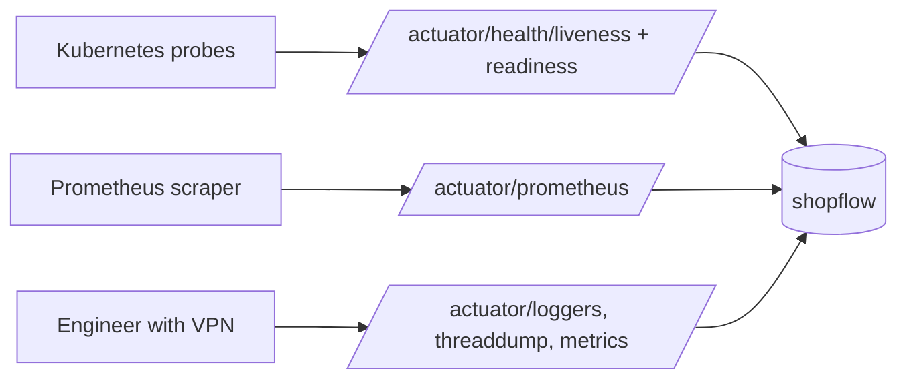
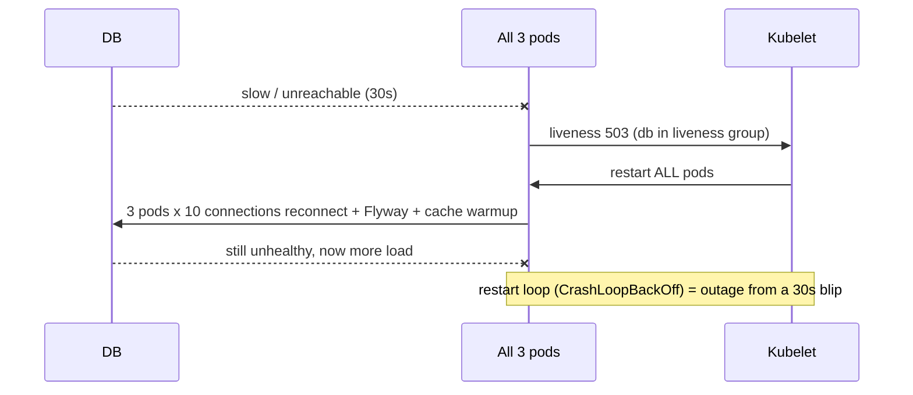
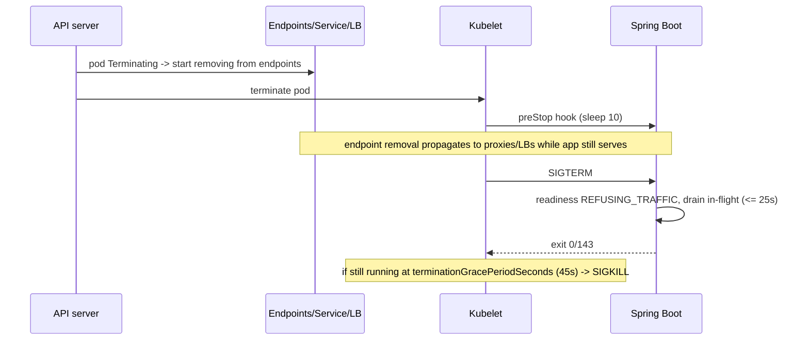
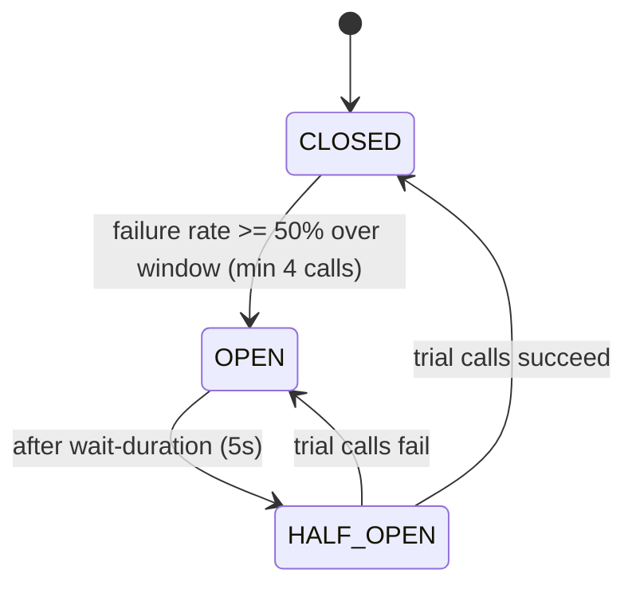

# Session 7 - Operations, resilience and deployment (from zero)

Goal: make the backend survive production. By the end you can expose health/metrics safely, make probes that do not cause restart storms, shut down without dropping requests, put timeouts/retries/circuit breakers in the right places, ship a small non-root Docker image, build a CI pipeline, deploy without downtime, and find a latency spike with metrics plus a thread dump. Everything is shown broken first, then fixed, with real output.

Real-world work this maps to: you own a Spring Boot service called "shopflow" (checkout, payments, catalog, reports). Typical tickets: "pods restart when the DB is slow", "deploys give customers 502s", "checkout p95 doubled at 2 pm", "payment provider outage took the whole site down", "add alerts for the checkout SLO", "why is the container OOM-killed". This session is the toolbox for those tickets.

Scenarios used (all in package `com.example.shopflow`):
- Checkout: stock decrement + fake payment provider (RestClient, idempotency key, retry + circuit breaker) -> resilience, timeouts, metrics, SLO.
- Catalog: product reads via Redis cache, Redis outage falls back to the DB -> health indicators, breaker fallback, cache hit ratio.
- Reports: a heavy "sales report" holding one DB connection -> bulkhead, HikariCP pool exhaustion, the latency-spike investigation.
- Coupon validation public API -> rate limiter (429).
- Notification buffer (batches writes) -> SmartLifecycle, flush on graceful shutdown.

## How to use this article

1. Work through sections in order. Section 0 creates one project (`shopflow`) that all later sections use. Every file has a `file:` header.
2. Tools: Java 21, Maven 3.9+, Docker Desktop. All commands are PowerShell. Postgres and Redis run in Docker on RANDOM host ports so nothing collides (we discover the port).
3. "Try it" lines are meant to break things on purpose. Do them.
4. Items marked `(not run)` were written but not executed (GitHub Actions, Kubernetes, anything needing a cluster).
5. Versions used: Spring Boot 4.0.8 (Spring Framework 7, Tomcat 11, Micrometer 1.16, Hibernate 7), Java 21. Boxes that start with `> If your company is on Spring Boot 3.x:` give the 3.x names.

## Topics

| # | Topic | You will be able to |
|---|-------|---------------------|
| 0 | The shopflow project | run an app with real Postgres + Redis dependencies |
| 1 | Actuator and endpoint exposure | choose what to expose and why default is only `health` |
| 2 | Health groups and probes | design liveness vs readiness; avoid restart storms |
| 3 | Custom health, info, env, management port, security | lock actuator down properly |
| 4 | Graceful shutdown | deploy without dropping in-flight requests |
| 5 | Metrics (Micrometer, Prometheus) | add counters/timers/gauges, avoid high-cardinality tags |
| 6 | Tracing, structured logs, runtime log levels | correlate one request across services |
| 7 | SLI / SLO / error budget / burn rate | write real alert rules |
| 8 | Resilience4j and Spring 7 built-ins | timeouts, retry, breaker, bulkhead, rate limit, fallbacks |
| 9 | HTTP client timeouts and pools | never wait forever |
| 10 | Docker | layered, non-root, container-aware JVM image; compose |
| 11 | CI with GitHub Actions | verify + Testcontainers + image push |
| 12 | Deploy basics | migrations, rolling/blue-green/canary, rollback, K8s YAML, capacity |
| 13 | JVM troubleshooting | diagnose a real pool-exhaustion latency spike |
| 14 | Production-readiness checklist | audit your team's service |

---

## 0. The shopflow project

Start Postgres and Redis on random host ports and find the ports:

```powershell
docker network create s7-net
docker run -d --name s7-pg --network-alias pg --network s7-net -e POSTGRES_DB=shopflow -e POSTGRES_USER=shopflow -e POSTGRES_PASSWORD=shopflow -p 0:5432 postgres:17-alpine
docker run -d --name s7-redis --network-alias redis --network s7-net -p 0:6379 redis:7-alpine
$pgPort    = (docker port s7-pg 5432/tcp    | Select -First 1) -split ':' | Select -Last 1
$redisPort = (docker port s7-redis 6379/tcp | Select -First 1) -split ':' | Select -Last 1
"pg=$pgPort redis=$redisPort"
```

```text
pg=32861 redis=32862
```

(Your ports will differ. In every command below replace them.) The `--network` + alias lets other containers reach `pg:5432` and `redis:6379` by name later (section 4 and 10).

```xml
<!-- file: pom.xml -->
<?xml version="1.0" encoding="UTF-8"?>
<project xmlns="http://maven.apache.org/POM/4.0.0">
  <modelVersion>4.0.0</modelVersion>
  <parent>
    <groupId>org.springframework.boot</groupId>
    <artifactId>spring-boot-starter-parent</artifactId>
    <version>4.0.8</version>
    <relativePath/>
  </parent>
  <groupId>com.example</groupId>
  <artifactId>shopflow</artifactId>
  <version>0.0.1-SNAPSHOT</version>
  <properties>
    <java.version>21</java.version>
    <resilience4j.version>2.4.0</resilience4j.version>
  </properties>
  <dependencies>
    <dependency><groupId>org.springframework.boot</groupId><artifactId>spring-boot-starter-webmvc</artifactId></dependency>
    <dependency><groupId>org.springframework.boot</groupId><artifactId>spring-boot-starter-actuator</artifactId></dependency>
    <dependency><groupId>org.springframework.boot</groupId><artifactId>spring-boot-starter-restclient</artifactId></dependency>
    <dependency><groupId>org.springframework.boot</groupId><artifactId>spring-boot-starter-data-jpa</artifactId></dependency>
    <dependency><groupId>org.springframework.boot</groupId><artifactId>spring-boot-starter-data-redis</artifactId></dependency>
    <dependency><groupId>org.springframework.boot</groupId><artifactId>spring-boot-starter-flyway</artifactId></dependency>
    <dependency><groupId>org.flywaydb</groupId><artifactId>flyway-database-postgresql</artifactId></dependency>
    <dependency><groupId>org.postgresql</groupId><artifactId>postgresql</artifactId><scope>runtime</scope></dependency>
    <dependency><groupId>io.micrometer</groupId><artifactId>micrometer-registry-prometheus</artifactId><scope>runtime</scope></dependency>
    <!-- @Timed / Resilience4j annotations need AspectJ -->
    <dependency><groupId>org.springframework.boot</groupId><artifactId>spring-boot-starter-aspectj</artifactId></dependency>
    <dependency><groupId>io.github.resilience4j</groupId><artifactId>resilience4j-spring-boot4</artifactId><version>${resilience4j.version}</version></dependency>
  </dependencies>
  <build>
    <plugins>
      <plugin>
        <groupId>org.springframework.boot</groupId>
        <artifactId>spring-boot-maven-plugin</artifactId>
        <executions><execution><goals><goal>build-info</goal></goals></execution></executions>
      </plugin>
      <plugin>
        <groupId>io.github.git-commit-id</groupId>
        <artifactId>git-commit-id-maven-plugin</artifactId>
        <configuration><failOnNoGitDirectory>false</failOnNoGitDirectory></configuration>
      </plugin>
    </plugins>
  </build>
</project>
```

> If your company is on Spring Boot 3.x: `spring-boot-starter-webmvc` is `spring-boot-starter-web`; `spring-boot-starter-aspectj` is `spring-boot-starter-aop`; `spring-boot-starter-flyway` is just `org.flywaydb:flyway-core` (+ `flyway-database-postgresql`); `spring-boot-starter-restclient` does not exist (RestClient autoconfig ships in the web starter); Resilience4j is `resilience4j-spring-boot3` instead of `resilience4j-spring-boot4`. Verified: `resilience4j-spring-boot4:2.4.0` works on Boot 4.0.8 and brings `resilience4j-spring6` plus the core modules.

```sql
-- file: src/main/resources/db/migration/V1__init.sql
CREATE TABLE products (
    id BIGSERIAL PRIMARY KEY, sku VARCHAR(32) NOT NULL UNIQUE, name VARCHAR(200) NOT NULL,
    price_cents BIGINT NOT NULL, stock INT NOT NULL CHECK (stock >= 0));
CREATE TABLE orders (
    id BIGSERIAL PRIMARY KEY, customer_id BIGINT NOT NULL, status VARCHAR(20) NOT NULL,
    total_cents BIGINT NOT NULL, created_at TIMESTAMPTZ NOT NULL DEFAULT now());
CREATE TABLE order_items (
    id BIGSERIAL PRIMARY KEY, order_id BIGINT NOT NULL REFERENCES orders(id),
    product_id BIGINT NOT NULL REFERENCES products(id), quantity INT NOT NULL, unit_price_cents BIGINT NOT NULL);
CREATE TABLE notifications (
    id BIGSERIAL PRIMARY KEY, order_id BIGINT NOT NULL, kind VARCHAR(40) NOT NULL,
    created_at TIMESTAMPTZ NOT NULL DEFAULT now());
INSERT INTO products (sku, name, price_cents, stock) VALUES
    ('KB-001', 'Mechanical keyboard', 8999, 100),
    ('MS-002', 'Wireless mouse', 2999, 250),
    ('HD-003', 'USB-C hub', 4999, 5);
```

```properties
# file: src/main/resources/application.properties
spring.application.name=shopflow

# DB + Redis: override per environment with env vars (SPRING_DATASOURCE_URL ...)
spring.datasource.url=jdbc:postgresql://localhost:5432/shopflow
spring.datasource.username=shopflow
spring.datasource.password=shopflow
spring.datasource.hikari.maximum-pool-size=10
spring.jpa.hibernate.ddl-auto=validate
spring.jpa.open-in-view=false
spring.data.redis.host=localhost
spring.data.redis.port=6379
spring.data.redis.timeout=200ms
spring.data.redis.connect-timeout=200ms

shopflow.payment.url=http://localhost:8080

management.endpoints.web.exposure.include=health,info,metrics,prometheus,loggers
management.endpoint.health.show-details=always
management.endpoint.health.probes.enabled=true
management.info.env.enabled=true
info.app.name=shopflow
management.observations.annotations.enabled=true

resilience4j.circuitbreaker.instances.redis.sliding-window-size=10
resilience4j.circuitbreaker.instances.redis.minimum-number-of-calls=5
resilience4j.circuitbreaker.instances.redis.failure-rate-threshold=50
resilience4j.circuitbreaker.instances.redis.wait-duration-in-open-state=10s
resilience4j.circuitbreaker.instances.redis.permitted-number-of-calls-in-half-open-state=3
resilience4j.circuitbreaker.instances.payments.sliding-window-size=6
resilience4j.circuitbreaker.instances.payments.minimum-number-of-calls=4
resilience4j.circuitbreaker.instances.payments.failure-rate-threshold=50
resilience4j.circuitbreaker.instances.payments.wait-duration-in-open-state=5s
resilience4j.circuitbreaker.instances.payments.permitted-number-of-calls-in-half-open-state=2
resilience4j.retry.instances.payments.max-attempts=3
resilience4j.retry.instances.payments.wait-duration=100ms
resilience4j.retry.instances.payments.enable-exponential-backoff=true
resilience4j.retry.instances.payments.exponential-backoff-multiplier=2
resilience4j.retry.instances.payments.enable-randomized-wait=true
resilience4j.retry.instances.payments.randomized-wait-factor=0.5
resilience4j.bulkhead.instances.reports.max-concurrent-calls=2
resilience4j.bulkhead.instances.reports.max-wait-duration=0
resilience4j.ratelimiter.instances.coupons.limit-for-period=5
resilience4j.ratelimiter.instances.coupons.limit-refresh-period=1s
resilience4j.ratelimiter.instances.coupons.timeout-duration=0
```

Now the Java. Entities are plain (JPA needs a protected no-arg constructor):

```java
// file: src/main/java/com/example/shopflow/ShopflowApplication.java
package com.example.shopflow;

import org.springframework.boot.SpringApplication;
import org.springframework.boot.autoconfigure.SpringBootApplication;

@SpringBootApplication
public class ShopflowApplication {
    public static void main(String[] args) {
        SpringApplication.run(ShopflowApplication.class, args);
    }
}
```

```java
// file: src/main/java/com/example/shopflow/Product.java
package com.example.shopflow;

import jakarta.persistence.*;

@Entity @Table(name = "products")
public class Product {
    @Id @GeneratedValue(strategy = GenerationType.IDENTITY) private Long id;
    private String sku; private String name; private long priceCents; private int stock;
    protected Product() {}
    public Long getId() { return id; }
    public String getSku() { return sku; }
    public String getName() { return name; }
    public long getPriceCents() { return priceCents; }
}
```

```java
// file: src/main/java/com/example/shopflow/Order.java
package com.example.shopflow;

import jakarta.persistence.*;
import java.time.Instant;

@Entity @Table(name = "orders")
public class Order {
    @Id @GeneratedValue(strategy = GenerationType.IDENTITY) private Long id;
    private long customerId; private String status; private long totalCents;
    private Instant createdAt = Instant.now();
    protected Order() {}
    public Order(long customerId, long totalCents) {
        this.customerId = customerId; this.totalCents = totalCents; this.status = "PENDING_PAYMENT";
    }
    public Long getId() { return id; }
    public long getTotalCents() { return totalCents; }
    public void setStatus(String status) { this.status = status; }
}
```

```java
// file: src/main/java/com/example/shopflow/OrderItem.java
package com.example.shopflow;

import jakarta.persistence.*;

@Entity @Table(name = "order_items")
public class OrderItem {
    @Id @GeneratedValue(strategy = GenerationType.IDENTITY) private Long id;
    private long orderId; private long productId; private int quantity; private long unitPriceCents;
    protected OrderItem() {}
    public OrderItem(long orderId, long productId, int quantity, long unitPriceCents) {
        this.orderId = orderId; this.productId = productId; this.quantity = quantity; this.unitPriceCents = unitPriceCents;
    }
}
```

```java
// file: src/main/java/com/example/shopflow/ProductRepository.java
package com.example.shopflow;

import java.util.Optional;
import org.springframework.data.jpa.repository.*;
import org.springframework.data.repository.query.Param;

public interface ProductRepository extends JpaRepository<Product, Long> {
    Optional<Product> findBySku(String sku);

    /** Atomic: the WHERE clause is the oversell guard. Returns 0 when stock is too low. */
    @Modifying
    @Query("update Product p set p.stock = p.stock - :qty where p.id = :id and p.stock >= :qty")
    int decrementStock(@Param("id") long id, @Param("qty") int qty);
}
```

```java
// file: src/main/java/com/example/shopflow/OrderRepository.java  (and OrderItemRepository.java: same shape)
package com.example.shopflow;
import org.springframework.data.jpa.repository.JpaRepository;
public interface OrderRepository extends JpaRepository<Order, Long> {}
// OrderItemRepository: public interface OrderItemRepository extends JpaRepository<OrderItem, Long> {}
```

The two short transactions around the remote call (rule: never hold a DB transaction open while calling a remote service - that is how pools get exhausted):

```java
// file: src/main/java/com/example/shopflow/OrderTx.java
package com.example.shopflow;

import java.util.ArrayList;
import java.util.List;
import org.springframework.stereotype.Service;
import org.springframework.transaction.annotation.Transactional;

@Service
public class OrderTx {
    public record Line(String sku, int quantity) {}

    public static class OutOfStockException extends RuntimeException {
        public OutOfStockException(String sku) { super("not enough stock for " + sku); }
    }

    private final ProductRepository products;
    private final OrderRepository orders;
    private final OrderItemRepository items;

    public OrderTx(ProductRepository products, OrderRepository orders, OrderItemRepository items) {
        this.products = products; this.orders = orders; this.items = items;
    }

    @Transactional
    public Order createPending(long customerId, List<Line> lines) {
        long total = 0;
        record Priced(long productId, int qty, long price) {}
        var priced = new ArrayList<Priced>();
        for (Line line : lines) {
            Product p = products.findBySku(line.sku()).orElseThrow(() -> new OutOfStockException(line.sku()));
            if (products.decrementStock(p.getId(), line.quantity()) == 0) throw new OutOfStockException(line.sku());
            total += p.getPriceCents() * line.quantity();
            priced.add(new Priced(p.getId(), line.quantity(), p.getPriceCents()));
        }
        Order order = orders.save(new Order(customerId, total));
        for (Priced p : priced) items.save(new OrderItem(order.getId(), p.productId(), p.qty(), p.price()));
        return order;
    }

    @Transactional
    public void setStatus(long orderId, String status) {
        orders.findById(orderId).orElseThrow().setStatus(status);
    }
}
```

The payment provider client. Connect and read timeouts are ALWAYS set; the idempotency key makes retrying a POST safe:

```java
// file: src/main/java/com/example/shopflow/PaymentGateway.java
package com.example.shopflow;

import io.github.resilience4j.circuitbreaker.annotation.CircuitBreaker;
import io.github.resilience4j.retry.annotation.Retry;
import java.time.Duration;
import java.util.Map;
import org.slf4j.Logger;
import org.slf4j.LoggerFactory;
import org.springframework.beans.factory.annotation.Value;
import org.springframework.boot.http.client.ClientHttpRequestFactoryBuilder;
import org.springframework.boot.http.client.HttpClientSettings;
import org.springframework.stereotype.Component;
import org.springframework.web.client.RestClient;

@Component
public class PaymentGateway {
    private static final Logger log = LoggerFactory.getLogger(PaymentGateway.class);
    private final RestClient client;

    public PaymentGateway(RestClient.Builder builder,
                          @Value("${shopflow.payment.url}") String baseUrl,
                          @Value("${shopflow.payment.connect-timeout:500ms}") Duration connectTimeout,
                          @Value("${shopflow.payment.read-timeout:1s}") Duration readTimeout) {
        HttpClientSettings settings = HttpClientSettings.defaults()
                .withConnectTimeout(connectTimeout).withReadTimeout(readTimeout);
        this.client = builder.baseUrl(baseUrl)
                .requestFactory(ClientHttpRequestFactoryBuilder.detect().build(settings)).build();
    }

    @Retry(name = "payments")
    @CircuitBreaker(name = "payments")
    public String charge(long orderId, long amountCents) {
        log.info("charging order {} ({} cents)", orderId, amountCents);
        return client.post().uri("/fake-gateway/charge")
                .header("Idempotency-Key", "order-" + orderId)
                .body(Map.of("amountCents", amountCents))
                .retrieve().body(String.class);
    }

    public String ping() {
        return client.get().uri("/fake-gateway/ping").retrieve().body(String.class);
    }
}
```

A fake provider living in the same app (so you can switch it to `ok | fail | slow` at runtime):

```java
// file: src/main/java/com/example/shopflow/FakeGatewayController.java
package com.example.shopflow;

import java.util.Map;
import java.util.Set;
import java.util.concurrent.ConcurrentHashMap;
import java.util.concurrent.atomic.AtomicInteger;
import java.util.concurrent.atomic.AtomicReference;
import org.springframework.http.HttpStatus;
import org.springframework.http.ResponseEntity;
import org.springframework.web.bind.annotation.*;

@RestController
@RequestMapping("/fake-gateway")
public class FakeGatewayController {
    private final AtomicReference<String> mode = new AtomicReference<>("ok");
    private final AtomicInteger calls = new AtomicInteger();
    private final Set<String> charged = ConcurrentHashMap.newKeySet();

    @PostMapping("/mode/{m}") public String setMode(@PathVariable String m) { mode.set(m); return "gateway mode = " + m + "\n"; }
    @GetMapping("/ping") public String ping() { return "pong\n"; }
    @GetMapping("/stats")
    public Map<String, Object> stats() {
        return Map.of("httpCalls", calls.get(), "uniqueCharges", charged.size(), "mode", mode.get());
    }

    @PostMapping("/charge")
    public ResponseEntity<String> charge(@RequestHeader("Idempotency-Key") String key) throws InterruptedException {
        calls.incrementAndGet();
        switch (mode.get()) {
            case "fail": return ResponseEntity.status(HttpStatus.SERVICE_UNAVAILABLE).body("provider down\n");
            case "slow": Thread.sleep(5000); break;
            default: break;
        }
        charged.add(key);
        return ResponseEntity.ok("charged " + key + "\n");
    }
}
```

The checkout orchestration with custom metrics (explained in section 5):

```java
// file: src/main/java/com/example/shopflow/CheckoutService.java
package com.example.shopflow;

import io.micrometer.core.instrument.MeterRegistry;
import io.micrometer.core.instrument.Tags;
import io.micrometer.core.instrument.Timer;
import io.micrometer.observation.annotation.Observed;
import java.time.Duration;
import java.util.List;
import org.slf4j.Logger;
import org.slf4j.LoggerFactory;
import org.springframework.beans.factory.annotation.Value;
import org.springframework.stereotype.Service;

@Service
public class CheckoutService {
    private static final Logger log = LoggerFactory.getLogger(CheckoutService.class);
    public record Result(long orderId, String status) {}

    private final OrderTx tx;
    private final PaymentGateway gateway;
    private final NotificationBuffer notifications;
    private final MeterRegistry registry;
    private final boolean badTags;

    public CheckoutService(OrderTx tx, PaymentGateway gateway, NotificationBuffer notifications,
                           MeterRegistry registry, @Value("${shopflow.metrics.bad-tags:false}") boolean badTags) {
        this.tx = tx; this.gateway = gateway; this.notifications = notifications;
        this.registry = registry; this.badTags = badTags;
    }

    @Observed(name = "checkout.place-order", contextualName = "place-order")
    public Result placeOrder(long customerId, List<OrderTx.Line> lines) {
        Timer.Sample sample = Timer.start(registry);
        String outcome = "error";
        try {
            Order order = tx.createPending(customerId, lines);              // short tx 1: reserve stock
            try {
                gateway.charge(order.getId(), order.getTotalCents());       // remote call, NO transaction open
                tx.setStatus(order.getId(), "PAID");                        // short tx 2
                notifications.enqueue(order.getId());
                outcome = "paid";
                return new Result(order.getId(), "PAID");
            } catch (Exception e) {
                log.warn("payment for order {} failed: {}", order.getId(), e.toString());
                outcome = "payment_pending";
                return new Result(order.getId(), "PENDING_PAYMENT");
            }
        } catch (OrderTx.OutOfStockException e) {
            outcome = "out_of_stock";
            throw e;
        } finally {
            Tags tags = Tags.of("outcome", outcome);
            if (badTags) tags = tags.and("customer", String.valueOf(customerId));   // the bug of section 5
            registry.counter("orders.placed", tags).increment();
            sample.stop(Timer.builder("checkout.latency").tag("outcome", outcome)
                    .publishPercentiles(0.5, 0.95, 0.99)
                    .serviceLevelObjectives(Duration.ofMillis(100), Duration.ofMillis(250),
                            Duration.ofMillis(500), Duration.ofSeconds(1), Duration.ofSeconds(3))
                    .register(registry));
        }
    }
}
```

Catalog with a Redis cache that degrades to a cache miss when Redis fails:

```java
// file: src/main/java/com/example/shopflow/ProductCache.java
package com.example.shopflow;

import io.github.resilience4j.circuitbreaker.annotation.CircuitBreaker;
import java.time.Duration;
import java.util.Optional;
import org.springframework.data.redis.core.StringRedisTemplate;
import org.springframework.stereotype.Component;

@Component
public class ProductCache {
    private static final Duration TTL = Duration.ofMinutes(10);
    private final StringRedisTemplate redis;
    public ProductCache(StringRedisTemplate redis) { this.redis = redis; }

    @CircuitBreaker(name = "redis", fallbackMethod = "getFallback")
    public Optional<String> get(long id) { return Optional.ofNullable(redis.opsForValue().get("product:" + id)); }

    @CircuitBreaker(name = "redis", fallbackMethod = "putFallback")
    public void put(long id, String json) { redis.opsForValue().set("product:" + id, json, TTL); }

    Optional<String> getFallback(long id, Throwable t) { return Optional.empty(); }   // behave like a miss
    void putFallback(long id, String json, Throwable t) { }
}
```

```java
// file: src/main/java/com/example/shopflow/CatalogService.java
package com.example.shopflow;

import io.micrometer.core.annotation.Timed;
import io.micrometer.core.instrument.MeterRegistry;
import java.util.Optional;
import org.springframework.stereotype.Service;

@Service
public class CatalogService {
    private final ProductRepository repo; private final ProductCache cache; private final MeterRegistry registry;
    public CatalogService(ProductRepository repo, ProductCache cache, MeterRegistry registry) {
        this.repo = repo; this.cache = cache; this.registry = registry;
    }

    @Timed(value = "catalog.product.lookup", description = "time to serve one product")
    public Optional<String> productJson(long id) {
        Optional<String> cached = cache.get(id);
        registry.counter("catalog.cache.requests", "result", cached.isPresent() ? "hit" : "miss").increment();
        if (cached.isPresent()) return cached;
        return repo.findById(id).map(p -> {
            String json = "{\"id\":%d,\"sku\":\"%s\",\"name\":\"%s\",\"priceCents\":%d}"
                    .formatted(p.getId(), p.getSku(), p.getName(), p.getPriceCents());
            cache.put(id, json);
            return json;
        });
    }
}
```

Reports (a connection hog), coupons (rate limited), notifications (SmartLifecycle), availability logger, health indicator, observability config, error mapping and controller:

```java
// file: src/main/java/com/example/shopflow/ReportService.java
package com.example.shopflow;

import io.github.resilience4j.bulkhead.annotation.Bulkhead;
import org.slf4j.Logger;
import org.slf4j.LoggerFactory;
import org.springframework.jdbc.core.JdbcTemplate;
import org.springframework.stereotype.Service;
import org.springframework.transaction.annotation.Transactional;

@Service
public class ReportService {
    private static final Logger log = LoggerFactory.getLogger(ReportService.class);
    private final ReportQuery query;
    public ReportService(ReportQuery query) { this.query = query; }

    @Bulkhead(name = "reports")
    public String salesReport(long ms) {
        log.info("sales report started ({} ms)", ms);
        String r = query.run(ms);
        log.info("sales report finished");
        return r;
    }

    @Service
    public static class ReportQuery {
        private final JdbcTemplate jdbc;
        public ReportQuery(JdbcTemplate jdbc) { this.jdbc = jdbc; }

        @Transactional(readOnly = true)   // holds ONE pooled connection for the whole duration
        public String run(long ms) {
            jdbc.queryForObject("select count(*) from (select pg_sleep(?)) s", Integer.class, ms / 1000.0);
            Long orders = jdbc.queryForObject("select count(*) from orders", Long.class);
            return "orders so far: " + orders + "\n";
        }
    }
}
```

```java
// file: src/main/java/com/example/shopflow/CouponService.java
package com.example.shopflow;

import io.github.resilience4j.ratelimiter.annotation.RateLimiter;
import java.util.Map;
import org.springframework.stereotype.Service;

@Service
public class CouponService {
    @RateLimiter(name = "coupons")
    public Map<String, Object> validate(String code) {
        return Map.of("code", code, "valid", code.startsWith("SAVE"), "percentOff", 10);
    }
}
```

```java
// file: src/main/java/com/example/shopflow/NotificationBuffer.java
package com.example.shopflow;

import java.util.ArrayList;
import java.util.List;
import java.util.concurrent.*;
import org.slf4j.Logger;
import org.slf4j.LoggerFactory;
import org.springframework.beans.factory.annotation.Value;
import org.springframework.context.SmartLifecycle;
import org.springframework.jdbc.core.JdbcTemplate;
import org.springframework.stereotype.Component;

/** Queues "order confirmed" notifications in memory and writes them in batches. Flushes on shutdown. */
@Component
public class NotificationBuffer implements SmartLifecycle {
    private static final Logger log = LoggerFactory.getLogger(NotificationBuffer.class);
    private final ConcurrentLinkedQueue<Long> pending = new ConcurrentLinkedQueue<>();
    private final JdbcTemplate jdbc;
    private final int phase;
    private ScheduledExecutorService scheduler;
    private volatile boolean running;

    public NotificationBuffer(JdbcTemplate jdbc, @Value("${shopflow.notification-buffer.phase:0}") int phase) {
        this.jdbc = jdbc; this.phase = phase;
    }

    public void enqueue(long orderId) { pending.add(orderId); }

    private int flush() {
        List<Long> batch = new ArrayList<>();
        Long id;
        while ((id = pending.poll()) != null) batch.add(id);
        if (!batch.isEmpty()) {
            jdbc.batchUpdate("insert into notifications (order_id, kind) values (?, 'ORDER_CONFIRMED')",
                    batch, batch.size(), (ps, orderId) -> ps.setLong(1, orderId));
        }
        return batch.size();
    }

    @Override public void start() {
        scheduler = Executors.newSingleThreadScheduledExecutor();
        scheduler.scheduleWithFixedDelay(this::flush, 5, 5, TimeUnit.SECONDS);
        running = true;
        log.info("NotificationBuffer started (phase {})", phase);
    }

    @Override public void stop() {
        scheduler.shutdown();
        int n = flush();
        running = false;
        log.info("NotificationBuffer stopped: flushed {} pending notifications", n);
    }

    @Override public boolean isRunning() { return running; }
    @Override public int getPhase() { return phase; }
}
```

```java
// file: src/main/java/com/example/shopflow/AvailabilityLogger.java
package com.example.shopflow;

import org.slf4j.Logger;
import org.slf4j.LoggerFactory;
import org.springframework.boot.availability.AvailabilityChangeEvent;
import org.springframework.boot.availability.LivenessState;
import org.springframework.boot.availability.ReadinessState;
import org.springframework.context.event.EventListener;
import org.springframework.stereotype.Component;

@Component
public class AvailabilityLogger {
    private static final Logger log = LoggerFactory.getLogger(AvailabilityLogger.class);
    @EventListener public void onReadiness(AvailabilityChangeEvent<ReadinessState> e) { log.info("Readiness is now {}", e.getState()); }
    @EventListener public void onLiveness(AvailabilityChangeEvent<LivenessState> e) { log.info("Liveness is now {}", e.getState()); }
}
```

```java
// file: src/main/java/com/example/shopflow/ApiErrors.java
package com.example.shopflow;

import io.github.resilience4j.bulkhead.BulkheadFullException;
import io.github.resilience4j.ratelimiter.RequestNotPermitted;
import java.util.Map;
import org.springframework.http.HttpStatus;
import org.springframework.http.ResponseEntity;
import org.springframework.web.bind.annotation.ExceptionHandler;
import org.springframework.web.bind.annotation.RestControllerAdvice;

@RestControllerAdvice
public class ApiErrors {
    @ExceptionHandler(RequestNotPermitted.class)
    public ResponseEntity<Map<String, String>> rateLimited() {
        return ResponseEntity.status(HttpStatus.TOO_MANY_REQUESTS).header("Retry-After", "1").body(Map.of("error", "rate limit exceeded"));
    }
    @ExceptionHandler(BulkheadFullException.class)
    public ResponseEntity<Map<String, String>> busy() {
        return ResponseEntity.status(HttpStatus.SERVICE_UNAVAILABLE).header("Retry-After", "5").body(Map.of("error", "too many concurrent reports"));
    }
    @ExceptionHandler(OrderTx.OutOfStockException.class)
    public ResponseEntity<Map<String, String>> outOfStock(OrderTx.OutOfStockException e) {
        return ResponseEntity.status(HttpStatus.CONFLICT).body(Map.of("error", e.getMessage()));
    }
}
```

```java
// file: src/main/java/com/example/shopflow/ShopController.java
package com.example.shopflow;

import java.util.List;
import java.util.Map;
import org.springframework.http.HttpStatus;
import org.springframework.http.ResponseEntity;
import org.springframework.web.bind.annotation.*;

@RestController
public class ShopController {
    public record OrderRequest(long customerId, List<OrderTx.Line> items) {}

    private final CheckoutService checkout; private final CatalogService catalog;
    private final ReportService reports; private final CouponService coupons;

    public ShopController(CheckoutService checkout, CatalogService catalog, ReportService reports, CouponService coupons) {
        this.checkout = checkout; this.catalog = catalog; this.reports = reports; this.coupons = coupons;
    }

    @PostMapping("/api/orders")
    public ResponseEntity<CheckoutService.Result> placeOrder(@RequestBody OrderRequest req) {
        CheckoutService.Result r = checkout.placeOrder(req.customerId(), req.items());
        return ResponseEntity.status(r.status().equals("PAID") ? HttpStatus.CREATED : HttpStatus.ACCEPTED).body(r);
    }

    @GetMapping("/api/products/{id}")
    public ResponseEntity<String> product(@PathVariable long id) {
        return catalog.productJson(id)
                .map(json -> ResponseEntity.ok().header("Content-Type", "application/json").body(json))
                .orElseGet(() -> ResponseEntity.notFound().build());
    }

    @GetMapping("/api/reports/sales")
    public String sales(@RequestParam(defaultValue = "10000") long ms) { return reports.salesReport(ms); }

    @GetMapping("/api/coupons/{code}")
    public Map<String, Object> coupon(@PathVariable String code) { return coupons.validate(code); }
}
```

```java
// file: src/main/java/com/example/shopflow/ObservabilityConfig.java
package com.example.shopflow;

import io.github.resilience4j.circuitbreaker.CircuitBreaker;
import io.github.resilience4j.core.registry.*;
import io.micrometer.core.aop.TimedAspect;
import io.micrometer.core.instrument.MeterRegistry;
import org.slf4j.Logger;
import org.slf4j.LoggerFactory;
import org.springframework.context.annotation.Bean;
import org.springframework.context.annotation.Configuration;

@Configuration
public class ObservabilityConfig {
    private static final Logger log = LoggerFactory.getLogger("circuit-breaker");

    @Bean TimedAspect timedAspect(MeterRegistry registry) { return new TimedAspect(registry); }   // makes @Timed work

    /** Log every circuit breaker state change: the most useful 1 line of resilience logging. */
    @Bean
    RegistryEventConsumer<CircuitBreaker> circuitBreakerLogger() {
        return new RegistryEventConsumer<>() {
            @Override public void onEntryAddedEvent(EntryAddedEvent<CircuitBreaker> e) {
                e.getAddedEntry().getEventPublisher()
                        .onStateTransition(t -> log.warn("breaker '{}' {}", t.getCircuitBreakerName(), t.getStateTransition()));
            }
            @Override public void onEntryRemovedEvent(EntryRemovedEvent<CircuitBreaker> e) { }
            @Override public void onEntryReplacedEvent(EntryReplacedEvent<CircuitBreaker> e) { }
        };
    }
}
```

The custom health indicator is shown in section 3. Create `order.json` for load tests, then run (replace the ports):

```json
{"customerId":1,"items":[{"sku":"MS-002","quantity":1}]}
```

```powershell
mvn -B -q clean package -DskipTests
java -jar target\shopflow-0.0.1-SNAPSHOT.jar --server.port=18417 --spring.datasource.url=jdbc:postgresql://localhost:$pgPort/shopflow --spring.data.redis.port=$redisPort
curl.exe -s -X POST -H "Content-Type: application/json" -d "@order.json" http://localhost:18417/api/orders
```

```text
{"orderId":1,"status":"PAID"}
```

A tiny load generator used by later sections (virtual threads, prints status counts and latency percentiles). Save it next to the pom and run with `java Load.java <url> <concurrency> <total> [GET|POST] [jsonBody]`; in PowerShell pass JSON as `'{\"k\":1}'`:

```java
// file: Load.java
import java.net.URI;
import java.net.http.*;
import java.time.Duration;
import java.util.*;
import java.util.concurrent.*;
import java.util.concurrent.atomic.AtomicInteger;

public class Load {
    public static void main(String[] args) throws Exception {
        String url = args[0];
        int concurrency = Integer.parseInt(args[1]);
        int total = Integer.parseInt(args[2]);
        String method = args.length > 3 ? args[3] : "GET";
        String body = args.length > 4 ? args[4] : "";
        HttpClient client = HttpClient.newBuilder().connectTimeout(Duration.ofSeconds(5)).build();
        Semaphore inFlight = new Semaphore(concurrency);
        List<Long> latencies = Collections.synchronizedList(new ArrayList<>());
        Map<String, AtomicInteger> statuses = new ConcurrentHashMap<>();
        long start = System.nanoTime();
        try (var pool = Executors.newVirtualThreadPerTaskExecutor()) {
            for (int i = 0; i < total; i++) {
                inFlight.acquire();
                pool.submit(() -> {
                    long t0 = System.nanoTime();
                    String key;
                    try {
                        HttpRequest.Builder b = HttpRequest.newBuilder(URI.create(url)).timeout(Duration.ofSeconds(30));
                        if (method.equals("POST")) b.header("Content-Type", "application/json").POST(HttpRequest.BodyPublishers.ofString(body));
                        key = String.valueOf(client.send(b.build(), HttpResponse.BodyHandlers.discarding()).statusCode());
                    } catch (Exception e) {
                        key = e.getClass().getSimpleName();
                    } finally {
                        inFlight.release();
                    }
                    latencies.add((System.nanoTime() - t0) / 1_000_000);
                    statuses.computeIfAbsent(key, k -> new AtomicInteger()).incrementAndGet();
                });
            }
        }
        double secs = (System.nanoTime() - start) / 1e9;
        List<Long> s = new ArrayList<>(latencies);
        Collections.sort(s);
        System.out.printf("requests=%d concurrency=%d wall=%.1fs throughput=%.0f/s%n", total, concurrency, secs, total / secs);
        System.out.printf("latency ms: p50=%d p95=%d p99=%d max=%d%n", pct(s, 0.50), pct(s, 0.95), pct(s, 0.99), s.get(s.size() - 1));
        System.out.println("status: " + new TreeMap<>(statuses));
    }
    static long pct(List<Long> s, double p) { return s.get((int) Math.min(s.size() - 1, Math.ceil(p * s.size()) - 1)); }
}
```

Pitfall seen while building this: stale `target/` classes after renaming a class made Flyway fail with "Found more than one migration with version 1". Always `mvn clean` when you move files.

---

## 1. Actuator: what it is and what it exposes

Actuator is a set of production endpoints (`/actuator/health`, `/metrics`, `/env`...) added by `spring-boot-starter-actuator`. Think of it as the dashboard on the car: the platform (Kubernetes, load balancer, Prometheus) reads it; humans debug with it.



Two switches per endpoint: it must be ENABLED (almost all are, by default) and EXPOSED over the transport (web/JMX). Verified default for `management.endpoints.web.exposure.include` in Boot 4.0.8 is `health`. Why: endpoints like `env` (configuration), `heapdump` (all memory, including secrets and customer data), `threaddump`, `loggers` (can change log levels), `beans`/`mappings` (your internals) are information leaks or controls. Rule: expose the minimum, add per need.

Try it - with only the starter and no exposure property:

```powershell
curl.exe -s http://localhost:18417/actuator
```

```text
{"_links":{"self":{...},"health":{"href":"http://localhost:18417/actuator/health","templated":false},"health-path":{...}}}
```

Only `health` (and its `health-path` helper) is linked (expected from the verified default; this exact call was not re-run). Now what we use in shopflow:

```properties
management.endpoints.web.exposure.include=health,info,metrics,prometheus,loggers
```

Pitfalls:
- `include=*` is fine on a laptop, a vulnerability in prod. If you must, list endpoints explicitly.
- Exposure does not equal access: on the same port as your API, anyone who reaches the API reaches actuator unless you secure it (section 3).
- `management.endpoint.shutdown` stays off. Do not enable it.

> If your company is on Spring Boot 3.x: the exposure property and its default (`health`) are the same. The Java API package for health types differs (section 3).

React/Express equivalent: a `/healthz` route plus `prom-client` metrics route that you mount only on an internal port.

---

## 2. Health, groups and probes (liveness vs readiness)

`GET /actuator/health` aggregates "indicators" (db, redis, diskSpace, ping, plus your own). With `management.endpoint.health.show-details=always` you see components (in production show details only to authorised users: `when-authorized`).

```powershell
curl.exe -s http://localhost:18417/actuator/health
```

```text
{"status":"UP","groups":["liveness","readiness"],"components":{"db":{"status":"UP","details":{"database":"PostgreSQL","validationQuery":"isValid()"}},"diskSpace":{"status":"UP",...},"livenessState":{"status":"UP"},"paymentProvider":{"status":"UP"},"ping":{"status":"UP"},"readinessState":{"status":"UP"},"redis":{"status":"UP","details":{"version":"7.4.9"}},"ssl":{"status":"UP",...}}}
```

With `management.endpoint.health.probes.enabled=true` you also get two health GROUPS, `/actuator/health/liveness` and `/actuator/health/readiness`. (On Kubernetes, Boot enables them automatically; set the property to get them anywhere else.)

| Probe | Question it answers | If it fails, Kubernetes... | Should contain |
|-------|---------------------|-----------------------------|----------------|
| liveness | "Is this process broken beyond self-repair?" (deadlock, corrupted state) | RESTARTS the container | only `livenessState` (internal state). NOT db, redis, downstream APIs |
| readiness | "Can this instance take traffic right now?" | removes pod from the Service endpoints (no restart) | `readinessState`, may add `db` (cannot serve without it) |
| startup | "Has it finished booting?" | delays liveness until done | same endpoint as liveness, with a generous failureThreshold |

### The restart-storm failure (broken first)

Wrong config: someone puts `db` into liveness because "if the DB is down the app is unhealthy":

```properties
management.endpoint.health.group.liveness.include=livenessState,db
```

(env var form: `MANAGEMENT_ENDPOINT_HEALTH_GROUP_LIVENESS_INCLUDE=livenessState,db`). Simulate a DB outage with `docker pause s7-pg` (the DB accepts TCP but never answers; set `SPRING_DATASOURCE_HIKARI_CONNECTION_TIMEOUT=2000` so a probe does not hang for 30s):

```powershell
docker pause s7-pg
curl.exe -s -o NUL -w "liveness=%{http_code}\n"  http://localhost:18417/actuator/health/liveness
curl.exe -s -o NUL -w "readiness=%{http_code}\n" http://localhost:18417/actuator/health/readiness
```

```text
liveness=503
readiness=503
```

The `db` component showed `DOWN` with `CannotGetJdbcConnectionException: Failed to obtain JDBC Connection`. After `docker unpause s7-pg` both returned 200. In Kubernetes the 503 liveness means: kill every pod at the same time.



| | DB blip with `db` in liveness | DB blip with `db` only in readiness |
|---|---|---|
| Liveness | 503 -> restart | 200 -> nothing |
| Readiness | 503 -> out of rotation | 503 -> out of rotation |
| Effect | all pods restart, cold JVMs, thundering herd on DB, full outage | pods stop receiving traffic, recover in seconds when DB returns |
| Warm caches, in-flight work | lost | kept |

### Fixed

```properties
management.endpoint.health.probes.enabled=true
management.endpoint.health.group.readiness.include=readinessState,db
# liveness left at default: livenessState only
```

Same pause test:

```text
liveness : {"status":"UP"}   HTTP 200
readiness: {"status":"DOWN"} HTTP 503   (db DOWN)
... docker unpause s7-pg ...
readiness: HTTP 200
```

Pitfalls (verified or standard):
- Redis, the payment provider, Kafka and other soft dependencies must NOT be in readiness either, unless the service is useless without them. Verified: with Redis paused, the overall `/actuator/health` went DOWN (503) although product reads kept working from the DB. Whoever points a load balancer at the overall `/actuator/health` takes a healthy pod out. Point probes at `/health/liveness` and `/health/readiness`.
- Probes must be cheap and have timeouts. A readiness check that itself hangs for 30s is the failure.
- The first call right after startup may return 503 while db/redis connections warm up; use a `startupProbe`.
- If the JVM is in a long GC pause or the process deadlocks, liveness (which in a deadlock still would answer 200 from a separate thread) will not catch it; do not rely on it for that. It is for "application state is corrupted" signals you publish with `AvailabilityChangeEvent.publish(ctx, LivenessState.BROKEN)`.

> If your company is on Spring Boot 3.x: same properties and same URLs. They automatically appear when running on Kubernetes (`management.endpoint.health.probes.enabled` defaults to true there).

C++ equivalent: liveness = "heartbeat of the watchdog"; readiness = "load-balancer health check". Conflating them is like having the watchdog reboot the machine because the network cable is unplugged.

---

## 3. Custom health, info, metrics, env, separate port, security

### 3.1 Custom HealthIndicator

```java
// file: src/main/java/com/example/shopflow/PaymentGatewayHealthIndicator.java
package com.example.shopflow;

import org.springframework.boot.health.contributor.Health;
import org.springframework.boot.health.contributor.HealthIndicator;
import org.springframework.stereotype.Component;

@Component("paymentProviderHealthIndicator")   // health name = "paymentProvider" (suffix HealthIndicator is stripped)
public class PaymentGatewayHealthIndicator implements HealthIndicator {
    private final PaymentGateway gateway;
    public PaymentGatewayHealthIndicator(PaymentGateway gateway) { this.gateway = gateway; }

    @Override
    public Health health() {
        try {
            gateway.ping();
            return Health.up().build();
        } catch (Exception e) {
            return Health.down().withDetail("error", e.getClass().getSimpleName()).build();
        }
    }
}
```

It appears as `"paymentProvider":{"status":"UP"}` in the output above. It is in the overall status only (not in either probe group) - that is deliberate: a payment outage should alert someone, not restart or unroute pods.

Pitfall (really hit): naming the bean `@Component("paymentGateway")` collides with the `PaymentGateway` client bean: `ConflictingBeanDefinitionException`. Name it `...HealthIndicator`.

> If your company is on Spring Boot 3.x: `import org.springframework.boot.actuate.health.Health;` and `org.springframework.boot.actuate.health.HealthIndicator`. In Boot 4 they moved to `org.springframework.boot.health.contributor`.

### 3.2 /info with build and git info

`spring-boot-maven-plugin`'s `build-info` goal writes `META-INF/build-info.properties`; `git-commit-id-maven-plugin` writes `git.properties`. Run:

```powershell
curl.exe -s http://localhost:18417/actuator/info
```

```text
{"app":{"name":"shopflow"},"git":{"build":{"version":"0.0.1-SNAPSHOT","host":"buildkitsandbox","time":"1980-02-01T00:00:00Z"}},"build":{"artifact":"shopflow","name":"shopflow","time":"1980-02-01T00:00:00Z","version":"0.0.1-SNAPSHOT","group":"com.example"}}
```

Surprises: (1) the time is 1980-02-01 because the Boot parent POM sets a reproducible build timestamp (same source -> same jar bytes; good for caching); (2) in the Docker build there is no `.git` directory (it is in `.dockerignore`), so only `git.build.*` shows up. Pass the commit as a build arg or env var (`info.app.commit=${GIT_SHA}`) if you want it in `/info`. (3) `management.info.git.mode=full` adds the last committer's name and email on the host - use `simple` (commit id + time) when the endpoint can be seen by others. `(not run: output of mode=simple)`.

Use: "which build is running in prod?" is the first question in every incident.

### 3.3 /metrics and /env

```powershell
curl.exe -s http://localhost:18417/actuator/metrics/jvm.memory.used
curl.exe -s http://localhost:18417/actuator/env/spring.datasource.url
```

`/actuator/env` shows every property with its source. Boot 4 default `management.endpoint.env.show-values=never`: values are masked as `******` (verified default `never`), and you can set `when-authorized`. Why to secure it anyway: it lists property names, file locations, environment variable names; with `show-values=always` it leaks passwords/tokens (Boot masks keys named `password`, `secret`, `token`, `key` heuristically, but not everything, e.g. a connection string with credentials inside a URL).

### 3.4 Separate management port

```properties
management.server.port=9090
```

```text
GET :8080/actuator/health  -> HTTP 404
GET :9090/actuator/health  -> {"status":"UP",...}
```

Effect: the public port serves only the API; the management port is reachable only from inside the cluster (probes, Prometheus) because the Service/Ingress simply does not publish it. This is the cheapest and strongest protection. Compose/K8s examples in sections 10 and 12 use it.

### 3.5 Securing actuator with Spring Security

When your API is public and you cannot use a second port (or in addition to it):

```xml
<!-- pom.xml -->
<dependency><groupId>org.springframework.boot</groupId><artifactId>spring-boot-starter-security</artifactId></dependency>
```

```java
// file: src/main/java/com/example/shopflow/SecurityConfig.java
package com.example.shopflow;

import org.springframework.boot.security.autoconfigure.actuate.web.servlet.EndpointRequest;
import org.springframework.context.annotation.Bean;
import org.springframework.context.annotation.Configuration;
import org.springframework.core.annotation.Order;
import org.springframework.security.config.Customizer;
import org.springframework.security.config.annotation.web.builders.HttpSecurity;
import org.springframework.security.core.userdetails.User;
import org.springframework.security.core.userdetails.UserDetailsService;
import org.springframework.security.crypto.factory.PasswordEncoderFactories;
import org.springframework.security.provisioning.InMemoryUserDetailsManager;
import org.springframework.security.web.SecurityFilterChain;

@Configuration
public class SecurityConfig {

    @Bean @Order(1)
    SecurityFilterChain actuator(HttpSecurity http) throws Exception {
        http.securityMatcher(EndpointRequest.toAnyEndpoint())
            .authorizeHttpRequests(a -> a
                .requestMatchers(EndpointRequest.to("health", "info")).permitAll()   // probes stay open
                .anyRequest().hasRole("OPS"))
            .httpBasic(Customizer.withDefaults())
            .csrf(c -> c.disable());     // see pitfall below
        return http.build();
    }

    @Bean @Order(2)
    SecurityFilterChain app(HttpSecurity http) throws Exception {
        http.authorizeHttpRequests(a -> a.anyRequest().permitAll()).csrf(c -> c.disable());
        return http.build();
    }

    @Bean
    UserDetailsService users() {
        var enc = PasswordEncoderFactories.createDelegatingPasswordEncoder();
        return new InMemoryUserDetailsManager(User.withUsername("ops").password(enc.encode("ops-secret")).roles("OPS").build());
    }
}
```

Results (verified):

```text
GET /actuator/metrics                 (no auth)            -> 401
GET /actuator/metrics   -u ops:ops-secret                  -> 200
GET /actuator/health                  (no auth)            -> 200
GET /actuator/env                     (no auth)            -> 401
```

Pitfall found: `POST /actuator/loggers/com.example` returned **403** with a valid user. Cause: CSRF protection on the actuator chain (it blocks any POST without a token). A machine-to-machine ops endpoint with Basic auth has no browser session, so disable CSRF on THIS chain only. After the fix the POST returned 204.

> If your company is on Spring Boot 3.x: the matcher class is `org.springframework.boot.actuate.autoconfigure.security.servlet.EndpointRequest`. In Boot 4 it lives in `org.springframework.boot.security.autoconfigure.actuate.web.servlet` (jar `spring-boot-security`). The `SecurityFilterChain` code is otherwise the same. In prod use real credentials from a secret, not hard-coded ones (the example password is for the demo only).

Try it: remove the `@Order(1)` chain and observe `/actuator/metrics` hit by the app chain's rules instead. Order matters: first matching chain wins.

---

## 4. Graceful shutdown

A deploy means: new pods come up, old pods get SIGTERM. If the old process just dies, every in-flight request fails. Three things must happen on SIGTERM: stop receiving new traffic, let in-flight requests finish, close resources in the right order.

### 4.1 Broken first: `server.shutdown=immediate`

Windows note: `Stop-Process` on Windows is a hard kill (TerminateProcess); no JVM shutdown hooks run, so it cannot demonstrate graceful shutdown. The realistic path is a container: `docker stop` sends SIGTERM (then SIGKILL after a timeout). Build the image from section 10 as `s7-shopflow:3`, then:

```powershell
docker run -d --name s7-app --network s7-net -p 0:8080 `
  -e SPRING_DATASOURCE_URL=jdbc:postgresql://pg:5432/shopflow -e SPRING_DATA_REDIS_HOST=redis `
  -e SHOPFLOW_PAYMENT_URL=http://localhost:8080 -e SERVER_SHUTDOWN=immediate s7-shopflow:3
$port = (docker port s7-app 8080/tcp | Select -First 1) -split ':' | Select -Last 1
# 10 s "report" in the background, then stop the container 3 s later
$j = Start-Job { curl.exe -s -S -w "http=%{http_code} after %{time_total}s" "http://localhost:$using:port/api/reports/sales?ms=10000" 2>&1 | Out-String }
Start-Sleep 3; docker stop -t 30 s7-app | Out-Null
$j | Wait-Job | Receive-Job
```

```text
curl: (52) Empty reply from server
```

(after 3.2 s). Server logs:

```text
... AvailabilityLogger : Readiness is now REFUSING_TRAFFIC
... NotificationBuffer : NotificationBuffer stopped: flushed 0 pending notifications
... HikariPool-1 - Shutdown completed
... PSQLException: An I/O error occurred while sending to the backend.   Caused by: SocketException: Socket closed
... ERROR TransactionInterceptor : Application exception overridden by rollback exception
```

The pool is closed under the running query: the customer sees a failed request and the server logs errors. Exit code 143 = 128 + 15 (SIGTERM).

### 4.2 Fixed: `server.shutdown=graceful`

```properties
server.shutdown=graceful
spring.lifecycle.timeout-per-shutdown-phase=20s
```

Same demo with `-e SERVER_SHUTDOWN=graceful -e SPRING_LIFECYCLE_TIMEOUT_PER_SHUTDOWN_PHASE=20s`:

```text
orders so far: 243
http=200 after 10.2s
exit code 143, docker stop took 7.7 s
```

Log order (real):

```text
Readiness is now REFUSING_TRAFFIC
o.s.boot.tomcat.GracefulShutdown : Commencing graceful shutdown. Waiting for active requests to complete
ReportService                    : sales report finished
o.s.boot.tomcat.GracefulShutdown : Graceful shutdown complete
NotificationBuffer               : NotificationBuffer stopped: flushed 0 pending notifications
Closing JPA EntityManagerFactory ...
HikariPool-1 - Shutdown initiated...
HikariPool-1 - Shutdown completed.
```

What happened: (1) Spring publishes `AvailabilityChangeEvent` -> readiness becomes `REFUSING_TRAFFIC` (the readiness probe now returns 503, so the Service stops routing); (2) Tomcat stops accepting new connections but lets active requests finish, up to the phase timeout; (3) only then do other beans stop, then the JPA/Hikari beans. The 10 s report finished with HTTP 200.

Verified detail: in Boot 4.0.8 the default of `server.shutdown` is `graceful` (from the configuration metadata) and `spring.lifecycle.timeout-per-shutdown-phase` is `30s`. We set both explicitly anyway: explicit beats remembering defaults.

> If your company is on Spring Boot 3.x: the default of `server.shutdown` is `immediate` and you must set `graceful`. Property names are identical.

Try it: `docker stop -t 2` with a 10 s request and graceful on. Docker SIGKILLs after 2 s (exit 137) in the middle of the drain. In my environment the daemon even had a 1 s stop timeout configured, so graceful was killed (137) until I passed `-t 30`. The default `docker stop` grace is 10 s. Lesson: the platform's kill timeout must be longer than your drain time (K8s: `terminationGracePeriodSeconds`).

### 4.3 SmartLifecycle phases: who stops first

`NotificationBuffer` (in the project) implements `SmartLifecycle`, with `phase=0`. Start order is ascending phase; stop order is DESCENDING phase. Spring Boot's web server graceful shutdown lifecycle runs at a very high phase (`Integer.MAX_VALUE` for the "start accepting requests" part, one lower for the stop), so it stops FIRST and your phase-0 beans stop after in-flight requests are drained. That is exactly what you want for a buffer that requests write to: drain requests, then flush.

Proof: place an order, stop within 5 s (before the scheduled flush):

```text
{"orderId":257,"status":"PAID"}
... NotificationBuffer : NotificationBuffer stopped: flushed 1 pending notifications
```

Without SmartLifecycle (or a `@PreDestroy`) that notification would have been lost. Executors you create yourself (`Executors.newFixedThreadPool`) are not closed automatically: expose them as Spring beans (`@Bean(destroyMethod = "shutdown")` or `ThreadPoolTaskExecutor` with `setWaitForTasksToCompleteOnShutdown(true)` and `setAwaitTerminationSeconds(...)`) so the context closes them.

I did not run a non-default phase for the buffer `(not run)`; setting `shopflow.notification-buffer.phase=2147483647` would stop it BEFORE the web server drains - a good experiment: orders finishing during the drain would add notifications after the flush.

### 4.4 Kubernetes: preStop and terminationGracePeriodSeconds



Endpoint removal and SIGTERM race: for a second or two some proxies still send new requests to a pod that already got SIGTERM. A `preStop: sleep 10` keeps the app fully serving while the removal propagates. Budget: `terminationGracePeriodSeconds (45) > preStop (10) + spring.lifecycle.timeout-per-shutdown-phase (25) + a margin`. The K8s YAML in section 12 uses these numbers `(not run)`.

React/Express equivalent: `server.close()` plus `process.on('SIGTERM')`; Spring does the same with Tomcat's graceful connector pause. C++ equivalent: your signal handler sets an atomic flag, joins workers, then exits.

---

## 5. Metrics: Micrometer and Prometheus

Micrometer is the SLF4J of metrics: you write against `MeterRegistry`; the registry (Prometheus here) formats it. Meter types:

| Type | Use | Example in shopflow |
|------|-----|---------------------|
| Counter | monotonically increasing count of events | `orders.placed{outcome}`, `catalog.cache.requests{result}` |
| Timer | duration + count (and histogram/percentiles) | `checkout.latency`, `http.server.requests` |
| Gauge | a value that goes up and down, sampled | pool active connections, queue length |
| DistributionSummary | sizes (bytes, items) | order size in cents |

### 5.1 Counters, timers, gauges in code

Already in `CheckoutService` and `CatalogService`. A gauge example (queue length of the notification buffer) - register once in the constructor of a bean:

```java
Gauge.builder("notifications.pending", pending, ConcurrentLinkedQueue::size).register(registry);
```

`@Timed` needs the `TimedAspect` bean (we defined it in `ObservabilityConfig`) and the AspectJ starter. `@Observed` needs `management.observations.annotations.enabled=true` and then one annotation produces a metric AND (with tracing on) a span. Verified: after `@Observed(name="checkout.place-order")`, `/actuator/metrics` lists `checkout.place-order`.

> If your company is on Spring Boot 3.x: AOP starter is `spring-boot-starter-aop`; `@Observed` needs the `ObservedAspect` bean (and Boot 3.x did not have the `management.observations.annotations.enabled` property until 3.2/3.3 - check your version).

### 5.2 What Prometheus sees

```powershell
curl.exe -s http://localhost:18417/actuator/prometheus | Select-String "orders_placed|checkout_latency_seconds_bucket|catalog_cache|hikaricp_connections_(active|pending|max)|circuitbreaker_state.*payments"
```

```text
orders_placed_total{outcome="paid"} 12.0
orders_placed_total{outcome="out_of_stock"} 118.0
checkout_latency_seconds_bucket{outcome="paid",le="0.1"} 9
checkout_latency_seconds_bucket{outcome="paid",le="0.25"} 12
checkout_latency_seconds_bucket{outcome="paid",le="0.5"} 12
checkout_latency_seconds_bucket{outcome="paid",le="1.0"} 12
checkout_latency_seconds_bucket{outcome="paid",le="3.0"} 12
checkout_latency_seconds_bucket{outcome="paid",le="+Inf"} 12
checkout_latency_seconds_count{outcome="paid"} 12
catalog_cache_requests_total{result="hit"} 196.0
catalog_cache_requests_total{result="miss"} 4.0
hikaricp_connections_active{pool="HikariPool-1"} 0.0
hikaricp_connections_max{pool="HikariPool-1"} 10.0
resilience4j_circuitbreaker_state{name="payments",state="closed"} 1.0
```

(Series names, tags, the order outcome counts and the 196/4 cache counts are real output; the exact bucket counts and the Hikari values above are abbreviated/illustrative.) Notes: dots become underscores, counters get `_total`, timers get `_seconds` and `_bucket`. `serviceLevelObjectives(...)` creates buckets at exactly those durations, which is what lets you compute "share of requests under 500 ms" (section 7) - percentiles published from the app (`publishPercentiles`) cannot be averaged across pods, buckets can. Prefer buckets for SLOs, percentiles for a single-instance quick look.

Cache hit ratio = hits / (hits + misses): 196 / 200 = 98%. In PromQL: `sum(rate(catalog_cache_requests_total{result="hit"}[5m])) / sum(rate(catalog_cache_requests_total[5m]))`.

### 5.3 The high-cardinality tag mistake (broken -> see failure -> fixed)

Broken: a developer wants "orders per customer" and adds `customer=<id>` as a tag (`--shopflow.metrics.bad-tags=true` turns that bug on in our app). Send orders for 40 customers:

```powershell
# start the app with --shopflow.metrics.bad-tags=true, send orders for 40 different customerIds (vary "customerId" in order.json), then count series:
curl.exe -s http://localhost:18417/actuator/prometheus | Select-String 'orders_placed_total{customer' | Measure-Object
```

```text
Count: 40        # 40 time series for ONE counter (vs 2-4 with the fix). Counted in my run; the loop command itself is a sketch.
orders_placed_total{customer="1001",outcome="paid"} 1.0
orders_placed_total{customer="1002",outcome="paid"} 1.0
...
```

Each unique tag-value combination is a separate time series stored in RAM in your app and in Prometheus. 1 million customers x 4 outcomes = 4 million series: scrape size in hundreds of MB, Prometheus OOM, slow queries, and a bill (managed metrics are priced per series). The same applies to `userId`, `orderId`, `sku` of a huge catalog, raw URLs with ids (`/api/orders/123`), and exception messages.

Fixed: tags must be a small bounded set: `outcome` (4 values), `status` class, `uri` TEMPLATE (`/api/orders/{id}`, which Spring does for you in `http.server.requests` - verified templated URIs). Per-customer or per-order analysis goes to logs/traces (which hold high-cardinality fields cheaply), not metrics.

Rule of thumb: total series for one metric = product of the distinct values of its tags; keep it under ~100.

### 5.4 Prometheus scraping (optional, run)

```yaml
# file: prometheus.yml
global:
  scrape_interval: 5s
scrape_configs:
  - job_name: shopflow
    metrics_path: /actuator/prometheus
    static_configs:
      - targets: ['s7-appB:9090']    # container name on the same docker network, management port
```

```powershell
docker run -d --name s7-prom --network s7-net -p 0:9090 -v ${PWD}\prometheus.yml:/etc/prometheus/prometheus.yml prom/prometheus
```

Queries I ran (Prometheus UI or `/api/v1/query`):

```text
sum by (outcome)(orders_placed_total)                                         -> out_of_stock 118, paid 12
histogram_quantile(0.95, sum by (le)(increase(checkout_latency_seconds_bucket[5m])))  -> 0.095  (seconds)
sum(catalog hit)/sum(catalog total)                                           -> 0.98
```

Grafana is the usual dashboard on top (add Prometheus as a data source) `(not run)`.

> Boot 4 surprise: `spring-boot-starter-opentelemetry` (section 6) also adds an OTLP METER registry that pushes metrics to `http://localhost:4318/v1/metrics` every minute and logs a WARN when no collector is there. Turn it off with the `management.otlp.metrics.export.enabled=false` property (property name from the docs, `not run`) unless you want it.

---

## 6. Tracing, structured logging, runtime log levels

A metric says "p95 is bad". A trace says "this one request spent 800 ms in the payment call". A trace is a tree of spans sharing one `traceId`; services pass it along in the W3C `traceparent` HTTP header.

### 6.1 Tracing in Boot 4

Boot 4 has one starter that bundles Micrometer Tracing, the OpenTelemetry bridge and the OTLP exporter: `spring-boot-starter-opentelemetry`.

```xml
<dependency><groupId>org.springframework.boot</groupId><artifactId>spring-boot-starter-opentelemetry</artifactId></dependency>
```

```properties
management.tracing.sampling.probability=1.0
# real collector, e.g. Grafana Tempo / Jaeger / OTel Collector (not run):
management.opentelemetry.tracing.export.otlp.endpoint=http://otel-collector:4318/v1/traces
# no collector available? switch export off:
# management.tracing.export.otlp.enabled=false
```

> If your company is on Spring Boot 3.x: no such starter; add `io.micrometer:micrometer-tracing-bridge-otel` and `io.opentelemetry:opentelemetry-exporter-otlp`; the endpoint property is `management.otlp.tracing.endpoint`. (The old name is still accepted in 4.x as deprecated.) For Brave/Zipkin use `micrometer-tracing-bridge-brave` + `zipkin-reporter-brave`.

Verified with two apps: an "outer" endpoint calls an "inner" endpoint through a `RestClient` built from the injected `RestClient.Builder`. Sampling 1.0. Outer log line (the traceId-spanId pair is real; other fields shortened):

```text
INFO ... [extras] [nio-8081-exec-1] [e19377d7732d46cd097550736f2be2c7-06764f217184aaba] ... : outer handling
```

Inner log line: same traceId, new spanId, and the inner endpoint received:

```text
traceparent=00-e19377d7732d46cd097550736f2be2c7-9caa91ad99d0b138-01
```

(format: version-traceId-parentSpanId-flags). The bracketed `[traceId-spanId]` is the default log correlation in Boot 4 once tracing is on: the IDs are put in the SLF4J MDC (the per-thread diagnostic map) under `traceId` and `spanId`.

Pitfalls:
- Propagation works only for clients created from the Spring-provided builder (`RestClient.Builder`, `WebClient.Builder`). `RestClient.create()` or `new RestTemplate()` skips the instrumentation: the trace breaks at that hop.
- Sampling 1.0 in prod on a hot path is expensive; use 0.01-0.1 or tail-based sampling in the collector.
- Your own threads (executors) lose the MDC unless you wrap them with context propagation (Spring provides `ContextPropagatingTaskDecorator`).

### 6.2 Structured logging

Plain text logs need regexes; JSON logs go straight into Elasticsearch/Loki with fields. Native in Boot 3.4+ and 4:

```powershell
java -jar target\shopflow-0.0.1-SNAPSHOT.jar --logging.structured.format.console=ecs
```

```text
{"@timestamp":"2026-10-19T04:32:50.241Z","log.level":"INFO","process.pid":1,"process.thread.name":"nio-8080-exec-1","service.name":"shopflow","service.version":"0.0.1-SNAPSHOT","log.logger":"com.example.shopflow.PaymentGateway","message":"charging order 12 (2999 cents)","traceId":"e19377d7732d46cd097550736f2be2c7","spanId":"06764f217184aaba","ecs.version":"8.11"}
```

(verified format ecs, keys shortened). `logstash` and `gelf` are the other built-in formats (from the docs, `not run`). In production log to stdout as JSON, let the platform ship it. Never log secrets, card numbers or full request bodies. The traceId field lets you jump from a metric alert to a trace to the exact log lines.

### 6.3 Change log levels at runtime: /actuator/loggers

```powershell
curl.exe -s -u ops:ops-secret http://localhost:18417/actuator/loggers/com.example.shopflow
curl.exe -s -u ops:ops-secret -X POST -H "Content-Type: application/json" -d '{\"configuredLevel\":\"DEBUG\"}' http://localhost:18417/actuator/loggers/com.example.shopflow
```

```text
{"configuredLevel":null,"effectiveLevel":"INFO"}
(POST -> 204)
{"configuredLevel":"DEBUG","effectiveLevel":"DEBUG"}
```

Turn DEBUG on for one package during an incident, then set `{"configuredLevel":null}` to reset. It is lost on restart. This needs `loggers` exposed and the endpoint secured, and see the CSRF pitfall in section 3.5.

---

## 7. SLI, SLO, error budget, burn rate

- SLI (indicator): a measured ratio, "good events / valid events". Redirect-style example for checkout: requests to `POST /api/orders` that did not return 5xx.
- SLO (objective): the target for the SLI over a window, e.g. 99.9% over 30 days.
- Error budget: 1 - SLO = 0.1% of requests (or time) may be bad.
- Burn rate: how fast you consume the budget relative to the allowed pace. Burn = observed error ratio / (1 - SLO). Burn 1 = you exactly use the budget by the end of the window.

Worked math for checkout, SLO 99.9% over 30 days:

```text
budget         = 0.1% = 0.001
as time        = 30 d x 24 h x 60 min = 43,200 min ; x 0.001 = 43.2 minutes of total outage per month
at 100 req/s   = 259.2 M requests/month ; budget = 259,200 failed requests
burn 14.4 for 1 h  -> 14.4 x 1 h / 720 h = 2% of the monthly budget gone in an hour  -> PAGE
burn  6   for 6 h  ->  6   x 6 h / 720 h = 5% of the budget                         -> PAGE (slower)
burn  1   for 3 d  -> 10% of budget ; steady, ticket not page
```

Why alert on burn rate and not "error rate > 1%": a 1% error spike for 2 minutes is noise; 0.2% errors for 3 days quietly eats your budget. Multi-window (long AND short, e.g. 1 h and 5 min) means the alert fires fast but also stops firing quickly after the problem is fixed.

Alert rules (validated with `promtool check rules` -> `SUCCESS: 4 rules found`):

```yaml
# file: slo-rules.yml
groups:
  - name: shopflow-slo
    rules:
      - record: shopflow:checkout_error_ratio:rate5m
        expr: |
          sum(rate(http_server_requests_seconds_count{uri="/api/orders", status=~"5.."}[5m]))
          /
          sum(rate(http_server_requests_seconds_count{uri="/api/orders"}[5m]))
      - record: shopflow:checkout_error_ratio:rate1h
        expr: |
          sum(rate(http_server_requests_seconds_count{uri="/api/orders", status=~"5.."}[1h]))
          /
          sum(rate(http_server_requests_seconds_count{uri="/api/orders"}[1h]))
      - alert: CheckoutErrorBudgetFastBurn
        # SLO 99.9% -> budget 0.001. 14.4x burn for 1h = 2% of the 30-day budget gone
        expr: shopflow:checkout_error_ratio:rate1h > 14.4 * 0.001 and shopflow:checkout_error_ratio:rate5m > 14.4 * 0.001
        for: 2m
        labels: { severity: page }
        annotations:
          summary: "Checkout is burning the error budget 14x too fast"
      - alert: CheckoutSlow
        # latency SLI: 95% of checkouts under 500 ms (le="0.5" is one of our SLO buckets)
        expr: |
          sum(rate(checkout_latency_seconds_bucket{le="0.5"}[5m])) / sum(rate(checkout_latency_seconds_count[5m])) < 0.95
        for: 10m
        labels: { severity: ticket }
```

Note the latency alert only works because we declared a 500 ms bucket (`serviceLevelObjectives`). Locally the share under 500 ms came out as 1 (all fast), and the 5xx ratio query returned empty because no 5xx had occurred - an empty result is "no data", not "0": know the difference for alerts that should fire on "no data" (a dead scraper).

Design choices: count 5xx, not 4xx (a 409 out-of-stock is a correct answer). Exclude health checks from the SLI. Pick SLOs from what users need, not from what you hit today.

HLD notes to read alongside: `I4-Observability-SLOs.md`.

---

## 8. Resilience4j and Spring Framework 7 built-ins

Failure model: remote calls are slow or fail; without protection, a slow dependency eats your threads and connections and takes you down with it. Patterns:

| Pattern | Protects against | Resilience4j | Shopflow use |
|---------|------------------|--------------|--------------|
| Timeout | waiting forever | `TimeLimiter` (or client timeouts, section 9) | payment HTTP read timeout |
| Retry + backoff + jitter | transient failures | `Retry` | payment charge (idempotent) |
| Circuit breaker | hammering a dead dependency | `CircuitBreaker` | payments, Redis |
| Bulkhead | one workload eating all resources | `Bulkhead` | heavy reports |
| Rate limiter | clients/abuse overloading you | `RateLimiter` | coupon validation API |
| Fallback | total failure of an optional dependency | fallback method | Redis down -> read the DB |

Verified: `io.github.resilience4j:resilience4j-spring-boot4:2.4.0` works with Boot 4.0.8 (annotations + properties + metrics + health). The configuration is in `application.properties` (section 0).

### 8.1 Circuit breaker states with real logs



Switch the fake provider to failing and place orders:

```powershell
curl.exe -s -X POST http://localhost:18417/fake-gateway/mode/fail
1..6 | % { curl.exe -s -o NUL -w "%{http_code} " -X POST -H "Content-Type: application/json" -d "@order.json" http://localhost:18417/api/orders }
```

```text
202 202 202 202 202 202
```

Each order is saved as `PENDING_PAYMENT` (a design choice: the money did not move, we can retry later with the same idempotency key) and answers HTTP 202. Logs (the breaker listener from `ObservabilityConfig`):

```text
circuit-breaker : breaker 'payments' CLOSED -> OPEN
PaymentGateway  : payment for order 14 failed: io.github.resilience4j.circuitbreaker.CallNotPermittedException: CircuitBreaker 'payments' is OPEN and does not permit further calls
... 5 s later, next call ...
circuit-breaker : breaker 'payments' OPEN -> HALF_OPEN
curl -X POST .../fake-gateway/mode/ok ; place orders
circuit-breaker : breaker 'payments' HALF_OPEN -> CLOSED
```

In OPEN the call fails immediately (no 1-second timeout, no thread parked), which is the entire point: failing fast protects your threads and gives the provider room to recover.

Gotcha seen in practice: on a freshly started, cold JVM on a slow machine, the first payment calls took > 1 s (class loading/JIT), exceeded the read timeout, and opened the breaker (30 orders in a row answered 202). Warm up before taking traffic (readiness is a natural place) or require more `minimum-number-of-calls`, and consider `slow-call-duration-threshold`.

### 8.2 Retry with exponential backoff and jitter

Config (above): 3 attempts, 100 ms base, x2, randomized +/- 50%. Jitter spreads retries so thousands of clients do not retry in lockstep (thundering herd). Retry only when it is safe: GET, or POST with an idempotency key (our `Idempotency-Key: order-<id>` header makes the provider charge once per key). The fake provider counted `httpCalls` vs `uniqueCharges` to prove it.

Retry only transient errors (`retry-exceptions`, `ignore-exceptions`): do not retry 400/404/409.

### 8.3 Retry storm: 3 layers x 3 retries = 27 calls

Runnable demo (plain Java, no Spring, no Docker): a payment provider that is DOWN, and a call chain browser -> API gateway -> shopflow -> provider where each layer retries. The program counts how many calls the dead provider receives. Scratch setup: the `pom.xml` from section 8.4 below (or just `javac RetryStorm.java` - it uses only the JDK). In the same project, create the `com.example.shopflow.labs` package.

```java
// file: src/main/java/com/example/shopflow/labs/RetryStorm.java
package com.example.shopflow.labs;

import java.util.concurrent.atomic.AtomicInteger;
import java.util.function.Supplier;

/** Counts how many calls a DEAD payment provider receives. Layers: browser -> gateway -> shopflow -> provider. */
public class RetryStorm {

    static final AtomicInteger providerCalls = new AtomicInteger();

    static String provider() {
        providerCalls.incrementAndGet();
        throw new IllegalStateException("provider down");
    }

    /** Naive retry: up to `attempts` tries (1 = no retry), rethrow the last failure. */
    static <T> T retry(int attempts, Supplier<T> call) {
        RuntimeException last = null;
        for (int i = 0; i < attempts; i++) {
            try {
                return call.get();
            } catch (RuntimeException e) {
                last = e;
            }
        }
        throw last;
    }

    static void userAction(int browser, int gateway, int shopflow) {
        try {
            retry(browser, () -> retry(gateway, () -> retry(shopflow, RetryStorm::provider)));
        } catch (RuntimeException expected) {
        }
    }

    /** Retry budget: a retry is allowed only while retries stay below 10% of first attempts. */
    static int firstAttempts, retriesUsed;

    static void budgetedAction() {
        firstAttempts++;
        for (int attempt = 1; attempt <= 3; attempt++) {
            try {
                provider();
                return;
            } catch (RuntimeException e) {
                boolean allowed = retriesUsed < 0.10 * firstAttempts;
                if (attempt == 3 || !allowed) {
                    return;
                }
                retriesUsed++;
            }
        }
    }

    static int measure(Runnable oneAction, int times) {
        providerCalls.set(0);
        for (int i = 0; i < times; i++) {
            oneAction.run();
        }
        return providerCalls.get();
    }

    public static void main(String[] args) {
        System.out.println("Provider is DOWN. Calls it receives for ONE user action:");
        System.out.printf("  no retries anywhere        : %d%n", measure(() -> userAction(1, 1, 1), 1));
        System.out.printf("  retry in ONE layer (x3)    : %d%n", measure(() -> userAction(1, 1, 3), 1));
        System.out.printf("  retry in 3 layers (3x3x3)  : %d%n", measure(() -> userAction(3, 3, 3), 1));
        System.out.println("1000 failing user actions:");
        System.out.printf("  retry in 3 layers (3x3x3)  : %d provider calls%n", measure(() -> userAction(3, 3, 3), 1000));
        System.out.printf("  retry in ONE layer (x3)    : %d provider calls%n", measure(() -> userAction(1, 1, 3), 1000));
        System.out.printf("  ONE layer + 10%% retry budget: %d provider calls%n", measure(RetryStorm::budgetedAction, 1000));
    }
}
```

Run it (`java RetryStorm.java` works for a single-file program; or run from the project classpath):

```text
Provider is DOWN. Calls it receives for ONE user action:
  no retries anywhere        : 1
  retry in ONE layer (x3)    : 3
  retry in 3 layers (3x3x3)  : 27
1000 failing user actions:
  retry in 3 layers (3x3x3)  : 27000 provider calls
  retry in ONE layer (x3)    : 3000 provider calls
  ONE layer + 10% retry budget: 1100 provider calls
```

Read it: one layer retrying costs 3x, three layers cost 27x (the 3 x 3 x 3 multiplication), and a 10% retry budget keeps the dead provider at 1.1x (1000 first attempts + about 100 retries). Try it: set `userAction(4, 4, 4)` (64 calls) or change the budget to 0.50.

Each layer (browser -> API gateway -> shopflow -> provider) retrying 3 times multiplies: 3 x 3 x 3 = 27 hits on a service that is already down, turning a brownout into a blackout. Rules: retry at ONE layer (usually closest to the failing call); use a retry BUDGET (retries allowed only as a fraction, e.g. 10%, of normal traffic); keep attempts to 2-3; always add jitter; make retried operations idempotent; combine with a circuit breaker so retries stop when the dependency is known-bad.

HLD notes to read alongside: `I2-Timeouts-Retries-Backoff.md`, `I3-Circuit-Breaker-Bulkhead.md`.

### 8.4 Decorator order matters

Resilience4j's annotation aspects compose as `Retry( CircuitBreaker( RateLimiter( TimeLimiter( Bulkhead( function )))))` - retry is outermost. Below is a standalone project that proves it, first programmatically (you choose the nesting), then with the real annotations from `resilience4j-spring-boot4`.

Scratch project (own folder; it is also the project used for the Timeouts demo in section 9):

```xml
<!-- file: pom.xml -->
<?xml version="1.0" encoding="UTF-8"?>
<project xmlns="http://maven.apache.org/POM/4.0.0">
  <modelVersion>4.0.0</modelVersion>
  <parent>
    <groupId>org.springframework.boot</groupId>
    <artifactId>spring-boot-starter-parent</artifactId>
    <version>4.0.8</version>
    <relativePath/>
  </parent>
  <groupId>com.example</groupId>
  <artifactId>shopflow-labs</artifactId>
  <version>0.0.1-SNAPSHOT</version>
  <properties>
    <java.version>21</java.version>
    <resilience4j.version>2.4.0</resilience4j.version>
  </properties>
  <dependencies>
    <dependency><groupId>org.springframework.boot</groupId><artifactId>spring-boot-starter-restclient</artifactId></dependency>
    <dependency><groupId>org.springframework.boot</groupId><artifactId>spring-boot-starter-aspectj</artifactId></dependency>
    <dependency><groupId>io.github.resilience4j</groupId><artifactId>resilience4j-spring-boot4</artifactId><version>${resilience4j.version}</version></dependency>
  </dependencies>
</project>
```

> If your company is on Spring Boot 3.x: the artifact is `io.github.resilience4j:resilience4j-spring-boot3` (same annotations, same `resilience4j.*` properties) and the AOP starter is `spring-boot-starter-aop` instead of `spring-boot-starter-aspectj`.

```java
// file: src/main/java/com/example/shopflow/labs/Resilience4jOrder.java
package com.example.shopflow.labs;

import io.github.resilience4j.circuitbreaker.CircuitBreaker;
import io.github.resilience4j.circuitbreaker.CircuitBreakerConfig;
import io.github.resilience4j.retry.Retry;
import io.github.resilience4j.retry.RetryConfig;
import io.github.resilience4j.timelimiter.TimeLimiter;
import java.time.Duration;
import java.util.concurrent.CompletableFuture;
import java.util.concurrent.TimeoutException;
import java.util.concurrent.atomic.AtomicInteger;
import java.util.function.Supplier;

/** Same dead provider, same 3 failing requests; only the DECORATOR ORDER differs. */
public class Resilience4jOrder {

    static final AtomicInteger providerCalls = new AtomicInteger();

    static String provider() {
        providerCalls.incrementAndGet();
        throw new IllegalStateException("provider down");
    }

    static CircuitBreaker newBreaker(String name) {
        return CircuitBreaker.of(name, CircuitBreakerConfig.custom()
                .slidingWindowSize(6).minimumNumberOfCalls(6).failureRateThreshold(50)
                .waitDurationInOpenState(Duration.ofSeconds(30)).build());
    }

    static Retry newRetry(String name) {
        return Retry.of(name, RetryConfig.custom().maxAttempts(3).waitDuration(Duration.ofMillis(10)).build());
    }

    static void run(String label, Supplier<String> decorated, CircuitBreaker cb) {
        providerCalls.set(0);
        for (int request = 1; request <= 3; request++) {
            try {
                decorated.get();
            } catch (RuntimeException e) {
                // every request fails, we only care about the counters
            }
        }
        System.out.printf("%s breaker failures=%d, not-permitted=%d, state=%s, provider calls=%d%n", label,
                cb.getMetrics().getNumberOfFailedCalls(), cb.getMetrics().getNumberOfNotPermittedCalls(),
                cb.getState(), providerCalls.get());
    }

    public static void main(String[] args) throws Exception {
        CircuitBreaker cbA = newBreaker("A");
        Supplier<String> a = Retry.decorateSupplier(newRetry("A"),
                CircuitBreaker.decorateSupplier(cbA, Resilience4jOrder::provider));
        run("A  Retry(CircuitBreaker(call)):", a, cbA);

        CircuitBreaker cbB = newBreaker("B");
        Supplier<String> b = CircuitBreaker.decorateSupplier(cbB,
                Retry.decorateSupplier(newRetry("B"), Resilience4jOrder::provider));
        run("B  CircuitBreaker(Retry(call)):", b, cbB);

        TimeLimiter limiter = TimeLimiter.of(Duration.ofMillis(300));
        long t0 = System.nanoTime();
        try {
            limiter.executeFutureSupplier(() -> CompletableFuture.supplyAsync(() -> {
                try {
                    Thread.sleep(3000);
                } catch (InterruptedException ignored) {
                }
                return "slow result";
            }));
        } catch (TimeoutException e) {
            System.out.printf("C  TimeLimiter(300ms) around a 3000 ms call -> TimeoutException after %d ms%n",
                    (System.nanoTime() - t0) / 1_000_000);
        }
        System.exit(0);
    }
}
```

Run: `mvn -B -q compile dependency:build-classpath -Dmdep.outputFile=cp.txt`, then `java -cp "target\classes;<contents of cp.txt>" com.example.shopflow.labs.Resilience4jOrder` (on Linux/macOS use `:` instead of `;`). Real output:

```text
A  Retry(CircuitBreaker(call)): breaker failures=6, not-permitted=3, state=OPEN, provider calls=6
B  CircuitBreaker(Retry(call)): breaker failures=3, not-permitted=0, state=CLOSED, provider calls=9
C  TimeLimiter(300ms) around a 3000 ms call -> TimeoutException after 322 ms
```

Why the numbers differ (3 requests, 3 attempts each, window of 6 calls, 50% threshold):
- A (retry outside): every ATTEMPT passes through the breaker. Request 1 = 3 failures, request 2 = 3 failures -> window full (6 calls, 100% failed) -> OPEN. Request 3: all 3 attempts are rejected with `CallNotPermittedException` (not-permitted=3) and never reach the provider. Provider saw 6 calls.
- B (breaker outside): the breaker sees one outcome per request (the final failure), so after 3 requests it has only 3 recorded calls, below `minimumNumberOfCalls=6`, so it stays CLOSED and the provider took 9 calls.
- C: the time limiter returns control to the caller at about 300 ms (322 ms here) while the slow call is still running in the background - pair it with a client-level read timeout so the underlying call really stops.

Now the same thing with the real annotations (both on ONE method) in a Spring context with no web server:

```java
// file: src/main/java/com/example/shopflow/labs/AnnotationOrder.java
package com.example.shopflow.labs;

import io.github.resilience4j.circuitbreaker.CircuitBreakerRegistry;
import io.github.resilience4j.circuitbreaker.annotation.CircuitBreaker;
import io.github.resilience4j.retry.annotation.Retry;
import java.util.concurrent.atomic.AtomicInteger;
import org.springframework.boot.CommandLineRunner;
import org.springframework.boot.WebApplicationType;
import org.springframework.boot.autoconfigure.SpringBootApplication;
import org.springframework.boot.builder.SpringApplicationBuilder;
import org.springframework.context.annotation.Bean;
import org.springframework.stereotype.Component;

@SpringBootApplication
public class AnnotationOrder {

    @Component
    public static class Provider {
        final AtomicInteger calls = new AtomicInteger();

        @Retry(name = "demo")
        @CircuitBreaker(name = "demo")
        public String charge() {
            calls.incrementAndGet();
            throw new IllegalStateException("provider down");
        }

        public int calls() {
            return calls.get();   // read through a method: the bean is a CGLIB proxy, its fields are null
        }
    }

    @Bean
    CommandLineRunner experiment(Provider provider, CircuitBreakerRegistry registry) {
        return args -> {
            for (int request = 1; request <= 3; request++) {
                try {
                    provider.charge();
                } catch (RuntimeException expected) {
                }
            }
            var cb = registry.circuitBreaker("demo");
            System.out.printf("annotations: breaker failures=%d, not-permitted=%d, state=%s, provider calls=%d%n",
                    cb.getMetrics().getNumberOfFailedCalls(), cb.getMetrics().getNumberOfNotPermittedCalls(),
                    cb.getState(), provider.calls());
        };
    }

    public static void main(String[] args) {
        new SpringApplicationBuilder(AnnotationOrder.class)
                .web(WebApplicationType.NONE)
                .properties(
                        "spring.main.banner-mode=off",
                        "logging.level.root=WARN",
                        "resilience4j.circuitbreaker.instances.demo.sliding-window-size=6",
                        "resilience4j.circuitbreaker.instances.demo.minimum-number-of-calls=6",
                        "resilience4j.circuitbreaker.instances.demo.failure-rate-threshold=50",
                        "resilience4j.circuitbreaker.instances.demo.wait-duration-in-open-state=30s",
                        "resilience4j.retry.instances.demo.max-attempts=3",
                        "resilience4j.retry.instances.demo.wait-duration=10ms")
                .run(args);
    }
}
```

```text
annotations: breaker failures=6, not-permitted=3, state=OPEN, provider calls=6
```

Identical to variant A: with the default aspect order, Retry wraps CircuitBreaker. (The first version of this demo printed a NullPointerException because it read `provider.calls` - a field - on the CGLIB proxy; that is why the `calls()` getter exists. Lesson: always go through methods on Spring proxies.) The order is controlled by aspect-order properties, not by which annotation you type first. Flip it by making Retry the innermost aspect (highest order value) with a command-line argument:

```text
java -cp "target\classes;<cp>" com.example.shopflow.labs.AnnotationOrder --resilience4j.retry.retryAspectOrder=2147483647
annotations: breaker failures=3, not-permitted=0, state=CLOSED, provider calls=9
```

That is variant B. The matching property for the breaker is `resilience4j.circuitbreaker.circuitBreakerAspectOrder`.

Which is right? A breaker should see every real attempt, so the default (A) is right for most cases. In B the breaker reacts late and the provider takes more traffic while it is failing. `PaymentGateway.charge` in the main app therefore keeps the default order.

### 8.5 Bulkhead and rate limiter (run)

Bulkhead `reports` allows 2 concurrent calls, `max-wait-duration=0` (reject instead of queue). 3 concurrent reports:

```text
200
200
503   {"error":"too many concurrent reports"}   Retry-After: 5
```

Rate limiter `coupons`: 5 per second, no waiting. 100 requests at concurrency 10 (`java Load.java http://localhost:18417/api/coupons/SAVE10 10 100`):

```text
{200=15, 429=85}     # only the permits of the first few 1-second windows get through
```

Choose the failure status with care: 429 for limiting a caller (they should slow down), 503 for "I am overloaded/protecting myself". Always send `Retry-After`.

### 8.6 Fallback when Redis is down

`ProductCache` wraps Redis calls in a breaker whose fallback returns "miss" and ignores writes. With `docker pause s7-redis` (timeout 200 ms in the properties):

```text
GET /api/products/1 -> 200 {"id":1,"sku":"KB-001",...}      (served from Postgres)
GET /actuator/health -> 503 (redis DOWN)                    (but /health/readiness stays 200)
circuit-breaker : breaker 'redis' CLOSED -> OPEN
... docker unpause s7-redis, 10 s later ...
circuit-breaker : breaker 'redis' OPEN -> HALF_OPEN
circuit-breaker : breaker 'redis' HALF_OPEN -> CLOSED
```

Redis is an optimization, not the source of truth, so its failure degrades latency, not availability. Think this through per dependency: for each one decide (a) fail the request, (b) degrade (fallback), (c) queue for later (our payment `PENDING_PAYMENT`). Caveat: a DB that now serves 100% of reads must survive that load (capacity planning, section 12.6).

### 8.7 Spring Framework 7 built-in resilience (no extra library)

Spring Framework 7 (Boot 4) ships `@Retryable` and `@ConcurrencyLimit` in `org.springframework.resilience`, enabled with `@EnableResilientMethods` (`org.springframework.resilience.annotation`). Verified:

```java
@EnableResilientMethods
@SpringBootApplication
class ExtrasApplication { ... }

@Retryable(maxRetries = 3, delay = 100, multiplier = 2, jitter = 30, includes = IllegalStateException.class)
String flaky() { ... }

@ConcurrencyLimit(2)
String slow() { ... }
```

```text
attempt 1 -> IllegalStateException ; attempt 2 -> IllegalStateException ; attempt 3 -> ok
@ConcurrencyLimit(2) with 4 virtual-thread callers: 2 ran immediately, the other 2 WAITED ~500 ms (it blocks, it does not reject)
```

| | Spring 7 built-in | Resilience4j |
|---|---|---|
| Retry with backoff + jitter | yes (`@Retryable`) | yes |
| Concurrency limit | yes, blocks callers | Bulkhead: can reject immediately |
| Circuit breaker | NO | yes |
| Rate limiter | NO | yes |
| Time limiter | NO (use client timeouts) | yes |
| Metrics out of the box | no | yes (`resilience4j_*`) |

Use Spring 7 for a quick retry; use Resilience4j when you need breakers, rate limits, bulkhead rejection and metrics.

> If your company is on Spring Boot 3.x: `@Retryable` lives in the separate `spring-retry` library (`org.springframework.retry`) with `@EnableRetry`; no `@ConcurrencyLimit`.

---

## 9. HTTP clients: timeouts and pools

Defaults of many HTTP clients are "no read timeout". One slow dependency then pins every request thread forever.

Runnable demo: `Timeouts.java` in the same scratch project as section 8.4 (needs `spring-boot-starter-restclient`; the "provider" is a JDK `HttpServer` on a random port that answers after 6 s). It makes three calls: no timeouts (broken), connect 500 ms + read 1 s (fixed), and a connect to a black-hole address.

```java
// file: src/main/java/com/example/shopflow/labs/Timeouts.java
package com.example.shopflow.labs;

import com.sun.net.httpserver.HttpServer;
import java.io.IOException;
import java.net.InetSocketAddress;
import java.time.Duration;
import java.util.concurrent.Executors;
import org.springframework.boot.http.client.ClientHttpRequestFactoryBuilder;
import org.springframework.boot.http.client.HttpClientSettings;
import org.springframework.web.client.RestClient;

/** A payment provider that answers after 6 s, called without and with timeouts. */
public class Timeouts {

    static void call(String label, RestClient client) {
        long t0 = System.nanoTime();
        try {
            String body = client.post().uri("/charge").header("Idempotency-Key", "order-1").retrieve().body(String.class);
            System.out.printf("%-28s result: %s after %d ms%n", label, body, (System.nanoTime() - t0) / 1_000_000);
        } catch (Exception e) {
            Throwable root = e;
            while (root.getCause() != null) {
                root = root.getCause();
            }
            System.out.printf("%-28s %s <- %s after %d ms%n", label, e.getClass().getSimpleName(),
                    root.getClass().getSimpleName(), (System.nanoTime() - t0) / 1_000_000);
        }
    }

    public static void main(String[] args) throws IOException {
        HttpServer provider = HttpServer.create(new InetSocketAddress("127.0.0.1", 0), 0);   // port 0 = random
        provider.setExecutor(Executors.newCachedThreadPool());
        provider.createContext("/charge", ex -> {
            try {
                Thread.sleep(6000);
            } catch (InterruptedException ignored) {
            }
            byte[] out = "charged".getBytes();
            ex.sendResponseHeaders(200, out.length);
            ex.getResponseBody().write(out);
            ex.close();
        });
        provider.start();
        String url = "http://127.0.0.1:" + provider.getAddress().getPort();
        System.out.println("slow provider on " + url);

        // BROKEN: no timeouts configured -> waits as long as the provider takes
        RestClient noTimeout = RestClient.builder().baseUrl(url)
                .requestFactory(ClientHttpRequestFactoryBuilder.detect().build(HttpClientSettings.defaults()))
                .build();
        call("no timeouts:", noTimeout);

        // FIXED: connect 500 ms, read 1 s
        HttpClientSettings settings = HttpClientSettings.defaults()
                .withConnectTimeout(Duration.ofMillis(500))
                .withReadTimeout(Duration.ofSeconds(1));
        RestClient withTimeout = RestClient.builder().baseUrl(url)
                .requestFactory(ClientHttpRequestFactoryBuilder.detect().build(settings)).build();
        call("connect 500ms / read 1s:", withTimeout);

        // Connect timeout: 10.255.255.1 is a non-routable address, the SYN is never answered
        RestClient blackHole = RestClient.builder().baseUrl("http://10.255.255.1:9")
                .requestFactory(ClientHttpRequestFactoryBuilder.detect().build(settings)).build();
        call("connect to black hole:", blackHole);

        provider.stop(0);
        System.exit(0);
    }
}
```

Run it like the other labs (`java -cp "target\classes;<cp>" com.example.shopflow.labs.Timeouts`). Real output (port is random every run):

```text
slow provider on http://127.0.0.1:60982
no timeouts:                 result: charged after 6266 ms
connect 500ms / read 1s:     ResourceAccessException <- HttpTimeoutException after 1029 ms
connect to black hole:       ResourceAccessException <- ConnectException after 520 ms
```

Reading it:
- Broken: with no timeouts the caller waits as long as the provider takes (6.3 s here; if it hangs for 10 minutes so do you, holding a request thread and maybe a DB connection).
- Fixed: the read timeout turns "slow" into a fast failure at about 1 s, and the connect timeout bounds a dead host at about 0.5 s. The black-hole result depends on your network: on some networks `10.255.255.1` is rejected immediately (you then see `NoRouteToHostException` or `ConnectException` much faster) - the point is that it never exceeds the 500 ms limit.
- Try it: change `withReadTimeout` to 10 s and watch the call succeed after about 6 s; remove `Idempotency-Key` handling on a real provider and think about what a retry after a read timeout would do (the charge may have succeeded - section 8.2).

The fix, isolated:

```java
HttpClientSettings settings = HttpClientSettings.defaults()
        .withConnectTimeout(Duration.ofMillis(500))
        .withReadTimeout(Duration.ofSeconds(1));
RestClient client = RestClient.builder()
        .baseUrl(url)
        .requestFactory(ClientHttpRequestFactoryBuilder.detect().build(settings))
        .build();
```

Fail fast, then let the circuit breaker/fallback decide. Choose timeouts from the provider's p99 plus margin, never infinite; the sum of timeouts x retries must fit inside your own caller's timeout (a 1 s read timeout x 3 attempts = 3.3 s; the user-facing timeout must be > that).

> If your company is on Spring Boot 3.x: use `ClientHttpRequestFactories` / `ClientHttpRequestFactorySettings` (3.2-3.5), or set `setConnectTimeout/setReadTimeout` on `SimpleClientHttpRequestFactory` / `HttpComponentsClientHttpRequestFactory`. In Boot 4 these were replaced by `org.springframework.boot.http.client.{HttpClientSettings,ClientHttpRequestFactoryBuilder}`.

Pools:
- Outbound HTTP: the Apache/JDK client keeps a pool with per-route limits; set `maxConnPerRoute`, not unlimited.
- DB (HikariCP): `spring.datasource.hikari.maximum-pool-size` (default 10) and `connection-timeout` (default 30 s: callers wait this long for a connection, then get `SQLTransientConnectionException`). Metrics: `hikaricp_connections_active`, `_pending`, `_max`, `hikaricp_connections_timeout_total`, `hikaricp_connections_acquire_seconds`. Alert when `pending > 0` for a minute.
- Pool size is not "bigger is better". Little's law: needed connections = requests/s x seconds the connection is held. 50 checkouts/s x 15 ms of DB time = 0.75 connections (estimate). A pool of 10 is plenty; a 10 s report holds a connection for its whole life.

---

## 10. Docker

### 10.1 Multi-stage layered image, non-root

```dockerfile
# file: Dockerfile
# syntax=docker/dockerfile:1

# ---- build stage: JDK + Maven, has everything needed to compile ----
FROM eclipse-temurin:21-jdk AS build
WORKDIR /workspace
COPY .mvn .mvn
COPY mvnw pom.xml ./
RUN --mount=type=cache,target=/root/.m2 ./mvnw -B -q dependency:go-offline
COPY src src
RUN --mount=type=cache,target=/root/.m2 ./mvnw -B -q -DskipTests package
# split the fat jar into layers: dependencies change rarely, application classes change every commit
RUN java -Djarmode=tools -jar target/shopflow-0.0.1-SNAPSHOT.jar extract --layers --destination /workspace/extracted

# ---- runtime stage: JRE only, no compiler, no Maven, non-root ----
FROM eclipse-temurin:21-jre AS runtime
RUN useradd --system --uid 10001 --no-create-home app
WORKDIR /app
COPY --from=build /workspace/extracted/dependencies/ ./
COPY --from=build /workspace/extracted/spring-boot-loader/ ./
COPY --from=build /workspace/extracted/snapshot-dependencies/ ./
COPY --from=build /workspace/extracted/application/ ./
USER 10001
EXPOSE 8080
ENV JAVA_TOOL_OPTIONS="-XX:MaxRAMPercentage=75 -XX:+ExitOnOutOfMemoryError"
ENTRYPOINT ["java", "-jar", "shopflow-0.0.1-SNAPSHOT.jar"]
```

(Generate the Maven wrapper once: `mvn -N wrapper:wrapper`.)

```text
# file: .dockerignore
target/
.git/
.idea/
.vscode/
*.log
*.md
Dockerfile
docker-compose.yml
```

`.dockerignore` keeps `target/` and `.git` out of the build context (faster, no secrets or history in the image).

```powershell
docker build -t s7-shopflow:1 .
```

Verified facts:
- `java -Djarmode=tools -jar app.jar extract --layers` works in Boot 3.3+ and 4 (older: `-Djarmode=layertools list/extract`). The extracted `lib/` is 71 MB of third-party jars; your code is a 40 KB jar.
- After a one-line source change, rebuilding left the `dependencies`, `spring-boot-loader`, `snapshot-dependencies` layers `CACHED`; only the `application` layer and compile rebuilt. A 40 KB layer to push per deploy instead of 70 MB.
- Image size 393 MB. Runs as `uid=10001(app)`, PID 1 is `java` (so it receives SIGTERM directly: do not wrap it in `sh -c`, or add `exec`).
- Startup took about 20 s on a slow laptop.

`ENTRYPOINT ["java", ...]` in exec form (JSON array) matters: shell form makes `sh` PID 1, SIGTERM never reaches the JVM and you hit the 10 s kill timeout on every stop.

> If your company is on Spring Boot 3.x: before 3.3 use `-Djarmode=layertools extract`; in 3.3+ `-Djarmode=tools` (and `layertools` is deprecated).

Pitfall: the `eclipse-temurin:21-jre` image has `curl` and `wget` but NO `jcmd`/`jstat` (only `java`, `jfr`, `keytool`, ...). For diagnostics in prod use `/actuator/threaddump`, or a JDK-based debug sidecar / `kubectl debug` (section 13).

### 10.2 JVM in containers: heap size

Since JDK 10 the JVM reads the container's cgroup limit. Without help, default max heap = 25% of RAM (too small); `-XX:MaxRAMPercentage=75` sets 75%. Verified in the image with `JAVA_TOOL_OPTIONS`:

```powershell
docker run --rm -m 512m s7-shopflow:1 java -XX:+PrintFlagsFinal -version | Select-String "MaxHeapSize|MaxRAMPercentage"
```

```text
-m 512m + image default (75%) -> max heap 371.25M
-m 512m without the flag      -> max heap 123.75M   (25%)
-m 1g   + 75%                 -> max heap 742.44M
```

Why not 100%: the container limit covers heap + metaspace + thread stacks + direct buffers + the JVM itself; exceeding it gets the process OOM-KILLED (exit 137) by the kernel with no Java stack trace. 70-75% is the usual starting point for small containers. `-XX:+ExitOnOutOfMemoryError` makes the JVM die on heap OOM so the orchestrator restarts it rather than leaving a zombie.

### 10.3 Buildpacks alternative

```powershell
mvn -B spring-boot:build-image "-Dspring-boot.build-image.imageName=s7-shopflow-bp:1"
```

Verified: succeeded (first run took 7 minutes: it pulled the Paketo builder and run images). Image 324 MB, non-root user, entrypoint `/cnb/process/web`, Liberica JRE, with memory settings computed by the buildpack at start. No Dockerfile to maintain; less control. Fine when the platform has no Dockerfile culture.

### 10.4 docker compose: app + Postgres + Redis

```yaml
# file: compose.yaml
services:
  db:
    image: postgres:17-alpine
    environment:
      POSTGRES_DB: shopflow
      POSTGRES_USER: shopflow
      POSTGRES_PASSWORD: ${DB_PASSWORD:?set DB_PASSWORD in .env or the shell}
    volumes:
      - dbdata:/var/lib/postgresql/data
    healthcheck:
      test: ["CMD-SHELL", "pg_isready -U shopflow -d shopflow"]
      interval: 5s
      timeout: 3s
      retries: 10

  redis:
    image: redis:7-alpine
    healthcheck:
      test: ["CMD", "redis-cli", "ping"]
      interval: 5s
      timeout: 3s
      retries: 10

  app:
    image: ${APP_IMAGE:-shopflow:local}
    depends_on:
      db:
        condition: service_healthy
      redis:
        condition: service_healthy
    environment:
      SPRING_DATASOURCE_URL: jdbc:postgresql://db:5432/shopflow
      SPRING_DATASOURCE_PASSWORD: ${DB_PASSWORD}
      SPRING_DATA_REDIS_HOST: redis
      SHOPFLOW_PAYMENT_URL: http://localhost:8080
      SERVER_SHUTDOWN: graceful
      SPRING_LIFECYCLE_TIMEOUT_PER_SHUTDOWN_PHASE: 20s
      MANAGEMENT_SERVER_PORT: "9090"
    ports:
      - "8080"          # tests: random host port. For local dev write "8080:8080"
    stop_grace_period: 30s
    healthcheck:
      test: ["CMD", "curl", "-fs", "http://localhost:9090/actuator/health/readiness"]
      interval: 10s
      timeout: 3s
      start_period: 60s
      retries: 3

volumes:
  dbdata:
```

Note: `"8080"` publishes a RANDOM host port (find it with `docker compose port app 8080`); the typical dev mapping is `"8080:8080"`, which fails if the port is taken. `depends_on: service_healthy` is what stops the app starting before Postgres accepts connections. `stop_grace_period` is the compose equivalent of `terminationGracePeriodSeconds`.

```powershell
$env:DB_PASSWORD = "change-me"; $env:APP_IMAGE = "s7-shopflow:3"
docker compose -p s7c up -d
docker compose -p s7c ps
curl.exe -s http://localhost:$(docker compose -p s7c port app 8080 | % { $_.Split(':')[-1] })/api/products/1
docker compose -p s7c down -v
```

```text
all three services reached "healthy"
{"id":1,"sku":"KB-001","name":"Mechanical keyboard","priceCents":8999}
POST /api/orders -> {"orderId":1,"status":"PAID"}
down -v finished in ~4 s
```

### 10.5 Config, profiles, secrets, 12-factor

Relaxed binding maps environment variables onto properties: `SPRING_DATASOURCE_URL` -> `spring.datasource.url`, `SPRING_DATA_REDIS_HOST` -> `spring.data.redis.host`, `SERVER_SHUTDOWN` -> `server.shutdown`, `MANAGEMENT_ENDPOINT_HEALTH_GROUP_LIVENESS_INCLUDE` -> the health group. You used it all through this article. The same image runs in every environment; only the environment differs.

Profiles: `application-prod.properties` + `SPRING_PROFILES_ACTIVE=prod` for non-secret differences (log format, pool sizes). Secrets: never in the image, never in git, never in `application.properties`. Inject via env from a secret store (Kubernetes Secret as in section 12; compose `${DB_PASSWORD:?...}` fails loudly when unset). Do not log them, and remember `/actuator/env` masks values by default (section 3.3).

12-factor checklist (the parts that matter here):
1. One codebase, many deploys (one image).
2. Dependencies declared in the pom, no machine-wide installs.
3. Config in the environment (relaxed binding).
4. Backing services (DB, Redis, provider) are attached resources: URL swap, no code change.
5. Build, release, run are separate: CI builds the image once; deploy only changes config.
6. Stateless processes: no sessions or files on local disk; state in DB/Redis.
7. Port binding: the app is its own server (embedded Tomcat).
8. Concurrency by scaling out processes (replicas).
9. Disposability: fast start, graceful shutdown (section 4).
10. Dev/prod parity: Testcontainers/compose use the same Postgres major version as prod.
11. Logs are an event stream to stdout (JSON).
12. Admin tasks (migrations, one-off jobs) run as separate commands (section 12.2).

---

## 11. CI with GitHub Actions

```yaml
# file: .github/workflows/ci.yml
name: ci

on:
  pull_request:
  push:
    branches: [main]

permissions:
  contents: read

jobs:
  verify:
    runs-on: ubuntu-latest
    timeout-minutes: 20
    steps:
      - uses: actions/checkout@v4

      - uses: actions/setup-java@v4
        with:
          distribution: temurin
          java-version: "21"
          cache: maven            # caches ~/.m2 keyed on the hash of pom.xml files

      # ubuntu-latest has Docker, so Testcontainers (Postgres, Redis) just works
      - name: Build, unit tests and integration tests
        run: ./mvnw -B verify

      - name: Upload test reports
        if: always()              # upload even when tests failed: that is when you need them
        uses: actions/upload-artifact@v4
        with:
          name: test-reports
          path: |
            target/surefire-reports/
            target/failsafe-reports/
          if-no-files-found: ignore

  image:
    needs: verify
    if: github.event_name == 'push' && github.ref == 'refs/heads/main'
    runs-on: ubuntu-latest
    permissions:
      contents: read
      packages: write             # lets GITHUB_TOKEN push to ghcr.io
    steps:
      - uses: actions/checkout@v4
      - uses: docker/setup-buildx-action@v3
      - uses: docker/login-action@v3
        with:
          registry: ghcr.io
          username: ${{ github.actor }}
          password: ${{ secrets.GITHUB_TOKEN }}
      - id: meta
        uses: docker/metadata-action@v5
        with:
          images: ghcr.io/${{ github.repository }}/shopflow
          tags: |
            type=sha,format=long
            type=raw,value=latest
      - uses: docker/build-push-action@v6
        with:
          context: .
          push: true
          tags: ${{ steps.meta.outputs.tags }}
          labels: ${{ steps.meta.outputs.labels }}
          cache-from: type=gha
          cache-to: type=gha,mode=max
```

Validation: the YAML (this file, `compose.yaml` and `k8s.yaml`) was parsed with Python `yaml.safe_load` without errors. The workflow itself was NOT executed on GitHub `(not run)`.

Why each piece:
- `permissions` minimal: the default token should not have write access. Only the image job gets `packages: write`.
- `cache: maven` avoids re-downloading the world every run.
- `if: always()` upload so a red build still has its reports.
- Image is built only on `main`, tagged with the commit SHA (immutable, traceable) plus `latest` (convenience; never deploy `latest` to prod, deploy the SHA).
- `needs: verify` - no image from a red build.
- Secrets: only `GITHUB_TOKEN`; never echo secrets; PRs from forks do not get secrets.
- Testcontainers (Session 6 pattern): tests start real Postgres/Redis on random ports; the runner has Docker.

> If your company is on Spring Boot 3.x: identical workflow; only the Java/Maven commands you call may differ. If your company uses Jenkins/GitLab CI/Azure DevOps the stages are the same: verify -> build image -> push -> deploy.

---

## 12. Deploy basics

### 12.1 Environments and promotion

dev (every merge, throwaway data) -> staging (prod-like, same image, same migrations, load tests) -> prod (promote the SAME image SHA, change only config). Never rebuild for prod.

### 12.2 Database migrations: at startup or as a separate job?

| | Flyway at app startup | Separate migration job (init container / pipeline step) |
|---|---|---|
| Simple | yes | more moving parts |
| N pods start together | Flyway locks, one migrates, others wait; slow starts, probes may time out | one run, then rollout |
| App needs DDL rights at runtime | yes (bad: broader privileges) | no: job has DDL user, app has DML only |
| Failed migration | pods crash-loop | pipeline fails, old pods keep serving |
| Best for | small apps, dev | real production |

In the roadmap exercise (N instances deploying): startup migrations work because Flyway takes a lock (`flyway_schema_history` table lock), but start-up time and privileges argue for the separate job.

### 12.3 Expand / contract (backward-compatible migrations)

During a rolling deploy, old and new code run against the SAME database at the same time. A migration must work for both. To rename `orders.total_cents` to `orders.amount_cents`:

1. EXPAND: add `amount_cents`, keep `total_cents`; new code writes both, reads old (deploy 1).
2. Backfill existing rows (batched job).
3. Switch reads to `amount_cents` (deploy 2).
4. CONTRACT: drop `total_cents` in a later release when no running version uses it (deploy 3).

A single-step rename breaks the old pods during the rollout (every query fails: `column "total_cents" does not exist`).

### 12.4 Rolling, blue/green, canary, rollback

| Strategy | How | Pros | Cons |
|----------|-----|------|------|
| Rolling | replace pods gradually | no extra capacity, default | two versions live together (needs backward-compat) |
| Blue/green | whole new stack, flip router | instant switch and rollback | double capacity, DB still shared |
| Canary | 1-5% of traffic to new, watch SLO, then grow | limits blast radius | needs routing + good metrics |

Rollback: redeploying the old image is easy; rolling back the DATABASE is not (data written in the new shape, dropped columns, dropped data). Hence: only forward-compatible migrations, destructive changes last, take a backup/snapshot before risky ones, and prefer "roll forward with a fix" for schema. Feature flags decouple deploy from release: ship the code dark, enable for 1% of users, instant kill switch without a deploy (a boolean property or a flag service; flip it per environment).

### 12.5 Kubernetes minimal manifest `(not run)`

```yaml
# file: k8s.yaml
apiVersion: apps/v1
kind: Deployment
metadata:
  name: shopflow
spec:
  replicas: 3
  selector:
    matchLabels: { app: shopflow }
  strategy:
    type: RollingUpdate
    rollingUpdate:
      maxSurge: 1               # start 1 extra pod first ...
      maxUnavailable: 0         # ... and never drop below 3 ready pods
  template:
    metadata:
      labels: { app: shopflow }
    spec:
      terminationGracePeriodSeconds: 45     # must be > preStop + spring.lifecycle.timeout-per-shutdown-phase
      containers:
        - name: app
          image: ghcr.io/acme/shopflow/shopflow:sha-0123456789abcdef
          ports:
            - { name: http, containerPort: 8080 }
            - { name: mgmt, containerPort: 9090 }
          env:
            - { name: SERVER_SHUTDOWN, value: graceful }
            - { name: SPRING_LIFECYCLE_TIMEOUT_PER_SHUTDOWN_PHASE, value: 25s }
            - { name: MANAGEMENT_SERVER_PORT, value: "9090" }
            - { name: SPRING_DATASOURCE_URL, value: "jdbc:postgresql://shopflow-db:5432/shopflow" }
            - name: SPRING_DATASOURCE_PASSWORD
              valueFrom:
                secretKeyRef: { name: shopflow-db, key: password }
          resources:
            requests: { cpu: 500m, memory: 768Mi }
            limits: { memory: 768Mi }           # JVM heap follows this via MaxRAMPercentage
          startupProbe:                          # gives a slow start up to 30 x 5s = 150s
            httpGet: { path: /actuator/health/liveness, port: mgmt }
            periodSeconds: 5
            failureThreshold: 30
          livenessProbe:                         # no db / redis / payment provider in this group
            httpGet: { path: /actuator/health/liveness, port: mgmt }
            periodSeconds: 10
            failureThreshold: 3
          readinessProbe:                        # includes db; failing = removed from the Service, NOT restarted
            httpGet: { path: /actuator/health/readiness, port: mgmt }
            periodSeconds: 5
            failureThreshold: 2
          lifecycle:
            preStop:
              exec:
                command: ["sleep", "10"]         # let endpoint removal propagate before SIGTERM
---
apiVersion: v1
kind: Service
metadata:
  name: shopflow
spec:
  selector: { app: shopflow }
  ports:
    - { name: http, port: 80, targetPort: http }
```

Reading guide: `maxUnavailable: 0` + `maxSurge: 1` = capacity never dips during a rollout; three different probes with different jobs; a memory LIMIT equal to the request (memory is not compressible: over the limit means OOM-kill), no CPU limit (CPU throttling hurts JVM latency; a request is enough); the pod needs the `db` readiness group to be part of the readiness path (set `management.endpoint.health.group.readiness.include=readinessState,db`).

### 12.6 Capacity and cost back-of-envelope (estimates, not measurements)

Assume peak 2,000 read rps (catalog) and 50 order rps.
- Tomcat threads: concurrency = rps x latency (Little's law) = 2,000 x 0.020 s = 40 busy threads. The default 200-thread pool is ample; a slow dependency (latency 2 s) would need 4,000 threads, which is why timeouts and bulkheads matter.
- DB connections: 50 order rps x 15 ms = 0.75 connections busy on average, ~3 at peak; with a 98% cache hit ratio only 2% x 2,000 = 40 DB reads/s x 3 ms = 0.12. Pool of 10 per pod x 3 pods = 30 connections; check Postgres `max_connections` (default 100) leaves room for other services and migrations.
- If Redis dies, DB reads go 40/s -> 2,000/s: at 3 ms = 6 connections busy, but the CPU of the DB is the real limit. Plan for it or rate-limit.
- Pod sizing: 768 Mi limit with 75% heap = ~576 Mi heap; 500m CPU request; 3 replicas for availability (survive 1 pod loss plus a rolling update). Cost = replicas x (cpu, memory) x unit price: size from load tests, not guesses.

HLD notes to read alongside: `A5-Latency-Estimation.md`, `A7-Scaling-Basics.md`.

---

## 13. JVM troubleshooting: the latency-spike investigation (reproduced)

Scenario: "checkout got slow and then started failing, but CPU is low and the DB looks fine". Run the app with a small pool and a long connection timeout so the effect is visible, and give it a report workload that holds connections:

```powershell
java -Xmx256m -Xlog:gc:file=gc.log -jar target\shopflow-0.0.1-SNAPSHOT.jar --server.port=18417 `
  --spring.datasource.hikari.maximum-pool-size=5 --spring.datasource.hikari.connection-timeout=3000 `
  --resilience4j.bulkhead.instances.reports.max-concurrent-calls=100 `
  --spring.datasource.url=jdbc:postgresql://localhost:$pgPort/shopflow --spring.data.redis.port=$redisPort
```

(The bulkhead is raised to 100 to simulate a service without protection.) Start 8 reports of ~45 s in the background (`curl ".../api/reports/sales?ms=45000"` x8), then run checkouts: `java Load.java http://localhost:18417/api/orders 6 40 POST '{\"customerId\":1,\"items\":[{\"sku\":\"MS-002\",\"quantity\":1}]}'`.

```text
status counts: {500=40}      p50 = 3.0-3.2 s
```

Step 1 - metrics (from `/actuator/metrics` or Prometheus):

```text
hikaricp.connections.active   5      <- == max
hikaricp.connections.max      5
hikaricp.connections.pending  6      <- threads waiting for a connection
hikaricp.connections.timeout  COUNT=39
hikaricp.connections.acquire  MAX=3.04 s   <- equals connection-timeout
```

Reading it: active == max and pending > 0 and acquire time ~ the timeout = pool exhaustion, not a slow DB. The log says the same:

```text
HikariPool-1 - Connection is not available, request timed out after 3007ms (total=5, active=5, idle=0, waiting=0)
```

Step 2 - thread dump (`jcmd <pid> Thread.print`, or `/actuator/threaddump`):

```text
"http-nio-18417-exec-7" ... TIMED_WAITING (parking)
    at java.util.concurrent.SynchronousQueue...poll
    at com.zaxxer.hikari.util.ConcurrentBag.borrow(ConcurrentBag.java:163)
    at com.zaxxer.hikari.pool.HikariPool.getConnection(HikariPool.java:160)
    ...
    at com.example.shopflow.OrderTx.createPending(OrderTx.java:...)

"http-nio-18417-exec-2" ... RUNNABLE
    at org.postgresql.jdbc.PgStatement.executeInternal(...)
    at com.example.shopflow.ReportService$ReportQuery.run(ReportService.java:39)
    at com.example.shopflow.ReportService.salesReport
    at com.example.shopflow.ShopController.sales
```

Find the pattern: many request threads parked in `ConcurrentBag.borrow` (waiting) and the holders (the connections) busy inside `ReportQuery.run`. (Grep for `ConcurrentBag.borrow`, not `HikariPool.getConnection`, which also appears in healthy stacks.) Dumps: take 3 about 5 seconds apart; threads that are in the same place in all 3 are your stuck ones.

Step 3 - fix: the bulkhead. With `reports` capped at 2 concurrent calls, the same load:

```text
checkouts: 40/40 -> 201     p50 = 282 ms, p95 = 1012 ms
hikaricp.connections.active 2   pending 0   timeout 0
extra reports -> immediate 503 (BulkheadFullException), 2 client timeouts at 30 s on the 40 s reports
```

Reports can no longer take more than 2 of the 5 connections, so checkout always has 3. Other cures: run reports on a read replica, make them async jobs (202 + poll), cap query time with `statement_timeout`, a separate small pool for reports.

### 13.1 The toolkit

```powershell
jcmd                                          # list JVMs and PIDs
jcmd <pid> Thread.print                       # thread dump (also: jstack <pid>)
jcmd <pid> GC.heap_info                       # heap summary
jcmd <pid> GC.class_histogram | Select -First 12
jstat -gcutil <pid> 500 3                     # GC every 500 ms, 3 samples
jcmd <pid> GC.heap_dump C:\path\heap.hprof    # heap dump file
```

Real outputs from the 256 MB heap run:

```text
  S0     S1     E      O      M     CCS    YGC     YGCT    FGC    FGCT     CGC    CGCT     GCT
    -  89.62  62.79  87.77  98.95  96.37    106    0.709      0    0.000     56    0.224   0.933

garbage-first heap   total 104448K, used 82580K ...  Metaspace used 117113K

 num   #instances   #bytes  class name
   1:   140478   10192864  [B
   2:   132119   ...       java.lang.String
```

gc.log (`-Xlog:gc`) lines look like `Pause Young (Mixed) (G1 Evacuation Pause) 91M->51M(102M) 5.592ms`. What to look for: Old gen (`O`) near 100% and Full GC (`FGC`) rising = memory pressure/leak; many back-to-back long pauses = latency spikes from GC; Young GC time small and steady = healthy.

Heap dump: `GC.heap_dump` wrote 92,781,971 bytes in 0.47 s, and triggers a Full GC first (`Pause Full (Heap Dump Initiated GC) 44M->44M(102M) 75.872ms`): it pauses the app, so do it on one instance taken out of rotation. Open it in Eclipse MAT or VisualVM; look at the "dominator tree" and "leak suspects": one object retaining hundreds of MB (a cache or a static map with no eviction) is the typical culprit. Heap dumps contain customer data and secrets: restrict access, do not attach to tickets. Async-profiler (CPU/alloc flame graphs, `asprof`) is the next tool for "CPU is high and I do not know where" `(not run)`.

Production access: the JRE image has no `jcmd`. Options: expose `threaddump` on the secured management port and curl it; `kubectl debug -it <pod> --image=eclipse-temurin:21-jdk --target=app` with shared PID namespace; or Java Flight Recorder (`-XX:StartFlightRecording`, `jfr` is in the JRE).

Which metric answers which question:

| Symptom | Look at |
|---------|---------|
| requests slow, CPU low | `hikaricp_connections_pending/active`, thread dump, downstream timeouts |
| requests slow, CPU high | async-profiler / thread dump hot frames, GC time |
| intermittent stalls | `jvm_gc_pause_seconds_max`, gc.log |
| memory growth, OOM-kills | `jvm_memory_used_bytes{area="heap"}`, container working set, heap dump |
| 5xx burst | `http_server_requests_seconds_count{status=~"5.."}` by `uri`, then logs by traceId |
| Tomcat saturation | `tomcat_threads_busy_threads` vs `_config_max_threads` (needs `server.tomcat.mbeanregistry.enabled=true`) |

---

## 14. Production-readiness checklist

Observability and health
- [ ] Actuator exposure is explicit; sensitive endpoints are not public; management port separate or secured
- [ ] Liveness has no external dependencies; readiness may have the DB only; probes have timeouts and a startup probe
- [ ] `/info` shows build version and git SHA
- [ ] RED metrics (rate, errors, duration) per endpoint; pool, JVM, breaker metrics scraped; tags are low-cardinality
- [ ] Logs are structured JSON to stdout with traceId; log level changeable at runtime
- [ ] SLO defined; burn-rate alerts (fast and slow) with runbook links; dashboards per service

Resilience
- [ ] Every outbound call has connect + read timeouts; total of timeouts x retries fits the caller budget
- [ ] Retries only on idempotent operations, with backoff + jitter, at one layer
- [ ] Circuit breaker on each unreliable dependency; fallbacks decided per dependency
- [ ] Bulkheads separate heavy/background workloads from the checkout path; rate limits on public APIs
- [ ] Pool sizes calculated, not guessed; `statement_timeout` set

Deploy
- [ ] Graceful shutdown on; grace period > preStop + drain time
- [ ] Image: layered, non-root, JRE only, `MaxRAMPercentage`, no secrets, pinned tags (SHA)
- [ ] Config via env; secrets from a secret store; same image in all environments
- [ ] CI runs `mvn verify` with real DB via Testcontainers; reports uploaded; image pushed from main only
- [ ] Migrations are backward compatible (expand/contract); rollback and feature-flag plan exist
- [ ] 2+ replicas, rolling update with `maxUnavailable: 0`

### Work task: audit your team's service

1. List what your team's service exposes in actuator and on which port; who can reach it? Write the findings.
2. Find every outbound call (HTTP, DB, cache, queue) and write down its connect timeout, read timeout, retry policy and pool size. Any "infinite"/default 30 s ones? Open tickets for them.
3. Open the dashboards: do they show request rate, error rate, p95, pool usage, GC, per instance? What is the SLO (if any)? Draft one burn-rate alert.
4. Read the Dockerfile/deploy YAML: probes (which endpoints?), grace period, shutdown mode, memory limit vs heap setting, runs as non-root?
5. Do a safe rolling restart in a non-prod environment under load and look for errors during the deploy.

---

## Practice tasks

1. Run the project. Reproduce the restart storm: put `db` in liveness, `docker pause s7-pg`, record both probe codes; fix it and record again.
2. Add a `DiskSpace`-like custom `HealthIndicator` for the `notifications` table (UP if fewer than 1000 unprocessed rows) and put it ONLY in the overall health, not in any probe. Explain why.
3. Secure actuator with Spring Security: open `health`/`info`, require role OPS for the rest; POST a logger level change; fix the 403.
4. Reproduce graceful vs immediate shutdown with a 10 s request and `docker stop -t 30`; capture both logs.
5. Set `shopflow.notification-buffer.phase=2147483647`; place an order during a long drain and show a lost notification; explain with phases.
6. Add a gauge `notifications.pending` and a counter `orders.placed`; scrape `/actuator/prometheus` and find them. Then add `customer` as a tag, count series, remove it.
7. Add `checkout.latency` SLO buckets and compute the share of checkouts under 500 ms in PromQL; write the burn-rate alert and run `promtool check rules` in a container.
8. Trip the `payments` breaker with the gateway in `fail` mode; watch the 3 state transitions in logs; reset it.
9. Extend `RetryStorm` (section 8.3): add jitter and a per-layer budget, then compare provider call counts.
10. Reproduce the pool-exhaustion incident, capture the Hikari metrics and a thread dump, then fix it with a bulkhead of 2.
11. Build the image, change one source line, rebuild, and confirm only the `application` layer changes. Run with `-m 512m` and print max heap.
12. Write the GitHub Actions workflow for your own repo; parse it with a YAML linter; list what you could not test locally.
13. Write an expand/contract plan for renaming `orders.total_cents` to `amount_cents` with 3 deploys.

## Interview questions

1. What is the difference between liveness and readiness, and what goes in each?
   - Liveness = "restart me if I am broken" and must contain only internal state; readiness = "route traffic to me" and may include hard dependencies like the DB. Putting DB/Redis in liveness turns a dependency blip into a fleet-wide restart storm (cold JVMs, thundering herd, longer outage).
2. How do you deploy without dropping in-flight requests?
   - `server.shutdown=graceful` with a phase timeout; readiness flips to REFUSING_TRAFFIC, Tomcat drains active requests, then beans close. On Kubernetes add a `preStop` sleep for endpoint propagation and set `terminationGracePeriodSeconds` > preStop + drain. Rolling update with `maxUnavailable: 0`, and backward-compatible migrations.
3. Explain timeouts, retries and circuit breakers together. What is a retry storm?
   - Timeouts bound waiting; retries (with exponential backoff + jitter, only for idempotent calls) handle transient errors; a breaker stops calls to a known-bad dependency and lets it recover. Retrying at every layer multiplies traffic (3 x 3 x 3 = 27x); retry at one layer, use budgets, and let the breaker open.
4. Checkout latency doubled but CPU is flat. How do you investigate?
   - Check metrics first: Hikari active/pending/acquire time, downstream timers, GC pauses, Tomcat busy threads. Then 3 thread dumps 5 s apart: many threads parked in `ConcurrentBag.borrow` means pool exhaustion; find which code holds connections (e.g. a long report or a transaction around a remote call). Fix with bulkhead/timeouts/separate pool, then verify metrics return to normal.
5. What are SLI, SLO, error budget and burn rate, and how do you alert on them?
   - SLI is good/valid events; SLO is the target (99.9%/30 d = 43.2 min budget); burn rate = error ratio / (1 - SLO). Page on fast burn over two windows (14.4x over 1 h and 5 min), ticket on slow burn (6x over 6 h, 1x over days). This alerts on user impact and budget, not on single spikes.
6. How do you do a DB migration with N instances running (and keep rollback possible)?
   - Use expand/contract so old and new code both work: add column/table, deploy writing both, backfill, switch reads, drop later. Run migrations as a separate step (or rely on Flyway's lock) with a DDL-privileged user. Rollback of code is easy, rollback of data is not, so avoid destructive changes in the same release.
7. Why is `/actuator/env` or `/heapdump` dangerous, and how do you protect actuator?
   - They leak configuration, secrets and customer data; `loggers` and others can change behavior. Expose the minimum, use a separate management port that is not routed publicly, require auth/roles with a dedicated security filter chain, mask values (`show-values`), and keep probes open.
8. Why is putting a customer id in a metric tag a bug?
   - Each distinct tag value creates a new time series in the app and Prometheus; unbounded values explode memory, scrape size, cost and query time. Use bounded tags (outcome, status class, templated URI) and use logs/traces for per-entity detail.
9. How do you size the JVM in a container?
   - Set a container memory limit and `-XX:MaxRAMPercentage=70-75` (default 25% wastes RAM); leave room for metaspace, thread stacks, direct memory. Add `ExitOnOutOfMemoryError` so the orchestrator restarts a dead JVM. An exit code 137 usually means the kernel OOM-killed the container.
10. Resilience4j vs Spring Framework 7 `@Retryable`/`@ConcurrencyLimit`?
    - Spring 7 gives retry (backoff, jitter) and a blocking concurrency limit with no extra dependency. Resilience4j adds circuit breaker, rate limiter, time limiter, bulkhead rejection and metrics. Use the built-ins for simple retry; Resilience4j for full resilience policies.

## Done when

- [ ] I can explain liveness vs readiness and show the restart-storm failure on my machine
- [ ] Actuator exposes only what I chose, on a separate or secured port, and I know why `env`/`heapdump` are dangerous
- [ ] I reproduced immediate vs graceful shutdown with `docker stop` and read the log order
- [ ] I can add counters/timers/gauges, avoid high-cardinality tags, and read `/actuator/prometheus`
- [ ] I can compute an error budget and write a burn-rate alert
- [ ] I tripped a circuit breaker and saw CLOSED -> OPEN -> HALF_OPEN -> CLOSED in logs
- [ ] I can show a retry storm (27x) and explain how to avoid it
- [ ] I set connect and read timeouts on RestClient and saw the fail-fast difference
- [ ] I built a layered, non-root image and saw the heap size inside a 512 MB container
- [ ] I reproduced pool exhaustion, diagnosed it with metrics and a thread dump, and fixed it with a bulkhead
- [ ] I wrote a CI workflow and a Kubernetes manifest and can explain every probe and timeout in them
- [ ] I completed the work task: audited my team's dashboards, timeouts and probes

## Reading

- Spring Boot reference: https://docs.spring.io/spring-boot/reference/index.html
- Actuator endpoints: https://docs.spring.io/spring-boot/reference/actuator/endpoints.html
- Observability (metrics, tracing): https://docs.spring.io/spring-boot/reference/actuator/observability.html
- Graceful shutdown: https://docs.spring.io/spring-boot/reference/web/graceful-shutdown.html
- Container images: https://docs.spring.io/spring-boot/reference/packaging/container-images/index.html
- Task execution and scheduling: https://docs.spring.io/spring-boot/reference/features/task-execution-and-scheduling.html
- Profiles and external config: https://docs.spring.io/spring-boot/reference/features/profiles.html , https://docs.spring.io/spring-boot/reference/features/external-config.html
- Testing with Testcontainers: https://docs.spring.io/spring-boot/reference/testing/testcontainers.html and https://java.testcontainers.org
- Resilience4j: https://resilience4j.readme.io/docs/getting-started
- Security reference: https://docs.spring.io/spring-security/reference/index.html
- Flyway: https://documentation.red-gate.com/flyway
- ShedLock (scheduled jobs on many instances): https://github.com/lukas-krecan/ShedLock
- Bucket4j (rate limiting): https://github.com/bucket4j/bucket4j

HLD notes to read alongside (in `C:\Users\neerajj\personal\SystemDesign\Notes\HLD\`): `A5-Latency-Estimation.md`, `A7-Scaling-Basics.md`, `I2-Timeouts-Retries-Backoff.md`, `I3-Circuit-Breaker-Bulkhead.md`, `I4-Observability-SLOs.md`.
